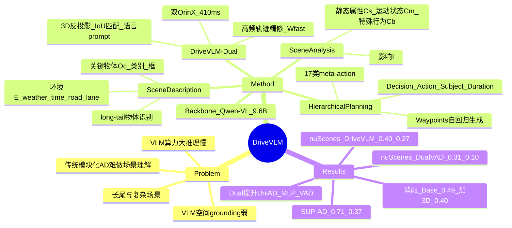

## Summary

针对城市自动驾驶最难的一环——理解复杂与长尾场景（恶劣天气、复杂道路布局、细微的人类行为），`DriveVLM` 把一个 VLM（默认 `Qwen-VL`）改造成带 Chain-of-Thought 的三模块驾驶系统：Scene Description（环境 + 关键物体）→ Scene Analysis（关键物体的静态属性 / 运动状态 / 特殊行为 + 对 ego 的影响）→ Hierarchical Planning（17 类 meta-action → decision description → waypoints）。针对 VLM 空间 grounding 弱、算力大两点局限，进一步提出 `DriveVLM-Dual`：把 `DriveVLM` 与传统 AD pipeline（3D 感知 + 高频轨迹精修）耦合，形成 slow-fast 双系统。作者自建 `SUP-AD` 数据集，在 `nuScenes` val 上 `DriveVLM-Dual`（协同 `VAD`）取得 L2 Avg **0.31 m** / Collision Avg **0.10%**，并已部署到量产车验证真实环境有效性。

## Problem & Motivation

- **传统模块化 AD 难以做场景理解**：3D 感知只能检测/跟踪熟悉物体，漏掉罕见物体及其属性；运动预测与规划聚焦轨迹级动作，忽略物体与车辆之间的 decision-level 交互。
- **长尾与复杂场景是核心障碍**：城市自动驾驶的主要难点是恶劣天气、复杂道路布局与未预料的人类行为等长尾情形。
- **VLM 的两点局限**：① **空间 grounding 与推理弱**，难以给出精确的 3D 位置与运动；② **计算量大、onboard 推理慢**，难以满足实时高频规划需求。
- **动机**：用 VLM 承担高层语义理解与决策（它能捕获传统 pipeline 难以表达的语义与意图），同时用传统 pipeline 补足 3D 空间 grounding 与高频轨迹——即一个"慢-快"双系统。

## Method

**0) Backbone**
- 默认 `Qwen-VL`，共 9.6B 参数：visual encoder 1.9B + vision-language adapter 0.08B + LLM（`Qwen`）7.7B；图像 resize 到 448×448。
- 输入为图像序列；训练时随机取 $T_s$、$T-1\,\text{s}$、$T-2\,\text{s}$、$T-3\,\text{s}$ 四帧（含当前帧、时间升序）。
- 采用 co-tuning（`Talk2Car` / `BDDX` / `Drama` / `SUTD` / `LLAVA`，各按 1:1 采样）以在微调中保留 LLM 的泛化能力。

**1) Scene Description（§3.2）**
- **Environment Description**：语言化描述环境 $E = \{E_{\text{weather}}, E_{\text{time}}, E_{\text{road}}, E_{\text{lane}}\}$。
- **Critical Object Identification**：只标注最可能影响当前场景的 critical objects，每个物体 $O_c = (c, b(x_1, y_1, x_2, y_2))$（类别 + 图像上近似框），类目与坐标映射为 language token；借助预训练 vision encoder，可识别 3D 检测器察觉不到的 long-tail 物体（路障、异常动物等）。

**2) Scene Analysis（§3.3）**
- **Critical Object Analysis**：对每个 critical object 从三方面刻画——静态属性 $C_s$、运动状态 $C_m$、特殊行为 $C_b$（实践中每个物体通常只适用一到两项），并预测该物体对 ego 的潜在**影响 $I$**。
- **Summarized analysis**：汇总所有关键物体与环境描述，形成 scene-level summary 输入规划模块。

**3) Hierarchical Planning（§3.4）**
- **Meta-actions $A$**：短时驾驶策略决策，共 **17 类**（加速、减速、左转、变道、微调位置、等待等），组成 meta-action 序列。
- **Decision Description $D$**：三元组 $(\text{Action}, \text{Subject}, \text{Duration})$——动作、交互对象、持续时间。
- **Trajectory Waypoints $W$**：$W = \{w_1, \dots, w_n\}$，$w_i = (x_i, y_i)$，固定间隔 $\Delta t$，映射为 language token 自回归生成。

**4) DriveVLM-Dual（§3.5）**
- **Integrating 3D Perception**：3D 检测框 $O_{\text{3D}} = \{c^i_{\text{3D}}, b^i_{\text{3D}}\}$ 反投影到 2D 得 $b^i_{\text{2D}}$，与关键物体框 $b^j_c$ 做 approximate IoU 匹配；匹配上（$c^j_c = c^i_{\text{2D}}$ 且 $\text{aIoU}(b^j_c, b^i_{\text{2D}}) > \tau$）的关键物体，用其 3D 中心、朝向与历史轨迹作为 language prompt 辅助分析；未匹配者仍只依赖图像 token。
- **High-frequency Trajectory Refinement**：`DriveVLM` 低频给出 $W_{\text{slow}}$，作为传统 planner 的参考——优化式 planner 用其作初值，网络式 planner 用 $W_{\text{fast}} = \text{Planner}([W_{\text{slow}}, f])$ 解码新轨迹。两分支异步 slow-fast 运行，传统分支可选择性地接收 VLM 轨迹作为额外输入。
- **部署**：量产车用两片 `OrinX`（一片跑高频端到端、一片跑 `DriveVLM`），平均推理约 410 ms。

## Pipeline

*`DriveVLM` 与 `DriveVLM-Dual` 整体框架。`DriveVLM` 以图像序列为输入，经 Chain-of-Thought（CoT）机制依次输出 Scene Description、Scene Analysis 与 Hierarchical Planning（meta-action → decision description → waypoints）三层结果；`DriveVLM-Dual` 在此基础上进一步接入传统 3D 感知与（高频）轨迹规划模块，以获得空间 grounding 能力与实时轨迹规划。*

## Key Results

- **`SUP-AD` test（Table 1，Scene Description / Meta-actions）**：`DriveVLM` w/ `Qwen` **0.71 / 0.37**（最优）；Fine-tuning w/ `CogVLM` 0.49 / 0.22；Fine-tuning w/ `Lynx` 0.46 / 0.15；`GPT-4V`† 0.38 / 0.19（`GPT-4V` 不能微调、只能 in-context learning，产生多余信息被判为 hallucination）。数据集按 train/val/test = 7.5 : 1 : 1.5 划分。
- **`nuScenes` val 规划（Table 2，L2 m↓ / Collision %↓，1s/2s/3s/Avg）**：`DriveVLM` L2 `0.18/0.34/0.68` → Avg **0.40**，Collision `0.10/0.22/0.45` → Avg **0.27**；`DriveVLM-Dual`†（协同 `VAD`）L2 `0.15/0.29/0.48` → Avg **0.31**，Collision `0.05/0.08/0.17` → Avg **0.10**，为最优。对比 `VAD-Base` 0.37 / 0.14、`UniAD` 1.03 / 0.31、`ST-P3` 2.11 / 0.71、`FF` 1.43 / 0.43、`EO` 1.60 / 0.33，以及 `NMP` 2.31 / 1.92、`SA-NMP` 2.05 / 1.59。指标为 DE（Displacement Error）与 CR（Collision Rate）。
- **模块消融（Table 3，`nuScenes` val）**：Base（仅 hierarchical planning、无 CoT 推理）L2 **0.49** / Collision **0.36**；+Critical Object（CO）**0.44** / **0.35**；+CO+3D **0.40** / **0.27**——关键物体分析提升决策精度，3D 感知 prompt 进一步提升预测精度。
- **传统 pipeline 泛化（Table 4，`nuScenes` val）**：`DriveVLM-Dual` 接入不同后端均有效——`UniAD` 1.03 / 0.31 → Dual(`UniAD`) **0.39 / 0.20**；MLP 0.44 / 0.20 → Dual(MLP) **0.31 / 0.13**；`VAD` 0.37 / 0.14 → Dual(`VAD`) **0.31 / 0.10**。单用 MLP 与 `VAD` 差距大，但二者接入 Dual 后性能接近，说明 dual 设计稳健。

## Strengths & Weaknesses

**Strengths**
- **问题定位准确**：把传统 pipeline 的短板（long-tail 物体、decision-level 交互）对应到 VLM 的强项（语义理解、常识推理），并用 CoT 三模块显式落地，逻辑闭环清晰。
- **分层 CoT 结构可解释**：Scene Description → Scene Analysis → Hierarchical Planning 对应感知-预测-规划，且 meta-action / decision / waypoint 三层粒度使决策过程自然语言可读、可审计。
- **双系统设计务实**：`DriveVLM-Dual` 用 3D 反投影 + IoU 匹配补空间 grounding，用高频精修补实时性，且对不同传统后端（`UniAD` / MLP / `VAD`）都稳定有效——工程可落地，并已上量产车验证。
- **自建 long-tail 数据集**：`SUP-AD` 通过 long-tail object mining + challenging scenario mining + 3 人交叉校验构建，切中自动驾驶最缺的安全关键场景数据。

**Weaknesses / 边界**
- **`DriveVLM-Dual` 的性能高度依赖协同后端**：Table 2 的 SOTA 主结果是与 `VAD` 协同得到的（†），单看 `DriveVLM` 自身（0.40 / 0.27）并不突出，甚至不与 `VAD-Base`（0.37 / 0.14）拉开差距；novelty 与增益主要来自 dual 耦合而非 VLM 本身。
- **开环评测**：主结果基于 `nuScenes` 开环（L2 + collision），缺少闭环/反应式评测（如 `CARLA` / `Bench2Drive`），规划精度与闭环鲁棒性之间的 gap 未被检验。
- **17 类 meta-action 的监督与评测口径**：`SUP-AD` 的 meta-action 分数依赖 LLM 生成"语义等价"序列 + 动态规划比对，评测本身引入模型主观性；Scene Description 亦用 LLM 打分，指标的稳定性与可复现性存疑。
- **VLM 的已知局限被"绕过"而非"解决"**：空间 grounding 与推理弱的问题交给传统 3D 感知，实时性交给高频 planner——即 `DriveVLM` 本身仍不能独立保证空间精度与实时性，架构复杂度与系统集成成本上升。
- **推理开销与效率**：端到端双 OrinX、约 410 ms 的延迟对 onboard 仍偏重；论文未给出与纯传统 pipeline 的详细算力/成本对比。

## Mind Map

## Notes

- **在 VLA 谱系中的位置**：`DriveVLM` 是以 VLM 做**高层决策 + 语言输出**的代表作之一（与 `DriveGPT4`、`DriveLM`、`GPT-Driver` 同族），其"meta-action → decision → waypoint"的分层输出与"dual system 补 3D/实时性"的思路，被后续工作（如 `AutoVLA` 指出其双系统复杂、训练开销大）作为对比基线。
- **可迁移点**：①"VLM 出高层 slow 决策 + 传统 planner 高频 fast 精修"的 slow-fast 双系统，是把大模型接进实时系统的通用范式；②用 3D 反投影 + IoU 匹配把符号化的语言关键物体与几何 3D 物体对齐，是缓解 VLM 空间弱点的低成本技巧；③meta-action（离散决策）→ decision（三元组）→ waypoint（连续）的三级粒度监督，可复用于任何"高层语义 → 低层动作"的具身任务。
- **待跟进/疑问**：410 ms 延迟为双 `OrinX` 上的平均推理速度（§6，具体序列长度/并发条件未细述）；17 类 meta-action 的完整清单待补；`SUP-AD` 是否公开、规模数字待查；闭环与真实长尾场景下的失败模式未系统报告。
