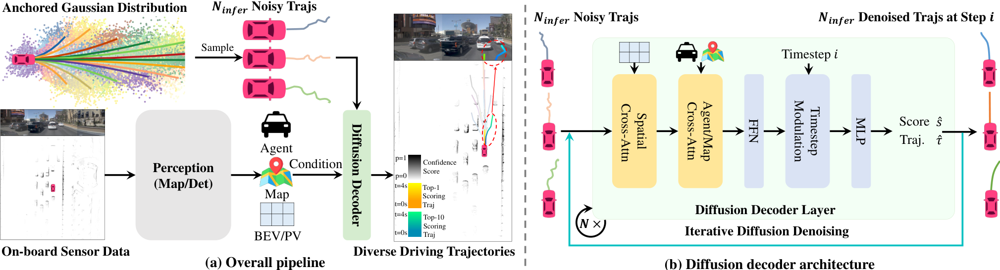

## Summary

把机器人领域成熟的 conditional diffusion policy 搬到端到端自动驾驶，但不从纯 Gaussian 噪声开始去噪：先用 K-Means 在训练集轨迹上聚类出 20 个 anchor，只在 anchor 周围加少量噪声（训练 schedule 截断到 50/1000）构造 anchored Gaussian 分布，让网络学习"从 anchor 附近恢复到 GT 轨迹"。配合一个 transformer diffusion decoder（deformable spatial cross-attention + agent/map cross-attention + cascade）同时输出每条候选轨迹的 confidence 与坐标偏移，训练目标为 GT 最近 anchor 的 L1 重建加 BCE 分类，推理只用 2 步 DDIM 并取最高置信度轨迹。NAVSIM navtest 达到 88.1 PDMS（ResNet-34，比 Transfuser +4.1），规划模块 7.6 ms、整机 45 FPS（4090），参数量 60M。

## Problem & Motivation

- 主流端到端规划器（Transfuser、UniAD、VAD）从 ego-query 回归**单条**轨迹，无法表达驾驶行为固有的不确定性与多模态性，容易在多解场景下回归到"平均"轨迹。
- VADv2 用大规模固定 anchor 词表（4096，实验中的 $V_{8192}$ 变体为 8192 条）离散化动作空间再打分采样，但性能被 anchor 的数量与质量限制，out-of-vocabulary 场景会失效，且大量 anchor 带来实时性负担。
- 直接套用机器人 diffusion policy 会暴露两个问题：
  - **mode collapse**：从 20 个不同 Gaussian 噪声出发、去噪 20 步后，轨迹高度重叠；作者用轨迹间 mIoU 定义的 diversity score $D$ 量化，Transfuser$_{\text{DP}}$ 仅 11%。
  - **去噪开销大**：20 步 DDIM 使 FPS 从 60 降到 7（规划模块 130 ms），无法实时。
- 作者的观察：人类驾驶遵循相对固定的行为模式，只根据实时交通状况做局部调整。因此合理的先验不是纯噪声，而是"数据中已有的驾驶模式 + 少量随机扰动"。把 diffusion 的起点改为 anchor 附近的 anchored Gaussian 分布，既能保留生成模型的多模态表达能力，又能把去噪步数压到 2 步。

## Method

**0. 总体框架**

+ 输入为原始传感器数据，经任意现成 perception 模块（本文用 Transfuser 的 ResNet-34 + 前视相机 + rasterized BEV LiDAR）得到条件信息 $z$（BEV 特征、agent queries）。
+ 规划头由三部分组成：
  + **Truncated diffusion policy**：20 个 K-Means anchor，训练时只对 anchor 加截断 schedule 的噪声，推理时从 anchored Gaussian 分布采样 $N_{\text{infer}}$ 条带噪轨迹。
  + **Diffusion decoder**：以带噪轨迹为 query，与场景条件交互，输出每条轨迹的 confidence 与相对初始坐标的 offset；2 层 cascade，参数在不同去噪步之间共享。
  + **2 步 DDIM 推理**：每步对 $N_{\text{infer}}$ 条轨迹去噪，最后取置信度最高的一条作为规划结果。

**1. 基础条件扩散与 Transfuser$_{\text{DP}}$**

+ 轨迹表示为未来 $T_f$ 个 waypoint $\tau=\{(x_t,y_t)\}_{t=1}^{T_f}$，在当前自车坐标系下定义。
+ 条件扩散的前向过程为对干净轨迹逐步加噪：

$$
q(\tau^i\mid\tau^0)=\mathcal{N}\left(\tau^i;\sqrt{\bar{\alpha}^i}\tau^0,(1-\bar{\alpha}^i)\mathbf{I}\right)
$$

+ 其中 $\bar{\alpha}^i=\prod_{s=1}^{i}(1-\beta^s)$，上标 $i$ 表示 diffusion timestep。反向过程在条件 $z$ 下从 $\tau^T$ 逐步恢复：

$$
p_\theta(\tau^0\mid z)=\int p(\tau^T)\prod_{i=1}^{T}p_\theta(\tau^{i-1}\mid\tau^i,z)\,\mathrm{d}\tau^{1:T}
$$

+ **Transfuser$_{\text{DP}}$**：把 Transfuser 的回归 MLP 替换为 conditional diffusion UNet（vanilla diffusion policy 做法），推理用 20 步 DDIM。PDMS 从 84.0 升到 84.6，但 diversity 只有 11%，FPS 降到 7，参数量 101M。
+ **Mode diversity score**：用每条去噪轨迹与所有轨迹并集的 mIoU 衡量重叠程度：

$$
D=1-\frac{1}{N}\sum_{i=1}^{N}\frac{\mathrm{Area}\left(\tau_i\cap\bigcup_{j=1}^{N}\tau_j\right)}{\mathrm{Area}\left(\tau_i\cup\bigcup_{j=1}^{N}\tau_j\right)}
$$

+ $D$ 越高表示轨迹间差异越大；它只度量多样性，不度量单条轨迹是否合理。

**2. Truncated Diffusion Policy**

+ 在训练集 GT 轨迹上做 K-Means，得到 $N_{\text{anchor}}$ 条 anchor $\{\mathbf{a}_k\}_{k=1}^{N_{\text{anchor}}}$，每条 anchor 同样是 $T_f$ 个 waypoint。
+ 训练时把 diffusion schedule 截断，只把 anchor 扩散到低噪声区间：

$$
\tau_k^i=\sqrt{\bar{\alpha}^i}\mathbf{a}_k+\sqrt{1-\bar{\alpha}^i}\,\epsilon,\quad \epsilon\sim\mathcal{N}(0,\mathbf{I}),\quad i\in[1,T_{\text{trunc}}]
$$

+ 其中 $T_{\text{trunc}}\ll T$。本文总 schedule 为 1000 步，训练只截断使用 50 步（50/1000），即 anchor 只被加少量噪声。
+ Diffusion decoder 一次处理全部 anchor 的带噪轨迹，同时预测分类分数与去噪轨迹：

$$
\{\hat{s}_k,\hat{\tau}_k\}_{k=1}^{N_{\text{anchor}}}=f_\theta\left(\{\tau_k^i\}_{k=1}^{N_{\text{anchor}}},z\right)
$$

+ 标签分配：与 GT 轨迹 $\tau_{\text{gt}}$ 最近的 anchor 对应的带噪轨迹为正样本（$y_k=1$），其余为负样本（$y_k=0$）。训练目标：

$$
\mathcal{L}=\sum_{k=1}^{N_{\text{anchor}}}\left[y_k\mathcal{L}_{\text{rec}}(\hat{\tau}_k,\tau_{\text{gt}})+\lambda\,\mathrm{BCE}(\hat{s}_k,y_k)\right]
$$

+ $\mathcal{L}_{\text{rec}}$ 为 L1 重建损失，$\lambda$ 平衡重建与分类；论文未给出 $\lambda$ 的具体取值。
+ **推理**：从 anchored Gaussian 分布采样 $N_{\text{infer}}$ 条带噪轨迹，用截断 DDIM 逐步去噪；每个 timestep 都把上一步估计的轨迹送入 decoder，得到新的 confidence 与坐标，再按 DDIM update 采样下一步输入。
+ **推理灵活性**：模型训练时用 $N_{\text{anchor}}$ 条轨迹，推理时 $N_{\text{infer}}$ 可任意调整，用于在算力与覆盖率之间取舍。
+ **Transfuser$_{\text{TD}}$**（只换 policy、保留 UNet）：步数 20→2，PDMS 84.6→85.7，diversity 11%→70%，FPS 7→27。

**3. Diffusion Decoder 与 Cascade**

+ 每条带噪轨迹作为一个 trajectory query，依次经过：
  + **Deformable spatial cross-attention**：按轨迹坐标在 BEV（Transfuser 设置）或 PV 特征上做稀疏可变形采样，注入局部场景几何。
  + **Agent/map cross-attention**：与 perception 模块输出的 agent queries（nuScenes 设置下还包括 map queries）交互；Transfuser 没有 vectorized map，因此 NAVSIM 上只做 agent cross-attention。
  + **FFN**，随后接 **Timestep Modulation** 注入 diffusion timestep 信息。
  + **MLP** 输出两项：该轨迹的 confidence score，以及相对初始带噪轨迹坐标的 offset。
+ **Cascade**：堆叠 2 层 decoder，前一层的输出作为后一层的输入，用于在同一步内迭代 refine 轨迹；不同去噪 timestep 之间共享 decoder 参数。
+ 最终在所有去噪完成的候选中取 confidence 最高的一条作为 top-1 输出，其余按分数排序可用于 top-10 分析。

**4. 实现细节**

| 项目 | 设置 |
|:--|:--|
| Perception / Backbone | Transfuser 的 ResNet-34（ImageNet 预训练）+ 3D 检测、BEV 语义分割辅助任务 |
| 输入 | 3 张裁剪缩放前视相机拼成 1024×256；rasterized BEV LiDAR（前后左右各 32 m） |
| Anchor | NAVSIM 20 条；nuScenes 18 条，均由训练集 K-Means 得到 |
| 训练 schedule | 总 1000 步，截断为 50 步 |
| 推理 | 2 步 DDIM，取 top-1 |
| 输出 | 8 个 waypoint / 4 s |
| 训练 | navtrain 从头训练 100 epochs，AdamW，8×4090，batch 512，lr $6\times10^{-4}$ |
| 数据增强 | 无 test-time augmentation |
| nuScenes 训练 | 加载 SparseDrive stage-1 感知权重，stage-2 训练 10 epochs |
| 参数量 / 速度 | 60M；规划模块 7.6 ms，整机 45 FPS（4090） |

## Pipeline

1. **感知**：相机与 LiDAR 经 ResNet-34 perception 模块得到 BEV 特征与 agent queries，作为条件 $z$。
2. **构造 anchored Gaussian 分布**：从 20 条 K-Means anchor 中采样，按截断后的 schedule 加少量噪声，得到 $N_{\text{infer}}$ 条带噪轨迹。
3. **Decoder 交互**：每条轨迹先做 BEV 上的 deformable spatial cross-attention，再与 agent/map queries 做 cross-attention，FFN 后用 Timestep Modulation 注入步数信息。
4. **预测与 refine**：MLP 输出 confidence 与坐标 offset；2 层 cascade 在同一步内继续 refine；不同去噪步共享参数。
5. **DDIM 更新**：用当前步的去噪结果按 DDIM 规则采样下一步输入，重复 2 步。
6. **输出**：在全部候选中取 confidence 最高的轨迹；其余候选保留排序，用于 top-10 多样性展示。

## Key Results

**1) NAVSIM navtest 主结果（Table 1）**

| Method | Input | Backbone | Anchor | NC | DAC | TTC | Comf. | EP | PDMS |
|:--|:--:|:--|--:|--:|--:|--:|--:|--:|--:|
| UniAD | C | ResNet-34 | 0 | 97.8 | 91.9 | 92.9 | 100 | 78.8 | 83.4 |
| PARA-Drive | C | ResNet-34 | 0 | 97.9 | 92.4 | 93.0 | 99.8 | 79.3 | 84.0 |
| LTF | C | ResNet-34 | 0 | 97.4 | 92.8 | 92.4 | 100 | 79.0 | 83.8 |
| Transfuser | C & L | ResNet-34 | 0 | 97.7 | 92.8 | 92.8 | 100 | 79.2 | 84.0 |
| DRAMA | C & L | ResNet-34 | 0 | 98.0 | 93.1 | 94.8 | 100 | 80.1 | 85.5 |
| VADv2-$V_{8192}$ | C & L | ResNet-34 | 8192 | 97.2 | 89.1 | 91.6 | 100 | 76.0 | 80.9 |
| Hydra-MDP-$V_{8192}$ | C & L | ResNet-34 | 8192 | 97.9 | 91.7 | 92.9 | 100 | 77.6 | 83.0 |
| Hydra-MDP-$V_{8192}$-W-EP | C & L | ResNet-34 | 8192 | 98.3 | 96.0 | 94.6 | 100 | 78.7 | 86.5 |
| **DiffusionDrive** | **C & L** | **ResNet-34** | **20** | **98.2** | **96.2** | **94.7** | **100** | **82.2** | **88.1** |

+ 相对 VADv2-$V_{8192}$：+7.2 PDMS，anchor 从 8192 降到 20（400× 减少）。
+ 相对 Hydra-MDP-$V_{8192}$：+5.1 PDMS；相对带额外 EP 监督与 weighted confidence 后处理的 W-EP：+3.5 EP、+1.6 PDMS。
+ 相对同 perception 的 Transfuser：+4.1 PDMS，五个子指标全部不低于 baseline。
+ 表中 Hydra-MDP-W-EP 使用了额外监督与后处理，DiffusionDrive 只做行为克隆且无后处理，两者并非完全同口径。

**2) 从 Transfuser 到 DiffusionDrive 的路线图（Table 2）**

| Method | PDMS | Plan Arch. | Step Time | Steps | Total Time | $D$ | Param. | FPS |
|:--|--:|:--:|--:|--:|--:|--:|--:|--:|
| Transfuser | 84.0 | MLP | 0.2 ms | 1 | 0.2 ms | 0% | 56M | 60 |
| Transfuser$_{\text{DP}}$ | 84.6 | UNet | 6.5 ms | 20 | 130.0 ms | 11% | 101M | 7 |
| Transfuser$_{\text{TD}}$ | 85.7 | UNet | 6.9 ms | 2 | 13.8 ms | 70% | 102M | 27 |
| **DiffusionDrive** | **88.1** | **Decoder** | **3.8 ms** | **2** | **7.6 ms** | **74%** | **60M** | **45** |

+ 从 Transfuser$_{\text{DP}}$ 到 DiffusionDrive：+3.5 PDMS、diversity +64%、去噪步数 10× 减少、FPS 6×。
+ 从 Transfuser$_{\text{TD}}$ 到 DiffusionDrive：+2.4 PDMS、diversity 70%→74%、参数量 102M→60M（−39%），说明 decoder 本身既提精度又降参数。
+ 45 FPS 虽满足"实时"叙事，但仍低于确定性 Transfuser 的 60 FPS；规划模块耗时是 Transfuser 的 38 倍。

**3) Diffusion decoder 设计消融（Table 3）**

| ID | UNet Decoder | Ego Query | Spatial Cross-attn | Agent/Map Cross-attn | Cascade | Param. | PDMS |
|:--:|:--:|:--:|:--:|:--:|:--:|--:|--:|
| 1 | ✓ | ✓ | ✗ | ✗ | ✗ | 102M | 85.7 |
| 2 | ✗ | ✓ | ✗ | ✗ | ✗ | 57M | 55.1 |
| 3 | ✗ | ✓ | ✓ | ✗ | ✗ | 58M | 87.1 |
| 4 | ✗ | ✓ | ✗ | ✓ | ✗ | 58M | 85.1 |
| 5 | ✗ | ✓ | ✓ | ✓ | ✗ | 59M | 87.4 |
| 6 | ✗ | ✓ | ✓ | ✓ | ✓ | 60M | 88.1 |

+ ID-1 即 Table 2 的 Transfuser$_{\text{TD}}$（UNet + ego query）。
+ 去掉 UNet decoder 后若不做任何交互（ID-2），PDMS 崩到 55.1，说明轨迹 query 必须与场景特征交互。
+ spatial cross-attention 是主要增益来源（ID-3 相对 ID-2 +32.0）；agent cross-attention 单独使用不如 spatial（ID-4 85.1），两者叠加到 87.4（ID-5）；再加 cascade 到 88.1（ID-6）。

**4) 去噪步数（Table 4）**

| Steps | Param. | NC | DAC | TTC | Comf. | EP | PDMS |
|:--:|--:|--:|--:|--:|--:|--:|--:|
| 1 | 60M | 98.3 | 96.0 | 94.7 | 100 | 82.1 | 87.9 |
| 2 | 60M | 98.2 | 96.2 | 94.7 | 100 | 82.2 | 88.1 |
| 3 | 60M | 98.2 | 96.3 | 94.7 | 100 | 92.2 | 88.1 |

+ 由于起点已是 anchored Gaussian，1 步就有 87.9，2 步达到 88.1；再多一步 PDMS 不再提升。
+ 3 步行的 EP 写作 92.2，与其他行（82.x）差 10，且 PDMS 不变，疑似 82.2 的笔误。

**5) Cascade 层数（Table 5）**

| Stages | Param. | NC | DAC | TTC | Comf. | EP | PDMS |
|:--:|--:|--:|--:|--:|--:|--:|--:|
| 1 | 59M | 98.0 | 95.8 | 94.4 | 100 | 81.7 | 87.4 |
| 2 | 60M | 98.2 | 96.2 | 94.7 | 100 | 82.2 | 88.1 |
| 4 | 65M | 98.4 | 96.2 | 94.9 | 100 | 82.4 | 88.2 |

+ 1→2 层带来 +0.7 PDMS，2→4 层只再 +0.1，但参数量 +5M、每步耗时增加，因此默认用 2 层。

**6) 采样噪声数 $N_{\text{infer}}$（Table 6）**

| $N_{\text{infer}}$ | Param. | NC | DAC | TTC | Comf. | EP | PDMS |
|:--:|--:|--:|--:|--:|--:|--:|--:|
| 10 | 60M | 97.9 | 93.5 | 93.1 | 100 | 80.0 | 84.9 |
| 20 | 60M | 98.2 | 96.2 | 94.7 | 100 | 82.2 | 88.1 |
| 40 | 60M | 98.5 | 96.2 | 94.8 | 100 | 82.5 | 88.2 |

+ 10 条时覆盖率不足，PDMS 掉到 84.9；20→40 只 +0.1，说明 20 条已接近饱和。
+ 主结果采用 20 条，而 40 条在 NC、EP、PDMS 上略高，作者未采用最佳配置。

**7) nuScenes open-loop（Table 7）**

| Method | Backbone | L2 Avg (m) | Collision Avg (%) | FPS |
|:--|:--|--:|--:|--:|
| ST-P3 | EffNet-b4 | 2.11 | 0.71 | 1.6 |
| UniAD | ResNet-101 | 0.73 | 0.61 | 1.8 |
| OccNet | ResNet-50 | 2.14 | 0.72 | 2.6 |
| VAD | ResNet-50 | 0.72 | 0.22 | 4.5 |
| SparseDrive | ResNet-50 | 0.61 | 0.08 | 9.0 |
| **DiffusionDrive** | **ResNet-50** | **0.57** | **0.08** | **8.2** |

+ 相对 SparseDrive：L2 降低 0.04 m，collision 持平，FPS 从 9.0 降到 8.2。
+ 相对 VAD：快 1.8×、L2 低 20.8%、collision 低 63.6%。
+ 作者明确指出 nuScenes 场景简单，因此只作为补充验证。

**8) 驾驶先验消融（Table 8，附录）**

| Train Prior | Infer Prior | NC | DAC | TTC | Comf. | EP | PDMS |
|:--|:--|--:|--:|--:|--:|--:|--:|
| Anchored Dist. | Anchored Dist. | 98.2 | 96.2 | 94.7 | 100 | 82.2 | 88.1 |
| Anchored Dist. | Extra. Traj. | 96.3 | 91.7 | 90.4 | 100 | 76.8 | 81.3 |
| Extra. Traj. | Extra. Traj. | 97.3 | 94.0 | 92.6 | 100 | 79.6 | 84.7 |

+ "Extra. Traj." 指按当前状态外推的单条轨迹。用外推轨迹替代 anchor 采样（第 2 行）掉 6.8 PDMS，说明单先验无法覆盖动作空间；训练与推理都用外推先验（第 3 行）也只有 84.7，比多 anchor 低 3.4。

**9) Anchor 来源泛化（Table 9，附录）**

| Method | Anchor Source | DS | RC | IS |
|:--|:--|--:|--:|--:|
| Transfuser | – | 47.30 ± 5.72 | 93.38 ± 1.20 | 0.50 ± 0.06 |
| **DiffusionDrive** | **NAVSIM** | **64.27 ± 2.43** | **94.16 ± 1.46** | **0.69 ± 0.02** |

+ 在 CARLA Longest6 上训练，但 anchor 直接来自 NAVSIM 的 K-Means，DS 从 Transfuser 的 47.30 升到 64.27，说明 anchor 作为驾驶先验可以跨数据集迁移。
+ 该实验只有一组对比、一个 anchor 来源，未比较 CARLA 自身聚类 anchor 的效果。

**Critical reading**

- **Table 4 的 EP 数值自相矛盾**：3 步时 EP 写 92.2，而 1/2 步分别为 82.1/82.2，PDMS 又完全不变。PDMS 是子指标的加权组合，EP 跳变 10 而 PDMS 纹丝不动在数学上不成立，几乎可以确定是 82.2 的笔误。
- **正文表号引用错误**：§4.5 的 "Denoising step number"、"Cascade stages"、"Number of sampled noises" 三段都写 "Tab. 6 shows"，但对应表格分别是 Table 4、Table 5、Table 6，只有最后一段引用正确。
- **主结果未用最佳配置**：Table 6 显示 $N_{\text{infer}}=40$ 时 PDMS 88.2、NC 98.5、EP 82.5，均优于主表中的 20 条（88.1/98.2/82.2）。作者为速度选择 20 条可以理解，但摘要中的 "88.1" 并非该方法的上限。
- **"实时"是相对 diffusion baseline**：45 FPS 低于 Transfuser 的 60 FPS，规划模块 7.6 ms 是 MLP 的 38 倍。若把"实时"理解为不慢于原确定性规划器，这个 claim 不成立；它只说明比 20 步 diffusion 快 6×。
- **Diversity score 不衡量质量**：$D$ 只算轨迹两两之间的 mIoU，完全可能通过输出互相远离但都不可行的轨迹刷高。Table 2 中 Transfuser$_{\text{TD}}$ 的 $D$ 已达 70%，与最终模型 74% 很接近，但 PDMS 相差 2.4，说明 $D$ 与规划质量并不强相关。top-10 的合理性只有 Fig. 2 的定性展示。
- **多模态主张缺少标准指标**：只报 top-1 PDMS，没有 minADE/minFDE、mode recall 或 best-of-N 上界；无法判断 20 条候选中是否真的覆盖了 GT 所在的模式，也无法与 VADv2 的多模态能力做定量比较。
- **评测面偏窄**：只在 NAVSIM v1 navtest 上做非反应式评测，没有 navhard、NAVSIMv2，也没有 CARLA 闭环的完整对比（Table 9 只有一组 DS/RC/IS）。"closed-loop" 的说法容易让读者高估其闭环交互能力。
- **与 Hydra-MDP-W-EP 不同口径**：对方使用 rule-based evaluator 的额外监督与 weighted confidence 后处理，DiffusionDrive 只有行为克隆。+1.6 PDMS 的优势不能简单归因于生成式 policy；反过来，作者也没有给出"同样加 EP 监督/后处理"的对照。
- **关键超参缺失**：分类损失权重 $\lambda$、K-Means 的 anchor 数量选择依据、cascade 中间层维度均未给出；也没有 anchor 数量的消融（20 是否最优、10/40 会怎样）。
- **训练成本未对齐**：8×4090、100 epochs 从头训练，而 Transfuser baseline 的训练配方与成本没有并列给出；+4.1 PDMS 中有多少来自更长训练/更大 batch 无法区分。
- **单次运行无方差**：NAVSIM 所有结果都是单点值，没有随机种子或置信区间；只有 CARLA 的 Table 9 给了 ±。88.1 与 88.2 这类差距不应被赋予实质意义。
- **Anchor 的分布假设**：K-Means 在训练集 GT 上聚类，anchor 自然覆盖常见行为，但长尾/ OOD 场景（施工区、紧急避让）可能没有对应 anchor；Table 8 只比较了"多 anchor vs 单外推"，没有分析 anchor 覆盖不足时的失效模式。

## Strengths & Weaknesses

**Strengths**

- **问题与方法的对应关系清晰**：mode collapse 与 20 步开销都源于"从纯噪声开始"，把起点换成数据驱动的 anchored Gaussian 分布同时缓解两者，是一个简单且可解释的改动，而不是堆模块。
- **Truncated diffusion 的 formulation 干净**：只改训练 schedule 与推理起点，不改变 diffusion 的目标函数；$N_{\text{infer}}$ 可在推理时自由调整，给算力/覆盖率提供了连续旋钮。
- **Decoder 设计有明确消融支撑**：Table 3 从 UNet 到 spatial/agent/cascade 逐项拆解，且最终 decoder 比 UNet 少 39% 参数还高 2.4 PDMS，"更快更准"的论证成立。
- **路线图实验（Table 2）叙事完整**：Transfuser → Transfuser$_{\text{DP}}$ → Transfuser$_{\text{TD}}$ → DiffusionDrive 四步分别量化 policy 与 decoder 的贡献，读者能看清每个改动的边际收益。
- **主结果幅度大**：在相同 ResNet-34 perception 下比 Transfuser +4.1、比 VADv2 +7.2，且 anchor 少 400×；这是端到端规划中少见的、无需后处理的大幅提升。
- **工程完成度高**：公开代码与模型，NAVSIM 与 nuScenes 两套 perception 配置都跑通，45 FPS 有实测。

**Weaknesses**

- **"实时"叙事有水分**：45 FPS 仍慢于 Transfuser 60 FPS，规划模块 7.6 ms vs 0.2 ms；方法是用更多规划算力换精度，而不是"既快又准"。
- **多模态能力没有被严格评测**：只有 $D$ 与几张定性图，缺少 mode-level 指标与 best-of-N 上界；"diverse and plausible" 的后半句证据不足。
- **表格与正文存在数值/引用错误**：Table 4 的 EP 92.2、§4.5 连续三处 "Tab. 6" 都说明论文校对不够仔细，降低了对其他数字的信任度。
- **评测协议单一**：NAVSIM v1 navtest 非反应式 + nuScenes 简单场景，缺少 navhard/v2 与完整 CARLA 闭环；对交互密集场景的结论未知。
- **先验依赖训练集分布**：anchor 由 K-Means 得到，长尾行为可能不在 anchor 覆盖范围内；论文没有分析 anchor 数量、初始化方式与 OOD 失效。
- **超参与成本不透明**：$\lambda$、anchor 数选择、训练成本对比均缺失，复现与公平比较困难。
- **比较口径不完全一致**：与 Hydra-MDP-W-EP 的对比中对方有额外监督与后处理，作者虽在表注说明，但没有做同口径对照来隔离 policy 本身的贡献。

## Notes

+ **论文定位**：第一篇把 diffusion policy 系统性地用于端到端自动驾驶的工作。核心 insight 不是"diffusion 能建模多模态"，而是**diffusion 的起点应该由数据先验决定**：当动作空间存在强结构（驾驶行为模式）时，从 anchor 附近的低噪声分布出发，可以用 2 步去噪同时获得多模态性与实时性。这与"扩大固定词表"（VADv2/Hydra-MDP）是两条不同的 scaling 路线——前者 scaling 的是生成过程的表达能力，后者 scaling 的是离散候选数量。

+ **可迁移点**：
  + **截断扩散作为先验注入手段**：任何"数据中存在强模式、但需要保留局部随机性"的生成任务，都可以把 schedule 截断到低噪声区间，用少量 anchor 替代纯 Gaussian 起点；不需要改 diffusion 的目标函数，也不需要大规模词表。
  + **Anchor + confidence 分类 + offset 回归**的三输出头，可以直接复用到其他候选生成式规划器；分类头负责选模，回归头负责精修，二者共享 query。
  + **Decoder 参数跨去噪步共享**：把"去噪步"与"网络深度"解耦，cascade 只增加同一步内的 refine 深度，参数量增长很小；适合实时约束下的生成式规划。
  + **推理时可变样本数**：训练用固定 anchor 数、推理用任意 $N_{\text{infer}}$，使同一模型可以在不同算力平台上部署；这个设计与"训练/推理分布一致"并不冲突，因为所有样本都来自同一个 anchored 分布。
  + **路线图式消融**：从 deterministic → vanilla diffusion → truncated diffusion → 新 decoder 逐步替换，每步只改一个因素，比一次性堆最终模型的消融更有解释力。

+ **待跟进**：
  - **Anchor 数量与覆盖率的定量关系**：在 NAVSIM 上扫描 5/10/20/40/80 条 anchor，同时报告 PDMS、$D$ 与长尾场景（施工区、紧急避让）的成功率，判断 20 条是饱和点还是资源妥协。
  - **多模态的严格评测**：引入 minADE/minFDE、mode recall、best-of-N PDMS，并分析 top-10 中是否存在碰撞轨迹；只有这样才能验证"diverse and plausible"而非仅"diverse"。
  - **反应式闭环评测**：把方法接到 NAVSIMv2 navhard 或 CARLA 闭环，观察 2 步去噪在交互密集场景下是否仍足够；非反应式评测无法暴露规划器对他人反应的敏感性。
  - **与固定词表方法的同口径比较**：给 VADv2/Hydra-MDP 同样的 perception、训练 epoch 与无后处理设置，隔离"生成式 policy"与"词表规模/后处理"的贡献。
  - **Anchor 的跨数据集迁移**：Table 9 只验证了 NAVSIM→CARLA 一组；需要系统比较源域 anchor、目标域 anchor、混合 anchor 在多个数据集上的表现，判断 anchor 先验的通用性边界。
  - **训练成本与精度分解**：给出 Transfuser baseline 在相同 8×4090、100 epochs 下的结果，区分 +4.1 PDMS 中有多少来自 diffusion policy、多少来自更长训练/更大 batch。
  - **长尾与 OOD 失效模式**：构造 anchor 覆盖不到的轨迹（急转、避障、非标准路口），分析模型是退回到最近 anchor 还是产生不可行轨迹；这决定该方法能否直接用于开放道路。
