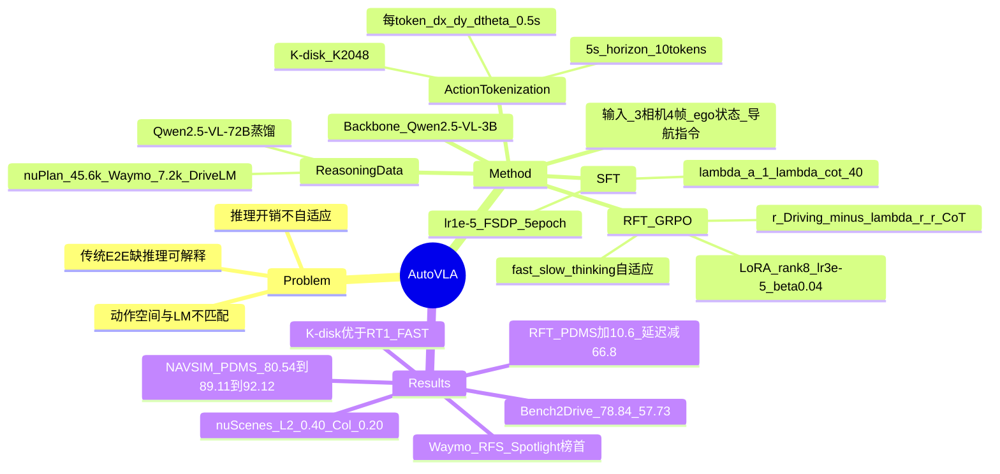

## Summary

`AutoVLA` 提出一个面向端到端自动驾驶的 VLA 模型，试图用**单一自回归模型**同时解决两个此前割裂的问题：①物理动作生成（连续轨迹难以直接放入语言模型的输出空间）与 ②自适应推理（何时需要长 CoT、何时只需快速出动作）。核心做法是把动作**离散化**为一个由 K-disk 聚类得到的 action codebook（$K=2048$ 个 token，每个 token $=(\Delta x,\Delta y,\Delta\theta)$ 覆盖 0.5 s），从而让"推理文本 + 动作 token"统一在同一个自回归序列里；再用两阶段训练——SFT 学推理与动作，**GRPO-based Reinforcement Fine-Tuning (RFT)** 用驾驶奖励抑制"过度思考"——并支持 fast thinking（直接出动作）与 slow thinking（完整 CoT）两种模式。在 `NAVSIM` 上 Post-RFT PDMS 达 89.11（best-of-N 92.12），`Bench2Drive` 闭环 Driving Score 78.84，并在 `Waymo` 公开榜单上取得 Spotlight 子集 `RFS` 榜首。

## Problem & Motivation

- **传统端到端 AD 缺可解释推理**：直接 image→trajectory 的模型（如 `UniAD`、`VAD`）可做规划，但缺少显式的场景理解与决策理由，难解释、难迁移。
- **VLM/VLA 路线存在两个结构性问题**：① **动作空间不匹配**——语言模型输出离散 token，而轨迹是连续量，早期工作多靠外部 policy head 或文本化 waypoint，破坏端到端性；② **推理开销与自适应性问题**——固定使用长 CoT（如 `DriveVLM` 的慢系统）延迟高，且模型不会根据场景难度自动"少想"或"多想"。
- **动机**：做一个**完全端到端、单模型**的 VLA——用离散 action token 打通动作与语言，用强化微调（RFT）让模型学会在"推理充分"与"动作准确、响应快"之间权衡。

## Method

**0) Backbone 与输入（§3）**
- Backbone 为 `Qwen2.5-VL-3B`。输入包含：3 路相机（front、front-left、front-right），每路 4 帧、采样率 2 Hz（约 2 s 历史）；ego 状态（velocity、acceleration、历史 action）；以及高层导航指令（左转/右转/直行）。

**1) Action Tokenization：K-disk Codebook（§3）**
- 用 **K-disk 聚类**把连续动作空间离散化为 $K=2048$ 个 discrete action token，每个 token 表示 $(\Delta x,\Delta y,\Delta\theta)$，对应 0.5 s 的动作片段；5 s 规划时域 → **10 个 action token** 的自回归序列。
- 与 `RT-1`（256 bins）、`FAST`（DCT 压缩）等 tokenizer 相比，K-disk 在重建精度上更优（见 Table 4）。

**2) Reasoning Data 构造（§3）**
- 用大模型 `Qwen2.5-VL-72B` 蒸馏生成推理标注：约 45.6k `nuPlan` + 7.2k `Waymo` + `DriveLM` 数据。

**3) 阶段一：SFT（§3）**
- 损失 $\mathcal{L}_{SFT,i} = w_i (\mathcal{L}_{LLM,i} + \lambda_a \mathcal{L}_{action,i})$，其中 $w_i = \lambda_{cot}$ 当该样本 GT 含 CoT，否则 $w_i = 1$；$\lambda_a = 1,\ \lambda_{cot} = 40$（放大推理 token 权重）。
- 超参：lr $1\times10^{-5}$，FSDP，5 epochs，8×`L40S`，per-GPU batch size 1，gradient accumulation steps 4（有效 batch 32）。
- 支持两种推理模式：**fast thinking**（直接输出动作 token）与 **slow thinking**（先输出 CoT 再输出动作）。

**4) 阶段二：GRPO-based RFT（§3、附录 §D）**
- 奖励 $r = r_{Driving} - \lambda_r r_{CoT}$：$r_{Driving}$ 在 `nuPlan` 用 `PDMS`，在 `Waymo` 用 $\frac{\delta - \text{ADE}}{\kappa}$（$\delta=2,\ \kappa=10$）；$r_{CoT} = \frac{1}{1+e^{-(L-L_{tol})\gamma}}$ 用于惩罚过长推理。
- 超参：`LoRA` rank = alpha = 8, dropout = 0.1；lr $3\times10^{-5}$；KL 系数 $\beta=0.04$；6000 steps；$\gamma = 2\times10^{-3},\ L_{tol}=400,\ \lambda_r=0.3$；GRPO 采样 temperature 1.0, top-p 1.0, top-k 0.0。
- RFT 让模型自适应地在难/易场景切换 fast/slow thinking，并压缩冗余推理长度。

## Pipeline

*`AutoVLA` 模型与训练流程总览。预训练小 VLM（`Qwen2.5-VL-3B`）作为 backbone，接收多视角相机流、system prompt、驾驶指令与车辆状态作为输入，直接输出文本 reasoning 与 physical action token（K-disk codebook）。`SFT` 阶段用大 VLM（`Qwen2.5-VL-72B`）采集 reasoning 数据，与轨迹数据一起监督训练；`RFT` 阶段用 `GRPO` 结合可验证的驾驶奖励对齐策略，并通过惩罚过长推理实现 fast/slow thinking 的自适应切换。*

## Key Results

- **`NAVSIM` 开环规划（Table 1，PDMS↑）**：`AutoVLA` one-shot **80.54** → Post-RFT **89.11** → best-of-N **92.12**。对比 `Ego Status MLP` 66.40、`TransFuser` 83.88、`DRAMA` 86.87、`Hydra-MDP` 91.26、`Centaur` 92.10、`TrajHF` 93.95。
- **推理延迟（Table 2）**：Fast thinking 平均 **1.072 s**（0.997 / 1.116 / 1.072）；Slow thinking 平均 **10.518 s**（7.607 / 13.706 / 10.518）。RFT 后 500 个场景平均 **延迟 −66.8%、`PDMS` +10.6%**。
- **`Bench2Drive` 闭环（`CARLA`，Table 3，Driving Score / Success Rate / Efficiency / Comfortness）**：`AutoVLA` **78.84 / 57.73 / 146.93 / 39.33**，优于 `Orion` 77.74 / 54.62 / 151.48 / 17.38、`DriveAdapter` 64.22 / 33.08 / 70.22 / 16.01、`TCP-traj` 59.90 / 30.00 / 76.54 / 18.08、`UniAD-Base` 45.81 / 16.36 / 129.21 / 43.58、`VAD` 42.35 / 15.00 / 157.94 / 46.01、`AD-MLP` 18.05 / 0.00 / 48.45 / 22.63。
- **`nuScenes` 开环（Table S2，w/ CoT）**：ST-P3 协议下 L2 `0.21/0.38/0.60` → Avg **0.40**、Collision `0.13/0.18/0.28` → Avg **0.20**；UniAD 协议下 L2 Avg **0.70**、Collision Avg **0.31**。参照 `OpenDriveVLA-3B` ST-P3 0.33 / 0.10、`EMMA` Avg L2 0.32、`UniAD` 1.03 / 0.31、`VAD` 0.37 / 0.14。
- **`Waymo` 公开榜单（Table S3）**：`AutoVLA` `RFS` Overall **7.5566**、ADE@5s 2.9580、ADE@3s 1.3507；Spotlight 子集 `RFS` **6.9436 位列榜首**（Overall 最高为 `Poutine` 7.9860）。
- **Tokenization 消融（Table 4 / Table 6，`NAVSIM`）**：K-disk（2048）重建 ADE **0.0182** / FDE **0.0203**、motion consistency (MC) 99.42%、collision-free (CU) 100.0%，优于 `RT-1`（0.1014 / 0.1775）与 `FAST`（0.0281 / 0.0309）；`NAVSIM` 上 K-disk PDMS **80.54** vs `FAST`(DCT) 67.63。
- **动作表示消融（Table 5）**：Physical action token 优于 Text waypoint——PDM **80.54** vs 71.31、Avg L2 **0.70** vs 0.89、Collision **0.31** vs 0.36、Runtime **3.95 s** vs 7.65 s。

## Strengths & Weaknesses

**Strengths**
- **真正的单模型端到端**：用离散 action token 把"连续轨迹"塞进语言模型的自回归输出，无需外挂 policy head 或文本化 waypoint，架构简洁、与 LLM 训练/推理栈天然兼容——这是相对 `DriveVLM` 双系统 / `EMMA` 等路线的关键简化和统一。
- **K-disk tokenizer 有实测优势**：在重建 ADE/FDE 与 `NAVSIM` PDMS 上均优于 `RT-1` bins 与 `FAST`(DCT)（Table 4/6），说明"动作离散化质量"确实是 VLA 动作生成的关键变量，值得单独研究。
- **RFT 解决"过度思考"**：GRPO + CoT 长度惩罚（$r_{CoT}$）让模型自适应切换 fast/slow thinking，实测同时带来 PDMS +10.6% 与延迟 −66.8%，在"精度 vs 效率"上给出了明确的正向证据。
- **评测覆盖开环 + 闭环 + 真实榜单**：`NAVSIM`/`nuScenes`/`Waymo` 开环 + `Bench2Drive`/`CARLA` 闭环，且 `Waymo` Spotlight 榜首是少见的外部第三方榜单背书。

**Weaknesses / 边界**
- **`NAVSIM` one-shot 绝对值不占优**：one-shot PDMS 80.54 低于 `TrajHF`(93.95)、`Centaur`(92.10)、`Hydra-MDP`(91.26)，即便 Post-RFT 89.11 仍低于 `TrajHF`；best-of-N（92.12）依赖多次采样、推理成本更高，"SOTA"叙事需要限定条件。
- **延迟仍不达实时**：Fast 约 1.07 s、Slow 约 10.5 s，作者自述仅 near-real-time（~1 Hz）且强依赖 GPU；相对传统高频 planner 的量级差距未消解。
- **CoT 与动作的因果贡献未完全解耦**：`nuScenes` 上 CoT 训练相对 action-only 的增益很小（L2 0.70 vs 0.71、Collision 0.31 vs 0.35），说明"显式推理"的实际收益仍偏弱，主要收益可能来自 RFT 与 tokenizer 而非 CoT 本身。
- **依赖蒸馏推理数据**：reasoning 监督来自 `Qwen2.5-VL-72B` 蒸馏，继承教师模型的偏差与幻觉，且教师推理质量上限决定了学生上限。
- **闭环只在 `CARLA`/`Bench2Drive` 验证**：真实道路的长尾安全场景（`DriveVLM` 的 `SUP-AD` 那类）未被系统检验。

## Mind Map

## Notes

- **在 VLA 谱系中的位置**：`AutoVLA` 是"**单模型、完全端到端**"路线的代表作，直接对标 `DriveVLM` 的双系统（slow VLM + fast planner）——后者被其批评为"架构复杂、非完全端到端"；与 `EMMA`（text waypoint 输出）相比，其 physical action token 在 Table 5 中被证明更优。
- **与 notebook 内其他论文的关系**：与 `HybridDriveVLA` 同属"把 CoT 放进驾驶 VLA"的路线，但 `AutoVLA` 用**强化学习（GRPO）**而非纯 SFT 来调节推理；与 `SpanVLA` / `CriticVLA` / `ColaVLA` 关注的方向（空间表示、评价器、潜在动作）形成互补——`AutoVLA` 的 action tokenizer（K-disk）与 `ColaVLA` 的 latent action 是"离散 vs 连续动作表示"的一组对照。
- **可迁移点**：① **K-disk 动作离散化**是把连续控制并入自回归 LM 的通用手段，可迁移到机器人操作；② **$r = r_{task} - \lambda_r r_{length}$ 的"抑制过度思考"奖励**对任何"CoT 长但收益递减"的推理模型都适用；③ fast/slow thinking 的自适应切换（由 RFT 习得）可作为推理效率优化的通用范式。
- **待跟进/疑问**：① 代码/权重/数据集官网标注 "We will release"（截至撰写尚未发布），复现性待观察；② Table 5 显示 physical action 全面优于 text waypoint，但两者是否公平对齐了推理预算需查正文；③ Fig 4 data-scaling 中 action-only 与 reasoning 两条曲线的具体 PDM 数值存在抽取歧义，本笔记只做定性描述未引用具体数字；④ best-of-N 92.12 的采样次数与额外算力未展开。
