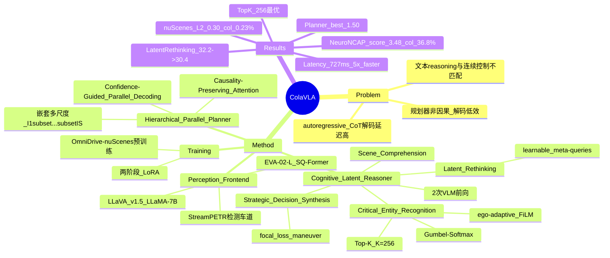

## Summary

针对驾驶 VLA 的三个痛点——离散文本 reasoning 与连续控制不匹配、autoregressive CoT 解码带来高延迟、以及规划器非因果 / 解码低效——ColaVLA 把 reasoning 从文本 CoT 迁移到统一的 latent 空间，并用 hierarchical parallel decoding 一次性并行产出多尺度轨迹。方法由两部分构成：**Cognitive Latent Reasoner**（仅需 2 次 VLM 前向即可完成 scene comprehension → critical entity recognition → latent rethinking → strategic decision）与 **Hierarchical Parallel Planner**（单次前向并行解码 S 个嵌套时间尺度的轨迹）。在 nuScenes open-loop 上 L2 平均 0.30 m / collision 0.23%，在 NeuroNCAP closed-loop 上 score 3.48 / collision 36.8%，推理延迟 727 ms，比 OmniDrive（3727 ms）与 SOLVE-VLM（3719 ms）快 5 倍以上。

## Problem & Motivation

- **离散文本 reasoning 与连续控制不匹配**：现有 driving VLA 多以自然语言 CoT 做推理，再映射回连续控制量；文本 token 与轨迹空间之间存在结构性 gap，推理结果难以直接约束动作。
- **Autoregressive CoT 解码延迟高**：逐 token 生成 reasoning 使推理时延随推理长度线性增长，难以满足实时规划需求；这对驾驶这种高频、强实时的任务尤其致命。
- **规划器非因果、低效**：常用 planner 要么非线性/非因果地一次性回归整条轨迹（信息泄漏、忽略时间依赖），要么逐尺度串行解码（慢）。论文主张轨迹应在因果一致的约束下被**并行**解码。
- **动机**：把 reasoning 放到与 action 共享的 latent 空间，可同时缓解"模态 gap"与"解码延迟"——既不需要生成文本 token，又能让推理信息以 latent 形式直接喂给并行 planner。

## Method

**1) Perception Front-end（感知前端）**
- VLM 底座沿用 LLaVA v1.5 架构、LLaMA-7B 语言模型；视觉编码器为 **EVA-02-L + SQ-Former**。
- 检测与车道解码器沿用 **StreamPETR**（900 object queries + 300 lane queries），输出结构化场景表征供 VLM 使用。

**2) Cognitive Latent Reasoner（§3.2，仅 2 次 VLM 前向）**
- **Driving Scene Comprehension**：`Q_V = D_vlm([T; V; E])`，其中 T 为 text prompt、V 为视觉 token、E 为 ego state；仅保留 visual slice，丢弃 text / ego 的更新输出，得到场景级 visual latent。
- **Critical Entity Recognition**：用 ego-adaptive router `H_φ` 做 FiLM 调制 `Q̃_V = (1 + γ_Re(E)) ⊙ Q_V + β_Re(E)`，再打分 `w = H_φ(Q̃_V)` 并对 `Q̃_V` 取 Top-K 得 `Q* = TopK(Q̃_V, w, K)`；训练时用 **Gumbel-Softmax** 形成 K-hot 软掩码（可微、可端到端），推理时直接保留 top-K。默认 **K = 256**。
- **Latent Rethinking**：第二次 VLM 前向 `Q_M = D_vlm([T; Q*; E; M])`，其中 M 为 C 个可学习 **meta-queries**（如 straight cruising / unprotected left turn / hard braking），由训练轨迹聚类初始化——用"驾驶 maneuver 先验"引导 latent 再思考。
- **Strategic Decision Synthesis**：对 `Q_M` 先 FiLM 调制，再经 cross-attention（attend `Q*`）+ self-attention 融合，最后共享 2 层 MLP 输出 maneuver logits，用 **focal loss** 监督。

**3) Hierarchical Parallel Planner（§3.3）**
- 把时间轴划分为 S 个**嵌套尺度** `I_1 ⊂ … ⊂ I_S = T`，构造查询序列 `X = [Q*; F_1; …; F_S]`（Q* 为推理得到的 latent，F_s 为各尺度轨迹 token）。
- **Causality-Preserving Hybrid Attention**：设计专门的注意力掩码，满足三条原则——同一尺度内双向可见、全局 context 可聚合、尺度 s 只能访问尺度 s−1 的信息——从而在并行解码的同时阻止未来信息泄漏。
- **Confidence-Guided Parallel Decoding**：两个轻量 MLP 头分别预测每个尺度轨迹的置信度与多尺度轨迹回归量，**单次前向**并行产出全部尺度轨迹。

**4) 训练（两阶段）**
- 阶段①：用 **OmniDrive-nuScenes** QA 数据 + LoRA 做预训练，对齐视觉-语言表征与驾驶场景理解。
- 阶段②：接入 planner 做联合微调，**仅更新 LoRA 参数**（backbone 冻结），把 latent reasoner 与并行 planner 端到端对齐。
- 优化器 AdamW + Cosine Annealing，weight decay 1e-4，lr 1e-4。

## Pipeline

*ColaVLA 整体框架。左侧感知前端由 VLM（LLaVA v1.5 / LLaMA-7B）与 StreamPETR 检测/车道解码器构成；中间 Cognitive Latent Reasoner 用 2 次 VLM 前向在共享 latent 空间完成 scene comprehension、critical entity recognition 与 latent rethinking，并合成 maneuver 决策；右侧 Hierarchical Parallel Planner 在因果混合注意力约束下，一次前向并行解码嵌套多尺度轨迹。*

## Key Results

- **nuScenes open-loop**（Table 1）：ColaVLA L2 在 1s/2s/3s 为 0.14 / 0.27 / 0.50，平均 **0.30 m**；collision 0.04 / 0.17 / 0.47，平均 **0.23%**。相比 SOLVE-E2E（L2 平均 0.31、collision 平均 0.30），L2 略优、collision 下降约 23%。
- **NeuroNCAP closed-loop**（Table 2）：ColaVLA score 平均 **3.48**（Static 3.54 / Frontal 3.16 / Side 3.75），collision 平均 **36.8%**（32.3 / 51.6 / 26.4）；对比 ImpromptuVLA† 的 score 2.06、collision 65.1%，全面领先。
- **推理延迟**（Table 3，H20、无 flash-attn）：ColaVLA **727 ms**，显著快于 OmniDrive **3727 ms** 与 SOLVE-VLM **3719 ms**，**>5× 加速**。
- **Latent reasoning ablation**（Table 4，L2 cm）：无 reasoning 32.2 → 仅 reasoning 31.3 → 加 Latent Rethinking **30.4**，说明 latent 再思考带来实质增益。
- **Planner ablation**（Table 5，NeuroNCAP score 平均）：MLP 1.05、Diffusion 1.02、**Ours 1.50**，层次化并行 planner 明显优于单步回归与 diffusion 解码。
- **Top-K 敏感性**（Table 6，L2 cm）：K=128→31.2、192→30.9、**256→30.4**、320→31.7，K=256 最优（过小丢信息、过大引入噪声）。
- **回归策略**（Table 7，L2 cm）：Single scale 31.9、Sequential 31.8、Reverse 31.4、**Interpolate 30.4**，嵌套插值式多尺度并行回归最佳。

## Strengths & Weaknesses

**Strengths**
- **问题切得准且自洽**：把"文本 CoT 与连续控制不匹配"与"autoregressive 解码慢"统一到"reasoning 应在 latent 空间做"这一命题下，并用 2 次 VLM 前向 + 单次并行 planner 前向给出干净解法。
- **效率优势显著**：727 ms 相比同类 VLA 的 3.7 s 有 5× 以上差距（Table 3），且 planner 用单次前向并行解码多尺度轨迹，工程上对实时驾驶友好。
- **设计有针对性**：critical entity recognition 的 ego-adaptive FiLM + Top-K 稀疏化、latent rethinking 的可学习 meta-query、causality-preserving 混合注意力，三个组件分别回应"噪声 token 干扰""缺乏 maneuver 先验""并行解码需防泄漏"的问题，且各自有 ablation 支撑（Table 4/6/7）。
- **报告了开放式 + 闭环两类评测**：nuScenes open-loop 与 NeuroNCAP closed-loop 双向验证，比只报单一指标的驾驶工作更完整。
- **latent reasoning 的范式意义**：对"VLM reasoning 不必落到文本"这一方向提供了驾驶域的可复现证据，可外推到其他具身 VLA。

**Weaknesses / 边界**
- **正文与表格数字不一致（见 Notes）**：§4.2 正文引用的 NeuroNCAP 数字（3.16 / 65.1%→42.5% / 54.8→15.0）与 Table 2 实际值对不上，削弱叙事可信度，需以表格为准。
- **感知前端依赖既成组件**：VLM 底座（LLaVA v1.5 / LLaMA-7B）与检测器（StreamPETR）均为既有工作，novelty 集中在 reasoner + planner 两端；对感知 backbone 的替换鲁棒性未做消融。
- **Top-K 与尺度数 S 敏感**：K 的精度-噪声权衡强依赖 256 这一经验值（Table 6 中 320 已开始掉点），超参调优空间较大。
- **对比基准偏窄**：efficiency 只对比 OmniDrive / SOLVE-VLM，未系统覆盖其他 latent-reasoning 或并行 planner 方案的延迟-精度帕累托。
- **领域偏驾驶**：结论主要建立在 nuScenes / NeuroNCAP 上，向通用机器人任务的外推需谨慎（meta-query 的 maneuver 语义是驾驶特有的）。
- **未确认开源**：笔记写作时未见官方代码仓库，复现性暂无法由外部核验。

## Mind Map

## Notes

- **正文与表格数字不一致（重要）**：§4.2 正文声称 "NeuroNCAP score of 3.16"、"collision 65.1%→42.5%"、"static 54.8%→15.0%"，但 **Table 2** 实际为 ColaVLA score 平均 **3.48**（Static 3.54 / Frontal 3.16 / Side 3.75）、collision 平均 **36.8%**（32.3 / 51.6 / 26.4）；其中 ImpromptuVLA† score 2.06、collision 65.1%。经验算表格自洽（3.48 = (3.54+3.16+3.75)/3，36.8 = (32.3+51.6+26.4)/3，65.1 = (54.8+72.8+67.6)/3），可知正文的 3.16 实为 Frontal 子分、54.8 实为 ImpromptuVLA 的 static 子分，而 42.5% / 15.0% 在表中不存在。**该矛盾在 arXiv v1 与 v3 中均存在**，应视为正文旧版残留，引用以表格为准。
- **"两次 VLM 前向" 与 "three forward passes"**：Abstract 与正文强调 **only two VLM forward passes**（scene comprehension 一次 + latent rethinking 一次）；Figure 1 图注中的 "three forward passes" 指 scene understanding、latent rethink、parallel action decoding 三个阶段，其中第三次是 planner 前向而非 VLM 前向，两者不冲突。
- **版本与 venue**：arXiv v1（2025-12-28）、v2（2025-12-31）、v3（2026-02-27）；arXiv Comments 标注 "CVPR2026 (Main Conference)"，故 frontmatter `venue` 取 CVPR 2026，`date_publish` 取 2025-12（v1）。
- **与既有工作的关系**：感知侧直接复用 LLaVA v1.5 + StreamPETR；latent reasoning 思路与"把 CoT 迁到连续空间"的相关工作同源；planner 侧以因果混合注意力 + 并行多尺度解码区别于逐尺度自回归回归方案；maneuver 预测（focal loss）借鉴驾驶规划常见做法。
- **可迁移点**：①用可学习 meta-query（由轨迹聚类初始化）注入任务的"高层模式先验"值得迁移到其他具身任务的 latent reasoning；②causality-preserving 掩码设计是"并行解码 + 防未来泄漏"的通用方案；③Top-K + Gumbel-Softmax 的稀疏实体选择可用于任何需要从长序列中挑关键 token 的场景。
- **待跟进**：官方代码/权重发布后应复核延迟口径（H20、无 flash-attn）与 K 的敏感性；正文-表格数字矛盾是否在后续版本修正值得关注；该文与本 vault GUI / Embodied 方向的连接点主要在 latent reasoning + VLA 范式。
