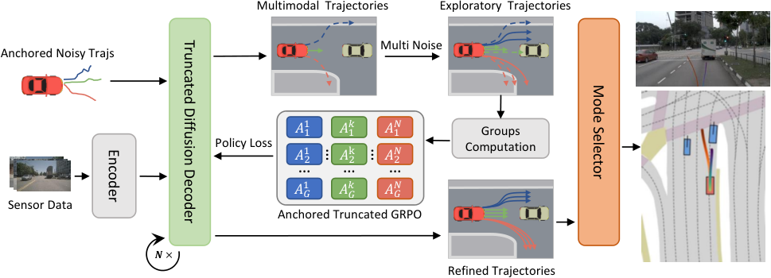

## Summary

DiffusionDrive 的 anchored truncated diffusion 用 GMM 先验保证多模态，但 imitation learning 每个场景只监督离 GT 最近的单个 anchor，负模态完全无约束，生成器因此产出大量碰撞轨迹并把筛选压力推给弱 selector。本文在预训练 DiffusionDrive 上做轨迹级 RL：把去噪链当作 MDP 用 REINFORCE 优化，探索噪声改为两个标量的乘性高斯，advantage 在单个 anchor 组内做 GRPO 标准化（Intra-Anchor），再用截断负 advantage 的方式引入跨 anchor 的全局比较（Inter-Anchor Truncated）。NAVSIM v1 navtest **PDMS 91.2**（ResNet-34，DiffusionDrive 88.1、DIVER 88.3），v2 **EPDMS 85.5**，且未筛选的 Top-10 PDMS 从 75.3 升到 84.4。

## Problem & Motivation

- anchored truncated diffusion 的训练目标在实践中退化为只优化"离专家轨迹最近的那个 anchor"（式 (4)），其余 anchor 的样本没有任何显式约束；而负模态样本占绝大多数，于是生成器同时输出高质量轨迹和大量碰撞/出界轨迹。
- 这种"高质量与低质量混杂"的候选集必须依赖下游 selector 兜底。selector 参数远少于生成器，在 out-of-distribution 场景更容易失效，因此把安全性寄托在 selector 上本身是系统性风险。
- 直接套用 GRPO 会遇到 anchor 的语义问题：每个 anchor 对应一种驾驶意图（左转、直行、变道），把不同意图的轨迹放进同一个 group 做相对 advantage，等于让模型在"左转 vs 直行"之间比优劣，结果会塌向数据中更常见的直行，反而加剧 mode collapse。
- 另一处工程障碍是探索噪声的尺度：轨迹近端位移小、远端位移大，逐点加性高斯噪声会把平滑轨迹打成折线，探索出的样本本身就不可行，reward 信号因此失真。
- 作者的主张是保留 GMM 结构不变，把 RL 的作用限定为"约束所有模态 + 在模态内探索"，跨模态只传递"是否绝对失败"这一种全局信息。

## Method

**0. 总体框架**

- 生成器直接复用 DiffusionDrive：ResNet-34 perception + 截断 diffusion decoder，沿用其 K-Means anchor 集合（anchor 数量正文未给），输入为三张前视裁剪图（拼成 1024×256）与 LiDAR 点云栅格化的 BEV。
- 两阶段训练：Stage I 从 DiffusionDrive 权重冷启动，用 RL 微调生成器；Stage II 用 20 epochs 训练 mode selector。推理仍为 2 步去噪，每个 anchor 各生成一条轨迹、合计 20 条候选，由 selector 选 1 条。

**1. 去噪链即 MDP（§4.2）**

- 每个从 anchor 出发的条件去噪步被写成高斯策略，均值由网络预测，方差由 noise schedule 与系数决定：

$$
\pi_\theta\left(\tau_{t-1}^{k}\mid\tau_t^{k},z,\mathbf{a}^{k}\right)=\mathcal{N}\left(\tau_{t-1}^{k};\mu_\theta\left(\tau_t^{k},t,z,\mathbf{a}^{k}\right),\eta\left(1-\alpha_t\right)\mathbf{I}\right)
$$

- 该高斯似然可解析计算，因此可直接用 REINFORCE 的策略梯度，单条轨迹的终局 reward 广播到整条去噪链：

$$
\nabla_\theta\mathcal{J}\left(\pi_\theta^{k}\right)=\mathbb{E}_{\pi_\theta^{k}}\left[\sum_{t=1}^{T_{\text{trunc}}}\nabla_\theta\log\pi_\theta^{k}\left(\tau_{t-1}^{k}\mid\tau_t^{k}\right)A_t^{k}\right]
$$

- 训练时设 $\eta=1$（退化为 DDPM，产生随机性以支持探索），验证与推理设 $\eta=0$（DDIM 确定性采样）。

**2. Scale-Adaptive Multiplicative Exploration Noise（§4.3）**

- 不再逐点加性加噪，而是只采样纵向、横向两个乘性扰动，作用在整条归一化轨迹上：

$$
\tau'=\left(1+\epsilon_{\text{mul}}\right)\tau,\qquad\epsilon_{\text{mul}}=\left(\epsilon_{\text{long}},\epsilon_{\text{lat}}\right)
$$

- 乘性形式让扰动幅度随轨迹尺度自适应：近端位移小则扰动小，远端位移大则扰动大，探索样本仍保持平滑与几何可行。消融中乘性噪声比加性噪声高 0.4 PDMS。

**3. Intra-Anchor GRPO（§4.4）**

- 对每个 anchor 独立扩散 G 条轨迹，只在这 G 条内做组内标准化 advantage，避免跨意图比较；组内标准化不需要 value model：

$$
A^{k,i}=\frac{r^{k,i}-\operatorname{mean}\left(\left\{r^{k,1},\dots,r^{k,G}\right\}\right)}{\operatorname{std}\left(\left\{r^{k,1},\dots,r^{k,G}\right\}\right)}
$$

- 对应的 RL 损失对 anchor、组内样本、去噪步三层取平均，早步用折扣系数降低权重：

$$
L_{RL}=-\frac{1}{N_{\text{anchor}}}\sum_{k=1}^{N_{\text{anchor}}}\frac{1}{G}\sum_{i=1}^{G}\frac{1}{T_{\text{trunc}}}\sum_{t=1}^{T_{\text{trunc}}}\gamma_{t-1}\log\pi_\theta\left(\tau_{t-1}^{k,i}\mid\tau_t^{k,i}\right)A^{k,i}
$$

- 为防止 RL 过拟合、保住通用驾驶能力，再加入 imitation loss 作为正则，总损失由权重 $\lambda\in(0,1)$ 控制：

$$
L=L_{RL}+\lambda L_{IL}
$$

**4. Inter-Anchor Truncated GRPO（§4.5）**

- 完全隔离模态后，advantage 失去全局可比性：某个模态内"最好"的碰撞轨迹仍可能拿到正 advantage。作者的修正原则是"奖励相对进步，只惩罚绝对失败"，即把负 advantage 截断为 0、碰撞样本直接置 $-1$：

$$
A_{\text{trunc}}^{k,i}=\begin{cases}-1 & \text{if collision},\\ \max\left(0,A^{k,i}\right) & \text{otherwise}.\end{cases}
$$

- 截断后的 advantage 替换式 (7) 中的 $A^{k,i}$。这样跨模态只传递"碰撞"这一种可全局比较的信号，不传递意图之间的优劣。

**5. Mode Selector（§4.6）与实现细节**

- selector 以轨迹坐标为 query，先对 BEV 特征做 deformable spatial cross-attention，再与 agent/map queries 交互，MLP 输出分数；结构上采用 DriveSuprim 式的两阶段 coarse-to-fine scorer，损失为 BCE + Margin-Rank：

$$
\mathcal{L}_{\text{rank}}=\frac{1}{N}\sum_{i,j}\max\left(0,-\operatorname{sign}\left(s_i-s_j\right)\cdot\left(\hat{s}_i-\hat{s}_j\right)+m\right)
$$

- Margin-Rank 只约束候选之间的相对次序，避免直接回归连续分数的绝对值；这带来额外 0.2 PDMS，coarse-to-fine 另带来 0.2 PDMS。

| 项目 | 设置 |
|:--|:--|
| Backbone / 参数量 | ResNet-34，21.8M（与 Transfuser、DiffusionDrive 同规模） |
| Diffusion decoder | 与 DiffusionDrive 同规模，anchor 数量正文未给 |
| 输入 | 3 张前视裁剪图拼成 1024×256 + LiDAR BEV 栅格 |
| 训练数据 | navtrain，1,192 场景 |
| Stage I | 10 epochs，AdamW，lr 2e-4，weight decay 1e-4，batch 512，cosine + 10% warmup |
| 探索噪声 | 最小标准差 0.04；log-likelihood 计算时标准差下限 0.1 |
| 去噪折扣 | $\gamma=0.8$ |
| BC loss 权重 | 0.1 |
| Stage II | selector 20 epochs，同 lr / batch；训练时加 std 0.1–0.2 的乘性噪声，并混入 1% GTRS 轨迹词表 |
| 算力 | 8×NVIDIA L20 |
| 推理 | 2 步去噪 |

## Pipeline

*上半部分为截断扩散生成器与 20 个意图 anchor，下半部分为 RL 微调链路：每条 anchor 扩散 G 条轨迹 → PDM 打分 → 组内标准化 advantage → 截断 → 策略梯度回传；右侧为两阶段 mode selector。*

1. **感知**：三张前视相机图与 LiDAR BEV 经 ResNet-34 得到场景条件 $z$。
2. **Anchor 采样**：从每个 K-Means anchor 的 anchored Gaussian 分布各采一条带噪轨迹，作为去噪初值。
3. **去噪（训练）**：每一步按式 (5) 的高斯策略采样，方差取 $\eta=1$；随机性来源除 DDPM 噪声外还有乘性探索噪声。
4. **组内 rollout 与打分**：每个 anchor 扩散 G 条完整轨迹，用 PDM 类 reward 给每条终局轨迹打分（reward 的具体定义正文未展开）。
5. **Advantage 计算**：先在锚内标准化得到 $A^{k,i}$，再按式 (10) 截断负值、碰撞置 $-1$。
6. **参数更新**：式 (7) 的策略梯度 + 式 (9) 的 IL 正则联合更新生成器； selector 在生成器固定后单独训练。
7. **推理**：$\eta=0$ 的 2 步 DDIM 生成 20 条候选，coarse selector 取 top-k，fine selector 加 Margin-Rank 分数选出最终轨迹。

## Key Results

**1) NAVSIM v1 navtest（Table 1，PDMS）**

| Method | Backbone | NC | DAC | TTC | Comf. | EP | PDMS |
|:--|:--|--:|--:|--:|--:|--:|--:|
| DiffusionDrive | ResNet-34 | 98.2 | 96.2 | 94.7 | 100 | 82.2 | 88.1 |
| WoTE | ResNet-34 | 98.5 | 96.8 | 94.9 | 99.9 | 81.9 | 88.3 |
| DIVER | ResNet-34 | 98.5 | 96.5 | 94.9 | 100 | 82.6 | 88.3 |
| DriveSuprim | ResNet-34 | 97.8 | 97.3 | 93.6 | 100 | 86.7 | 89.9 |
| Hydra-MDP | V2-99 | 98.4 | 97.8 | 93.9 | 100 | 86.5 | 90.3 |
| GoalFlow | V2-99 | 98.4 | 98.3 | 94.6 | 100 | 85.0 | 90.3 |
| **DiffusionDriveV2** | **ResNet-34** | **98.3** | **97.9** | **94.8** | **99.9** | **87.5** | **91.2** |

- 相对 DiffusionDrive 的 +3.1 PDMS 中，**EP 贡献 +5.3**，NC 只 +0.1；也就是说增益主要来自"把该走的路走完"，而不是减少碰撞。
- 与同为 RL 的 DIVER 比 +2.9 PDMS，作者归因于 Intra/Inter-Anchor 两组 GRPO；但 DIVER 的 RL 配置与训练预算未在表中对齐。
- Comfort 从 100 降到 99.9，说明 EP 的提升并非完全无代价。
- 21.8M 的 ResNet-34 版本超过 96.9M V2-99 的 Hydra-MDP / GoalFlow（均 90.3），但表格没有给后两者的推理延迟，参数量优势不能直接等同于部署优势。

**2) NAVSIM v2 navtest（Table 2，EPDMS）**

| Method | NC | DAC | DDC | TL | EP | TTC | LK | HC | EC | EPDMS |
|:--|--:|--:|--:|--:|--:|--:|--:|--:|--:|--:|
| Transfuser | 96.9 | 89.9 | 97.8 | 99.7 | 87.1 | 95.4 | 92.7 | 98.3 | 87.2 | 76.7 |
| Hydra-MDP++ | 97.2 | 97.5 | 99.4 | 99.6 | 83.1 | 96.5 | 94.4 | 98.2 | 70.9 | 81.4 |
| DriveSuprim | 97.5 | 96.5 | 99.4 | 99.6 | 88.4 | 96.6 | 95.5 | 98.3 | 77.0 | 83.1 |
| ARTEMIS | 98.3 | 95.1 | 98.6 | 99.8 | 81.5 | 97.4 | 96.5 | 98.3 | – | 83.1 |
| **DiffusionDriveV2** | 97.7 | 96.6 | 99.2 | 99.8 | **88.9** | 97.2 | 96.0 | 97.8 | **91.0** | **85.5** |

- EPDMS 领先第二名 2.4，优势集中在 **EC（91.0 vs DriveSuprim 77.0）** 与 EP（88.9），即扩展舒适性指标。
- NC 97.7 低于 ARTEMIS 的 98.3，v2 上仍未在碰撞维度做到最好。
- 所有模型都用 ResNet-34，这一点比 v1 表更干净；但 v2 的 EPDMS 权重（TTC 5、C 2、EP 5、LK 5、EC 5，除以 22）使 EC 的边际收益被放大，提升幅度不宜直接与 v1 的 PDMS 相加比较。

**3) 多样性与质量（Table 3，20 条原始候选、未过 selector）**

| Method | Div. | PDMS@1 | PDMS@5 | PDMS@10 |
|:--|--:|--:|--:|--:|
| Transfuser$_{\text{TD}}$ | 0.1 | 85.7 | 85.7 | 85.7 |
| DiffusionDrive | 42.3 | 93.5 | 84.3 | 75.3 |
| **DiffusionDriveV2** | 30.3 | **94.9** | **91.1** | **84.4** |

- 这组数字是全文最关键的证据：DiffusionDrive 的 PDMS@1 已经很高（93.5），但 Top-10 掉到 75.3，说明其高 PDMS 依赖 selector 从大量坏候选里挑；V2 把 PDMS@10 抬到 84.4，才是"提高下界"的直接证据。
- Diversity 从 42.3 降到 30.3。作者称之为"约束换质量"的最佳折中，但没有给出任务所需的 diversity 下限，30.3 是否仍覆盖多解场景无法从表内判断。
- PDMS@K 的排序规则未说明是否复用 selector；若排序本身用了 selector 分数，则这组数仍混入了选择模块的影响。

**4) 消融（Table 4–6、8–9）**

| Setting | PDMS | 说明 |
|:--|--:|:--|
| 加性噪声 | 89.7 | vs 乘性 90.1 |
| 无 Intra-Anchor GRPO | 89.2 | vs 完整 90.1 |
| 无 Inter-Anchor Truncated GRPO | 89.5 | vs 完整 90.1 |
| selector: base | 89.7 | 单阶段 |
| selector: + coarse-to-fine | 89.9 | +0.2 |
| selector: + rank loss | 90.1 | 再 +0.2 |
| DiffusionDrive + 本文 selector | 89.1 | 原 88.1，+1.0 |
| DiffusionDriveV2 | 91.2 | 比同 selector 的 DiffusionDrive 高 2.1 |

- 三个训练组件的单独增益都在 0.4–0.9 PDMS，量级接近，说明没有单一"银弹"；但消融均"训练更少 epochs"，与主结果 10 epochs 不同配置，只能看方向。
- Table 9 是最有说服力的对照：把更强的 selector 直接给 DiffusionDrive，只涨 1.0 PDMS，剩余 2.1 的差距只能来自生成器本身。
- 同一张表里 DiffusionDrive 换 selector 后 NC 从 98.2 掉到 97.2、TTC 从 94.7 掉到 92.2，提示 selector 会系统性改变安全指标；V2 的生成器质量是否也被 selector 部分掩盖，需要看无 selector 的 Table 3 才能分辨。

## Strengths & Weaknesses

**Strengths**

- 问题定位精确到训练目标：IL 只监督最近 anchor 这一事实（式 (4)）直接解释了"多样性高但质量不稳"，而不是泛泛地说"IL 有分布偏移"。
- 用 Top-K PDMS 把"生成器下界"和"selector 上限"分开度量（Table 3），这是评估多模态规划器时容易被忽略、但决定系统鲁棒性的维度。
- Intra-Anchor / Inter-Anchor 的拆分有明确的机制理由：前者防止跨意图比较导致塌向常见模式，后者只传递"碰撞"这一全局可比的绝对失败信号；两者对应的消融分别掉 0.9 和 0.6 PDMS。
- selector 迁移实验（Table 9）隔离了"增益是否来自更强 selector"这一替代解释，比多数 RL-for-planning 论文的对照更严谨。
- 乘性探索噪声只增加两个标量，既保留轨迹平滑性，又避免在近端/远端使用同一噪声尺度；实现成本极低。
- 超参与训练细节给得较完整（Table 7），包括噪声标准差下限、去噪折扣、selector 的数据增广与 GTRS 混采样。

**Weaknesses**

- **reward 函数 R(·) 在正文中没有定义**。式 (8) 只写 $r^{k,i}=R(\tau_0^{k,i})$，没有说明是 PDMS、其子项加权，还是另设的 shaping；而 NAVSIM 的 PDMS 正是评测指标，若直接用它做 reward，存在"优化评测口径"的循环，且无法判断 EP 的 +5.3 是能力提升还是 reward 直接奖励 progress 的结果。
- **λ 与组大小 G 未给出数值**。Table 7 列了 BC loss weight 0.1、discount 0.8、最小标准差，但式 (9) 的 λ、式 (7) 的 G、$T_{\text{trunc}}$ 都缺失，方法不可复现到超参级别。
- **单 benchmark、单次运行、无方差**：全部结论来自 NAVSIM navtest 的 136 个场景，没有多 seed 或置信区间；v1 与 v2 的提升都只有 2–3 分，是否超出 seed 波动未知。
- **"closed-loop" 的说法偏强**：NAVSIM 的 PDM 是给定轨迹后的伪闭环打分，不含自车动作对环境的反馈；论文多处称 closed-loop evaluation，但实验并不支持真实闭环的鲁棒性结论。
- **diversity 下降没有被证伪**：Div 42.3 → 30.3 被解释为"约束的必然结果"，但论文没有给出任务所需的多样性下界，也没有检查多解场景（路口左转/直行）中是否仍保留两个模态；因此"preserving multimodality"这一 claim 缺少直接证据。
- **消融与主实验配置不一致**：5.4 节明确写"trained for fewer epochs for rapid validation"，而主结果是 10 epochs RL；0.4–0.9 的消融差距在更长训练下是否仍成立未知。
- **安全性上限未提升**：v1 的 NC 98.3 低于 WoTE / DIVER 的 98.5，v2 的 NC 97.7 低于 ARTEMIS 的 98.3；方法主要改善的是 progress 与扩展舒适性，标题中的"constrain low-quality modes"在碰撞维度上没有体现为最优。
- **训练成本与推理延迟缺失**：只给 8×L20、10+20 epochs，没有 GPU-hours、显存，也没有与 DiffusionDrive 45 FPS 同口径的延迟对比；2 步去噪与 20 条候选的实际时延未知。
- **reward 广播方式的合理性未验证**：同一条终局 reward 被应用到所有去噪步，仅用 $\gamma_{t-1}$ 折扣；早步的信用分配是否合理没有对照实验（例如只用最后 k 步做策略梯度）。
- **selector 设计的贡献与生成器 RL 的贡献未完全分离**：Table 8 中 coarse-to-fine 与 rank loss 各 +0.2 PDMS（89.7→90.1），而主结果 91.2 与消融 90.1 的差距只有 1.1；selector 设计贡献与 RL 贡献处于同一量级，正文却把主要功劳归给 RL。

## Notes

+ **论文定位**：不是新的扩散架构，而是给已有的 anchored truncated diffusion 补上"负模态约束"这一训练目标缺口；核心 insight 是 RL 的 group 应该按意图（anchor）划分，跨组只允许传递绝对失败信号。
+ **可迁移点**：
  - "组内标准化 + 负 advantage 截断 + 绝对失败置负"这套 advantage 改造，可直接用于任何带离散 mode/anchor 的生成策略（VLA 的 action chunk、多候选规划器）。
  - 乘性探索噪声适用于输出为一条连续曲线的策略，不适用于逐点独立动作；当轨迹尺度变化大时，它比加性噪声更不容易破坏结构。
  - 用 Top-K 指标分离"生成器质量"与"选择器质量"，可作为评估任何 candidate-generation + rerank 系统的标准做法。
+ **待跟进**：
  - 查补充材料或代码确认 R(·) 的具体形式，以及 λ、G 的取值；若 reward 就是 PDMS，需要看是否有 reward hacking 的迹象（例如 EP 虚高、comfort 临界）。
  - 在 navtest 上按多解场景（路口）统计 20 条候选的模态覆盖数，验证 Div 30.3 是否仍保留两个以上意图。
  - 用同一 selector 对 DiffusionDrive 与 V2 的候选做 oracle 选择（PDMS@20 oracle），区分"生成器上限"与"selector 上限"。
  - 补一个只对最后 k 步做策略梯度的对照，检验终局 reward 广播到全链是否必要。
