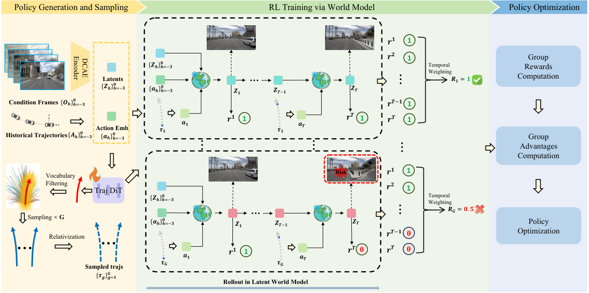

## Summary

把驾驶 world model 的生成过程压到 1 步，并在 latent 空间里完成 RL：`SF-WM` 用 shortcut forcing 把采样从 100 步降到 1 步，`AD-RM` 在 latent 上逐 horizon 预测 8 维奖励，`GRPO` 在轨迹词表的 Gaussian 邻域内采样。`NAVSIM v2` navtest 上 87.7 EPDMS（Epona 基线 85.1），单帧推理 0.03 s。

## Problem & Motivation

- 真实世界做 RL 试错成本与安全风险不可接受；传统仿真器有 sim-to-real gap，于是用 video world model 做 imagination-based training。
- 现有 pixel-level diffusion world model 有两个瓶颈：100 步采样约 2 s/帧，无法支撑高频 RL 交互；pixel-level 目标偏向视觉保真，而非驾驶安全所需的空间与动态理解。
- 已有 world-model RL（ReSim、WorldRFT、RAD 等）要么依赖 3D 标注、要么没有充分利用 latent 特征、要么在 OOD 动作下产生幻觉。作者的观察是：Video DiT 去噪后的 latent 已经有良好的空间结构与语义一致性（Fig. 2 的 PCA），可以直接作为 world model 的状态表示。

## Method

**0. 总体框架**

+ 两个紧耦合组件：

  + **World Model with Latent Reward Modeling**：`SF-WM` 单步预测未来 latent，`AD-RM` 自回归地给出逐 horizon 的奖励。
  + **RL with Vocabulary Sampling**：策略在高质轨迹词表的 Gaussian 邻域内采样，用 `GRPO` 更新，避免 OOD 动作触发 world model 幻觉。

**1. 基础 world model 与 SF-WM**

+ 以 `Epona` 为 backbone（autoregressive flow-matching diffusion，统一视频生成与轨迹规划）。给定历史观测 $O$ 与动作 $A$：

$$
Z = \text{DCAE-encoder}(O), \quad a = \text{MLP}(A)
$$

+ $Z$ 经 temporal projection 得 $Z_{proj}$，与 action embedding 在空间维拼接为 $E \in \mathbb{R}^{B \times P \times (L+3) \times C}$，取最后一帧作为条件 $F$，预测下一帧 latent $\hat{z}_{next}$ 与未来轨迹 $\tau_{pred}$。原始模型在 nuPlan 上以 10 Hz 训练，而 NavSim 以 2 Hz 运行，因此先在 NavSim 上微调，再做步数蒸馏。

+ **Shortcut Forcing World Model（SF-WM）**：在 rectified flow 下定义

$$
x_t = t x_1 + (1-t) x_0, \quad v = \frac{dx_t}{dt} = x_1 - x_0
$$

+ 训练时采样步长与信号水平：

$$
d \sim 1/\mathcal{U}(\{1,2,4,8,\dots,K_{max}\}), \quad t \sim \mathcal{U}(\{0,d,2d,\dots,1-d\})
$$

+ 模型同时以 $t$ 与 $d$ 为条件（step embedding）。$d=d_{min}$ 时用标准 flow matching 目标；$d>d_{min}$ 时用两个 teacher 半步：

$$
v_1 = \phi_\theta(x_t, t, d/2), \quad x_{mid} = x_t + v_1 d/2
$$

$$
v_2 = \phi_\theta(x_{mid}, t+d/2, d/2)
$$

$$
v_{target} = \begin{cases} x_1 - x_0, & d = d_{min} \\ \text{sg}((v_1+v_2)/2), & \text{otherwise} \end{cases}
$$

$$
\mathcal{L}(\theta) = \mathbb{E}_{x_0,x_1,t,d}\left[\omega(t)\|\phi_\theta(x_t,t,d) - v_{target}\|^2\right], \quad \omega(t) = 0.9t + 0.1
$$

+ 推理时可指定 $d$，用 1–4 步生成；论文称相比 100 步最多 80× 加速，1 步时视觉清晰度仍能维持（Fig. 4）。

**2. Autoregressive Dense Reward Model（AD-RM）**

+ **词表构造**：从 8192 条轨迹中，按终点状态过滤到人类轨迹邻域：

$$
|\Delta y| \le 5\,\text{m}, \quad |\Delta x| \le 10\,\text{m}, \quad \Delta\theta \le 20^\circ
$$

+ 再按 $|\Delta y|$ 排序、等距采样，得到 $K=256$ 的轨迹词表 $\Gamma$。每条轨迹在 NavSim PDM 仿真器中打分，得到 8 个维度 $\{r_{nc}, r_{dac}, r_{ddc}, r_{tlc}, r_{ep}, r_{ttc}, r_{lk}, r_{hc}\}$；与以往只算整条轨迹分数不同，这里在 $[0, 4.0]$ s 内每 0.5 s 打一次分，形成 8 个 horizon 的监督信号。

+ **奖励模型**：冻结 world model，自回归预测 $\{\hat{z}_1,\dots,\hat{z}_t\}$，历史编码为

$$
\text{his}_{-3:t} = \text{his\_enc}(\text{concat}[z_{-3},z_{-2},z_{-1},z_0,\hat{z}_1,\dots,\hat{z}_t])
$$

+ latent 维 $L=512$ 经 learnable query 压到 $l=32$；8 个奖励维度各有可学习 base $Q_{base} \in \mathbb{R}^{8 \times D}$，动态条件为

$$
C_{dyn} = \text{MLP}_{traj}(\text{traj}_{0:t}) + \text{Emb}_{step}(t), \quad Q_r = Q_{base} + C_{dyn}
$$

$$
r_{pred}^t = \text{MLP}(\text{Cross-Attention}(Q_r, \text{his}_{-3:t}))
$$

+ 监督用 BCE：

$$
\mathcal{L}_{sup} = \sum_{k=1}^{8} \omega_k \cdot \gamma(t) \cdot \text{BCEWithLogits}(r_{pred}, r)
$$

**3. RL：奖励设计与词表采样**

+ **奖励融合**：安全项 $r_{safe}=\{r_{nc}, r_{dac}, r_{ddc}, r_{tlc}\}$，任务项 $r_{task}=\{r_{ep}, r_{ttc}, r_{lk}, r_{hc}\}$。安全项用 log-sigmoid 聚合，任务项用加权和再取 log：

$$
L = \sum_{i \in safe} w_i \log(\text{sigmoid}(r_i)), \quad S = \log\left(\sum_{j \in task} w_j r_j\right)
$$

$$
r_{total}^t = L + S = \log\left(\prod_i r_i^{w_i} \times \sum_j w_j r_j\right)
$$

$$
r_{final} = \sum_{t=1}^{8} w_t \cdot r_{total}^t
$$

+ log 融合使碰撞类事件把安全项压向 0、$r_{total}$ 趋向 $-\infty$，从而让安全约束主导奖励；逐 horizon 求和则提供 temporal credit assignment。

+ **Gaussian 词表采样**：以策略输出 $\tau_{act}$ 为均值、固定方差构造 $\tau \sim \mathcal{N}(\tau_{act}, \sigma^2)$，按 Mahalanobis 距离对词表轨迹排序：

$$
d(x, \tau_{act}) = \sum_{t=1}^{T}\sum_{i=1}^{3} \frac{(x_{t,i} - \tau_{act_{t,i}})^2}{\sigma_{t,i}^2}
$$

+ 混合两种采样：$g_1$ 条按 softmax 概率做判别性选择，$g_2$ 条从 Gaussian 邻域做局部探索，$G = g_1 + g_2$。

+ **策略优化**：组内归一化优势与 PPO 式裁剪：

$$
A_i = \frac{r_{final}^i - \text{mean}(r_{final}^{1..G})}{\sqrt{\text{var}(r_{final}^{1..G})}}, \quad \rho = \exp(\log\pi_\theta - \log\pi_{old})
$$

$$
L_{actor} = \mathbb{E}\left[\max(-A_i\rho, -A_i\text{clip}(\rho, 1-\epsilon, 1+\epsilon))\right]
$$

$$
L_{total} = L_{actor} + L_{bc} + L_{kl}, \quad L_{bc} = \|\tau_{act} - \tau_{gt}\|_1, \quad L_{kl} = D_{KL}(\pi_\theta \| \pi_{ref})
$$

**4. 实现细节**

| 项目 | 设置 |
|:--|:--|
| 基础模型 | Epona，nuPlan + nuScenes 从零训练；图像 512×1024 |
| 硬件 | 32 × NVIDIA H20 |
| NavSim 微调 | AdamW，batch 128，lr $3\times10^{-5}$，weight decay $5\times10^{-2}$，5 epochs，约 1 天 |
| SF-WM 训练 | 12 epochs，约 3 天，其余超参同上 |
| 奖励模型 | batch 320，lr $3\times10^{-4}$，12 epochs，约 1 周 |
| RL | batch 196，lr $1\times10^{-4}$，2 epochs，约 8 h |
| 采样步数 | VisDiT 1 步，TrajDiT 20 步 |
| 推理硬件 | 单张 H20 |

## Pipeline

1. **World model 适配**：Epona 在 NavSim 上以 2 Hz 微调，对齐生成间隔。
2. **步数蒸馏**：用 shortcut forcing 训练 SF-WM，使其支持 1–4 步采样。
3. **词表与奖励监督**：过滤 8192 条轨迹得到 256 条词表，在 PDM 仿真器中按 8 个 horizon 打 8 维分数。
4. **奖励模型训练**：冻结 SF-WM，对词表轨迹做 latent rollout，自回归预测逐 horizon 奖励（BCE）。
5. **RL 训练**：策略输出 $\tau_{act}$ → Gaussian 词表采样 $G$ 条候选 → SF-WM latent rollout → AD-RM 打 dense reward → 组内归一化优势 → GRPO + BC + KL 更新。
6. **推理**：策略直接输出轨迹；需要可视化或事故分析时，才把 latent 解码成 RGB，训练时不解码。

## Key Results

**1) NAVSIM v2 navtest（Table 1）**

+ 测试集为 136 个场景，指标为 EPDMS（NC / DAC / DDC / TLC / EP / TTC / LK / HC / EC 聚合）。

| Method | NC | DAC | DDC | TLC | EP | TTC | LK | HC | EC | EPDMS |
|:--|--:|--:|--:|--:|--:|--:|--:|--:|--:|--:|
| TransFuser | 96.9 | 89.9 | 97.8 | 99.7 | 87.1 | 95.4 | 92.7 | 98.3 | 87.2 | 76.7 |
| Hydra-MDP++ | 97.2 | 97.5 | 99.4 | 99.6 | 83.1 | 96.5 | 94.4 | 98.2 | 70.9 | 81.4 |
| DriveSuprim | 97.5 | 96.5 | 99.4 | 99.6 | 88.4 | 96.6 | 95.5 | 98.3 | 77.0 | 83.1 |
| iPAD | 98.7 | 97.8 | 99.1 | 99.8 | 83.5 | 98.0 | 96.2 | 98.1 | 85.6 | 84.1 |
| ReCogDrive | 98.3 | 95.2 | 99.5 | 99.8 | 87.1 | 97.5 | 96.6 | 98.3 | 86.5 | 83.6 |
| DiffusionDrive | 98.2 | 95.9 | 99.4 | 99.8 | 87.5 | 97.3 | 96.8 | 98.3 | 87.7 | 84.5 |
| DriveVLA-W0 | 98.5 | 99.1 | 98.0 | 99.7 | 86.4 | 98.1 | 93.2 | 97.9 | 58.9 | 86.1 |
| World4Drive | 97.8 | 96.3 | 99.4 | 99.8 | 88.3 | 97.1 | 97.7 | 98.0 | 53.9 | 84.8 |
| WorldRFT | 97.8 | 96.5 | 99.5 | 99.8 | 88.5 | 97.0 | 97.4 | 98.1 | 69.1 | 86.7 |
| Epona (Base) | 97.1 | 95.7 | 99.3 | 99.7 | 88.6 | 96.3 | 97.0 | 98.0 | 67.8 | 85.1 |
| **DreamerAD** | **98.0** | **97.2** | **99.5** | **99.8** | **87.8** | **97.4** | **97.5** | **98.3** | **72.4** | **87.7** |

+ 相对 Epona：NC +0.9、DAC +1.5、TTC +1.1、LK +0.5、HC +0.3、EC +4.6，EP −0.8，EPDMS +2.6。作者把 EP 下降解释为 safety-first 的主动取舍。

**2) NAVSIM v1 navtest（Table 2）**

| Method | Input | NC | DAC | TTC | Comf | EP | PDMS |
|:--|:--|--:|--:|--:|--:|--:|--:|
| WoTE | C&L | 98.5 | 96.8 | 94.9 | 99.9 | 81.9 | 88.3 |
| DriveVLA-W0 | C&L | 98.7 | 96.2 | 95.5 | 100.0 | 82.2 | 88.4 |
| AutoVLA | C-Only | 98.4 | 95.6 | 98.0 | 99.9 | 81.9 | 89.1 |
| RecogDrive | C-Only | 97.9 | 97.3 | 94.9 | 100.0 | 87.3 | 90.8 |
| World4Drive | C-Only | 97.4 | 94.3 | 92.8 | 100.0 | 79.9 | 85.1 |
| WorldRFT | C-Only | 97.8 | 96.8 | 94.0 | 100.0 | 81.7 | 87.8 |
| Epona (Base) | C-Only | 97.9 | 95.1 | 93.8 | 99.9 | 80.4 | 86.2 |
| **DreamerAD** | **C-Only** | **98.0** | **97.2** | **94.3** | **100.0** | **83.1** | **88.7** |

+ 相对 Epona：NC +0.1、DAC +2.1、TTC +0.5、Comf +0.1、EP +2.7，PDMS +2.5。论文的表述是 "state-of-the-art among all world-model-based methods"——全表最高仍是 RecogDrive 90.8 与 AutoVLA 89.1。

**3) 组件消融（Table 3）**

| ID | SF-WM | AD-RM | RL-SM | EPDMS |
|:--|:--:|:--:|:--|--:|
| 1 | | | | 85.1 |
| 2 | | ✓ | Vocab Sampling | 86.4 |
| 3 | ✓ | | Vocab Sampling | 87.0 |
| 4 | ✓ | ✓ | Vocab Sampling | 87.7 |
| 5 | ✓ | ✓ | WorldRFT | 86.6 |
| 6 | ✓ | ✓ | Flow-GRPO | 87.0 |

+ 拆分来看：SF-WM 带来 +1.3（ID2 → ID4），AD-RM 带来 +0.7（ID3 → ID4），采样方式相对 Flow-GRPO +0.7、相对 WorldRFT +1.1。

**4) 采样步数与延迟（Table 4）**

| Steps | Latency / frame (s) | EPDMS |
|--:|--:|--:|
| 16 | 0.40 | 87.7 |
| 4 | 0.10 | 87.8 |
| 1 | 0.03 | 87.7 |

+ 1 步与 16 步的 EPDMS 几乎相同，说明在该设置下规划性能对 world model 采样步数不敏感。

**5) 奖励模型数据量（Table 5）**

| Data Scale | EPDMS |
|:--|--:|
| Epona Baseline | 85.1 |
| 20% | 87.5 |
| 40% | 87.5 |
| 100% | 87.7 |

+ 作者据此认为奖励模型只需少量数据即可学到好坏驾驶行为的差异。

**Critical reading**

- **benchmark 口径是最大的问题**：论文只报 136 场景的 navtest（v1 与 v2 的扩展指标版），没有 navhard。因此 87.7 EPDMS 不能与 navhard 榜单上的数值（例如 WorldDrive 的 34.9 EPDMS）直接比较；"SOTA" 也只是在 Table 1 这 11 个自行选取的方法内成立。
- **v1 的 88.7 并非全表最佳**：RecogDrive 90.8、AutoVLA 89.1 更高。论文把 claim 限定在 world-model-based 方法，措辞上没有问题，但摘要与结论的 "state-of-the-art" 容易被误读为全表第一。
- **增益拆分后每一项都不大**：+2.6 EPDMS 中 SF-WM +1.3、AD-RM +0.7、采样方式 +0.7；相对 Epona 的提升更像是三个工程改进的叠加，而非某个机制带来质变。
- **EP 的方向在 v1/v2 上相反**：v2 上 EP −0.8 被解释为 safety-first 取舍，v1 上 EP 却 +2.7。这个不一致没有被讨论，可能说明 v2 的 EP 与安全项权重之间存在更强的拉锯。
- **奖励模型是 PDM 的代理，存在 metric overfitting 风险**：监督标签直接来自 NavSim PDM 仿真器，RL 实际优化的是学到的 surrogate。论文没有报告奖励模型在 held-out 轨迹上的校准/准确率，也没有与 "用真 PDM 分数做 best-of-N" 的上界对比。
- **20% 与 100% 数据几乎无差别**（87.5 vs 87.7）有两种解释：奖励信号鲁棒，或该信号本身信息量有限、很快饱和。缺少奖励模型准确率曲线，无法区分。
- **1 步与 16 步 EPDMS 相同**说明最终规划对 world model 保真度不敏感；"80× 加速" 是真实的工程收益，但也削弱了 "高保真 world model 是 RL 关键" 的叙事。视觉质量只有定性图（Fig. 4），没有 FVD/FID。
- **内部口径不一致**：0–4.0 s、步长 0.5 s 应得 9 个时间点，原文写 8 个；式 (18) 用 $t \in \{0,\dots,7\}$，式 (19) 却从 $t=1$ 加到 8。属于写作疏漏，但会影响复现。
- **关键细节缺失**：$g_1$、$g_2$、$\sigma$、奖励模型参数量、每个场景过滤后剩多少条轨迹、RL 多种子方差均未给出。
- **预训练数据与测试集的关系未说明**：Epona 在 nuPlan 上预训练，而 NavSim 由 nuPlan 构建。navtrain/navtest 是否与 Epona 的预训练场景重叠、重叠程度如何，论文没有交代；这会影响对 85.1 基线与最终 87.7 的解释。
- **计算成本不低**：32 张 H20，奖励模型训练约一周；"efficient" 指的是推理（0.03 s/帧），不是训练。

## Strengths & Weaknesses

**Strengths**

- 问题切分干净：三个组件各自对应一个明确瓶颈——采样慢、奖励稀疏、OOD 探索幻觉；消融也按这个结构组织，容易读懂每个模块的边际贡献。
- 用 latent 而非 pixel 做 RL，既避开解码开销，又保留了可解码的可解释性；0.03 s/帧使 high-frequency RL 交互真正可行。
- dense reward 的设计（8 维 × 8 horizon + log-sigmoid 安全融合）比只给整条轨迹一个分数更符合 credit assignment 的需求，且不需要额外 3D 标注。
- 词表约束采样是对 world model 幻觉的直接工程回应，并在同容量下与 WorldRFT、Flow-GRPO 做了对照，不是只与自己比。
- 1 步 SF-WM 与 16 步性能持平，说明 shortcut forcing 在这个任务上没有牺牲规划所需的信息，属于可信的效率收益。

**Weaknesses**

- 只在 navtest 上验证，缺少 navhard 与真正的 long-tail / 反应式场景；而论文的 motivation 正是 long-tail。
- 奖励模型蒸馏 PDM，评测也用 PDM/EPDMS，闭环里存在指标自洽但外部效度未知的问题；没有真人偏好、闭环反应式或实车验证。
- 相对基线的绝对提升有限，且部分来自 baseline 选择（Epona 微调后的 85.1 是否已包含 NavSim 适配并不完全清楚）。
- "first latent world model framework" 的说法偏强：Dreamer 系列与若干 latent driving world model 已经在 latent 空间做 rollout，本文更准确的定位是 "first 1-step latent WM + dense latent reward for driving RL"。
- 复现信息不足：采样超参、奖励模型规模、数据过滤后的词表分布、随机种子方差都缺失。
- 训练成本（32×H20、奖励模型一周）与 "efficient" 的标题形成反差，实际收益集中在推理侧。

## Notes

+ **论文定位**：把 video world model 当作 RL 的 latent simulator，用可学习的 dense reward 替代昂贵的环境交互，并用轨迹词表把 exploration 限制在物理可行流形内。核心贡献是 "让 world model 快到可以参与 RL 循环"，而不是提出新的世界模型结构。

+ **可迁移点**：
  + shortcut forcing 的 step embedding（同时以 $t$ 和 $d$ 为条件）可以直接套到任何 flow-matching 视频模型上，把它变成 1–4 步 sampler；对需要高频采样的 planner/RL 场景是通用加速手段。
  + "在受限候选集上用规则/仿真器打标签 → 训练 latent reward model → RL 时替代环境" 这套流程，可以迁移到其他难以实时仿真的具身任务。
  + 以策略输出为均值、在词表上按 Mahalanobis 距离做混合采样，是一种通用的 constrained exploration 方案，比直接对连续动作加 Gaussian 噪声更不容易跳出可行域。

+ **待跟进**：
  - **latent reward 在长尾场景下的有效性**：现有验证只在 navtest 的常规场景，若换到 navhard 或反应式闭环，EP 与安全项的拉锯是否会改变、奖励模型是否会偏向保守或冒进，目前没有证据。
  - **奖励模型的校准与不确定性**：论文没有报告 held-out 轨迹上的校准误差，也没有给出与 "best-of-N + 真 PDM 打分" 的上界差距；这两项决定了 latent reward 能否安全地替代仿真器。
  - **采样超参与词表覆盖**：$\sigma$、$g_1/g_2$ 未给出取值和敏感性分析，10 m / 5 m / 20° 的过滤阈值也可能把必要的避险动作排除在词表之外，需要看词表在 cut-in、施工区等场景下的覆盖率。
  - **预训练数据重叠**：Epona 在 nuPlan 上预训练而 NavSim 由 nuPlan 构建，navtrain/navtest 与预训练场景的重叠程度会直接影响 85.1 → 87.7 这一提升的解释。
  - **训练效率的边界**：论文的 "efficient" 只体现在推理侧，32 张 H20、奖励模型约一周的训练成本没有与 ReSim、WorldRFT 等方法做同口径对比。
