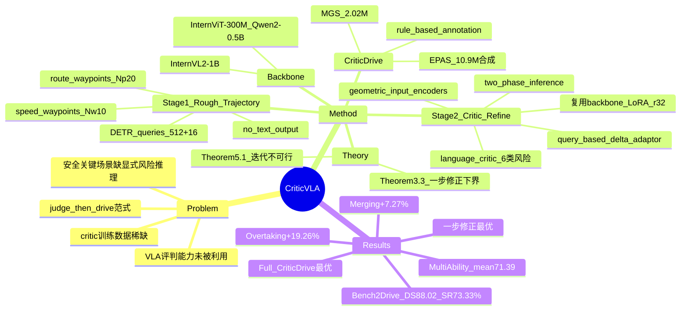

## Summary

`CriticVLA` 主张 VLA 不该只是"从多模态输入直接回归控制信号"的 action generator，而应先"判断"再"驾驶"。它提出一个 **two-stage、critic-centric** 框架：Stage-1 用 VLA 生成一条 rough trajectory，Stage-2 复用**同一个 VLA**（充当 multimodal critic）对该轨迹做结构化自然语言风险分析并输出纠正建议，再由 query-based delta adaptor 把建议转成对轨迹的精细化修正。配套构建 `CriticDrive`——1290 万条带标注轨迹的大规模合成数据集。在 `Bench2Drive` closed-loop 上取得 SOTA：`Driving Score` **88.02** / `Success Rate` **73.33%**，多能力评测平均 71.39%，均超越 `SimLingo` 等基线，并在高交互场景（merging / overtaking / 非信号路口）有 20%–80% 级别的显著提升。

## Problem & Motivation

- **VLA 的"评判"能力被浪费**：现有 driving VLA 几乎都只把模型当作 action generator，把多模态输入映射到控制信号；而 LLM 系列的 "LLM-as-a-judge" 已证明模型具备评估、打分与纠错能力，这套 critic 能力在驾驶 VLA 中尚未被显式利用。
- **安全关键场景需要显式风险推理**：高速并线、无保护转向、与激进车辆博弈等场景中，缺乏显式 critic 使模型难以主动发现潜在风险并修正自身动作，闭环鲁棒性受限。
- **一步修正 vs 直接生成**：论文用理论分析（Theorem 3.3）指出，只要 critic 泛化足够好、且初始轨迹不过差，一步修正就能带来有保证的价值提升——这为"先粗后精"的两段式设计提供了依据。
- **critic 训练数据稀缺**：要降低初始轨迹到训练集的距离 $\rho_0$，训练集必须覆盖足够广的 rough 轨迹分布；真实驾驶日志中此类带风险标注的失败/纠错样本稀缺，需要专门合成。

## Method

**0) Backbone**
- 采用 Mini-InternVL 家族的 `InternVL2-1B`：`InternViT-300M-448px` 视觉编码器 + `Qwen2-0.5B-Instruct` 语言模型。
- 轨迹采用 `dual-trajectory representation`，解耦横纵向控制：`Geometric Route Waypoints` $P \in \mathbb{R}^{N_p \times 2}$（固定空间间隔约 1 m，刻画路径几何与曲率，供横向 PID 循迹）与 `Temporal Speed Waypoints` $W \in \mathbb{R}^{N_w \times 2}$（固定时间间隔 $\Delta t = 0.25$ s，隐式编码速度与加速度剖面，供纵向 throttle/brake）。

**1) Stage-1: Rough Trajectory Generation**
- 输入：多视角 RGB 图像 + 语言指令 + ego state（当前车速）+ navigation input（2D GPS 目标点）。
- GPS 目标点经 `Waypoint Input Adaptor`（3 层 MLP + ReLU）编码为 $d_{\text{model}} = 2048$ 的 token embedding，与导航 prompt token 拼接后送入 LLM。
- 基于 `DETR` 思路使用两组可学习 query：512 vision queries（latent 多模态特征抽取与 grounding）与 16 trajectory queries（交互后直接映射为输出轨迹 $A_0$）。
- `Driving Adaptor` 两个头：`Route Waypoints Head` 预测 $N_p = 20$ 个 route waypoints（输出相对 ego 的累计 delta 再求和，`Linear→SiLU→Linear`）；`Speed Waypoints Head` 预测 $N_w = 10$ 个 speed waypoints。**该阶段不产生任何文本输出**。
- 训练数据：来自 `CARLA`、`DriveLM` 与高质量安全驾驶数据的多场景基座数据集，>202 万帧；用 `Weighted Bucket Sampling`（借鉴 `SimLingo`）按场景难度非均匀采样，抑制大量平淡样本，每 epoch 约 48 万样本。

**2) Stage-2: Critic and Refinement by VLA**
- 复用 Stage-1 的 backbone 作为 `multimodal critic`，对所有 linear 层施加 `LoRA`（`r=32`, `α=64`, `dropout 0.1`）。
- `Geometric Input Encoders`：`Delta Waypoint Encoder` 与 `Delta Speed Encoder` 分别把粗轨迹 $P_{\text{rough}}$、$V_{\text{rough}}$ 映射进 token 空间（共享 MLP：`Linear(2→256)→ReLU→Linear(256→512)→ReLU→Linear(512→d_model)`），替换 Delta Prompt 中的占位 token（如 `<wpt>…</wpt>`）。
- `Language Head`（Delta Language Adaptor）：自回归生成 **structured risk assessment**——对 6 类风险（`Collision` / `Speed` / `Direction` / `Pedestrian` / `Stop Sign` / `Traffic Light`）给出 True/False 判断，再给出具体 action recommendation（如 "reduce speed from 7.4 m/s to 3.5 m/s"）。
- `Query-Based Delta Adaptors`：可学习 `Learnable Refinement Queries` $Q_{\text{route}} \in \mathbb{R}^{1 \times 20 \times d_{\text{model}}}$、$Q_{\text{speed}} \in \mathbb{R}^{1 \times 10 \times d_{\text{model}}}$ 锚定修正任务，其 hidden state 经 DeltaAdaptor（`Linear(d_model→2d_mlp)→SiLU→Linear(2d_mlp→d_mlp)→SiLU→Linear(d_mlp→2)`，$d_{\text{mlp}} = 256$）预测**修正增量 $(\Delta P, \Delta W)$ 而非绝对坐标**。
- `Two-Phase Inference`：① `Semantic Analysis Phase`——语言头自回归产出完整风险分析与建议；② `Refinement Phase`——以该分析为上下文，由 delta adaptor 直接预测修正后轨迹。

**3) CriticDrive 数据集**
- 总计 **308 万带标注驾驶帧**，合成出 **1290 万条带标注轨迹**（≈12.9 M）：
  - `MGS`（Model-Generated Subset）：202.3 万帧，由 Stage-1 模型产出的 rough trajectory 经自动标注得到，帮 critic 建立对 Stage-1 的稳定改进比 $\beta$。
  - `EPAS`（Extra Perturbation-Augmented Subset）：从 105.8 万条 GT 轨迹经三类扰动合成 **1089.6 万条**高风险轨迹——纵向速度缩放（$\gamma \sim U(1.1, 1.5)$ 激进 / $U(0.3, 0.9)$ 保守）、强制车道偏移、强制碰撞合成（用自行车模型校验物理可行性），用于扩大动作集支撑、降低 $\rho_0$。
- 标注由规则式 `Critic Reasoning Creator` 自动生成，四步风险评估：横向风险（角度偏移、路径偏移）、纵向风险（限速合规、速度偏差、意图分类）、碰撞风险（3D OBB + 分离轴定理）、环境合规（复杂度、交规、通行权、行人、恶劣条件）。
- 两种训练配置：`Base CriticDrive`（MGS + 15% GT，教 critic 在已优轨迹上输出近零 delta，48 万/epoch）与 `Full CriticDrive`（(MGS+GT) 与 EPAS 按 1:1 采样，96 万/epoch）。

**4) 理论依据**
- Theorem 3.3：$Q(A_1) \geq \beta Q^* + (1-\beta)Q(A_0) - \rho_0 \cdot L_Q(1-\beta+L_C)$——要拿到高的 $Q(A_1)$，需 (a) critic 泛化好（$\rho_0$ 小，即 T 覆盖足够广的 rough 轨迹），(b) 初始轨迹 $A_0$ 不能太差。经验估计 $\beta \approx 0.1$。
- Theorem 5.1：迭代式修正收敛要求训练集 T 几乎覆盖整个测试分布，实际不可行；因此**推荐一步修正**。

**5) 训练**
- 8× A100 + `DeepSpeed` ZeRO Stage-2 + 16-bit 混合精度；`AdamW`，`lr=3e-5`，`wd=0.1`，$\beta = (0.9, 0.999)$，`OneCycleLR`（5% warmup），`grad clip 0.3`，每阶段 13 `epochs`。
- Stage-1：视觉编码器与投影层全量微调，LLM 用 `LoRA`（`r=32`, `α=64`）。
- Stage-2：仅微调 critic 相关参数，Stage-1 generator（视觉编码器 + LLM）冻结。
- Loss：$L_{\text{total}} = \lambda_{\text{lang}} \cdot L_{\text{CE}} + \lambda_{\text{route}} \cdot L_{\text{Smooth-L1}}^{\text{route}} + \lambda_{\text{speed}} \cdot L_{\text{Smooth-L1}}^{\text{speed}}$。
- 轨迹预测 horizon $T = 11$ 步（未来 2.5 s @4Hz），输出 20 个 spatial waypoints。

## Pipeline

*`CriticVLA` 整体框架（"judge, then drive" 两段式）。Stage-1 将多视角图像、语言指令与 rough trajectory query 送入 LLM，直接输出无语言输出的粗轨迹 $A_0$（含 route waypoints 与 speed waypoints）；Stage-2 把 $A_0$ 经 geometric input encoder 重新编码，由同一 LLM 生成结构化语言 critique（风险分析 + 纠正建议），再结合 refinement trajectory query 输出修正后的最终动作 $A'$。两阶段共享同一个 LLM backbone。*

## Key Results

- **`Bench2Drive` closed-loop（Table 1）**：`CriticVLA` **DS 88.02 (±0.17) / SR 73.33% (±0.27)**，Efficiency 269.24、Comfortness 36.45；超越 `SimLingo`（85.07 / 67.27 / 259.23 / 33.67）与 `TransFuser++`（84.21 / 67.27），为 SOTA。论文称在提升安全与任务完成的同时未牺牲驾驶质量，缓解了端到端模型常见的 safety–efficiency 权衡。
- **Critic 设计 ablation（Table 2）**：Stage-1 only 87.48 / 70.6 → `Implicit critic`（无语言，直接输出精修轨迹）87.49 / 71.06 → `Base CriticDrive` 87.97 / 72.27 → **`Full CriticDrive` 88.02 / 73.33**。显式语言 critic 相对 Stage-1 的 SR 增益（+1.67）明显大于隐式 critic（+0.46）；引入 `EPAS` 进一步降方差、提鲁棒性。
- **Multi-Ability（Table 3）**：`CriticVLA` `Merging` **61.28** / `Overtaking` **76.30** / `Emergency Brake` 88.33 / `Give Way` 50.00 / `Traffic Sign` 81.06 / **Mean 71.39**，相对 `SimLingo` 平均 +4.36%，其中 `Overtaking` **+19.26%**、`Merging` **+7.27%**。
- **迭代修正（Table 4，core-set）**：0 步 82.58 / 61.36 → 1 步（本文）**88.24 / 72.73** → 2 步 88.75 / 75.00 → 3 步 88.13 / 70.45；第二步仅边际增益，印证一步修正为推荐工作点。
- **$A_0$ 质量 ablation（Table 5，core-set）**：$\sigma = 1.0$ → 85.18 / 62.79；$\sigma = 0.5$ → 86.57 / 70.45；无噪声 → **88.24 / 72.73**，验证初始轨迹质量对最终性能的关键影响。
- **Critic 精修能力 ablation（Table 6，core-set）**：base(e=0) 82.58 / 61.36 → e=5 84.04 / 65.91 → e=9 86.43 / 70.45 → **e=13 88.24 / 72.73**，训练越充分修正能力越强。
- **分场景（Fig. 5 / E.2）**：`InterurbanActorFlow` SR **20%→100%**（纵向限速风险修正），`NonSignalizedJunction` Left/RightTurn **60%→100%**（横向风险拉回车道中心），`OppositeVehicleTakingPriority` +20%（碰撞风险 OBB 检测促其让行），`VanillaSignalizedTurnEncounterRedLight` +40%（红绿灯风险给出 Stop 指令）。

## Strengths & Weaknesses

**Strengths**
- **范式新颖且理论支撑**：把 LLM-as-a-judge 的 critic 能力显式引入驾驶 VLA，用 Theorem 3.3 给出"何时一步修正有效"的可检验条件（$\rho_0$ 小 + $\beta > 0$），并用 Table 5/6 做数值验证，理论—实验闭环较好。
- **复用同一 backbone、参数高效**：Stage-2 不引入新 backbone，靠 `LoRA` + 额外可学习 query 复用 Stage-1 权重，且冻结 generator，训练与部署成本可控。
- **数据集贡献明确**：`CriticDrive` 合成 12.9 M 带标注轨迹，用规则引擎自动产生结构化风险标注，且 `Base` / `Full` 两配置的 ablation 清楚展示 `EPAS` 的价值（降方差、涨点）。
- **修正是"增量"而非重生成**：delta adaptor 预测 $(\Delta P, \Delta W)$ 相对绝对坐标回归，更贴合"在粗轨迹上小幅纠偏"的语义；风险类别解耦为速度 / 方向分别修正，避免"be careful"式模糊指令。
- **闭环 + 多能力 + 分场景三重评测**：`Bench2Drive` 主指标、`Multi-Ability` 五能力、逐场景分析，并诚实给出 failure case，证据链完整。

**Weaknesses / 边界**
- **依赖规则式标注流水线**：`CriticDrive` 的 risk analysis / action suggestion 全部由启发式规则生成，规则覆盖度与正确性直接决定 critic 上限；规则偏差可能被模型学习放大。
- **仅用前视输入**：`YieldToEmergencyVehicle` 等需要后向感知的场景天然吃亏（论文自认局限），多视角扩展尚未验证。
- **一步修正是硬约束**：Theorem 5.1 论证迭代修正需近乎覆盖全测试分布故不可行，但这也意味着框架无法通过多轮自我纠错处理"一步修不好"的困难样本。
- **方向风险指令偏粗**：`ConstructionObstacle` 等需精确几何操作（如 "nudge 0.5m left"）的场景中，粗粒度 "adjust direction to the left/right" 会导致过修正；`SequentialLaneChange` 中逐帧风险判定可能在 "maintain"/"adjust" 间抖动，产生锯齿轨迹。
- **对比基准与延迟未报告**：主表聚焦 DS/SR/Efficiency/Comfortness，未给出与其他 VLA 的推理延迟对比；Theorem 中的 $\beta$ 仅为经验估计（$\approx 0.1$），缺乏跨场景的稳定量化。

## Mind Map

## Notes

- **与既有工作的关系**：backbone（`InternVL2-1B`）与 `DETR`-based trajectory head 沿用既有 VLA 范式（如 `SimLingo` 系列后训练管线，`Weighted Bucket Sampling` 亦借鉴 `SimLingo`）；核心 novelty 在于把 "LLM-as-a-judge" 的 critic 思想搬到驾驶 VLA，并以结构化自然语言 critique 作为轨迹修正的中间监督；delta 式增量修正在概念上与残差/refinement head 同源，但以语言推理驱动。
- **可迁移点**：①"生成—评判—精修"两段式 + 显式语言 critique 的范式可迁移到其他具身 VLA（如操作任务的动作自评与纠偏）；②用规则引擎自动合成"失败 + 纠错"监督以降低 $\rho_0$ 的数据构造思路，对缺乏负面样本的领域有借鉴价值；③delta（增量）而非绝对坐标的修正头，是"在不破坏原计划前提下小幅纠偏"的通用设计。
- **待跟进**：规则式标注流水线在长尾场景的覆盖度与偏差；多视角扩展后 `YieldToEmergencyVehicle` 等场景是否改善；延迟/吞吐基线缺失下的部署可行性。
