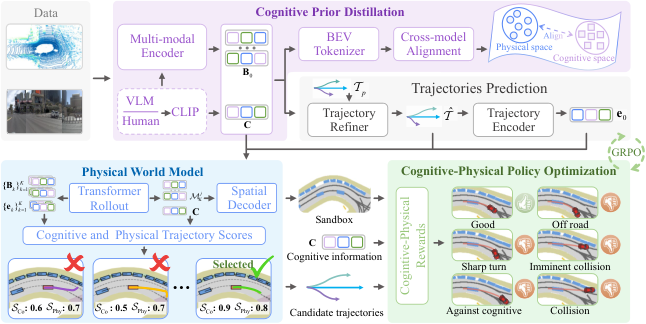

## Summary

CoPhy 把 VLM 的语义认知蒸馏进 BEV encoder，训练后丢弃 VLM，实现零推理开销的 cognitive channel；同时用 auto-regressive BEV world model 在候选轨迹条件下 rollout 未来语义地图，作为可解释的物理沙盒。策略用 GRPO 优化，奖励由 world model rollout 导出的物理安全项与 language-aligned cognitive scorer 组成。NAVSIM v1 navtest 91.4 PDMS、v2 navtest 86.1 EPDMS，均为表中最高，并支持用自然语言命令做 intent control。

## Problem & Motivation

- **行为克隆天花板**：E2E 驾驶模型主要在专家轨迹上做 behavior cloning，只能拟合已见行为，遇到 OOD 场景缺乏探索经验，也无法超越专家。
- **认知缺口**：纯视觉特征偏向短视距轨迹拟合，不理解交通语义与驾驶意图。VLM 虽能提供场景推理，但在线部署成本过高；现有 VLA 方法又常把驾驶退化为 VQA 或直接接 action head，语义意图与物理执行之间缺少可靠连接，并伴随 reasoning hallucination。
- **物理缺口**：已有 world model 多预测隐空间特征，或依赖外部模拟器，无法给出可解释、可操作的物理状态，难以直接用于安全评估。作者主张应显式 rollout 未来 BEV 状态，作为 "what-if" 沙盒。
- **RL 缺口**：把 RL 用于 E2E 驾驶需要环境与奖励。既有工作要么从场景想象中构造 intrinsic reward，要么用语言反馈优化低层执行，但普遍把**硬物理约束**（碰撞、可行驶区域）与**软认知偏好**（意图合规）分开处理，缺少统一的 dual-reward 形式。
- 因此论文的目标是把三件事放进一个架构：零成本的语义认知、显式的物理预判、以及能同时优化安全与意图的 RL 后训练。

## Method

**0. 总体框架**

+ 输入多模态观测 $\mathcal{V}=\{\mathcal{V}_{\text{RGB}},\mathcal{V}_{\text{LiDAR}}\}$，经多模态 encoder $\mathcal{E}_{\theta}$ 得到 BEV 状态：

$$
\mathbf{B}_0=\mathcal{E}_{\theta}(\mathcal{V})
$$

+ 从专家演示中聚类出 $N$ 个运动学轨迹原型 $\mathcal{T}_p$，把动作空间限制在物理可行范围内。轨迹 refiner $\pi_{\theta}$ 输出候选轨迹：

$$
\hat{\mathcal{T}}=\mathcal{T}_p+\pi_{\theta}(\mathrm{TE}(\mathcal{T}_p),\mathbf{B}_0)
$$

+ 后续在 refiner 中加入认知条件 $\mathbf{C}$，并在 IL 之后只对该 refiner 做 RL。整体包含三个模块：cognitive prior distillation、physical world model rollout、cognitive-physical policy optimization。

**1. Cognitive Prior Distillation（Distill to Think）**

+ 用 LoRA 在多个驾驶 VQA 数据集上微调 InternVL3-8B，使其成为领域专家，输出交通标志、道路拓扑、驾驶意图等 cognitive priors：

$$
\mathcal{L}_{\text{VLM}}=-\sum_{l=1}^{L}\log P_{\xi}(y_l\mid y_{<l},\mathcal{V},Q)
$$

+ 其中 $\xi$ 为 LoRA 参数。训练完成后冻结 VLM，用其为 IL 训练生成文本描述，再由 CLIP text encoder 编码为 cognitive prior $\mathbf{C}$，从而把 VLM 从"在线推理器"变成"离线标注器"。

+ 为让 BEV encoder 内化语言先验，用 BEV tokenizer $\mathrm{BE}(\cdot)$ 提取认知特征，并与 $\mathbf{C}$ 做跨模态余弦对齐：

$$
\mathcal{L}_{\text{Distill}}=1-\frac{\mathrm{BE}(\mathbf{B}_0)\cdot\mathbf{C}}{\|\mathrm{BE}(\mathbf{B}_0)\|_2\|\mathbf{C}\|_2}
$$

+ 除特征级蒸馏外，$\mathbf{C}$ 还直接注入 refiner：

$$
\hat{\mathcal{T}}=\mathcal{T}_p+\pi_{\theta}(\mathrm{TE}(\mathcal{T}_p),\mathbf{B}_0,\mathbf{C})
$$

+ 这一注入同时打开了 intent-controllable driving 的接口：推理时把 $\mathbf{C}$ 换成用户命令的 CLIP embedding 即可，无需重训练。

**2. Physical World Model Rollout（Foresee to Act）**

+ Transformer world model 以当前 BEV 状态 $\mathbf{B}_0$、认知特征 $\mathbf{C}$ 与初始 ego 特征 $\mathbf{e}_0=\mathrm{TE}(\hat{\mathcal{T}})$ 为输入，递归 rollout：

$$
(\mathbf{B}_k,\mathbf{e}_k)=\mathrm{WM}(\mathbf{B}_{k-1},\mathbf{e}_{k-1},\mathbf{C}),\quad k\in\{1,\dots,K\}
$$

+ 训练时每次迭代随机采样一个未来步 $j$，用轻量 spatial decoder 把对应状态投影为 dense BEV 语义地图 $\hat{\mathcal{M}}_K^j\in\mathbb{R}^{H\times W\times C_c}$，以 nuPlan 生成的真值地图做 focal loss 监督：

$$
\mathcal{L}_{\text{WM}}=\mathrm{FocalLoss}(\hat{\mathcal{M}}_K^j,\mathcal{M}_K^j)
$$

+ world model 有两个用途：为候选轨迹提供未来 rollout 的物理沙盒；在 RL 阶段充当内部环境。

**3. Cognitive 与 Physical 轨迹打分**

+ 对 $N$ 条候选轨迹沿两个互补维度打分。**Physical score** 以到专家轨迹的距离 $d$ 为监督信号，$s_{\text{Phy}}\propto\exp(-d)$；把 $\{\mathbf{B}_k\}_{k=1}^{K}$ 沿时间拼接后用卷积压成 BEV 向量 $\mathbf{b}$，与 ego 特征 $\{\mathbf{e}_k\}$ 一起经 MLP 与 softmax 输出：

$$
\hat{s}_{\text{Phy}}=\mathrm{Softmax}\big(\mathrm{MLP}([\mathbf{b};\mathbf{e}])\big),\quad
\mathcal{L}_{\text{Phy}}=-s_{\text{Phy}}\log(\hat{s}_{\text{Phy}})
$$

+ **Cognitive score** 定义为 $\mathbf{C}$ 与候选轨迹在投影后的余弦相似度。由于缺少人工意图标签，作者假设专家轨迹与 VLM 的认知意图一致，用 InfoNCE 监督，负样本取与专家轨迹 L2 距离最大的 5 条候选：

$$
\hat{s}_{\text{Co}}=\cos\big(\mathrm{MLP}(\hat{\mathcal{T}}),\mathrm{MLP}(\mathbf{C})\big)
$$

$$
\mathcal{L}_{\text{Co}}=-\log\frac{\exp(s^{+}/\epsilon)}{\exp(s^{+}/\epsilon)+\sum_{m=1}^{5}\exp(s^{-}_{m}/\epsilon)}
$$

+ IL 阶段除 VLM 外的所有模块联合训练：

$$
\mathcal{L}_{\text{IL}}=\mathcal{L}_{\text{Traj}}+\mathcal{L}_{\text{Distill}}+\mathcal{L}_{\text{WM}}+\mathcal{L}_{\text{Phy}}+\mathcal{L}_{\text{Co}}
$$

+ 其中 $\mathcal{L}_{\text{Traj}}=\|\hat{\mathcal{T}}-\mathcal{T}\|_1$。

**4. Cognitive-Physical Policy Optimization**

+ RL 只优化轨迹 refiner $\pi_{\theta}$，冻结其余参数。冻结 world model 既降低训练成本，也避免"环境"与策略共同演化导致训练崩溃。

+ **Physical reward** 直接从 world model 想象出的 BEV 语义地图 $\hat{\mathcal{M}}_k$ 导出：把 ego 车辆 footprint $\mathcal{F}_{\text{ego}}$ 投影到 rollout 上，按五项指标加权：

$$
\mathcal{R}_{\text{Phy}}^{i}=\omega_1\mathcal{R}_{\text{NC}}^{i}+\omega_2\mathcal{R}_{\text{DAC}}^{i}+\omega_3\mathcal{R}_{\text{EP}}^{i}+\omega_4\mathcal{R}_{\text{TTC}}^{i}+\omega_5\mathcal{R}_{\text{Comf}}^{i}
$$

+ 五项指标定义为：

  + No Collision：$\mathcal{R}_{\text{NC}}=\mathbb{1}[\mathcal{F}_{\text{ego}}\cap\mathcal{M}_{\text{obs}}=\emptyset]$
  + Drivable Area：$\mathcal{R}_{\text{DAC}}=\mathbb{1}[\mathcal{F}_{\text{ego}}\subseteq\mathcal{M}_{\text{drive}}]$
  + Ego Progress：$\mathcal{R}_{\text{EP}}=\sigma\big((x_K-\mu_v)/\sigma_v\big)$，$\mu_v=v_{\text{ego}}\Delta T$，$\Delta T=4.0$ s，$\sigma_v=\max(0.3\mu_v,2.0)$
  + Time-to-Collision：$\mathcal{R}_{\text{TTC}}=\sigma\big((d_{\min}-d_{\text{safe}})/\Delta d\big)$，$d_{\text{safe}}=5.0$ m，$\Delta d=2.0$ m
  + Comfort：$\mathcal{R}_{\text{Comf}}=\exp(-\bar{a}/\lambda_a)\cdot\exp(-\bar{j}/\lambda_j)$，$\lambda_a=2.0$，$\lambda_j=5.0$

+ 权重取 $(\omega_1,\dots,\omega_5)=(1,1,0.4,0.4,0.2)$，即 NAVSIM 指标权重 $(5,5,2,2,1)$ 归一化后的比例。

+ **Cognitive reward** 用 IL 阶段训练好的 language-aligned scorer，参数冻结：

$$
\mathcal{R}_{\text{Co}}^{i}=\cos\big(\mathrm{MLP}(\hat{\mathcal{T}}^{i}),\mathrm{MLP}(\mathbf{C})\big)
$$

+ **GRPO**：旧策略对每个场景采样 $G$ 条轨迹，统一奖励 $\mathcal{R}^{i}=\mathcal{R}_{\text{Phy}}^{i}+\mathcal{R}_{\text{Co}}^{i}$，组内标准化得优势：

$$
\hat{A}^{i}=\frac{\mathcal{R}^{i}-\mu_{\mathcal{R}}}{\sigma_{\mathcal{R}}+\varphi}
$$

$$
\mathcal{J}_{\text{GRPO}}(\theta)=\frac{1}{G}\sum_{i=1}^{G}\Big[\min\big(\rho^{i}\hat{A}^{i},\mathrm{clip}(\rho^{i},1-\gamma,1+\gamma)\hat{A}^{i}\big)\Big]+\mathcal{H}(\pi_{\theta})-0.2\,\mathcal{L}_{\text{IL}}
$$

+ 其中 $\rho^{i}=\pi_{\theta}(\hat{\mathcal{T}}^{i})/\pi_{\theta_{\text{old}}}(\hat{\mathcal{T}}^{i})$，$\gamma=0.2$。IL 正则用于防止遗忘专家先验，熵项鼓励探索。

**5. 实现细节**

| 项目 | 设置 |
|:--|:--|
| VLM | InternVL3-8B + LoRA |
| Stage 1 | 驾驶 VQA 混合数据，5 epochs，LR $2\times10^{-4}$ |
| Stage 2 | world model + policy IL，30 epochs，LR $5\times10^{-5}$ |
| Stage 3 | 仅 refiner，GRPO，10 epochs，LR $1\times10^{-5}$ |
| 奖励权重 | NC 1、DAC 1、EP 0.4、TTC 0.4、Comf 0.2 |
| GRPO group size | $G=8$ |
| GRPO clip | $\gamma=0.2$ |
| IL 正则系数 | 0.2 |
| World model horizon | 4 s，$K=2$ |
| 优化器 | AdamW + linear warmup + cosine annealing |
| 硬件 | 8 × H20 |
| 数据 | NAVSIM / OpenScene，1,192 train / 136 test |

## Pipeline

1. **编码**：RGB + LiDAR 经多模态 encoder 得到 $\mathbf{B}_0$；轨迹原型 $\mathcal{T}_p$ 经 refiner 生成候选轨迹。
2. **认知蒸馏**：VLM 离线生成认知描述 → CLIP 编码为 $\mathbf{C}$；$\mathrm{BE}(\mathbf{B}_0)$ 与 $\mathbf{C}$ 做余弦对齐，同时 $\mathbf{C}$ 注入 refiner。
3. **物理 rollout**：world model 以 $(\mathbf{B}_{k-1},\mathbf{e}_{k-1},\mathbf{C})$ 递归预测未来 BEV 状态，spatial decoder 输出语义地图，并用 nuPlan 真值做 focal loss。
4. **双轴打分**：physical score 由 candidate 与专家的距离监督；cognitive score 由候选轨迹与 $\mathbf{C}$ 的余弦相似度经 InfoNCE 训练。
5. **IL 训练**：$\mathcal{L}_{\text{IL}}$ 联合优化除 VLM 外的所有模块。
6. **RL 后训练**：只更新 refiner，用 world model rollout 导出的物理奖励与冻结 cognitive scorer 的认知奖励做 GRPO。
7. **推理**：先用认知阈值 $\psi$ 过滤意图违规候选 $\Omega=\{i\mid\hat{s}_{\text{Co}}^{i}\geq\psi\}$，再在 $\Omega$ 内取 physical score 最大者；丢弃 VLM，用 $\mathrm{BE}(\mathbf{B}_0)$ 替代 $\mathbf{C}$；若用户下达命令，则改用命令的 CLIP embedding。

## Key Results

**1) NAVSIM v1 navtest（Table 1）**

| Method | Input | WM | NC | DAC | EP | TTC | C | PDMS |
|:--|:--:|:--:|--:|--:|--:|--:|--:|--:|
| DriveDPO | C+L | ✗ | 98.5 | 98.1 | 84.3 | 94.8 | 99.9 | 90.0 |
| DriveSuprim | C+L | ✗ | 97.8 | 97.3 | **86.7** | 93.6 | 100 | 89.9 |
| VADv2 | C | ✗ | 98.3 | 97.4 | 82.3 | 95.7 | 100 | 89.3 |
| DriveLaW | C | ✓ | 99.0 | 97.1 | 81.3 | 96.7 | 100 | 89.1 |
| ResAD | C+L | ✗ | 98.0 | 97.5 | 83.3 | 94.1 | 100 | 88.8 |
| WoTE | C+L | ✓ | 98.5 | 96.8 | 81.9 | 94.9 | 99.9 | 88.3 |
| DiffusionDrive | C+L | ✗ | 98.2 | 96.2 | 82.2 | 94.7 | 100 | 88.1 |
| **CoPhy** | **C+L** | **✓** | **99.0** | **98.2** | 85.3 | **96.8** | **100** | **91.4** |

+ 相对第二名 DriveDPO（90.0）为 +1.4 PDMS；NC、DAC、TTC 三个安全相关指标均为全表最高。EP 低于 DriveSuprim 的 86.7，作者将其解释为"安全—效率 trade-off"：纯 IL 的 DriveSuprim 进度更高，但 NC 97.8、TTC 93.6 明显更差。

**2) NAVSIM v2 navtest（Table 2）**

| Method | NC | DAC | DDC | TL | EP | TTC | LK | C | EC | EPDMS |
|:--|--:|--:|--:|--:|--:|--:|--:|--:|--:|--:|
| ResAD | 97.8 | 97.2 | 99.5 | 99.8 | 88.2 | 96.9 | 97.0 | 98.4 | 88.2 | 85.5 |
| DiffusionDrive | 98.2 | 95.9 | 99.4 | 99.8 | 87.5 | 97.3 | 96.8 | 98.3 | 87.7 | 84.5 |
| DriveSuprim | 97.5 | 96.5 | 99.4 | 99.6 | **88.4** | 96.6 | 95.5 | 98.3 | 77.0 | 83.1 |
| HydraMDP++ | 97.2 | 97.5 | 99.4 | 99.6 | 83.1 | 96.5 | 94.4 | 98.2 | 70.9 | 81.4 |
| **CoPhy** | **99.3** | **97.6** | 97.3 | **100** | 83.6 | **99.1** | 96.8 | 97.4 | 80.0 | **86.1** |

+ NC 99.3（+1.0）、TTC 99.1（+1.7）、TL 100 均为全表最高，说明认知奖励确实压住了交通灯违规。代价是 EP 83.6、EC 80.0 低于部分基线；DDC 97.3 是表中最低，C 97.4 也偏低。由于 EPDMS 对 DDC 是乘性惩罚，这一项被 TTC/TL 的增益抵消。

**3) 模块消融（Table 3，NAVSIM v1）**

| Model | PS | VD | CS | CRL | PRL | NC | DAC | EP | TTC | C | PDMS |
|:--|:--:|:--:|:--:|:--:|:--:|--:|--:|--:|--:|--:|--:|
| A0 | ✓ | | | | | 98.2 | 95.7 | 81.1 | 94.2 | 99.9 | 87.1 |
| A1 | ✓ | ✓ | | | | 98.1 | 97.6 | 83.6 | 93.0 | 100 | 88.6 |
| A2 | ✓ | ✓ | ✓ | | | 98.3 | 97.2 | 83.2 | 94.5 | 100 | 88.9 |
| B1 | ✓ | ✓ | ✓ | ✓ | | 98.8 | 97.1 | 84.2 | 95.1 | 100 | 90.2 |
| B2 | ✓ | ✓ | ✓ | | ✓ | 98.9 | 97.8 | 85.0 | 95.8 | 100 | 90.7 |
| **B3** | ✓ | ✓ | ✓ | ✓ | ✓ | **99.0** | **98.2** | **85.3** | **96.8** | **100** | **91.4** |

+ 增量拆解：VLM distillation +1.5（EP +2.5、DAC +1.9）；cognitive score 层级选择 +0.3（TTC +1.5）；单独 cognitive RL 奖励 +1.3（NC +0.5、EP +1.0）；单独 physical RL 奖励 +1.8（DAC +0.6、EP +1.8、TTC +1.3）；两者合用相对 A2 为 +2.5。PS = physical score，VD = VLM distillation，CS = cognitive score，CRL/PRL = cognitive/physical RL reward。

**4) VLM 微调与 rollout 步数（Table 4）**

| VLM | NC | DAC | EP | TTC | C | PDMS |
|:--|--:|--:|--:|--:|--:|--:|
| w/o fine-tune | 97.6 | 95.9 | 83.7 | 94.4 | 99.9 | 89.0 |
| w/ fine-tune | **99.0** | **98.2** | **85.3** | **96.8** | **100** | **91.4** |

| $K$ | NC | DAC | EP | TTC | C | PDMS |
|:--:|--:|--:|--:|--:|--:|--:|
| 1 | 98.9 | 97.2 | 84.8 | 95.3 | 100 | 90.8 |
| **2** | **99.0** | **98.2** | **85.3** | **96.8** | **100** | **91.4** |
| 4 | 98.8 | 98.0 | 85.4 | 95.1 | 100 | 91.2 |

+ 领域微调带来 2.4 PDMS 的差距；$K=1$ 的粗粒度预测漏掉中途违规（DAC 97.2、TTC 95.3），$K=4$ 虽然 EP 略高，但 NC/TTC 退化，作者归因于 auto-regressive 误差累积。4 s horizon 下 $K=2$ 最优。

**5) Intent-Controllable Driving**

+ 无定量指标，只有 Fig. 7 的两个定性例子：默认策略在红灯前减速，收到 "I'm in an urgent situation, accelerate and run the red light!" 后加速通过路口；跟车场景收到 "Do not tailgate. Change lanes to an open lane." 后执行左变道。作者强调 world model rollout 仍在执行物理安全约束。

**Critical reading**

- **SOTA 的来源是安全项，不是全面领先**：v2 上 NC/TTC/TL 三项第一，但 DDC 97.3 为表中最低、EP 83.6 低于 DriveSuprim 88.4、EC 80.0 低于 ResAD 88.2。EPDMS 的乘性结构让 TL=100 与 TTC=99.1 的增益覆盖了 DDC/C/EC 的损失，因此"leading safety-critical sub-scores"成立，但不宜读成所有维度都更好。
- **physical reward 来自 world model 自己的预测**：$\mathcal{R}_{\text{NC}}$、$\mathcal{R}_{\text{DAC}}$、$\mathcal{R}_{\text{TTC}}$ 都定义在想象出的语义地图上，而不是真实环境。论文没有报告 future BEV semantic map 的 IoU/mAP，也没有比较 predicted-metric reward 与 GT-metric reward 的相关性，因此无法排除 reward 自我实现：world model 若系统性漏检障碍，策略会得到虚高的安全奖励。
- **cognitive reward 可能退化为 imitation**：InfoNCE 的正样本是专家轨迹，cognitive scorer 本质上被训练成"专家轨迹与 $\mathbf{C}$ 更相似"。RL 阶段再用它作奖励，等于把专家对齐包装成认知合规。B1 的增益主要来自 EP（+1.0）与 NC（+0.5），与"更懂交通语义"的解释并不完全吻合。
- **intent control 缺少规则层级**：示例中用户可以让车辆闯红灯，论文把这当作能力展示，但未讨论交通法规与用户命令冲突时的优先级、否决机制或安全兜底。"world model 仍保证物理安全"只能防碰撞，防不了规则违规。
- **VLM-free 只有结构性论证**：用 $\mathrm{BE}(\mathbf{B}_0)$ 替代 $\mathbf{C}$ 的零开销结论来自蒸馏目标，但论文没有给出"用 VLM vs 不用 VLM"同口径的 PDMS/EPDMS 与延迟对比，也没有报告参数量或显存。
- **base 架构未明确命名**：physical score 与候选轨迹设计沿用 WoTE，但论文没有说明 CoPhy 建在哪个公开 baseline 上。A0 已有 87.1 PDMS，读者无法判断增益中有多少来自新模块、多少来自 base 本身。
- **复现信息缺口**：候选数 $N$、轨迹原型数、认知阈值 $\psi$、InfoNCE 温度 $\epsilon$、world model 层数与参数量、RL epoch 数、spatial decoder 结构均未给出；没有代码链接。
- **写作层面的编号错误**：§4.3 多处把组件消融与 VLM 微调表引用为 "Tab. 5"（实际为 Table 3 / Table 4），t-SNE 分析引用 "Fig. 7"（实际为 Figure 6）。数值本身与表格一致，但引用会误导读者。
- **单次评测、无方差**：NAVSIM 只有 136 个测试场景，v2 上 0.6 EPDMS 的领先幅度没有置信区间支撑。

## Strengths & Weaknesses

**Strengths**

- **统一了认知与物理两条线**：VLM 蒸馏负责语义，BEV world model 负责预判，GRPO dual reward 负责把两者写进策略，三个模块各司其职，接口清晰。
- **"训练时用 VLM、推理时丢掉"是实用的工程取舍**：避免在线部署 8B 模型，同时保留一个可插拔的认知通道；把通道换成用户命令就得到 intent control，几乎零额外设计成本。
- **world model 直接输出语义地图，而非隐空间特征**：NC/DAC/TTC 可以在预测地图上直接计算，奖励可解释、可定位，比从 latent reward model 打分更接近驾驶指标。
- **消融链条干净且单调**：87.1 → 88.6 → 88.9 → 90.2/90.7 → 91.4，每个模块都有正贡献，physical 与 cognitive reward 的单独/联合效果都报了。
- **RL 只更新 refiner、冻结 world model**：既省算力，又规避了环境与策略共同演化导致的 collapse，是 E2E 驾驶 RL 中值得复用的稳定性设计。
- **v1 与 v2 两个 benchmark 都达到表中最高**，且公开了较完整的训练超参与奖励公式。

**Weaknesses**

- **性能提升集中在安全指标**：EP/EC/C/DDC 均不占优，说明方法更像"把安全约束加满"，而不是整体驾驶质量提升；DDC 最低这一点论文完全没讨论。
- **奖励与被奖励的对象同源**：physical reward 由 world model 的预测地图计算，而 world model 又是 IL 阶段用同一批数据训练的。缺少 world model 精度的独立评估，奖励信号的可信度无法判断。
- **cognitive 分支的独立价值未被证明**：cognitive score 以专家轨迹为正样本，与 imitation 目标高度重合；没有实验区分"语义合规"与"更像专家"。
- **intent control 的安全边界未定义**：可以命令车辆闯红灯，却没有规则优先级或拒绝机制；在 safety-critical 系统里这是产品级风险，不只是 demo。
- **零推理开销缺少测量**：没有延迟、显存、参数量数字，"zero cost" 目前只是架构论证。
- **base 不透明**：不说明建在哪个 baseline 上，也没有与 base 的同口径对照，外部无法判断方法的真实增量。
- **复现性不足**：关键超参缺失、无代码、单次运行、无方差；表号与图号还有多处笔误。

## Notes

+ **论文定位**：不是新的 planner 架构，而是在"候选轨迹 + refiner + scorer"这类 E2E planner 上的一套**后训练配方**：用 VLM 蒸馏补语义、用 BEV world model 补预判、用 GRPO 把两者写进策略。核心 insight 是 VLM 不必在线，world model 也不必只做表征学习——它可以同时充当可解释的奖励计算器与 RL 环境。

+ **可迁移点**：
  + **VLM as offline teacher**：把 VLM 的文本输出经 CLIP 编码后与 BEV 特征做余弦对齐，再在推理时用 BEV 特征替代文本特征。这个模式对任何"想用 VLM 语义但付不起推理成本"的 E2E 系统都适用。
  + **在预测语义地图上直接算规则奖励**：NC/DAC/TTC 都能写成对 ego footprint 与地图通道的集合运算，比学习一个 reward model 更可解释，也更容易对齐评测指标。
  + **层级选择替代加权求和**：先用认知阈值过滤违规候选，再在剩余集合里最大化物理分数。这种 lexicographic 式选择避免了"用权重把两类错误折算成同一单位"的问题。
  + **冻结环境模型做 RL**：只更新策略、冻结 world model，可以同时降低算力与避免 co-evolution collapse，适合作为 E2E 驾驶 RL 的默认设置。
  + **认知通道即控制接口**：把蒸馏特征替换为命令 embedding，就得到不重训练的 intent control；这个接口设计可以复用到其他"特征对齐 + 条件注入"的架构。

+ **待跟进**：
  - **world model 保真度与 reward hacking**：报告未来 BEV 语义地图的 IoU/mAP，并测量 predicted-metric reward 与 GT-metric reward 的 rank correlation；若相关性低，说明 RL 在优化 world model 的偏差而非真实安全。
  - **DDC 与 TL 的冲突**：v2 上 DDC 97.3 为表中最低、TL 却为 100，需要定位是哪些场景牺牲了方向合规（例如为遵守交通灯而压线或逆行），并分析 EPDMS 乘性结构下的实际代价。
  - **cognitive reward 是否等价于 imitation**：把 InfoNCE 正样本从专家轨迹换成规则标签或多模态意图标签，或去掉专家监督只保留 CLIP 对齐，检验 cognitive reward 的独立贡献。
  - **intent control 的安全边界**：为命令加规则层级与否决机制（如交通灯优先级高于用户命令），并量化冲突命令下的行为与违规率。
  - **VLM-free 的定量验证**：同一模型分别用 $\mathbf{C}$ 与 $\mathrm{BE}(\mathbf{B}_0)$ 推理，比较 PDMS/EPDMS、延迟与显存，确认替换不掉点。
  - **world model horizon 的误差累积**：$K=4$ 退化但 EP 略升，需要逐 step 的地图误差曲线，判断是误差累积还是监督稀疏；可尝试单步 4 s 预测 + 中间步辅助监督的混合方案。
  - **A0 基线的身份**：说明 A0 对应哪个公开方法，并给出与 Table 1 中 base 的同口径复现，才能把 +4.3 PDMS 拆成 base 与模块两部分。
  - **复现要素补齐**：候选数 $N$、轨迹原型数、$\psi$、$\epsilon$、world model 层数与参数量、RL epoch 数，以及代码与训练成本。
