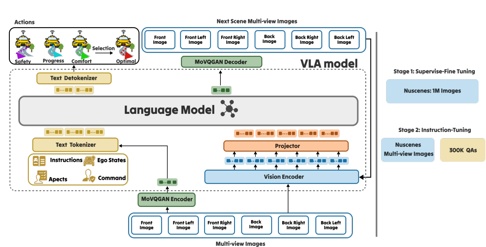
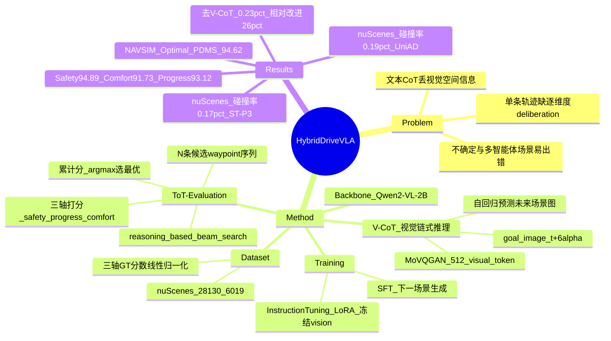

## Summary

针对传统驾驶 VLA 的两个痛点——① 用 image-to-text + 文本 CoT 推理，把连续高维的视觉场景离散成文本符号，损失空间信息（modality gap）；② 只预测**单条** waypoint 序列、同时兼顾多维度，缺乏逐维度的 deliberation——`HybridDriveVLA` 把推理整体搬到**视觉域**：用 Visual Chain-of-Thought（`V-CoT`）自回归预测未来场景图作为 goal，再用 Tree-of-Thought-inspired 的 waypoint 评估（`ToT-Evaluation`）生成并逐点打分 $N$ 条候选序列，按 safety / progress / comfort 三轴累计分选出最优。方法基于 `Qwen2-VL-2B`，经 `SFT`（视觉下一场景生成）+ `Instruction Tuning`（`LoRA`）两阶段训练，在 `nuScenes` 开环上报告平均碰撞率 **0.17%（`ST-P3`）/ 0.19%（`UniAD`）**，在 `NAVSIM` 上 Optimal 轨迹 `PDMS` **94.62**。论文自称是首个在 VLA 中统一 CoT 与 ToT 的方法。

## Problem & Motivation

- **文本 CoT 引入 modality gap**：传统 driving VLA 依赖 image-to-text + CoT，把连续、高维的视觉数据离散为文本表示；这种语言抽象不可避免地退化视觉中的空间信息，而对精度至关重要的正是这部分空间信息。
- **单条轨迹缺乏逐维度 deliberation**：现有 VLA 同时考虑多个维度、却只输出一条"统计上最可能"的 waypoint 序列，缺少对 safety / progress / comfort 各维度的显式评估与权衡。
- **不确定 / 多智能体场景下的失效**：单条统计最优序列在需要精确、灵活决策的复杂场景中，容易预测出不安全、不舒适或不前进的 waypoints。
- **动机（mimic 人类司机）**：让推理完全发生在视觉域（保留空间连续性与可解释性），并把"评价"显式拆解到多个维度——像人类司机一样对不同未来位置的 safety / progress / comfort 做权衡后选最优轨迹。

## Method

**0) Backbone**
- 基于预训练 `Qwen2-VL-2B`，由 vision encoder + projector + text tokenizer + text detokenizer 构成。
- 输入（时刻 $t$）：同步多视角图像 $I_t = \{i_t^1, \dots, i_t^h\}$、ego state $l_t$、导航命令 $c_t$（`LEFT` / `RIGHT` / `FORWARD`）、指令 $o_t$、评估维度 $E = \{e_{\text{safety}}, e_{\text{progress}}, e_{\text{comfort}}\}$。

**1) Visual Chain-of-Thought (V-CoT, §3.2)**
- 在动作生成前，先自回归预测 **$t + 6\alpha$（≈3 s）后的未来场景图** 作为 goal image：$\hat{I}_{t+6\alpha} = M(I_t, E, l_t, c_t, o_t)$。
- 未来场景经预训练 `MoVQGAN` encoder 离散化为 $\sigma = 512$ 个 visual token；V-CoT 目标即自回归重建这些 token：$\mathcal{L}_{\text{V-CoT}} = -\sum_{d=1}^{\sigma} \log P_\theta(q_d \mid q_{<\sigma}, I_t, E, l_t, c_t, o_t)$，训练时最小化预测 $\hat{I}_{t+6\alpha}$ 与 GT $I_{t+6\alpha}$ 的差异（Eq. 1–2）。
- 与文本 CoT 不同，V-CoT 完全在视觉域展开，生成结构化的视觉预测，保留空间细节与时序连续性——论文视其为"世界模型式"的下一场景预判。

**2) Tree-of-Thought-Evaluation (ToT-Evaluation, §3.3)**
- 以 V-CoT 的目标图为条件，生成 $N$ 条候选 waypoint 序列，每条序列的每个 waypoint 同时带三轴分数：$\{(a^n_{t+k\alpha}, S^n_{t+k\alpha})\}_{n=1}^{N} = M(I_t, \hat{I}_{t+6\alpha}, E, l_t, c_t, o_t)$（Eq. 3），其中序列 $A^n = \{a^n_{t+\alpha}, \dots, a^n_{t+6\alpha}\}$、$n \in \{1, \dots, N\}$、$k$ 为预测步、$\alpha$ 为相邻 waypoint 的时间间隔。
- waypoint 总分 $T^n_{t+k\alpha} = \sum_j s^{n,j}_{t+k\alpha}$（$j \in \{\text{safety}, \text{progress}, \text{comfort}\}$，Eq. 4），最优索引 $n^* = \arg\max_{n} T^n_{t+k\alpha}$（Eq. 5）。该 deliberation 是一种 **reasoning-based beam search**（每个节点是一个 waypoint），超越单路径、可按维度自适应评估与选择。
- 训练目标 $\mathcal{L}_{\text{ToT-Eval}}$ 最大化生成 GT 序列及其逐点分数的自回归对数似然（Eq. 6），保证预测 waypoints 与其评估在时间上一致：

  $$
  \mathcal{L}_{\text{ToT-Eval}} = -\sum_{n=1}^{N}\sum_{k=1}^{6}\sum_{j} \log P_\theta(a^n_{t+k\alpha},\, s^{n,j}_{t+k\alpha} \mid a^n_{<t+k\alpha},\, s^{n,j}_{<t+k\alpha},\, I_t,\, \hat{I}_{t+6\alpha},\, E,\, l_t,\, c_t,\, o_t)
  $$

- 总目标：$\mathcal{L}_{\text{HybridDriveVLA}} = \mathcal{L}_{\text{V-CoT}} + \mathcal{L}_{\text{ToT-Eval}}$（Eq. 7），联合优化视觉预测与评估式规划，使"预判的 goal"与"waypoint 序列"保持一致。

**3) 两阶段训练（§3.4–3.5）**
- `SFT`：从大规模 VLA 初始化，在"多视角输入 + 场景标注 + 对应下一场景图"的成对样本上微调，联合优化下一场景预测与多序列 waypoint；用于对齐视觉与语言 token 空间，建立视觉因果与时空一致性。20 `epochs`，`lr` $1.0 \times 10^{-4}$，`batch size` 8/device，16 `gradient accumulation steps`。
- `Instruction Tuning`：在 `nuScenes` 派生的 visual-instruction 语料上训练（每条样本 = 视觉上下文 + 引导多步推理与评估的自然语言 prompt），强化 `ToT-Evaluation` 的 deliberative 能力与跨时间的推理一致性；20 `epochs`，使用 `LoRA`，$\alpha = 0.5$ s，cosine LR 调度，**vision tower 冻结**，仅更新 language model 与 `LoRA` adapter。

**4) 数据构造与三轴 GT 分数（§3.6）**
- 基于 `nuScenes`（1000 条约 20 s 序列；28,130 训练 / 6,019 验证样本），构造两套互补数据：`SFT` 视觉生成集（取 $(t, t+6\alpha)$ 多视角帧对，future frame 经 `MoVQGAN` 编码为离散 visual token，prompt 形如 `"Generate the next scene view 3 s ahead"`）与 `IT` 推理集（模板化 visual-language 对，含当前视角 $I_t$、近期 ego 轨迹、导航命令、维度 $E$ 与预测未来场景 $\hat{I}_{t+6\alpha}$，响应为 $N$ 条 GT waypoint 序列 + 三轴分数）。
- GT 分数按 `nuScenes` 统计做线性归一化（经 $\sigma(\cdot)$，Eq. 8–10）：**Safety** 基于 ego 到其他物体的最小欧氏距离 $d$（越大越安全）；**Comfort** 基于 steering rate $c$（越小越舒适）；**Progress** 基于速度 $v$（越大越前进）。

## Pipeline

*`HybridDriveVLA` 整体架构。底部多视角图像经 `MoVQGAN` encoder 与 vision encoder / projector 编码后，与 instructions、ego states、aspects、command 等文本输入一并进入 Language Model；模型先以 `V-CoT` 自回归生成未来场景的 visual token，经 `MoVQGAN` decoder 还原为 next scene 多视角图作为 goal；再以该 goal 为条件生成多条候选 waypoint 序列并逐点给出 safety / progress / comfort 分数，经 Selection 选出累计分最高的 Optimal 序列作为 Actions。右侧为两阶段训练：Stage-1 `SFT` 用 `nuScenes` 1M 图像学习下一场景生成；Stage-2 `Instruction Tuning` 用 `nuScenes` 多视角图像与 300K QA 学习多序列评估与 deliberative 规划。*

## Key Results

- **`nuScenes` 开环规划（Table 1，`ST-P3` + `UniAD` 双口径）**：`HybridDriveVLA` (Full) 在 `ST-P3` 指标下 L2 Avg **0.26 m** / Collision Avg **0.14%**，在 `UniAD` 指标下 L2 Avg **0.31 m** / Collision Avg **0.19%**；论文摘要 / 正文报告的平均碰撞率为 **0.17%（`ST-P3`）/ 0.19%（`UniAD`）**。相比 autoregressive baseline：`OpenDriveVLA` 0.33 / 0.10（`ST-P3`）与 0.67 / 0.30（`UniAD`）、`GPT-Driver` 0.44 / 0.17、`DriveVLM` 0.40 / 0.27、`RDA-Driver` 0.40 / 0.10；甚至优于非自回归的 `UniAD`（0.69 / 0.12、1.03 / 0.31）。
- **`NAVSIM`（Table 2，`PDMS`↑，均越高越好）**：`HybridDriveVLA` **Safety 94.89**（`TTC` 98.73，最安全）、**Comfort 91.73**（Comfort 97.72，最舒适）、**Progress 93.12**（Progress 96.82，最前进）、**Optimal 94.62**（碰撞免率 97.63）；对比 `Centaur` 92.10、`AutoVLA` 92.12、`TrajHF` 93.95、`Hydra-MDP` 91.26、`DRAMA` 86.87、`TransFuser` 83.88。按指定维度引导即可得到对应最优，说明 `ToT-Evaluation` 的评估可解释且有效，Optimal 则兼顾全局。
- **`V-CoT` 消融（Table 1 / §4.2）**：`HybridDriveVLA` (`ToT-Evaluation`)（无 `V-CoT` 视觉预判）`ST-P3` 平均碰撞率 **0.23%**；加上 `V-CoT` 的 Full 模型降到 **0.17%**，**相对改进 26%**——证明 deliberative evaluation 单独有效，但 grounded 到"预判的未来视觉场景"后收益显著增强，显示 `V-CoT` 与 `ToT-Evaluation` 互补。
- **`SFT` 必要性（§4.2 Qualitative Analysis）**：`HybridDriveVLA` (`v-ToT`)（去掉 `V-CoT` 的初始 `SFT` 阶段）`ST-P3` 碰撞率同为 **0.23%**，说明在 instruction tuning 前先通过 `SFT` 建立视觉场景理解是关键先决条件。
- **定性分析**：直接跟随导航命令、不做 deliberative evaluation 会与另一车辆产生潜在冲突；`HybridDriveVLA` 的 `ToT-Evaluation` 生成并评估多条轨迹，正确给不安全 / 不舒适 / 不前进的 waypoints 打低分，选出最优序列，展示其在复杂交互中的 deliberative 推理能力。

## Strengths & Weaknesses

**Strengths**
- **问题定位清晰且对症**：把"文本 CoT 丢失视觉空间信息"与"单条轨迹缺乏逐维度 deliberation"分别用 `V-CoT` 与 `ToT-Evaluation` 回应，并把二者串成"预判 → 评估 → 选择"的闭环。
- **在视觉域推理**：`V-CoT` 直接生成未来场景图作为 goal，绕开文本 token 的 modality gap，保留空间连续性与时序一致性，也让中间推理过程可视化。
- **多维度可解释评估**：`ToT-Evaluation` 对每条候选序列逐 waypoint 给出 safety / progress / comfort 分数；`NAVSIM` 上按指定维度引导能得到对应最优（Safety → `TTC` 最高、Comfort → Comfort 最高），评估可解释、可干预。
- **训练流程有据、消融扎实**：`SFT` → `IT` 两阶段，并用"去 `V-CoT`"与"去 `SFT`"两组消融证明"视觉预判 + 先建立场景理解"是先决条件，`V-CoT` 与 ToT 互补（相对改进 26%）。
- **轻量 backbone 的性价比**：仅用 `Qwen2-VL-2B`，即达到与更大模型（7B 级 autoregressive baseline）可比或更优的规划精度，暗示收益主要来自 reasoning 设计而非模型规模。

**Weaknesses / 边界**
- **仅开环 / 非反应式评测**：主结果全部基于 `nuScenes` open-loop（L2 + collision）与 `NAVSIM`（非反应式仿真），缺少 `CARLA` / `Bench2Drive` 等闭环与真实路测验证；规划精度与闭环鲁棒性之间的 gap 未被检验。
- **ToT 的候选生成与监督细节不足**：候选序列数 $N$、如何生成 $N$ 条（采样 / 解码策略）以及"最优"如何被监督说明不充分；所选"最优"依赖三轴分数作为代理指标，代理目标与真实驾驶质量的一致性未深入分析。
- **`V-CoT` 的开销未量化**：自回归生成未来场景的 visual token（$\sigma = 512$）会带来显著推理延迟 / 算力开销，但论文未报告与 baseline 的延迟 / 吞吐对比，"用生成式未来场景换来的增益是否划算"缺乏成本视角。
- **与 7B 级 baseline 的可比性**：Table 1 中基于 `LLaVA-7B` / `GPT-3.5` 的 baseline 与本文 2B 模型的对比受模型规模与训练数据差异影响，归因不完全干净；且 `V-CoT` 与既有视觉域 CoT（如 `CoT-VLA`）思路接近，novelty 主要落在 `ToT-Evaluation` 与其与 `V-CoT` 的耦合。
- **实验规模有限**：仅 `nuScenes` + `NAVSIM` 两个数据集，未在更长预测时域或多个 benchmark 上验证泛化。

## Mind Map

## Notes

- **与既有工作的关系**：`V-CoT` 与既有"视觉域 CoT"（如 `CoT-VLA`）思路同源；`ToT-Evaluation` 借鉴 Tree-of-Thought 的多路径探索 + 自评估，并把它落成"逐 waypoint 打分 + 累计分 argmax"的轻量形式。未来场景生成装置沿用 `MoVQGAN` / `VQGAN` 离散 visual token 的自回归范式（与世界模型 `GAIA-1` / `DriveDreamer` 同族），差别在于把生成结果**直接用作规划的 goal**而非仅做合成。Backbone 为 `Qwen2-VL-2B`。
- **可迁移点**：①"在视觉域做 CoT（生成未来观测作为 goal）而非文本 CoT"是缓解 modality gap 的通用思路，可用于其他具身 VLA 的预测式推理；②"生成多条候选 → 按显式维度逐点打分 → 选累计最优"是把搜索式 deliberation 塞进单次前向的轻量方案，可迁移到需要多维权衡的规划 / 导航任务；③safety / progress / comfort 三轴可解释打分作为中间监督，是可复用的多目标评估接口。
- **待跟进**：闭环（`CARLA` / `Bench2Drive`）与真实路测验证；ToT 候选生成策略与 $N$ 的敏感性分析；`V-CoT` 生成式预判的推理开销 vs 精度收益帕累托；跨数据集 / 长时域泛化。
