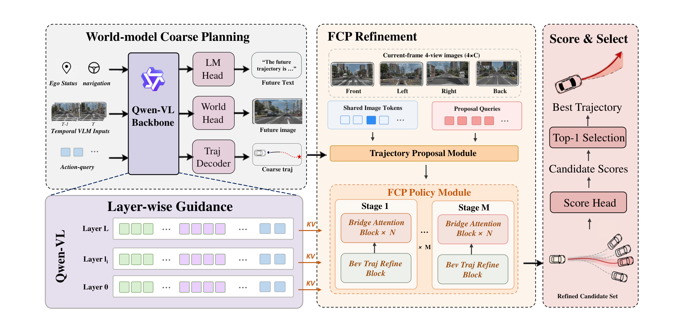

## Summary

`LWDrive` 不把 VLM 输出的轨迹当最终结果，而是当作 **intent-aware coarse plan**：先由 `Qwen2.5-VL-3B` 生成粗轨迹并输出分层 hidden states，再用 **Foresight Cascade Planner (FCP)** 围绕它扩展候选池，按 Qwen action layer 逐级注入分层特征、并用多视角 BEV 特征做残差修正，最后由 score head 选出最优轨迹。世界模型在训练期以**未来帧 latent 去噪**的方式监督 VLM hidden states（推理不需要未来图），使分层特征带上前瞻动力学。在 `NAVSIM` 上取得 **92.0 PDMS**（对比的学习方法中最高，表中 `Human driver` 94.8 为参考上界），`NAVSIM-v2` **89.6 EPDMS**（对比方法中最高，`Human Agent` 90.3 为上界），`nuScenes` ST-P3 开环 **L2 0.37 m / CR 0.16%**（L2 最低，CR 属 competitive）。

## Problem & Motivation

- **直接 VLM-to-trajectory 只给出粗意图**：轨迹规划不只要求语义推理，还要求细粒度空间精度、时序一致性与多视角场景约束下的物理可行性；VLM 直接解码的轨迹满足不了这些，因此难以支撑可靠规划。
- **现有 VLM 驾驶规划器只有两种范式**（Figure 1）：
  - (a) 直接从 VLM 表征解码轨迹或动作：能抓住高层意图，但缺少精确的几何与时序约束。
  - (b) 引入额外 driving backbone，与 VLM 特征融合后再交给 action expert：VLM 语义**只在一次融合中注入**，与后续轨迹修正弱耦合。
- 两种范式都没有用上 VLM 的**层级表示**——浅层保留局部视觉与运动线索，深层编码高层意图与场景推理，这些互补信息被浪费。
- **世界模型在既有工作中的角色受限**：多用作轨迹评估器、辅助损失，或最终共享表征；没有反过来把 VLM hidden states 显式塑造成 foresight-aware 的特征源。
- 论文的主张：VLM 应负责"意图 + 前瞻表征"，几何精修交给独立的 proposal-refinement 模块；世界模型只作为**训练期监督**，不增加推理开销。

## Method

**0) 总体流程（§3.1）**

Qwen2.5-VL 分支接收视觉观测、ego status、navigation 信息和可学习 action queries，输出 (i) intent-aware coarse trajectory，(ii) 受未来帧世界模型监督的分层 hidden states。粗轨迹用于初始化候选池，FCP 逐级注入分层前瞻特征并以当前帧多视角 BEV 做几何 grounding，score head 对精修后的候选排序取 top-1。VLM 只做意图级推理，FCP 做几何级优化。

**1) World-model-supervised coarse planning（§3.2）**

- 在规划训练前，先用 `Impromptu` 数据集把 `Qwen2.5-VL-3B` 适配到 ego-centric 驾驶场景，获得交通场景理解、导航跟随与轨迹风格响应的先验。
- 未来帧 $I_{t+\Delta}$ 由**冻结的 VAE** 编码为干净 latent target $z_{t+\Delta}$；去噪条件由 final-layer vision hidden state 与 action-query hidden state 拼接而成：

  $$
  c_t = \left[F^V_t;\ h^A_t\right], \qquad \hat{z}_{t+\Delta} = D_\theta\!\left(z^\tau_{t+\Delta},\ c_t,\ \tau\right),
  $$

  其中 $z^\tau_{t+\Delta}$ 为加噪后的未来 latent，$D_\theta$ 为 world head。
- 世界模型损失为 latent 距离：

  $$
  \mathcal{L}_{\text{wm}} = d\!\left(\hat{z}_{t+\Delta},\ z_{t+\Delta}\right).
  $$

- 轨迹分支用 SmoothL1 监督粗轨迹 $\hat{Y}^0$ 与专家轨迹 $Y^*$：

  $$
  \mathcal{L}_{\text{traj}} = \frac{1}{T}\sum_{t=1}^{T}\text{SmoothL1}\!\left(\hat{y}^0_t - y^*_t\right).
  $$

- Stage-1 目标：

  $$
  \mathcal{L}_{\text{stage1}} = \lambda_{\text{wm}}\mathcal{L}_{\text{wm}} + \lambda_{\text{traj}}\mathcal{L}_{\text{traj}},
  $$

  实验中 $\lambda_{\text{wm}} = 15.0$、$\lambda_{\text{traj}} = 1.0$。该阶段只优化 VLM 粗规划分支、world head 与 trajectory decoder，FCP 和 score head 不参与，避免 refinement 模块干扰世界模型监督下的表征学习。
- 关键点：未来帧监督**只在训练期存在**，推理只用当前观测；它的作用是把"预测动力学"写进 hidden states，供后续 FCP 当作 foresight features 使用。

**2) Foresight Cascade Planner（§3.3）**

- **候选池初始化**：不用解码出的粗轨迹作为最终输出，而是把 pooled action-query latent 当作全局意图锚点，与 ego-state 编码、可学习 proposal embeddings 一起初始化候选池：

  $$
  Q^0,\ P^0 = \text{TPM}\!\left(z_{\text{AQ}},\ e_t,\ E_{\text{init}}\right),
  $$

  其中 $z_{\text{AQ}}$ 为 pooled action-query latent，$e_t$ 为 ego-state 编码，$E_{\text{init}}$ 为可学习 proposal embeddings，$Q^0$ 为 proposal queries，$P^0$ 为含 $N_p$ 条轨迹的初始候选池。
- **稀疏分层级联**：设 Qwen action layer 总数为 $L$、refinement 间隔为 $M$，每 $M$ 层做一次精修，共 $R$ 个 stage：

  $$
  l_r = rM, \qquad r = 1, \dots, R.
  $$

  论文实现为 36 个 Qwen action layers、6 个 trajectory refinement modules（即每 6 层精修一次）。这样既避免逐层更新带来的冗余计算，又能让 planner 依次看到不同语义深度的表示。
- **每级输入**：第 $r$ 级聚合所选层的 vision/action-query hidden states、当前帧 BEV 特征与 ego-state：

  $$
  C_r = \left(H^{l_r}_V,\ H^{l_r}_A,\ B_t,\ s_t\right), \qquad Q^r,\ P^r = F_r\!\left(Q^{r-1},\ P^{r-1},\ C_r\right).
  $$
- **Bridge Attention**：proposal queries 同时 attend 三类 memory——proposal-pool self memory、action-query 与 ego-state memory、VLM foresight memory：

  $$
  \text{BA}(Q) = \text{Attn}\!\left(Q,\ K_{\text{mem}},\ V_{\text{mem}}\right).
  $$

  候选之间因此可以交换信息，同时吸收 VLM 的语义与预测线索。
- **BEV Trajectory Refinement**：用 `ResNet-34` 对四视角图像提取 BEV 特征，proposal queries 通过 attend BEV 特征获取车道布局、可行驶区域、道路边界与近邻障碍物，然后预测**残差**更新：

  $$
  \Delta Y^r_i = \text{MLP}_{\text{ref}}\!\left(Q^r_i\right), \qquad Y^r_i = Y^{r-1}_i + \Delta Y^r_i.
  $$

  残差形式避免单步覆盖 VLM 的高层意图，使每级只做小幅几何修正；$R$ 级之后输出精修候选池 $P^R$。

**3) Scoring and two-stage training（§3.4）**

- **Score head**：对每个候选沿时间维池化最终 proposal feature，回归标量分数，推理时取 argmax：

  $$
  S_i = \text{MLP}_{\text{score}}\!\left(\text{Pool}\!\left(Q^R_i\right)\right), \qquad i^\star = \arg\max_i S_i, \quad \hat{Y} = Y^R_{i^\star}.
  $$
- **Proposal-level 监督**：在 non-reactive log simulation 中，每个候选由控制器跟踪、周围 agent 按记录轨迹运动，按 NAVSIM 风格计算该候选的分数：

  $$
  \hat{S}_i = \text{NC}_i \cdot \text{DAC}_i \cdot \frac{5\text{EP}_i + 5\text{TTC}_i + 2\text{C}_i}{12},
  $$

  其中 NC、DAC、EP、TTC、C 分别为 No at-fault Collision、Drivable Area Compliance、Ego Progress、Time-to-Collision、Comfort。score head 用 BCE 监督：$\mathcal{L}_{\text{score}} = \text{BCE}(S,\ \hat{S})$。
- **轨迹精修监督（Min-over-N）**：第 $i$ 个候选在第 $r$ 级的回归损失为

  $$
  \ell^r_i = \frac{1}{T}\sum_{t=1}^{T}\text{SmoothL1}\!\left(y^r_{i,t} - y^*_t\right),
  $$

  对每个 stage 都施加监督，并用折扣因子 $\beta$ 放松早期 stage：

  $$
  \mathcal{L}_{\text{ref}} = \sum_{r=1}^{R}\beta^{R-r}\min_i \ell^r_i, \qquad \mathcal{L}_{\text{stage2}} = \lambda_{\text{ref}}\mathcal{L}_{\text{ref}} + \lambda_{\text{score}}\mathcal{L}_{\text{score}}.
  $$
- **两阶段训练**：Stage 1 训练粗规划分支（WM + 粗轨迹监督），FCP 与 score head 不优化；Stage 2 **冻结 Qwen2.5-VL backbone 与 action-query embeddings**，只训练 trajectory proposal module、FCP 与 score head。这样先学"预测性、意图感知"的表征，再在冻结的分层 foresight 特征上学精修与排序。

**4) 实现细节（§4.1）**

| 项目 | 设置 |
|:-----|:-----|
| VLM backbone | `Qwen2.5-VL-3B` |
| 前视图输入分辨率 | $280 \times 504$ |
| BEV encoder | `ResNet-34`，四视角输入 |
| Qwen action layers | 36 |
| Trajectory refinement modules | 6 |
| 候选池大小 $N_p$ | 论文未给出具体数值 |
| Stage 1 | AdamW，8,000 steps，lr $2 \times 10^{-4}$，global batch 48，loss weights 15.0 / 1.0，约 100 小时 |
| Stage 2 | 12 epochs，lr $3 \times 10^{-5}$，global batch 64，冻结 backbone 与 action-query embeddings，约 80 小时 |

## Pipeline

*Figure 2：LWDrive 由三部分组成——world-model coarse planning（左侧，未来帧 latent 去噪监督 VLM）、FCP refinement（中间，分层 foresight 注入 + BEV 残差修正，共 M 个 stage）、score & select（右侧，对精修候选打分取 top-1）。*

1. 当前帧四视角图像、ego status、navigation 与 action queries 送入 Qwen2.5-VL，输出粗轨迹与分层 hidden states。
2. 训练期 world head 从加噪的未来 latent 重建干净 latent（VAE 编码的未来帧），该监督不回传未来图像到推理路径。
3. 以 pooled action-query latent 初始化候选池，FCP 每 6 层注入一次分层特征，Bridge Attention 融合三类 memory，BEV block 输出残差修正。
4. score head 给全部精修候选打分，argmax 得到最终轨迹。

## Key Results

**评测设置**：`NAVSIM`（PDMS）、`NAVSIM-v2`（EPDMS）、`nuScenes` ST-P3（open-loop，L2 / CR）。NAVSIM 系列本质是 non-reactive log replay 的伪仿真（论文正文称 "closed-loop"，但 §4.2 自己也写作 "closed-loop-style"）。

**NAVSIM（Table 1，节选）**

| Method | Sensors | NC↑ | DAC↑ | TTC↑ | C↑ | EP↑ | PDMS↑ |
|:-------|:--------|----:|-----:|-----:|---:|----:|------:|
| Human driver（参考上界） | - | 100.0 | 100.0 | 100.0 | 99.9 | 87.5 | 94.8 |
| PDM-Closed | - | 94.6 | 99.8 | 89.9 | 86.9 | 99.9 | 89.1 |
| iPad | - | 98.6 | 98.3 | 94.9 | 100.0 | 88.0 | 91.7 |
| DriveWorld-VLA | 3×C | 99.1 | 98.2 | 96.1 | 100.0 | 85.9 | 91.3 |
| SGDrive | - | 98.6 | 97.8 | 96.2 | 100.0 | 85.8 | 91.1 |
| Hydra-MDP++ | 3×C+L | 98.6 | 98.6 | 95.1 | 100.0 | 85.7 | 91.0 |
| DriveVLA-W0 | 1×C | 98.7 | 99.1 | 95.3 | 99.3 | 83.3 | 90.2 |
| AutoVLA | 3×C | 98.4 | 95.6 | 98.0 | 99.9 | 81.9 | 89.1 |
| **LWDrive** | **4×C** | 98.8 | 98.4 | 96.2 | 99.8 | **87.3** | **92.0** |

LWDrive 的 PDMS 在对比的学习方法中最高，比 iPad 高 0.3、比 DriveWorld-VLA 高 0.7；EP 87.3 与 `Human driver` 的 87.5 基本持平。注意其输入为 4 路相机，多数对比方法为 3×C 或 1×C。

**NAVSIM-v2（Table 2，节选）**

| Method | NC↑ | DAC↑ | DDC↑ | TLC↑ | EP↑ | TTC↑ | LK↑ | HC↑ | EC↑ | EPDMS↑ |
|:-------|----:|-----:|-----:|-----:|----:|-----:|----:|----:|----:|-------:|
| Human Agent（参考上界） | 100.0 | 100.0 | 99.8 | 100.0 | 87.4 | 100.0 | 100.0 | 98.1 | 90.1 | 90.3 |
| PRIX | 98.0 | 95.6 | 99.5 | 99.8 | 87.4 | 97.2 | 97.1 | 98.3 | 87.6 | 84.2 |
| DriveVLA-W0 | 98.5 | 99.1 | 98.0 | 99.7 | 86.4 | 98.1 | 93.2 | 97.9 | 58.9 | 86.1 |
| DriveWorld-VLA | 98.6 | 99.1 | 99.6 | 99.8 | 87.4 | 97.9 | 97.0 | 97.8 | 78.6 | 86.8 |
| **LWDrive** | 98.8 | 98.4 | 99.0 | 99.7 | **90.3** | 98.6 | 96.3 | 97.9 | 73.3 | **89.6** |

EP 90.3、TTC 98.6 为对比方法中最好，NC/DAC/DDC/TLC/LK 保持较强；但 LK 96.3 低于 PRIX（97.1）与 DriveWorld-VLA（97.0），EC 73.3 明显低于 DriveWorld-VLA 的 78.6，正文未讨论这两项。

**nuScenes ST-P3（Table 3，节选）**

| Method | L2 (m)↓ | CR (%)↓ |
|:-------|--------:|--------:|
| ST-P3 | 2.11 | 0.71 |
| VAD | 1.25 | 1.09 |
| UniAD | 0.69 | 0.12 |
| InsightDrive | 0.44 | 0.15 |
| DriveVLM | 0.40 | 0.27 |
| RDA-Driver | 0.40 | 0.10 |
| AutoVLA (action only) | 0.43 | 0.19 |
| AutoVLA (w/ CoT) | 0.48 | 0.13 |
| **LWDrive** | **0.37** | 0.16 |

L2 0.37 m 为表中最低；CR 0.16% 并非最低（RDA-Driver 0.10、UniAD 0.12、AutoVLA w/ CoT 0.13），论文自身表述为 "competitive collision rate"。

**消融（Table 4，NAVSIM）**

| WM | LW | BA | BR | NC↑ | DAC↑ | EP↑ | TTC↑ | C↑ | PDMS↑ |
|:--:|:--:|:--:|:--:|---:|-----:|----:|-----:|---:|------:|
| × | × | × | × | 98.2 | 92.7 | 79.1 | 93.9 | 100.0 | 84.5 |
| √ | × | × | × | 98.4 | 94.7 | 81.5 | 94.7 | 99.9 | 86.3 |
| √ | √ | √ | × | 98.9 | 97.2 | 83.9 | 95.2 | 99.8 | 89.3 |
| √ | √ | × | √ | 98.7 | 97.7 | 84.6 | 95.1 | 99.7 | 90.0 |
| √ | Final | √ | √ | 98.7 | 98.0 | 88.1 | 95.7 | 99.7 | 91.8 |
| √ | √ | √ | √ | 98.8 | 98.4 | 87.3 | 96.2 | 99.8 | **92.0** |

- 纯 VLM 解码轨迹 84.5 → 加 world-model 监督 86.3（+1.8），说明粗轨迹只是先验，不是可执行轨迹。
- 去掉 BEV refinement 降到 89.3（−2.7），去掉 Bridge Attention 降到 90.0（−2.0），两者都不可或缺。
- 用 final-layer 特征替代分层特征为 91.8，低于完整模型 92.0，说明有用线索分散在不同 action layer。
- 反常点：`Final` 变体的 EP 88.1 高于完整模型的 87.3，但 PDMS 更低（EP 与安全性/舒适性存在权衡）。

## Strengths & Weaknesses

**Strengths**

- **训练期世界模型、推理零额外成本**：未来帧只以 latent target 形式出现，推理链路不需要生成视频或未来图像，思路简单且可直接套用到其他 VLM planner。
- **分层稀疏注入有明确动机**：浅层保留局部运动线索、深层编码意图，每 $M$ 层精修一次，避免逐层更新的冗余；ablation 中 final-layer 对照（91.8 vs 92.0）给出了直接证据。
- **模块解耦清晰**：VLM 负责意图与前瞻表征，FCP 负责几何，score head 负责选择；Stage 2 冻结 backbone 的设定使 FCP 可以当作独立插件复用。
- **残差更新 + Min-over-N + 阶段折扣**：三项组合让精修过程稳定，且不破坏粗意图。
- **跨 benchmark 一致**：NAVSIM 92.0、NAVSIM-v2 89.6、nuScenes L2 0.37 m 均为对比中的最好或接近最好。

**Weaknesses**

- **增益归因不够干净**：iPad（无 VLM）已达 91.7，LWDrive 只高 0.3；而分层特征相对 final-layer 只高 0.2。"world-model-guided layer-wise" 的贡献可能小于 proposal + score head 范式本身，论文缺少"同 proposal 框架 + 不同特征源"的对照。
- **传感器条件不对等**：LWDrive 用 4×C，iPad、SGDrive、Hydra-MDP++ 等多为 3×C 或更少，PDMS 领先 0.3–0.7 未必稳健。
- **关键工程指标缺失**：未报告参数量、推理延迟、训练 GPU 型号与数量；Stage 1 约 100 小时 + Stage 2 约 80 小时的训练成本也没有算力口径。
- **失败项未讨论**：NAVSIM-v2 的 LK（96.3 vs 97.1）与 EC（73.3 vs 78.6）落后，nuScenes CR 非最低（0.16 vs 0.10），论文均未分析。
- **世界模型只做 latent 重建**：没有评估未来帧预测质量（也无 FVD 等指标），Figure 4 只有定性展示，无法判断 foresight 表征是否真的学到了动力学。
- **术语不严谨**：把 NAVSIM / NAVSIM-v2 称为 "closed-loop"，但实际是 non-reactive log replay 的伪仿真；NAVSIM-v2 的 pseudo-simulation 更是离线重放。
- **可复现性暂缺**：仅声明 "Code and models will be made publicly available"，无链接；$N_p$、$\beta$、$\lambda_{\text{ref}}$、$\lambda_{\text{score}}$ 的取值均未给出。

## Notes

**论文定位**：把 VLM 的角色从"轨迹生成器"改成"意图提供者 + 前瞻特征源"，世界模型退化为训练期正则项。真正承重的设计是 proposal-refinement-score 这条几何精修链路，VLM 提供的是条件与特征，而不是最终输出。

**可迁移点**

- **future-frame latent denoising 作为 hidden-state 正则**：只需一个冻结 VAE + 小 world head，就能把"预测未来"压进任意 VLM 的中间层，推理零成本。适合作为其他 planner 的 auxiliary objective。
- **按层稀疏注入**：不必每层都接 refinement，按固定间隔取层即可；这比"只取最后一层"和"全层都接"都更划算，且实现简单（一次 index 选择）。
- **残差 + Min-over-N + 阶段折扣**：多 stage 精修时，早期 stage 用 $\beta^{R-r}$ 降权、每级只学残差，可避免深层 stage 梯度主导。
- **score head 用可仿真指标自监督**：用 NAVSIM 风格 proposal score 做 BCE，把"选择"变成一个可学习排序问题，而不依赖专家轨迹的 argmin 标签。

**待跟进 / 疑问**

- **Eq. 12 的权重写法**：论文写作 $\text{NC} \cdot \text{DAC} \cdot (5\text{EP} + 5\text{TTC} + 2\text{C}) / 12$，与 NAVSIM 官方 PDMS 的子项权重对应关系未作解释；且正文明确说子指标独立平均、无法由分项反推总分，因此无法用表中数字交叉验证该式。需要对照 NAVSIM 官方 evaluator 源码确认。
- **Stage 2 中 world head 的去留**：论文只说冻结 backbone 与 action-query embeddings，未说明 world head 是否仍参与前向或是否被移除；若仍参与，Stage 2 的显存/计算开销会被低估。
- **$N_p$ 与候选多样性**：候选池大小、初始化方式（除 TPM 外是否加噪声/聚类）都未给出，直接影响推理延迟与 Min-over-N 的行为。
- **延迟与参数量**：36 层 Qwen2.5-VL-3B + 6 个 refinement stage + ResNet-34 BEV encoder 的实际 FPS 未知，无法判断能否上车。
- **未来帧监督的因果性**：缺少"world-model 监督质量 ↔ 规划增益"的定量联系（如 future latent 重建误差 vs PDMS），目前只有 86.3 → 92.0 的整体差值。
- **"closed-loop" 表述**：若后续引用该论文的结论，应改写为"non-reactive pseudo-simulation"，避免与真实闭环仿真混淆。
