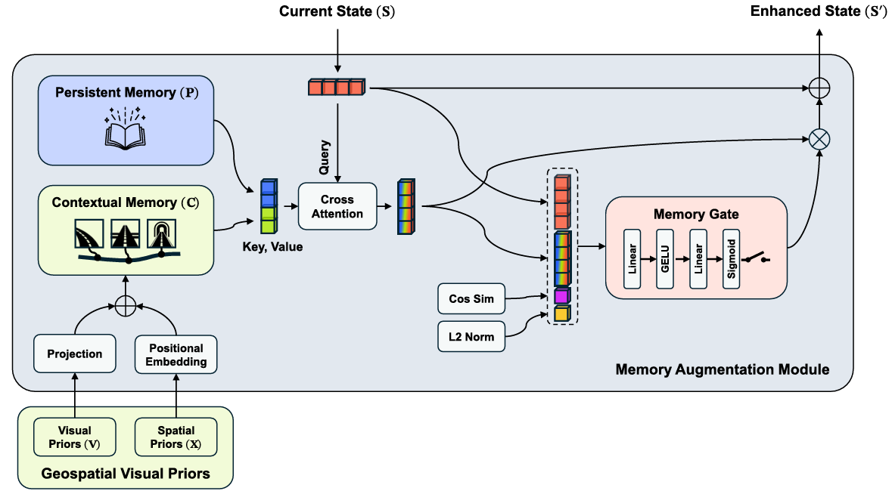

## Summary

PriorEye 提出 geospatial visual priors：把离线采集的街景图像按行驶路线锚定成可检索的记忆，通过 model-agnostic 的 dual-memory 模块与 adaptive gate 注入现有 end-to-end planner，使模型在传感器视野之外获得视觉-空间预判。方法不改 baseline 架构、不增加额外损失，在 NAVSIM-v2 的四个 E2E baseline 上一致提升 EPDMS（navhard-two-stage 上 GTRS-Dense 44.9→48.6），并改善传感器损坏与先验损坏下的鲁棒性。

## Problem & Motivation

- 现有 end-to-end 驾驶策略只输入几秒的实时传感器观测，本质上是**短视距反应式**的：无法预判被遮挡的弯道、路口或即将消失的车道。
- 人类驾驶员依赖**驾驶记忆**提前减速或变道，这类先验不受实时传感器退化（雨雪、泥污、遮挡）影响。
- 已有 prior 工作存在两个缺口：(1) 经验记忆多用于 high-level reasoning，spatial priors（HD map、航拍、route）多用于上游 online map 构建，二者很少直接注入 E2E planning；(2) 空间先验与视觉先验通常分开使用，planner 拿不到"沿意图路线的外观上下文"。
- 作者的 formulation：geospatial visual priors = 离线街景图像 embedding（visual） + 沿意图路线的相对坐标（spatial），二者成对检索后作为外部记忆输入 planner。

## Method

**0. 总体框架**

+ 系统输入为实时传感器观测、ego state 与高层导航指令，并假设部署区域有 lane connectivity graph。流程分三步：离线构建 memory bank → 按当前车道与导航意图检索 geospatial visual priors → 用 memory augmentation module 把中间状态 $\mathbf{S}$ 编辑为 $\mathbf{S}'$，交给下游 decoder 输出轨迹。模块与各 baseline 的原始训练目标联合优化，不引入额外 loss。

**1. Memory Bank 构建与检索**

+ 沿每条 lane 的中心线以固定 5 m 间隔采样街景图像，用冻结的 SigLIP2（base-patch16-256）编码，与车道关联后存入 memory bank。

+ 推理时从当前车道出发，在 lane graph 上做 **depth-first search (DFS)** 生成候选车道序列，再按导航意图（Turn Left / Turn Right / Straight）选择对应序列，沿该序列检索 $N$ 个视觉 embedding 及其相对坐标。检索结果为成对的 visual priors 与 spatial priors：

$$
\{(\mathbf{v}_i,\mathbf{x}_i)\}_{i=1}^{N},\quad \mathbf{v}_i\in\mathbb{R}^{D_m},\ \mathbf{x}_i\in\mathbb{R}^{2}
$$

+ 该设计只要求粗采样的街景，不要求精确几何重建，因此对缺失图像与轻微错位有一定容忍度。

**2. Dual Memory**

+ **Contextual memory** 把检索到的先验投影到模型内部 embedding 空间，并加入位置编码：

$$
\mathbf{C}=\phi(\mathbf{V})+\psi(\mathbf{X})
$$

+ 其中 $\phi(\cdot)$ 是 visual embedding 的投影，$\psi(\cdot)$ 是相对坐标的 2D sinusoidal positional embedding。二者相加使 contextual memory 同时携带外观语义与粗略空间布局。

+ **Persistent memory** 是一组与输入无关、跨样本共享的可学习 token：

$$
\mathbf{P}\in\mathbb{R}^{K\times D}
$$

+ 它的作用类似 Transformer 中的 attention sink：当检索到的街景因季节变化、几何错位或缺失而不可靠时，模型仍有一个稳定的回退目标，而不是被迫 attention 到错误 token 上。

**3. Memory Fusion 与 Adaptive Gate**

+ 把两种记忆沿 token 维拼接，以当前驾驶状态 $\mathbf{S}$ 为 query 做 cross-attention：

$$
\mathbf{M}=[\mathbf{P};\mathbf{C}]
$$

$$
\tilde{\mathbf{S}}=\mathrm{Attn}(\mathbf{S},\mathbf{M},\mathbf{M})
$$

+ gate 显式建模当前状态与记忆读出之间的兼容性，用归一化欧氏距离与余弦相似度作为线索：

$$
d=\frac{\lVert\mathbf{S}-\tilde{\mathbf{S}}\rVert_2}{\sqrt{D}},\quad c=\cos(\mathbf{S},\tilde{\mathbf{S}})
$$

$$
\mathbf{G}=\sigma\left(f_g\left([\mathbf{S};\tilde{\mathbf{S}};d;c]\right)\right)
$$

+ 其中 $f_g$ 是轻量 MLP。最终通过 gated residual 更新状态：

$$
\mathbf{S}'=\mathbf{S}+\mathbf{G}\odot\tilde{\mathbf{S}}
$$

+ gate 的 bias 初始化为接近关闭状态，使训练初期模型主要依赖原始状态，之后逐步引入记忆。

**4. 实现细节**

| 项目 | 设置 |
|:--|:--|
| 街景来源 | Google Street View Image API |
| 视觉编码器 | SigLIP2 base-patch16-256（冻结） |
| 采样间隔 | 5 m |
| Memory bank 规模 | 939 MB，覆盖约 6.5 km² |
| 推理检索数 | $N=20$，约 100 m lookahead |
| 新增参数 | 713K（相对 LTF / GTRS-DP / GTRS-Dense / DrivoR 为 1.3% / 0.6% / 0.9% / 1.7%） |
| 注入位置 | LTF、GTRS-DP：BEV features + ego status；GTRS-Dense：image features + ego status；DrivoR：scene tokens + ego status |
| 训练硬件 | 8 × NVIDIA RTX 5090 |

## Pipeline

1. **离线建库**：沿 lane centerline 每 5 m 采街景，SigLIP2 编码后与位置一起写入 memory bank。
2. **路线检索**：从当前车道做 DFS 生成候选序列，按导航意图选一条，取回 $N$ 个 $(\mathbf{v}_i,\mathbf{x}_i)$。
3. **构造 contextual memory**：$\phi(\mathbf{V})+\psi(\mathbf{X})$，把外观与相对位置对齐到模型 embedding 空间。
4. **双记忆 cross-attention**：$\mathbf{S}$ 同时 attend 到 persistent memory $\mathbf{P}$ 与 contextual memory $\mathbf{C}$。
5. **门控融合**：用距离与余弦相似度算 gate，$\mathbf{S}'=\mathbf{S}+\mathbf{G}\odot\tilde{\mathbf{S}}$，送入原 decoder 出轨迹；整个模块只改中间状态，不改 baseline 结构。

## Key Results

**1) NAVSIM-v2 navhard-two-stage（Table 1）**

| Method | EPDMS | 相对 baseline |
|:--|--:|--:|
| LTF | 24.7 | — |
| LTF + PriorEye | **32.4** | +31.2% |
| GTRS-DP | 26.3 | — |
| GTRS-DP + PriorEye | **30.1** | +14.4% |
| GTRS-Dense | 44.9 | — |
| GTRS-Dense + PriorEye | **48.6** | +8.2% |
| DrivoR | 48.9 | — |
| DrivoR + PriorEye | **49.6** | +1.4% |

**2) NAVSIM-v2 navtest（Table 2）**

| Method | EPDMS | Δ |
|:--|--:|--:|
| LTF | 84.3 | — |
| LTF + PriorEye | **86.8** | +2.5 |
| GTRS-DP | 82.2 | — |
| GTRS-DP + PriorEye | **82.5** | +0.3 |
| GTRS-Dense | 85.4 | — |
| GTRS-Dense + PriorEye | **88.8** | +3.4 |
| DrivoR | 87.2 | — |
| DrivoR + PriorEye | **89.9** | +2.7 |

+ 四个 baseline 覆盖 regression（LTF）、diffusion（GTRS-DP）、trajectory scoring（GTRS-Dense、DrivoR）三类范式，提升方向一致。绝对增益随 baseline 本身性能提高而收窄：DrivoR 在 navhard 上已接近饱和，仅 +1.4%。

**3) 传感器损坏鲁棒性（Table 3，GTRS-Dense，navhard-two-stage EPDMS）**

| Corruption | Baseline | Ours |
|:--|--:|--:|
| Nominal | 44.9 | 48.6 |
| Fingerprints | 40.0 (-10.9%) | 45.1 (-7.2%) |
| Handprints | 40.3 (-10.2%) | 45.4 (-6.6%) |
| Frost | 34.6 (-22.9%) | 38.1 (-21.6%) |
| Mud (Mild) | 42.3 (-5.8%) | 47.9 (-1.4%) |
| Mud (Heavy) | 21.0 (-53.2%) | 32.8 (-32.5%) |

+ 平均相对退化从 20.6% 降到 13.9%；Mud (Heavy) 下 baseline 掉 53.2%，PriorEye 只掉 32.5%。原因是检索到的街景独立于车载相机，不受当前帧污染。

**4) 先验损坏鲁棒性（Table 4）**

| Corruption | Attention to $\mathbf{P}$ | $\mathbf{C}$ only | $\mathbf{P}+\mathbf{C}$ |
|:--|--:|--:|--:|
| None | 0.29 | 47.9 | 48.6 |
| Visual | 0.97 | 38.5 (-19.6%) | 45.3 (-6.8%) |
| Spatial | 0.65 | 45.2 (-5.6%) | 46.6 (-4.1%) |
| Both | 0.99 | 39.0 (-18.6%) | 45.4 (-6.6%) |

+ 把检索到的先验替换成 500 m 外随机位置的先验后，full model 把 attention 几乎全部转向 persistent memory（0.97 / 0.99），性能退化从约 19% 压到 7% 以内，且仍高于 baseline。

**5) 消融（Table 5，LTF baseline，validation split）**

| 维度 | 配置 | EPDMS |
|:--|:--|--:|
| Baseline | LTF | 81.7 |
| Embedding backbone | DINOv2 / SegFormer / SigLIP2 | 83.4 / 82.9 / **84.4** |
| Retrieval | Proximity-based / Intention-guided | 82.1 / **84.4** |
| Memory | $\mathbf{P}$ only / $\mathbf{C}$ only / $\mathbf{P}+\mathbf{C}$ | 82.2 / 83.9 / **84.4** |
| Contextual memory | $\psi(\mathbf{X})$ / $\phi(\mathbf{V})$ / $\phi(\mathbf{V})+\psi(\mathbf{X})$ | 82.7 / 84.0 / **84.4** |
| Gate 输入 | $[\mathbf{S};\tilde{\mathbf{S}}]$ / $+d$ / $+c$ / $+d,c$ | 83.0 / 83.4 / 83.4 / **84.4** |

+ 关键信号：(1) 只按空间邻近检索几乎没有收益（82.1），必须按导航意图检索；(2) 只用 persistent memory 只有 82.2，说明"加参数"本身没用，收益来自 contextual memory；(3) 视觉与空间编码互补，单独用分别 +1.0 / +2.3，合用 +2.7。

**6) 其他分析**

+ **HD map 对照**（Appendix 0.D，GTRS-Dense 44.9）：vectorized HD map 46.4，rasterized HD map 47.1，PriorEye 48.6。PriorEye 只用 lane center 锚定，仍优于使用更丰富地图元素的 HD map 变体，说明增益主要来自沿路线的外观信息而非结构化地图元素。

+ **推理输入消融**（Appendix 0.E）：$N=10$（约 50 m）时最好（49.5），主实验用的 $N=20$ 为 48.6；去掉 priors 得 45.5，去掉 perception 暴跌到 22.0，说明先验是补充而非替代实时感知。

+ **Per-metric**（Appendix 0.F，Stage 1 tokens）：DAC +1.3、DDC +0.6、TLC +0.4、EP +3.3、LK +2.7、HC +1.1、EC +11.6；NC -0.9、TTC -1.1。EPDMS 76.9→80.8。

+ **Runtime**（Table 6，GTRS-Dense）：57.9 ms → 67.2 ms，其中 GPU +5.6 ms、CPU 检索 +3.7 ms，仍在 10 Hz 预算内。

**Critical reading**

- **增益高度依赖 baseline，缺少"何时有效"的判据**：navhard 上从 +31.2%（LTF）到 +1.4%（DrivoR），navtest 上 GTRS-DP 只有 +0.3。作者把原因归为 baseline 已充分利用场景上下文，但没有给出可用先验的信息量度量，也没有预测增益的指标，实际部署时无法判断是否值得建库。
- **主实验与消融不同源**：所有消融在 LTF + validation split（81.7→84.4）上完成，主表却报另外三个 baseline 的 navhard 结果，且 navhard 用的 $N=20$ 不是 Appendix 0.E 中最好的 $N=10$（49.5 vs 48.6）。读者无法确认哪个超参组合对应哪个主表数字。
- **per-metric 存在安全—效率 trade-off**：Stage 1 tokens 上 EP +3.3、EC +11.6，但 NC -0.9、TTC -1.1。作者解释为"更自信的 progress 压缩了安全裕度"，却没有给出碰撞率或危险场景子集上的统计；EPDMS 的增益部分来自 EC 的 11.6，而 EC 是乘性项，单项解释力有限。
- **先验损坏实验只覆盖"错位"，未覆盖"过期"**：随机 500 m 替换模拟的是检索错误，但真实部署更常见的是道路改建、施工、季节变化导致同一位置外观失效。论文没有构造"位置正确但外观错误"的对照，因此 persistent memory 的回退能力只验证了一半。
- **memory bank 的维护成本被低估**：939 MB / 6.5 km² 意味着城市级部署是 TB 量级，且街景来自 Google Street View API，许可、更新频率、道路变更后的重建流程均未讨论；Limitations 只提到检索依赖 ego 位置。
- **HD map 对照是自实现 baseline**：vectorized / rasterized HD map 变体由作者自行接入，未与公开 map-aware planner 对齐训练预算，46.4 / 47.1 不能直接当作 HD map 方法的上限。
- **没有真实闭环或跨城市实验**：全部结果来自 NAVSIM-v2 的 open-loop / 伪闭环协议，navhard-two-stage 的 Stage 2 只报合并 EPDMS，缺少交互场景下的失败分析。

## Strengths & Weaknesses

**Strengths**

- formulation 清晰：把"驾驶先验"具体化为可离线构建、可在线检索的 (街景 embedding, 路线坐标) 对，避开了 HD map 的构建成本。
- model-agnostic 做得扎实：四个不同规划范式的 baseline 共用同一个模块，只替换注入的中间特征，涨幅方向一致。
- 工程开销小：713K 参数、9.3 ms，且不引入额外 loss，容易复现和迁移。
- 两组鲁棒性实验设计有针对性：传感器损坏验证"先验独立于实时观测"，先验损坏验证 persistent memory 的回退作用，并用 attention 权重给出机制证据。
- HD map 对照回答了一个自然会问的问题：增益是否只是"多给了地图信息"。

**Weaknesses**

- 依赖部署区域的 lane connectivity graph 与离线街景库。6.5 km² 需要 939 MB，换城市或道路更新都要重建；街景来自 Google Street View API，实际部署的许可、更新频率与长期维护成本未讨论。
- 检索只用 ego 位置（作者在 Limitations 中承认），没有定位噪声或地图错位的定量实验；而实际部署中定位误差可能直接导致检索到错误路段。
- 先验只编码静态外观，不包含动态 agent。per-metric 显示 NC -0.9、TTC -1.1，作者解释为"更自信的 progress 压缩了安全裕度"，但这一安全性 trade-off 没有进一步量化。
- 主表提升跨度很大（+1.4% 到 +31.2%），且 GTRS-DP 在 navtest 仅 +0.3；收益明显依赖 baseline 是否已充分利用场景上下文，论文没有给出"何时有效"的判据。
- 消融全部在 LTF + validation split 上完成，主实验的绝对增益只在大模型 baseline 上报告，二者不可直接互推。
- 与 HD map 的对比只在 GTRS-Dense 上做，且 HD map baseline 是作者自行实现，未与已有 map-based planner 比较。
- 评测仍是 NAVSIM-v2 的 open-loop / 伪闭环协议，没有真实闭环部署或跨城市泛化实验。

## Notes

+ **论文定位**：不是新的 planner 或 world model，而是给现有 E2E planner 加一个"外部视觉记忆"适配器。核心 insight 是把先验从结构化地图换成沿意图路线的街景外观 embedding，并用 persistent memory 处理检索失败，使"用先验"这件事在工程上可控。

+ **可迁移点**：
  + dual memory + gate 是通用的 retrieval-augmented policy 模板：contextual memory 存检索结果，persistent memory 充当 attention sink，gate 用 state-memory 兼容性决定读多少。
  + gate 用归一化欧氏距离与余弦相似度两种互补线索，且 bias 初始化为近关闭；这个"先关后开"的训练技巧可以复用到任何残差式外部模块。
  + "proximity-based 检索几乎无效、intention-guided 检索才有效"是一个重要负结果：检索的关键不是空间最近，而是与当前 maneuver 相关。
  + 传感器损坏与先验损坏两组实验可以作为一个评估外部记忆模块的标准模板。

+ **待跟进**：
  - **定位噪声下的检索鲁棒性**：给 ego pose 注入偏移，量化检索错位对 EPDMS 的影响，并与 gate 的关闭行为对照。
  - **记忆库的更新与遗忘**：作者提到可用重复驾驶日志扩展，但未给出机制；可参考 continual learning 的 memory update / forgetting 方案。
  - **动态 agent 先验**：当前静态外观无法帮助避让，NC / TTC 略降；把历史轨迹或 occupancy 作为第二类记忆是自然的扩展。
  - **跨城市与跨季节泛化**：现有 memory bank 只覆盖 6.5 km²，需验证在新区域重建库的成本与性能衰减。
  - **与 map-based planner 的公平对比**：HD map baseline 为自行实现，需与公开的 map-aware planner 对齐训练预算后再比较。
  - **Stage 2 行为分析**：主表只给两阶段合并 EPDMS，缺少 Stage 2 交互场景下的单独指标与失败案例。
