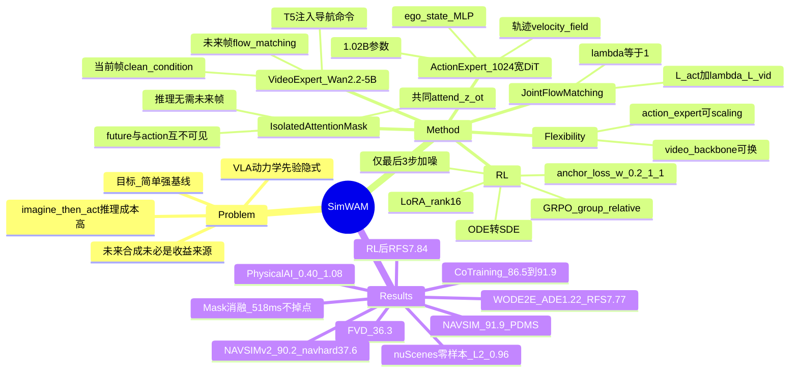

## Summary

`SimWAM` 把未来视频预测从"推理时必须生成"降级为**仅训练期的监督信号**：用 joint flow matching 联合训练一个预训练 video expert（`Wan2.2-5B`）和一个轻量 action expert，并用 **isolated attention mask** 让 action token 与 future-frame token 彼此不可见、只共同 attend 当前帧表示 $z(o_t)$，因此推理与 RL 都不需要 rollout 未来帧。方法还通过把确定性 flow ODE 改写成 SDE、只在最后 3 步注入噪声并用 `GRPO` 优化组合式驾驶 reward。结果在 `NAVSIM` navtest 上达到 **91.9 PDMS**、未来视频 **FVD 36.3**，单卡 `A100` 推理 **518 ms**，并在 `WOD-E2E`、`PhysicalAI-AV` 上取得有竞争力的开环精度，`nuScenes` 零样本迁移 L2 0.96 m / 碰撞率 0.05%。

## Problem & Motivation

- **现有 driving WAM 被"imagine-then-act"绑定**：`DriveLaW`、`DriveWAM`、`Epona` 等把策略分解为 $p_\theta(a_{t+1:t+H}, z_{t+1:t+N} \mid o_t, s_t, l) = p_\theta(z_{t+1:t+N} \mid o_t, s_t, l)\,p_\theta(a_{t+1:t+H} \mid o_t, s_t, l, z_{t+1:t+N})$，推理时必须先合成未来 latent，带来显著延迟（Fig. 1 中 `DriveLaW` / `Epona` / `DriveWAM` 均在高延迟区）。
- **未来合成未必是收益来源**：`Fast-WAM` 在具身智能中表明，video co-training 主要通过**训练期表征学习**帮助动作预测，而非测试时想象；这为"训练用 WM、推理删 WM"提供了直接依据。
- **VLA 的动力学先验仍是隐式的**：driving VLA 依赖语义与语言推理，运动/时序演化只被间接建模；而 world model 能提供显式的环境演化先验，但既有把二者结合的方案往往耦合松散，需要额外训练阶段或串行推理。
- **目标定位**：论文不追求架构创新，而是给出一个**简单、可复现、强基线**的 WAM——把 traffic-dynamics prior 通过联合训练迁移给 action expert，同时保持推理接口与普通 VLA 一样直接。

## Method

**0) 问题形式化（§4.1）**
- 输入为前视相机观测 $o_t$、ego state $s_t$（速度、加速度、yaw rate）与导航命令 $l$；输出 ego 坐标系下 $H$ 个 waypoint $a_{t+1:t+H} = (a_{t+1}, \dots, a_{t+H})$，每个 $a_i = (x_i, y_i, \psi_i)$ 含位置与 heading。
- 对比 imagine-then-act 的 Eq. 3，`SimWAM` 直接建模 $p_\theta(a_{t+1:t+H} \mid o_t, s_t, l) = p_\theta(a_{t+1:t+H} \mid z(o_t), s_t, l)$（Eq. 4），其中 $z(o_t)$ 是当前观测的表征，future-frame token 不进入策略条件。

**1) Video expert**
- 从 `Wan2.2-5B` 初始化 video DiT，沿用其 video VAE 与 `T5` text encoder。
- 当前帧作为 **clean condition**，$N$ 个未来帧加噪后用 flow matching 重建；导航命令 $l$ 先经 `T5` 编码，再通过 cross-attention 注入 DiT。
- 该视频生成目标迫使模型预测交通如何演化，从而把 traffic-dynamics-aware 表征写入当前帧特征。

**2) Action expert**
- 轻量 DiT，hidden size $d_a = 1024$（默认 1.02B 参数）；ego state 经小 MLP 嵌入，条件 $c = \{z(o_t), s_t, l\}$。
- 用 flow matching 预测轨迹速度场 $v_\theta(a_\tau, \tau, c)$，从 $\tau = 1$ 的高斯噪声沿 probability-flow ODE 积分到 $\tau = 0$ 得到轨迹；与 video expert 共享同一 flow-matching 接口。

**3) Isolated attention mask（核心设计）**
- future-frame token $z_{t+1:t+N}$ 与 action token **都 attend 当前观测** $z(o_t)$，但**彼此不可见**。
- 因此 action expert 只使用当前帧视觉表征、ego state 与导航命令；训练时未来视频监督仍能塑形 $z(o_t)$，推理时却无需实例化任何未来帧。
- 同一解耦也让 RL 可以在完全不 rollout 未来帧的情况下优化轨迹（§4.2）。

**4) Joint flow matching co-training**
- 两个 expert 只通过 shared attention 交互，各自保留原架构；联合目标为

  $$
  \mathcal{L} = \mathcal{L}_{\text{FM}}^{\text{act}} + \lambda\,\mathcal{L}_{\text{FM}}^{\text{vid}},
  $$

  其中 $\mathcal{L}_{\text{FM}}^{\text{act}}$ 与 $\mathcal{L}_{\text{FM}}^{\text{vid}}$ 分别是 Eq. 1 在轨迹 $a_{t+1:t+H}$ 与未来帧 latent $z_{t+1:t+N}$ 上的实例化，$\lambda$ 平衡两项（实验中 $\lambda = 1$）。
- 单步 flow matching 目标为

  $$
  \mathcal{L}_{\text{FM}} = \mathbb{E}_{x,\epsilon,\tau}\left[\left\lVert v_\theta(x_\tau, \tau, c) - (\epsilon - x) \right\rVert_2^2\right],
  $$

  其中 $x_\tau = (1-\tau)x + \tau\epsilon$、$\epsilon \sim \mathcal{N}(0, I)$、$\tau \in [0, 1]$。

**5) ODE → SDE + GRPO（§4.2）**
- 确定性 ODE 每个噪声只产生一条样本，缺少可处理的转移密度，无法做 policy-gradient 探索；因此采用与 ODE 同边缘分布的 SDE：

  $$
  \mathrm{d}x_\tau = \left[v_\theta(x_\tau, \tau) + \frac{\sigma_\tau^2}{2\tau}\left(x_\tau + (1-\tau)v_\theta(x_\tau, \tau)\right)\right]\mathrm{d}\tau + \sigma_\tau\,\mathrm{d}w,
  \qquad \sigma_\tau = \eta\sqrt{\frac{\tau}{1-\tau}},
  $$

  每个 Euler-Maruyama 步给出各向同性高斯转移 $\pi_\theta(x_{\tau-\Delta\tau} \mid x_\tau) = \mathcal{N}(\mu_\theta(x_\tau, \tau), \sigma_\tau^2\Delta\tau I)$，可计算逐步条件似然。
- **只在最后 3 步加噪**：$k \in \mathcal{W} = \{K-3, K-2, K-1\}$（$K = 10$），更新为 $a^{(k+1)} = \mu_{\theta,k} + \sigma_k\xi_k$，$\xi_k \sim \mathcal{N}(0, I)$，$\sigma_k = \eta\sqrt{\tau_k(\tau_k - \tau_{k+1})/(1-\tau_k)}$。早期加噪会被后续确定性步骤抹平，晚期噪声更直接影响最终轨迹，探索与 reward 差异更有效。
- 每个场景采样 $G$ 条候选并计算 reward $r_i$，group-relative advantage 为 $\hat{A}_i = (r_i - \bar{r})/(\sigma_r + \zeta)$，用 clipped surrogate 优化：

  $$
  \mathcal{L}_{\text{RL}} = -\mathbb{E}\left[\min\left(\frac{\pi_\theta(a_i^{(k+1)} \mid a_i^{(k)}, c)}{\pi_{\text{old}}(a_i^{(k+1)} \mid a_i^{(k)}, c)}\hat{A}_i,\ \operatorname{clip}\left(\frac{\pi_\theta}{\pi_{\text{old}}}, 1-\delta, 1+\delta\right)\hat{A}_i\right)\right] + \beta\,\mathcal{L}_{\text{anchor}}.
  $$
- **Anchor loss** 把 SDE 均值拉向冻结的 imitation policy（同状态、同 step），坐标权重 $w = (0.2, 1, 1)$，放宽纵向坐标以允许速度调整：

  $$
  \mathcal{L}_{\text{anchor}} = \mathbb{E}_{i,k}\left[\frac{1}{H}\sum_{h=1}^{H}\sum_{d=1}^{3} w_d\left(\mu_{\theta,i,k,h,d} - \mu_{\text{ref},i,k,h,d}\right)^2\right].
  $$

- RL 只更新 action expert attention projection 上的 rank-16 `LoRA`（scale $\alpha = 32$），video expert 与主体参数冻结。

**6) 结构灵活性（§4.3）**
- **Video expert 可替换**：action expert 只消费当前帧表征，换更强的视频 backbone 不需要改 action expert 或轨迹目标。
- **Action expert 可独立 scaling**：width 控制规划容量与算力，可在同一 attention 接口内按部署预算调整。

**训练超参（附录 B.3）**

| 配置 | `NAVSIM` | `WOD-E2E` | `PhysicalAI-AV` |
|:--|:--|:--|:--|
| 训练样本 | 85,109（navtrain） | 333,537 | 65K（从 153,625 中抽样） |
| IL epochs | 100 | 30 | 15 |
| 输入分辨率 | 384×672 | 512×480 | 前视相机（未单列） |
| 轨迹配置 | 8 waypoints / 4 s / 2 Hz | 20 waypoints / 5 s / 4 Hz | ADE / FDE @3 s、4 s |
| 未来视频监督 | 8 帧 / 4 s / 2 Hz | 4 帧 / 4 s / 1 Hz | 4 帧 / 4 s / 1 Hz |
| Optimizer | AdamW + cosine | 同左 | 同左 |
| 初始学习率 | $1\times10^{-4}$ | $1\times10^{-4}$ | $1\times10^{-4}$ |
| $\lambda$ | 1 | 1 | 1 |
| 总 batch size | 192 | 192 | 192 |
| IL 算力 | 48×`A100` | 48×`A100` | 48×`A100` |

| RL 配置 | `NAVSIM` | `WOD-E2E` |
|:--|:--|:--|
| 可训练参数 | rank-16 `LoRA`（$\alpha = 32$），仅 action expert attention projections | 同左 |
| 采样步数 $K$ | 10 | 10 |
| SDE 步 | 最后 3 步 $\{7, 8, 9\}$ | 同左 |
| 噪声强度 $\eta$ | 0.1 | 0.1 |
| Group size $G$ | 8 | 8 |
| 学习率 | $5\times10^{-5}$ | $5\times10^{-5}$ |
| Anchor 权重 $\beta$ | 50 | 50 |
| 坐标权重 $w$ | $(0.2, 1, 1)$ | $(0.2, 1, 1)$ |
| $\zeta$ | $10^{-8}$ | $10^{-8}$ |
| 训练量 | 20,000 steps，navtrain 中 IL PDMS < 90 的困难子集 | 10 epochs，validation split |
| RL 算力 | 1×`A100` | 1×`A100` |

## Pipeline

*`SimWAM` 整体架构。左侧训练阶段：video DiT（`Wan2.2-5B`）与 action DiT（$d_a = 1024$）通过 shared attention 联合 flow matching；当前帧 $f_0$ 作为 clean condition，未来帧 $f_1, \dots, f_n$ 加噪重建，action token $a_1, \dots, a_n$ 由 ego state 与 noisy action 生成。中间的 **isolated attention** 使 future-frame token 与 action token 都只 attend 当前帧、彼此不可见。右侧推理与 RL 阶段：video expert 生成未来帧的分支被整体移除（"Removed at Inference & RL"），模型直接从 $z(o_t)$、ego state 与导航命令预测轨迹，并用 reward $R_1, \dots, R_k$ 做 SDE-GRPO。*

## Key Results

- **`NAVSIM` navtest（Table 1，单前视相机）**：**91.9 PDMS**（NC 98.5 / DAC 99.1 / EP 86.5 / TTC 96.1 / C 99.8），超过 `SGDrive` 0.8、`ExploreVLA` 1.5、`DriveVA` 1.0、`DriveLaW` 2.8 分；在 world-model-based planners 中精度最高，同时保持较低延迟。
- **未来视频质量（Table 2）**：co-trained video expert 取得 **FVD 36.3**，次优 `DriveDreamer-Policy` 为 53.6，`ForgeDrive` 69.2、`PWM` 86.0。说明"训练期 WM"并未牺牲生成质量。
- **`WOD-E2E`（Table 3）**：validation split 上 IL 模型 RFS **7.99**（超过 `RAP-DINO` 7.91），RL 后 **8.29**；test split 上 ADE@3s **1.22** / ADE@5s **2.69** / RFS **7.77**，RL 后 **1.21 / 2.68 / 7.84**，RFS 优于 `UniPlan` 7.78、`NoRD` 7.71、`AutoVLA` 7.56。
- **`PhysicalAI-AV`（Table 4，1,000-clip test subset）**：仅 65K 训练样本、6B 参数，ADE@3s **0.40** / FDE@3s **1.08** / ADE@4s **0.69** / FDE@4s **1.96**；优于 `DriveWAM`（5B + 8B，0.47 / 1.35 / 0.83 / 2.47）、`Alpamayo-1.5`（10B，0.80 / 2.31 / 1.44 / 4.18）。
- **`nuScenes` 零样本（Table 5）**：`NAVSIM` 训练后不微调直接迁移，L2 Avg **0.96 m**、Collision Avg **0.05%**；与需要微调的 `UniAD`（1.03 / 0.31）、`VAD-Base`（1.22 / 0.53）相比更具竞争力，collision 低于 `DriveWAM` / `DriveVA` 的 0.06%。
- **`NAVSIM-v2`（Table 10–11）**：navtest EPDMS **90.2**，navhard EPDMS **37.6**（S1 71.6 / S2 69.9），分别领先 `DriveLaW` 1.6 与 7.0 分；在 reactive 的第二阶段仍保持 DAC / DDC / TTC / LK 领先。
- **Attention mask 消融（Table 6）**：Bidirectional 90.2（1512 ms）/ Action→video 90.1（1499 ms）/ **Isolated 90.3（518 ms）**——不访问未来帧不仅不掉点，还把轨迹推理加速近 3×。
- **Co-training 信号消融（Table 9）**：无 video expert 86.5 → 仅用 action loss 微调 video expert 88.4 → 加 future-video 监督 **90.3** → 加 RL **91.9**；配合 Fig. 3 的 linear probe，co-trained 当前帧特征在"周边车辆运动"（Probe A，ADE 6.91 → 5.89 → 4.72 m）与"ego 轨迹"（Probe B，1.23 → 0.84 → 0.81 m）上都更好，说明未来监督被蒸馏进了当前帧表征。
- **SDE 位置消融（Fig. 4）**：仅前两步 89.3（低于 IL 90.3）< 前两步 + 最后三步 91.6 < **最后三步 91.9**（论文未报告全部 10 步都加噪的设置）。
- **Video backbone 消融（Table 7）**：`LTX-Video` 88.7 (90.9) / `Wan2.1-1.3B` 90.2 (91.8) / `Wan2.2-5B` 90.3 (91.9) / `Cosmos2.5` **90.4 (92.4)**——驾驶域预训练的 `Cosmos2.5` 先验最强；backbone 可换且趋势合理。
- **Action expert scaling（Table 8）**：0.21B 89.9 / 0.45B 90.1 / 1.02B **90.3**，FLOPs 27.3 → 55.3 → 112.8 G；收益递增但边际变小。
- **其他消融**：未来视频监督 4f/2s/2Hz 89.9 → 4f/4s/1Hz 90.2 → **8f/4s/2Hz 90.3**（时间覆盖比帧密度更重要，Table 12）；输入分辨率 192×352 88.9 / **384×672 90.3** / 768×1344 90.6（Table 13）；采样步数 1 步 68.9 / 5 步 90.1 / **10 步 90.3** / 20 步 90.2，延迟 115 / 297 / 518 / 968 ms（Table 14）；去掉 anchor loss 掉到 **84.3**，$w = (1,1,1)$ 91.6 / $(0.5,1,1)$ 91.8 / **$(0.2,1,1)$ 91.9**（Table 15）；RL 只用 IL PDMS < 90 的困难子集优于全量 navtrain（Fig. 6）。

## Strengths & Weaknesses

**Strengths**
- **把"世界模型该在什么时候用"讲清楚了**：用 isolated mask 把 future-video 监督和 test-time future synthesis 彻底解耦，消融直接证明 mask 更简单、更快（518 vs ~1500 ms）且不掉点，是对 imagine-then-act 范式的一次干净否证。
- **消融覆盖完整、结论可检验**：attention mask、co-training 信号、SDE 位置、video backbone、action scale、视频时间配置、分辨率、采样步数、anchor loss、RL 数据子集共十组，且每组都有明确机制解释，不是堆数字。
- **结构与训练接口解耦**：video expert 可替换（`Cosmos2.5` 把 RL 后 PDMS 推到 92.4）、action expert 可独立 scaling，方法能直接吸收未来更强的视频生成模型。
- **RL 设计贴合连续轨迹生成**：SDE 只扰动最后 3 步 + group-relative advantage + anchor 正则，既提供探索又保持 imitation policy 的稳定性；去掉 anchor 会崩到 84.3，说明该正则是必要组件而非装饰。
- **多 benchmark + 零样本**：`NAVSIM`、`WOD-E2E`、`PhysicalAI-AV` 三个真实数据 benchmark，外加 `nuScenes` 零样本与 `NAVSIM-v2` navhard（含 reactive 第二阶段），泛化证据比多数 driving WAM 更完整；代码与权重开源。
- **工程性价比**：推理不生成未来帧，延迟落回纯 VLA 量级；相比 `DriveWAM` 的 5B + 8B，`SimWAM` 用 6B 在 `PhysicalAI-AV` 上全面更优。

**Weaknesses / 边界**
- **架构层面没有新东西**：video DiT + action DiT + shared attention + flow matching 均为已有组件，核心贡献是 mask 与训练/推理解耦的工程性洞察；相对最强 VLM planner `SGDrive` 仅高 0.8 PDMS，提升幅度有限。
- **只有前视单相机**：所有 benchmark 均为 1×camera，未使用多视角或 LiDAR；在遮挡、cut-in、交叉路口等需要环视的场景，单前视的感知上限可能成为瓶颈，论文未讨论。
- **评测仍是开环 / 非反应式**：`NAVSIM` 是 non-reactive pseudo-simulation，`WOD-E2E` 与 `PhysicalAI-AV` 是 open-loop ADE/FDE/RFS；没有 `CARLA` / `Bench2Drive` 闭环或真实路测，规划精度与闭环鲁棒性之间的 gap 未验证。navhard 的 reactive 阶段是少数例外，但仍属仿真。
- **"轻量 action expert"并不轻**：1.02B 参数、112.8 G FLOPs，整模 6B；518 ms / 10 步在 `A100` 上约 2 Hz，离车端实时仍有距离，论文未报告量化 / 蒸馏 / TensorRT 部署结果。
- **IL 成本高且未讨论数据效率**：48×`A100`、总 batch 192、`NAVSIM` 100 epochs；虽然 `PhysicalAI-AV` 只用 65K 样本，但整体训练门槛不低，"simple" 主要体现在推理与结构，而非训练成本。
- **RL 的评测口径需要留意**：`WOD-E2E` 的 RL 在 validation split 上训练、再报告 test；`NAVSIM` 的 RL 只在 IL PDMS < 90 的困难子集上训练。这些选择合理，但会让"RL 增益"与全量数据训练的结果不完全同口径。
- **mask 结论可能依赖任务域**：驾驶场景中未来帧对当前动作的边际信息较少，isolated mask 成立；在接触密集的 manipulation 任务中，未来帧可能直接决定动作，不能无条件外推（见 Notes 中 `OpenWAM` 的相反证据）。

## Mind Map

## Notes

- **与既有工作的关系**：`SimWAM` 直接建立在 `Fast-WAM`（"world action model 是否需要 test-time future imagination"）的结论上，把"训练期 WM"从具身智能迁移到驾驶。与 `DriveWAM` 共享 video expert 思路，但 `DriveWAM` 推理时仍合成未来帧；与 `DriveLaW` 的"video latent 条件化 planner"、`Epona` 的"自回归 diffusion 联合预测视频与轨迹"相比，`SimWAM` 在推理路径上删掉了整个未来生成分支。与 `DriveVLA-W0` 的 flow-matching / query-based 变体相比，`SimWAM` 的差异在于显式视频监督 + isolated mask，而非仅把 world model 当辅助 loss。
- **与 `AutoVLA` / `HybridDriveVLA` / `ColaVLA` 的对比**：这三者把推理放在语言或视觉 CoT 上，靠语义先验与显式 reasoning 提升可解释性；`SimWAM` 完全不做语言推理，靠视频预训练带来的动力学先验 + RL。`NAVSIM` 上 91.9 高于 `AutoVLA` 89.1、`HybridDriveVLA` 94.62（注意后者是 Optimal 口径，不可直接横比），说明"动力学先验"与"语义推理"是两条可叠加的互补路线，而非替代关系。
- **与 `DomainMaps/WorldModel` 的呼应**：地图 2026-08-11 条目已记录本文的核心结论——"监督应经共享表示塑形 policy，预测的未来不该作为 policy 的输入"；本文的 Table 6（90.3 / 90.2 / 90.1）与 Table 9（86.5 → 90.3）正是该结论的直接证据。地图 2026-09-18 条目记录的 `OpenWAM` 在 `RoboTwin` 上 "action-sees-video 92.39 vs isolated 87.41" 是**反方向证据**：在接触密集的操作任务中，未来帧可能是动作的必要条件。两者合起来给出的边界是——**未来帧的信息价值取决于任务：驾驶规划中它主要是训练期正则，操作控制中它可能是推理期必需输入**。
- **可迁移点**：① isolated attention mask 是"训练期 WM"的通用实现模板——只要让预测分支与动作分支共享当前观测表征、彼此不可见，就能在保留联合学习收益的同时删掉推理开销；② SDE 只在最后几步加噪，是把确定性 flow policy 改造成可 RL 的随机策略的轻量做法，可迁移到其他 flow-matching policy；③ anchor loss 用"冻结 imitation policy 的 SDE 均值"做正则，比 KL 更直接、更稳定，尤其适合连续轨迹空间；④ RL 只用困难子集训练，是利用 reward 信号密度的一种数据选择策略。
- **待跟进**：闭环（`CARLA` / `Bench2Drive`）与真实路测；多视角 / LiDAR 扩展后 isolated mask 是否仍成立；更长时域（>4 s）与交互密集场景；518 ms 能否通过量化、少步采样、模型蒸馏压到车端实时；isolated mask 在 manipulation 任务上的边界（与 `OpenWAM` 的分歧需要统一实验条件才能定论）。
