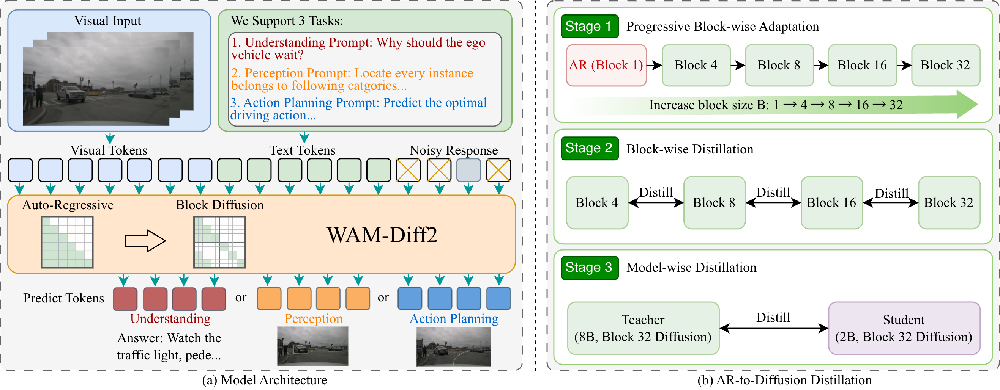

## Summary

自动驾驶 VLA 普遍用自回归解码，逐 token 生成带来线性延迟与 exposure bias；而从零训练的 diffusion policy 虽然能并行解码，却缺少多任务语义能力。WAM-Diff2 把已训练好的 Qwen3-VL 2B/8B 自回归 VLA 转成**多任务离散扩散**模型：attention 改为 block-causal（块内双向、块间因果），用三阶段蒸馏完成迁移——渐进扩大 block size 的 SFT、block-wise JSD 蒸馏、8B→2B 的跨规模 JSD 蒸馏。NAVSIM v1 **88.3 PDMS**、v2 **88.6 EPDMS**，加 score-based selection 后 91.1 / 90.7；解码吞吐 44.5 → 124.8 TPS（2.8×），叠加 FlashInfer 与 CUDA Graphs 后 673.4 TPS（15.1×，22.7 → 1.5 ms/token）。

## Problem & Motivation

- 自回归 VLA 的复杂度是 $\mathcal{O}(L)$：每个 token 都要一次完整前向，实时部署受限于解码延迟；训练时依赖 ground-truth prefix（teacher forcing），推理时误差会沿序列累积，即 exposure bias。
- 专用 diffusion policy 能并行去噪、延迟低，但通常从零训练、只做单一规划任务，不具备 VLM 的视觉-语言推理与多任务泛化能力。
- 因此理想路径是"把预训练 AR 通才转成并行 diffusion"：同时保留多任务语义与低延迟。难点在于两种范式的两处不匹配——causal vs bidirectional 的 attention 结构，以及 next-token prediction vs iterative denoising 的优化目标。
- 直接转换会显著掉点（Table 4：88.1 → 84.1 PDMS）。论文认为原因是 attention mask 突变使学生同时丢失因果先验与并行能力，因此需要把转换拆成可逐步逼近的课程，并用"同范式"教师提供蒸馏信号。
- 另一个隐含动机是部署：车端算力有限，2B 模型比 8B 更现实；跨规模蒸馏用来补回压缩损失。

## Method

**0. 总体框架**

- 基座为 Qwen3-VL：8B 版用 SigLIP2-SO-400M 视觉编码器（27 blocks、4096 hidden）+ 36 层 Transformer；2B 版用 SigLIP2-Large（24 blocks、2048 hidden）+ 28 层 Transformer。
- 所有任务共用同一个 text tokenizer：语言回答、2D bounding box 序列、BEV waypoint 都序列化成离散 token，不设任务专用 head。
- 标准 causal mask 改为 block-causal：同一解码 block 内双向 attention，block 之间保持因果约束。
- 训练数据覆盖 DriveLM、LingoQA（场景推理）、COCO（检测）、NAVSIM 与 Bench2Drive（规划）。

**1. 问题形式化（§3.1）**

- AR VLA 用标准的序列联合似然，逐 token 条件于前缀：

$$
p\left(\mathcal{O}\mid\mathcal{I}^{\text{cam}},\mathcal{L}^{\text{instruct}}\right)=\prod_{i=1}^{L}p\left(o_i\mid o_{<i},\mathcal{I}^{\text{cam}},\mathcal{L}^{\text{instruct}}\right)
$$

- 离散扩散采用 absorbing-state（masked）形式：前向过程每个 token 以 $\beta_t$ 概率变成 `[MASK]`，转移矩阵为

$$
q\left(\mathbf{o}^{t}\mid\mathbf{o}^{t-1}\right)=\prod_{i=1}^{L}\mathbf{o}_i^{t-1}Q_t,\qquad Q_t=\left(1-\beta_t\right)\mathbf{I}+\beta_t\mathbf{1}e_m^{\top}
$$

- 由于 $q(\mathbf{o}^t\mid\mathbf{o}^0)=\mathbf{o}^0\bar{Q}_t$ 可闭式求值，训练可以对随机噪声状态并行采样；推理从全 mask 序列开始，每步并行预测所有 token 分布，固定置信度最高的一部分、其余重新 mask，把解码复杂度压到 $\mathcal{O}(T)$（$T\ll L$）。

**2. Stage I：Progressive Block-wise Adaptation（§3.2）**

- 把 AR 视为 block size $B=1$ 的退化情形，按 $B\in\{4,8,16,32\}$ 逐步放宽因果约束；每个 $B$ 的学生在视觉上下文 $x$、未 mask 的上下文 $\mathbf{y}_{\setminus\mathcal{B}}$ 与扩散步 $t$ 条件下重建整块：

$$
\mathcal{L}_{\text{SFT}}^{B}=-\mathbb{E}_{t,\mathcal{B}:|\mathcal{B}|=B}\sum_{i\in\mathcal{B}}\log p_{\theta_B}\left(y_i\mid x,\mathbf{y}_{\setminus\mathcal{B}},t\right)
$$

- 每个新 block size 都从前一阶段权重初始化，而不是从 AR 直接跳到 $B=32$：

$$
\theta_B^{(0)}\leftarrow\theta_{B/2}^{\text{SFT}},\qquad \theta_1=\theta_{\text{AR}}
$$

- 这样 attention 从纯因果逐级过渡到块内双向，避免一次性结构突变导致语义崩塌。

**3. Stage II：Block-wise Distillation（§3.2）**

- 仅用 ground-truth 做 SFT 无法教会学生"迭代 refinement"的轨迹；Stage II 让小 block 的 diffusion 模型当教师，按 $4\rightarrow8\rightarrow16\rightarrow32$ 逐级蒸馏。
- 损失用对称 JSD 而非 forward KL，理由是 forward KL 的 mode-covering 倾向会抹平轨迹的多模态分布：

$$
\mathcal{L}_{\text{BWD}}^{B}=\mathbb{E}_{t,\mathcal{B},\tilde{\mathbf{y}}_t^{B}}\sum_{i\in\mathcal{B}}\operatorname{JSD}\left(p_{\theta_{B/2}}^{(i)}\left(\cdot\mid x,\tilde{\mathbf{y}}_t^{B},t\right)\parallel p_{\theta_B}^{(i)}\left(\cdot\mid x,\tilde{\mathbf{y}}_t^{B},t\right)\right)
$$

$$
\operatorname{JSD}(p\parallel q)=\frac{1}{2}\operatorname{KL}\left(p\parallel\frac{p+q}{2}\right)+\frac{1}{2}\operatorname{KL}\left(q\parallel\frac{p+q}{2}\right)
$$

- 教师本身是 diffusion 模型而非 AR 模型，作者称之为 paradigm-consistent：优化信号只涉及"并行 token 规模扩展"，不涉及跨范式对齐。

**4. Stage III：Model-Wise Cross-Scale Distillation（§3.2）**

- 2B 学生在压缩中丢失高层多任务能力，用 8B block-32 diffusion 教师补回。选择 diffusion 教师而非 AR 教师的依据是 top-$K$ 输出重叠率：

$$
\rho_K\left(p_T,p_S\right)=\frac{\left|\operatorname{TopK}\left(p_T\right)\cap\operatorname{TopK}\left(p_S\right)\right|}{K}
$$

- 实测 diffusion teacher 与学生的 $\rho_5=58.2\%$，AR teacher 只有 $51.2\%$，因此前者更适合跨规模蒸馏；损失同样是逐 token JSD：

$$
\mathcal{L}_{\text{MWD}}=\mathbb{E}_{t,\mathcal{B},\tilde{\mathbf{y}}_t^{2B}}\sum_{i\in\mathcal{B}}\operatorname{JSD}\left(p_{\phi_{32}^{8B}}^{(i)}\left(\cdot\mid x,\tilde{\mathbf{y}}_t^{2B},t\right)\parallel p_{\theta_B^{2B}}^{(i)}\left(\cdot\mid x,\tilde{\mathbf{y}}_t^{2B},t\right)\right)
$$

- 作者明确写这一阶段 not mandatory；Table 2 主结果的 88.3 与启用该阶段的 Table 4 终值一致，但论文没有单独给出只用 2B 学生的完整主表。消融中它带来 87.7 → 88.3 的 0.6 PDMS。

**5. 系统级推理优化（§3.3）**

- FlashInfer：为 block-causal mask 定制 attention kernel，提高块内双向 refinement 的 shared memory 吞吐。
- CUDA Graphs：并行 remasking 的步数 $T$ 与张量形状固定，可把整个执行图封装，消除 CPU launch 开销。

| 项目 | 设置 |
|:--|:--|
| Backbone | Qwen3-VL 2B / 8B，SigLIP2 视觉编码器 |
| Attention | block-causal，$B\in\{4,8,16,32\}$ |
| 训练阶段 | AR 预训练 5 epochs（可选）→ 每级 block 5 epochs → 跨规模蒸馏 5 epochs |
| 优化 | AdamW，weight decay 0.05，cosine + 10% warmup，global batch 128 |
| 学习率 | backbone 4e-5，visual encoder 2e-6；最终蒸馏统一 2e-6 |
| 算力 | 32×ASCEND 910C NPU |
| 输入 | 多视角相机，resize 到 1920×1080 |
| 推理 | 每 block 迭代去噪，约 8–16 步后饱和 |

## Pipeline

*左侧为 Qwen3-VL 的 AR 教师；中间三阶段蒸馏把 attention 从 causal 逐步改为 block-causal 并逐级放大 block size；右侧为 2B 学生，块内并行去噪、块间因果推进，最后接统一的文本/框/waypoint 输出接口。*

1. **多任务 AR 预训练（可选）**：Qwen3-VL 在 DriveLM、LingoQA、COCO、NAVSIM、Bench2Drive 混合数据上用 next-token prediction 训练 5 epochs；若已有通才权重可跳过。
2. **Stage I 块适配**：$B=1\rightarrow4\rightarrow8\rightarrow16\rightarrow32$，每级 5 epochs，新模型从前一级初始化，mask 逐步从 causal 放宽为 block-causal。
3. **Stage II 块蒸馏**：block-8 学 block-4、block-16 学 block-8、block-32 学 block-16，损失为块内逐 token JSD。
4. **Stage III 跨规模蒸馏**：2B block-32 学生对齐 8B block-32 diffusion 教师的输出分布。
5. **推理**：输入多视角图像与任务指令，全 mask 序列起步，每步并行预测、保留高置信 token、其余重新 mask，直至该 block 收敛。
6. **系统优化**：block-causal FlashInfer kernel + CUDA Graphs 封装固定形状的执行图。
7. **输出**：统一 tokenizer 直接解码为语言回答、bounding box 序列或 8 个 BEV waypoint。

## Key Results

**1) 统一多任务协议（Table 1，单 checkpoint）**

| Model | DriveBench | LingoQA | COCO | NAVSIM v1 | NAVSIM v2 | TPS（标准 / 优化） |
|:--|--:|--:|--:|--:|--:|--:|
| Qwen3-VL-2B | 47.68 | 48.00 | 34.20 | – | – | 44.5 |
| Qwen3-VL-8B | 59.75 | 60.20 | 38.30 | – | – | 34.2 |
| **Ours-2B（B=1，AR）** | **51.23** | **68.40** | **39.20** | **88.14 / 91.50\*** | **88.32** | 44.5 |
| Ours-2B（B=4） | 48.92 | 68.20 | 37.80 | 87.87 / 91.47\* | 87.99 | 68.3 / 401.4 |
| Ours-2B（B=8） | 48.81 | 68.00 | 37.30 | 87.57 / 91.19\* | 87.78 | 89.5 / 561.6 |
| Ours-2B（B=16） | 48.77 | 66.00 | 36.50 | 87.32 / 91.26\* | 87.30 | 108.4 / 635.3 |
| Ours-2B（B=32） | 48.80 | 65.80 | 36.30 | 87.44 / 91.05\* | 87.50 | 124.8 / 673.4 |

- 从 B=1 到 B=32，三项非规划指标全部下降：DriveBench −2.43、LingoQA −2.60、COCO −2.90；规划 PDMS 也从 88.14 掉到 87.44。所谓 "performance parity" 只在"相对 Qwen3-VL 原模型"的口径下成立，相对自家 AR baseline 是系统性退化。
- 退化的形状有规律：B=4 时下降最陡（LingoQA 只掉 0.2，但 COCO 掉 1.4），B=8→32 主要损失在 LingoQA 与 COCO；作者把 COCO 的早期退化归因于坐标格式约束严格，但没有给量化证据。
- 吞吐的标准实现从 44.5 涨到 124.8 TPS（2.8×），系统优化后 673.4 TPS；但表内没有说明 TPS 是在多少去噪步数下测的，而 Figure 3 显示步数会显著影响质量，因此吞吐数字与精度数字未必对应同一配置。

**2) 专用规划协议（Table 2，NAVSIM）**

| Method | v1 NC | v1 DAC | v1 TTC | v1 EP | v1 PDMS | v2 EPDMS |
|:--|--:|--:|--:|--:|--:|--:|
| DiffusionDrive | 98.2 | 96.2 | 94.7 | 82.2 | 88.1 | 84.5 |
| ReCogDrive | 97.9 | 97.3 | 94.9 | 87.3 | 90.8 | 83.6 |
| DriveVLA-W0 | 98.7 | 99.1 | 95.3 | 83.3 | 90.2 | 86.5 |
| **Ours（B=1，AR）** | 98.4 | 96.2 | 94.8 | 82.4 | 88.1 | 88.3 |
| **Ours（B=32）** | 98.6 | 96.1 | 95.5 | 82.1 | 88.3 | 88.6 |
| **Ours（B=32）+ selection\*** | **99.1** | **98.0** | **96.7** | **85.1** | **91.1** | **90.7** |

- 不加筛选时 88.3 / 88.6，与 AR baseline 的 88.1 / 88.3 基本持平（+0.2 / +0.3）；91.1 / 90.7 是加了 score-based candidate selection 的结果，不属于模型本身的单次前向能力，与 DriveVLA-W0 的 90.2 不可直接比较。
- 指标结构上 NC 与 TTC 略升、EP 略降：B=32 的 EP 从 82.4 掉到 82.1，说明并行解码让轨迹更保守；这与"无性能退化"的表述有细微出入。

**3) Bench2Drive 闭环（Table 3）**

| Model | Efficiency | Comfort | Success Rate | Driving Score | 多能力均值 |
|:--|--:|--:|--:|--:|--:|
| UniDriveVLA | 198.86 | 11.78 | 51.82 | 78.37 | 51.53 |
| **Ours（B=1，AR）** | 118.10 | 21.40 | **51.96** | **80.51** | **61.59** |
| **Ours（B=32）** | 108.20 | 23.15 | 49.55 | 78.93 | 60.58 |

- 闭环上 B=32 的 SR 掉 2.41、DS 掉 1.58、多能力均值掉 1.01；这与"robust generalization under distribution shifts"的说法相反，说明开放环 L2 的改善没有转化为闭环成功率的提升。
- 作者强调 Emergency Braking 从 60.34 升到 61.67，但同一张表里 Traffic Sign 从 89.25 降到 85.26；正文把它写成 "pronounced improvements in ... Traffic Sign compliance (85.26%)"，与自己 AR baseline 的 89.25 对比时这句话不成立。
- Efficiency 从 118.10 降到 108.20、Comfort 从 21.40 升到 23.15，说明扩散版开得更慢更稳；SR/DS 的下降可能部分来自这种保守化，而非泛化能力。

**4) 三阶段消融（Table 4）**

| Setting | NC | DAC | TTC | Comf. | EP | PDMS |
|:--|--:|--:|--:|--:|--:|--:|
| AR baseline | 98.4 | 96.2 | 94.8 | 99.9 | 82.4 | 88.1 |
| + 直接 AR→diffusion | 97.9 | 93.0 | 93.2 | 99.3 | 78.5 | 84.1 |
| + block-wise 蒸馏 | 98.2 | 95.7 | 95.0 | 99.3 | 81.6 | 87.7 |
| + model-wise 蒸馏 | 98.6 | 96.1 | 95.5 | 99.8 | 82.1 | 88.3 |

- 直接转换掉 4.0 PDMS，主要损失在 DAC（96.2→93.0）与 EP（82.4→78.5），说明结构突变首先破坏的是"留在可行驶区域"和"把路走完"。
- block-wise 蒸馏回收 3.6，model-wise 再回收 0.6；三阶段的边际收益递减，但方向单调，支持"课程式转换"的必要性。

**5) 蒸馏目标与教师选择（Table 5–7；ρ 见 Table 6，PDMS 见 Table 7）**

| 蒸馏损失 | PDMS |
|:--|--:|
| Forward KL | 88.2 |
| Reverse KL | 88.0 |
| JSD | 88.3 |

| Teacher | $\rho_1$ | $\rho_5$ | $\rho_{10}$ | $\rho_{20}$ | PDMS |
|:--|--:|--:|--:|--:|--:|
| AR Teacher | 83.6 | 51.2 | 54.3 | 46.1 | 79.9 |
| Diffusion Teacher | 84.8 | 58.2 | 60.5 | 50.7 | 88.3 |

- JSD 相对 forward KL 只高 0.1 PDMS，小于单次运行可能的波动；"对称 JSD 保住多模态"这一 claim 没有配套的 mode coverage / diversity 指标支撑。
- diffusion teacher 比 AR teacher 高 8.4 PDMS，是全文最有信息量的负结果：跨范式蒸馏即使教师更大也救不回来；但这也可能反映 AR teacher 本身未按同一规划协议训练，而不只是范式不匹配。

**6) Exposure bias 分析（§4.3、Figure 7）**

- 在 12,146 对 NAVSIM 样本上比较同一 condition 的预测，B=32 的平均 per-waypoint L2 从 0.5935 降到 0.5589（−5.8%）。
- 绝对误差差从第一个 waypoint 的 0.002 单调扩大到第 8 个的 0.082，作者据此论证双向 refinement 抑制了长程漂移。
- 这是开放环、teacher-forced 输入下的配对比较；闭环 Bench2Drive 的 SR/DS 反而下降，说明该指标与闭环鲁棒性之间仍有缺口。

## Strengths & Weaknesses

**Strengths**

- 转换路径的起点定义得很干净：$B=1$ 严格退化为 AR，$B$ 可以连续放大，因此"课程"不是比喻而是可验证的初始化链（$\theta_B\leftarrow\theta_{B/2}$）。
- 把"教师必须是同范式"做成了可检验的假设：用 $\rho_K$ 量化 teacher–student 的输出重叠，再用 AR / diffusion 两种教师对照（79.9 vs 88.3），给出了一个明确且反直觉的负结果。
- 评测覆盖三类能力（理解、检测、规划）且要求单一 checkpoint，比只报 NAVSIM 的规划论文更能暴露"转换是否损伤语义"。
- 速度报告分两层：标准实现 2.8× 与系统优化 15.1× 分开列，并给出 FlashInfer 1.7×、CUDA Graphs 3.1× 的分项，读者可以自行剥离工程贡献。
- exposure bias 用了 12,146 对配对样本与逐 waypoint 误差曲线，比只报一个平均 L2 更有说服力。
- 作者主动列出两条限制（离散 token 量化伪影、学生上限受 AR 教师语义能力约束），没有把方法包装成无损转换。

**Weaknesses**

- **"performance parity" 与表格不一致**：统一协议下 DriveBench −2.43、LingoQA −2.60、COCO −2.90，NAVSIM v1 −0.70；摘要与 4.2 节却用 "performance parity"、"no meaningful performance degradation" 描述。只有相对 Qwen3-VL 原模型才成立，相对自家 AR baseline 是全面退化。
- **闭环结果与"缓解 exposure bias"的叙事冲突**：Bench2Drive SR 51.96→49.55、DS 80.51→78.93，多能力均值 61.59→60.58。开放环 L2 改善 5.8% 没有转化为闭环成功率，说明该指标不足以支撑"提升闭环鲁棒性"的结论。
- **Traffic Sign 的"提升"引用错误**：正文称在 Traffic Sign compliance 上取得 "pronounced improvements (85.26%)"，但同表 AR baseline 是 89.25%，实际下降 3.99 点；只有 Emergency Braking（60.34→61.67）是真实提升。
- **15.1× 混淆了算法与系统工程**：2.8× 来自并行解码，其余来自 FlashInfer 与 CUDA Graphs；baseline 是自家 AR 实现（44.5 TPS，低于 Qwen3-VL-2B 的 44.5 与 8B 的 34.2 之间的可比口径未说明），没有与其他推理引擎（vLLM / TensorRT-LLM）对比。标题级加速不能归因于架构转换。
- **TPS 与精度可能不同配置**：表内 TPS 未注明去噪步数，而 Figure 3 显示步数从 8 到 16 才饱和；若吞吐是在更少步数下测得，则 673.4 TPS 对应的精度低于表中 PDMS。
- **Stage III 自称非必需却贯穿主结果**：跨规模蒸馏需要先训一个 8B diffusion 教师，消融只值 0.6 PDMS；论文没有报告教师训练成本，也没有给"只用 2B 学生"的完整主表结果。
- **JSD 的优势落在噪声内**：Forward KL 88.2、Reverse KL 88.0、JSD 88.3，差距 0.1–0.3 PDMS，且无方差；用这组数支持"对称 JSD 保留多模态"缺乏分布层面的证据（没有 diversity / mode coverage 指标）。
- **AR teacher 对照不公平的可能性未排除**：AR teacher 79.9 远低于 diffusion teacher 88.3，但论文没有说明两者是否用同一规划数据、同一训练预算；若 AR teacher 未经规划微调，这个对照放大了"范式不匹配"的效应。
- **离散 token 量化误差没有定量分析**：作者承认会有 spatial quantization artifacts，但没有给 waypoint 量化步长、量化误差分布，也没有与连续 diffusion planner 在同等吞吐下对比；这使"精度不受损"的结论缺少机制层面的支撑。
- **训练成本不可核**：32×ASCEND 910C、三阶段各 5 epochs、外加 8B 教师，论文称 "low-cost pipeline"，但没有 GPU-hours、总 token 数或与从头训练 diffusion policy 的成本对比。
- **单 seed、单次评测**：NAVSIM navtest 仅 136 场景，Bench2Drive 也只报一组数；多处 0.1–0.3 的差异（JSD、B=16 vs B=32）在这类规模下不足以区分方法。
- **remasking 策略细节缺失**：每步固定多少 token、置信度阈值如何取、$T$ 的默认值都未给出，影响复现与 TPS 对齐。

## Notes

+ **论文定位**：不是新的 diffusion policy，而是一套"AR 通才 → 多任务离散扩散"的架构迁移流程；核心 insight 是转换必须课程化，且教师必须与学生同范式。
+ **可迁移点**：
  - $B=1$ 等价 AR 的 block-causal 参数化，可用于任何想把现有 AR 模型改造成并行解码器的场景；初始化链 $\theta_B\leftarrow\theta_{B/2}$ 比一次性换 mask 稳定得多。
  - "同范式教师"这一约束可以推广到其他跨架构蒸馏（dense→MoE、双向→因果）；用 top-$K$ 输出重叠率做教师筛选是一个低成本的可操作代理。
  - 把 block size 当作运行时旋钮，在精度与吞吐之间连续调节，比训练多个固定模型更实用。
+ **待跟进**：
  - 复现 Bench2Drive 的 SR/DS 下降，判断它来自 token 量化、保守化（Efficiency 下降）还是闭环分布偏移；这决定该方法能否用于实车。
  - 测 waypoint token 的量化步长与误差分布，并与连续 diffusion planner 在相同 TPS 下对比，回答"离散化是否是可接受的代价"。
  - 补 AR teacher 在同一规划数据/预算下的对照，确认 79.9 的差距有多少来自范式、多少来自训练配方。
  - 明确 TPS 测量所用的去噪步数与 batch，重新对齐 Table 1 中吞吐与精度的对应关系。
