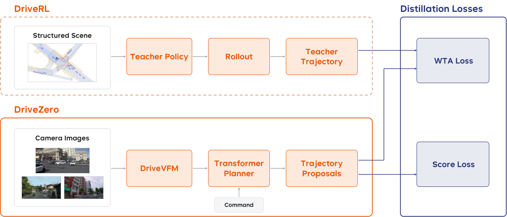

## Summary

把端到端驾驶拆成**动作模型**与**感知模型**分别在各自最适合的训练范式下预训练，再用蒸馏重新合并。动作侧 DriveRL 是一个 5.7M 参数的特权策略，在由真实 nuPlan 日志初始化的 mixed-agent 交互世界中从零开始用 PPO 训练，输入结构化场景状态与两点 goal，输出 jerk 与 steering-rate 的 Beta 分布；推理时用 critic 做 value-guided test-time action search（TTS）。感知侧 DriveVFM 把 DINOv3、SigLIP2、SAM、Depth Anything V2 四个冻结 foundation model 的特征蒸馏进一个 ViT backbone，不需要任何任务标注。最后 DriveZero 以 DriveVFM 为冻结 backbone（rank-32 Q/V LoRA），用 4 路相机输入预测 64 条轨迹 proposal，通过 winner-takes-all 拟合 DriveRL 的 rollout，并用 PDM 六项指标训练 proposal scoring。由于 teacher 是 goal-conditioned 的，可以对同一场景改查询不同导航意图，得到日志中不存在的多样化监督。结果：DriveRL 在 nuPlan 六个评测上均值 93.01（TTS 后 93.57），超过 Log-Replay；DriveZero 在 NAVSIMv1 navtest 上 94.8 PDMS 与人类司机持平，加 237K SimScale 仿真数据后 95.3；NAVSIMv2 navhard 51.5→57.1 EPDMS，HUGSIM 零样本 46.6 HD-Score。

## Problem & Motivation

- 主流端到端驾驶用 behavior cloning 拟合人类日志，监督信号只有**一条**被记录的未来轨迹。同一场景下多个合理动作、安全关键的纠偏与恢复操作在日志中极少出现，策略一旦离开示范分布就会误差累积。
- 闭环 RL 能优化显式目标、观察自身动作后果、访问并学会从扰动状态恢复，因此行为不被日志覆盖范围限制；但直接做视觉 RL 会把 sample-intensive 的探索与昂贵的视觉仿真耦合在一起，难以 scale。
- privileged RL teacher → visual student 的蒸馏路线（ROACH、GigaPixel、TerraTransfer）已经出现，但这些工作通常把视觉 encoder 当作现成组件，没有单独为驾驶预训练感知表征。
- 作者的核心主张：**perception 需要海量多样图像来理解世界，action 需要闭环交互来学会驾驶**，二者应解耦预训练，再通过轨迹蒸馏统一到一个 camera-only planner 中。这样 student 既继承 RL 学到的闭环行为，又不需要进入渲染环境做在线探索。
- 另一个被利用的性质是 teacher 的 goal-conditioning：日志只记录一个驾驶意图，而 teacher 可以在同一初始状态被查询不同 goal，从而生成反事实的、goal-consistent 的监督。

## Method

**0. 总体框架**

+ 三阶段：
  + **DriveRL**：在结构化状态上用 mixed-agent 闭环 PPO 从零训练特权 teacher，另用 critic 做推理期 TTS。
  + **DriveVFM**：只用原始图像，把多个冻结视觉 foundation model 的特征蒸馏进单个驾驶 backbone。
  + **DriveZero**：camera-only student，冻结 DriveVFM，用 LoRA 适配，通过 WTA 轨迹蒸馏与 proposal scoring 学习 teacher 行为。
+ teacher 只在训练期使用，推理时完全移除；student 在 logged frame 上 open-loop 训练，从不进入交互环境。

**1. DriveRL：结构化状态上的闭环 PPO teacher**

+ **输入**：每步观测 $O_t$ 包含 ego、周围交通参与者、局部 vector map 与交通灯状态。ego 与每个 agent 用 5 帧历史（当前帧 + 4 帧，5 Hz）表示，最多 96 个 agent；map 最多 256 个 token，交通灯状态附着在对应 map element 上。导航意图用 ego frame 下的两点 goal $G_t\in\mathbb{R}^{2\times 2}$ 表示。
+ **Goal 构造**：训练时从日志中的未来 ego 位置采样 1 或 2 个点（单点时复制到两个 slot），50% 保留日志位置、50% 投影到 20 m 内最近 lane center；部署时沿 route polyline 取 near/far 两个 anchor，look-ahead 距离随速度缩放，每步重算。两种来源共享同一个 permutation-invariant 两点接口。
+ **Policy network**：agent、ego kinematics、map 分别用独立 encoder 编码为 256 维 token；两个 goal 点经 sinusoidal positional encoding + 共享 MLP，再 mean-pool 成一个 goal feature。以 ego token 为唯一 query，先做 2 层 ego-to-agent cross-attention，再做 1 层 ego-to-map cross-attention；拼接 ego token、goal、kinematics、map context 后经 MLP 融合进入 policy head。总参数 5.7M。
+ **动作分布**：jerk 与 tire steering-angle rate 各用一个独立 Beta 分布，shape 参数用 $\operatorname{softplus}(x)+1$ 约束到 $(1,\infty)$，保证单峰并抑制极端动作。训练时采样，评测时取解析 mode $(\alpha-1)/(\alpha+\beta-2)$，再经 affine transform 映射到物理范围，由 kinematic bicycle model 执行。
+ **Mixed-agent 仿真**：每个背景 actor 通过统一的 physical state–action 接口挂载独立 behavior provider，支持 log replay、IDM、前车急刹与 learned policy（self-play）。训练配置中背景车用 batched IDM，少量车辆可被 front-vehicle braking 覆盖，行人保持 log replay。晚进入场景的 actor 只有在 ego 位姿距日志位姿 5 m / 0.35 rad 以内且不会碰撞时才被释放，避免 ego 偏离日志后出现不合理插入。
+ **奖励**：硬事件惩罚 $h_t$、一次性到达奖励 $g_t$、六项软质量分数 $q_{t,k}\in[0,1]$。PPO 直接以每步奖励 $r_t$ 为目标优化策略，其中 $H=110$ 为 rollout 长度，$d_t$ 表示硬终止；乘积形式要求六项软指标**同时**满足，防止某一项的高分掩盖另一项的严重缺陷。碰撞罚 $-1.0$，off-road 终止并按速度给 base $-2.0$ 的惩罚；1.5 m 内首次到达给一次性 $+0.5$，goal arrival 不终止 rollout。每步奖励定义为

$$
r_t = h_t+(1-d_t)\left(g_t+\frac{1}{H}\prod_{k\in\mathcal{K}}q_{t,k}\right),
$$

$$
\mathcal{K} = \{\text{cross-lane},\ \text{centerline},\ \text{curb},\ \text{comfort},\ \text{TTC},\ \text{overspeed}\},
$$
+ **八通道 critic**：把标量回报拆成 hard、goal 与六个 soft 通道，soft 通道按 deficit $b_{t,k}=\max(1-q_{t,k},0)$ 归一化分配，保证 $\sum_c r_{t,c}=r_t$。每个通道独立做 GAE 与 clipped value loss；actor 使用八通道 advantage 之和。由于 reward 与折扣因子一致，该分解在数学上等价于对标量回报做 GAE，只是让 critic 监督更有结构。
+ **训练规模**：从 nuPlan trainval 取 922,703 个场景，10 Hz 导出、每两帧取一帧得到 5 Hz；12 节点 96 GPU，每 rank 2,048 worlds，全局 196,608 worlds 并行，110 步 rollout。每 rank 225,280 transitions，切成 11 个 20,480 的 minibatch，跑 4 个 PPO epoch，即每次 update 44 步；共 2,400 updates，约 21 小时。优化器 Muon，$\gamma=0.99$，$\lambda=0.95$，clip 0.2/0.2，entropy 0.01，value 0.5，grad clip 0.5，lr $3\times10^{-4}$ cosine 无 warmup。

**2. Value-guided test-time action search（TTS）**

+ 每个 planner step 保留 Beta mode 作为候选 0，再从同一策略采样 $N-1$ 个首动作；每个候选做 $L$ 步短 rollout，后续动作取同策略在候选诱导状态上的 mode，背景 actor 用 constant-turn-rate-and-acceleration 外推。
+ 候选打分复用训练奖励、折扣因子与 critic：

$$
S^{(i)} = \sum_{\ell=0}^{L-1}\gamma^\ell\prod_{u<\ell}(1-d_u)\,r_\ell +\gamma^L\prod_{u<L}(1-d_u)\,V(O_L).
$$

+ 只有最高分候选超过 modal action 的分数一个 margin $\delta$ 时才替换，否则执行 modal action。所有候选并行 rollout，因此增大 $N$ 主要增加并行计算，增大 $L$ 才增加串行深度。默认 $L=5$、$\delta=0.03$。

**3. DriveVFM：多教师视觉表征蒸馏**

+ 共享 ViT 对每张图输出每个 foundation model 一个 summary token，以及一组共享 spatial patch token；每个冻结教师配一个轻量 adaptor，分别投影 summary 与 patch 表示。
+ **非对称监督**：DINOv3 同时监督 summary 与 patch；SigLIP2 只监督 summary；SAM 只监督 patch；Depth Anything V2 蒸馏其**视觉特征**而非 depth 预测（作者称 feature distillation 更好）。summary 用 cosine distance，patch 用 MSE：

$$
\mathcal{L}_{\mathrm{DriveVFM}}=\sum_{k\in\mathcal{T}}\left(\lambda_k^{\mathrm{sum}}\mathcal{L}_k^{\mathrm{sum}}+\lambda_k^{\mathrm{patch}}\mathcal{L}_k^{\mathrm{patch}}\right)
$$

+ **PHI-S 标准化**：不同教师特征的尺度、方差与各向异性差异很大，逐模型 loss 权重无法修正模型内部维度间的不平衡。PHI-S 用离线统计量中心化 patch 特征，做 PCA–Hadamard rotation 把方差均匀分配到各维，再用统一标量缩放，使每个教师成为条件相近的回归目标。
+ **QK-Clip**：训练中部分 attention head 的 QK 点积会快速增长，导致 loss spike。每次 optimizer update 后监测每个 head 的最大 pre-softmax logit，超过阈值 1,000 时对 query/key 投影权重做同比例平方根缩放，不改变 attention 形式。该约束同时让 FP16 部署近似无损（Table A14：mean abs 0.109→0.004，cosine 0.893→0.999）。
+ **预训练 schedule**：256×256 训练 600K iter，再 512×512 训练 200K iter，global batch 2,048，AdamW。数据混合 LAION-2B、ImageNet-21K、SA-1B 与 OpenDV、nuPlan、Waymo 的驾驶图像。预训练后丢弃所有教师与 adaptor，只保留 backbone。

**4. DriveZero：把 RL teacher 蒸馏成 camera-only planner**

+ **输入与架构**：当前帧 4 路相机（CAM_F0/B0/L0/R0）、ego kinematics、由 teacher goal 导出的导航 command。DriveVFM 共享权重编码每路图像，视觉 token 加 3D positional embedding，再用 16 个 learnable register token 压缩成 scene token；ego kinematics 与 command 编码成一个 ego token，加到 $M$ 个 learnable trajectory query 上；4 层 trajectory decoder 通过 cross-attention 输出轨迹。独立的 scoring decoder 把每条候选轨迹编码成 score query，attend 视觉 token，预测 PDM 六项分量。
+ **Teacher rollout 监督**：每个 logged frame 上，冻结 teacher 接收结构化状态与 goal，在所有背景 actor 按日志运动的条件下 rollout 出 20 步轨迹 $\tau^T$，表示为 ego-relative $(x,y,\mathrm{yaw})$ 序列。student 的 64 条 proposal 中只有最近的一条参与回归，$\operatorname{dist}$ 为逐点 $L_1$ 平均，该 WTA 分配让不同 query 捕获不同驾驶模式、选择交给 scoring branch：

$$
\mathcal{L}_{\mathrm{traj}}=\min_m\operatorname{dist}\left(\hat{\tau}_m,\tau^T\right)
$$
+ **Proposal scoring**：六项分量用 PDM 目标做 BCE，候选轨迹在进入 scoring 前 detach，使生成与排序解耦：

$$
\mathcal{L}_{\mathrm{score}} = \frac{1}{M}\sum_{m=1}^{M}\sum_{k=1}^{6}\mathrm{BCE}\left(\sigma(\hat{s}_{mk}),s_{mk}\right),\\
\mathcal{L}_{\mathrm{DriveZero}} = \lambda_{\mathrm{traj}}\mathcal{L}_{\mathrm{traj}}+\lambda_{\mathrm{score}}\mathcal{L}_{\mathrm{score}}.
$$

+ **Goal augmentation**：日志只有一条已实现轨迹，但 teacher 是 goal-conditioned 的。训练时先增广 route intent 与对应导航 command，再让 teacher 生成轨迹；同一增广 route 也用于评估 student proposal 的分数，保证 command、teacher 轨迹与 proposal score 三者一致。这样每个 logged scene 被扩展成多个有效监督目标。
+ **推理**：选预测总分最高的 proposal，不需要 teacher，也不需要渲染或闭环仿真。

**5. 实现细节**

| 项目 | 设置 |
|:--|:--|
| DriveRL 参数量 / token 宽 / heads | 5.7M / 256 / 4 |
| DriveRL attention | 2 层 ego-to-agent + 1 层 ego-to-map |
| Agent / map 容量 | 96 agents（含 ego）/ 256 map tokens |
| 动作空间 | jerk $[-8,5]$ m/s³；steering rate $[-0.8,0.8]$ rad/s |
| 车辆约束 | 加速度上限 4.0 m/s²；前轮转角上限 $\pi/3$ rad；轴距 3.09 m |
| DriveRL 分布式训练 | 12 节点 / 96 GPU；2,048 worlds/rank；全局 196,608 worlds |
| DriveRL rollout / update | 110 步 @5 Hz；每 rank 225,280 transitions；11 minibatch × 4 epoch |
| DriveRL 优化 | Muon；2,400 updates；lr $3\times10^{-4}$ cosine；约 21 h |
| TTS 默认参数 | $L=5$，$\delta=0.03$，$N\in\{8,16,32,64\}$ |
| DriveVFM 预训练 | 256² × 600K iter + 512² × 200K iter；batch 2,048；AdamW |
| DriveVFM 教师 | DINOv3（summary+patch）、SigLIP2（summary）、SAM（patch）、Depth Anything V2（patch feature） |
| DriveVFM 稳定化 | PHI-S；QK-Clip 阈值 1,000 |
| DriveZero backbone | DriveVFM ViT-L（冻结）+ rank-32 Q/V LoRA |
| DriveZero 输入 / 输出 | 4 相机 960×512；20 步 @5 Hz |
| DriveZero 规划头 | 64 proposals；256 维；4 层 decoder；每相机 16 register tokens |
| DriveZero 参数量 | 可训练 18.58M / 总计 338.46M |
| DriveZero 训练 | 100K navtrain + 237K SimScale；16×H20；25 epochs；batch 256；AdamW lr $2\times10^{-4}$ cosine；wd 0.01；grad clip 1.0；FP32；38 h |

## Pipeline

1. **构造交互世界**：从 nuPlan 日志取场景，每个背景 actor 挂载 log replay / IDM / 前车急刹 / learned policy 之一。
2. **训练特权 teacher**：DriveRL 从随机初始化开始，用结构化状态与两点 goal 做闭环 PPO，学习 jerk 与 steering-rate 的 Beta 策略；同时训练八通道 critic。
3. **推理期动作搜索**：TTS 采样 $N$ 个首动作，各做 $L$ 步 rollout，用 critic bootstrap 打分，超过 margin $\delta$ 才替换 modal action。
4. **预训练视觉 backbone**：DriveVFM 从原始图像蒸馏 DINOv3、SigLIP2、SAM、Depth Anything V2 的冻结特征，用 PHI-S 平衡异质目标。
5. **生成监督**：在每个 logged frame 上，冻结 teacher 接收结构化状态与 goal，rollout 出 20 步轨迹；训练时先增广导航意图，得到多样化 goal-consistent 轨迹。
6. **训练 student**：DriveZero 用冻结 DriveVFM + LoRA 编码 4 路相机，decoder 输出 64 条 proposal；最近 proposal 做 WTA 回归，scoring head 用 PDM 目标做 BCE。
7. **部署**：丢弃 teacher 与所有 foundation model，只保留 DriveVFM backbone 与 DriveZero 规划头；推理时选预测分数最高的 proposal。

## Key Results

**1) DriveRL 在 nuPlan 闭环评测（Table 2，CLS）**

| Method | Human | Val14 NR | Val14 R | Test14-hard NR | Test14-hard R | Test14-random NR | Test14-random R |
|:--|:--:|--:|--:|--:|--:|--:|--:|
| Log-Replay | ✗ | 93.53 | 80.32 | 85.96 | 68.80 | 94.03 | 75.86 |
| PDM-Closed | ✓ | 92.84 | 92.12 | 65.08 | 75.19 | 90.05 | 91.63 |
| CaRL | ✗ | 93.87 | 93.12 | – | 85.00 | – | – |
| GigaFlow | ✗ | – | 93.80 | – | – | – | – |
| **DriveRL** | ✗ | **95.16** | **94.25** | **89.97** | **89.18** | **94.50** | **95.00** |
| **DriveRL-TTS** | ✗ | **95.54** | **94.53** | **91.13** | 89.15 | **95.93** | **95.12** |

+ DriveRL 六项均值 93.01，超过 Log-Replay 的 83.08，且在全部六个设置上超过 Log-Replay；也超过 CaRL 与 GigaFlow 这两个同样不使用人类数据的已有方法。
+ TTS 把均值提升 0.56 到 93.57，五项提升、Test14-hard R 基本不变（89.15 vs 89.18）。

**2) TTS 的 test-time scaling（Table 3，固定 checkpoint）**

| Setting | Val14 NR | Val14 R | Hard NR | Hard R | Random NR | Random R | Mean | Δ |
|:--|--:|--:|--:|--:|--:|--:|--:|--:|
| DriveRL | 95.16 | 94.25 | 89.97 | 89.18 | 94.50 | 95.00 | 93.01 | 0.00 |
| TTS $N=8$ | 95.17 | 94.49 | 89.97 | 89.05 | 94.92 | 95.11 | 93.12 | +0.11 |
| TTS $N=16$ | 95.22 | 94.38 | 89.98 | 88.97 | 95.29 | 94.98 | 93.13 | +0.13 |
| TTS $N=32$ | 95.49 | 94.43 | 90.95 | 88.85 | 95.83 | 94.84 | 93.40 | +0.39 |
| TTS $N=64$ | 95.54 | 94.53 | 91.13 | 89.15 | 95.93 | 95.12 | 93.57 | +0.56 |

+ 收益集中在 non-reactive 的 Test14 拆分：Hard NR +1.16、Random NR +1.43；reactive 模式提升很小，Hard R 在 $N=16/32$ 时反而低于 baseline。
+ 作者把趋势解释为 test-time search 是局部 policy-improvement operator：候选越多，越可能找到一个短期 rollout 避开不利后果的首动作。

**3) NAVSIMv1 navtest（Table 4，PDMS）**

| Method | Input | Human | NC | DAC | TTC | C | EP | PDMS |
|:--|:--:|:--:|--:|--:|--:|--:|--:|--:|
| Human Driver | GT | ✓ | 100 | 100 | 100 | 99.9 | 87.5 | 94.8 |
| PDM-Closed | GT | ✓ | 94.6 | 99.8 | 89.9 | 86.9 | 99.9 | 89.1 |
| DriveSuprim | C & L | ✓ | 98.6 | 98.6 | 95.5 | 100 | 91.3 | 93.5 |
| DrivoR-Scale | C | ✓ | 99.1 | 99.2 | 96.9 | 100 | 91.6 | 94.6 |
| DriveRL | GT | ✗ | 99.8 | 99.9 | 99.1 | 99.0 | 91.5 | 95.8 |
| **DriveZero** | C | ✗ | 99.0 | 99.2 | 96.0 | 100 | **93.1** | **94.8** |
| **DriveZero-Scale** | C | ✗ | **99.2** | **99.4** | **97.3** | 99.9 | 92.5 | **95.3** |

+ DriveZero 在**不使用任何人类轨迹监督**的条件下达到 94.8，与 Human Driver 持平；DriveZero-Scale 用 237K SimScale 场景扩到 95.3，成为首个在该榜超过人类司机的端到端模型。
+ 提升主要来自 EP（DriveZero 93.1 vs Human 87.5），而 NC 99.0 仍低于人类的 100；PDMS 更高不等于更安全。

**4) NAVSIMv2 navhard（Table 5，EPDMS）**

| Method | Human | Stage 1 EPDM | Stage 2 EPDM | EPDMS |
|:--|:--:|--:|--:|--:|
| PDM-Closed* | ✓ | – | – | 56.6 |
| LTF | ✓ | – | – | 25.1 |
| NavFormer | ✓ | – | – | 34.1 |
| RAP | ✓ | – | – | 39.6 |
| GuideFlow | ✓ | – | – | 51.5 |
| SimScale | ✓ | – | – | 53.2 |
| DrivoR-Scale | ✓ | – | – | 54.6 |
| ZTRS | ✗ | – | – | 48.1 |
| GigaPixel | ✗ | 77.8 | 63.5 | 50.1 |
| DriveRL* | ✗ | 84.1 | 65.4 | 55.6 |
| **DriveZero** | ✗ | **84.1** | 60.8 | **51.5** |
| **DriveZero-Scale** | ✗ | 82.3 | **69.1** | **57.1** |

+ DriveZero 51.5，比同为 RL-teacher 路线的 GigaPixel 高 1.4；DriveZero-Scale 57.1 比 DriveZero 高 5.6，超过使用 GT symbolic 输入的 PDM-Closed（56.6）和同样用 SimScale 的 DrivoR-Scale（54.6）。
+ 扩数据的代价是 Stage 1 从 84.1 降到 82.3（-1.8），但 Stage 2 从 60.8 升到 69.1（+8.3）：nominal 性能略降，扰动鲁棒性大幅提升。
+ 注意 DriveRL 55.6 用 GT 结构化输入，仍低于 PDM-Closed 56.6；DriveZero 与 GuideFlow 在 51.5 上持平。

**5) HUGSIM 真闭环零样本评测（Table 6，HD-Score）**

| Method | Human | RC Avg | HD Easy | HD Medium | HD Hard | HD Extreme | HD Avg |
|:--|:--:|--:|--:|--:|--:|--:|--:|
| LTF | ✓ | 38.9 | 58.9 | 18.0 | 9.8 | 25.9 | 23.7 |
| VAD | ✓ | 31.4 | 36.3 | 9.5 | 8.0 | 11.5 | 13.4 |
| UniAD | ✓ | 45.9 | 64.9 | 45.8 | 20.6 | 6.6 | 32.7 |
| DrivoR-Scale | ✓ | 46.4 | 64.8 | 50.3 | 16.8 | 25.8 | 38.1 |
| GigaPixel | ✗ | 50.1 | 67.4 | 51.9 | 19.1 | 21.6 | 38.5 |
| **DriveZero** | ✗ | **53.9** | **78.5** | 47.2 | 16.0 | **28.7** | **39.4** |
| **DriveZero-Scale** | ✗ | **54.5** | **81.9** | **60.5** | **24.7** | 27.6 | **46.6** |

+ 没有任何 HUGSIM 微调，DriveZero-Scale 平均 46.6，比此前最好的 GigaPixel 高 8.1。作者把增益归因于 DriveRL 在 OOD SimScale 数据上生成的更多样、更合理的轨迹。
+ 绝对分数仍低：Hard 24.7、Extreme 27.6，说明真闭环下的长尾交互依然困难。

**6) DriveVFM 与 DriveZero 消融（Table 7，ViT-S，仅 navtrain）**

| Study | Configuration | NC | DAC | EP | TTC | Comfort | PDMS |
|:--|:--|--:|--:|--:|--:|--:|--:|
| Visual backbone | DA3 Small | 99.10 | 98.84 | 89.68 | 96.21 | 99.93 | 93.31 |
| | DA2 ViT-S | 98.57 | 99.21 | 91.44 | 95.13 | 99.96 | 93.72 |
| | DINOv2 ViT-S | 98.86 | 99.07 | 91.63 | 95.46 | 99.98 | 93.88 |
| | DINOv3 ViT-S | 98.93 | 99.01 | 91.31 | 95.77 | 99.97 | 93.88 |
| | **DriveVFM ViT-S** | **99.17** | **99.14** | **91.79** | **96.29** | **99.98** | **94.41** |
| Teachers | DINOv3 + SigLIP2 | 98.67 | 98.98 | 91.55 | 95.27 | 99.98 | 93.69 |
| | + SAM | 98.79 | 99.11 | 91.44 | 96.06 | 99.97 | 94.10 |
| | + DA2 = Full | 99.17 | 99.14 | 91.79 | 96.29 | 99.98 | 94.41 |
| Supervision | Human trajectories | 98.76 | 98.95 | 91.99 | 95.30 | 99.98 | 93.92 |
| | DriveRL trajectories | 98.60 | 98.81 | 91.64 | 95.27 | 99.94 | 93.61 |
| | DriveRL + goal aug. | 99.17 | 99.14 | 91.79 | 96.29 | 99.98 | 94.41 |

+ DriveVFM ViT-S 比同容量 DINOv3 ViT-S 高 0.53 PDMS；加入 SAM +0.41、加入 Depth Anything V2 +0.31，两个教师累计 +0.72。
+ **关键对照**：只用 DriveRL 轨迹监督（93.61）反而低于人类轨迹（93.92）；加上 goal augmentation 才升到 94.41，比人类高 0.49。也就是说，"超越人类示范"的增益几乎全部来自 goal augmentation 带来的监督多样性，而不是 RL 轨迹本身更好。

**7) 视觉 backbone scaling（Table A13，仅 navtrain）**

| Backbone | NC | DAC | TTC | Comfort | EP | DDC | PDMS |
|:--|--:|--:|--:|--:|--:|--:|--:|
| DINOv3 ViT-L | 98.80 | 99.25 | 95.74 | 99.94 | 92.72 | 95.87 | 94.55 |
| DriveVFM ViT-S | 99.17 | 99.14 | 96.29 | 99.98 | 91.79 | 95.97 | 94.41 |
| DriveVFM ViT-B | 98.89 | 99.24 | 95.93 | 99.97 | 92.44 | 95.79 | 94.54 |
| **DriveVFM ViT-L** | **99.00** | 99.24 | **95.97** | **99.99** | **93.10** | 95.89 | **94.83** |

+ ViT-S→B→L 为 94.41→94.54→94.83，呈正 scaling；ViT-L 仍略高于预训练规模大得多的 DINOv3 ViT-L（94.55）。

**8) 交通灯输入与奖励（Table A8/A9）**

| 设置 | Val14 NR | Val14 R | Hard NR | Hard R | Random NR | Random R | 红灯违规率 |
|:--|--:|--:|--:|--:|--:|--:|--:|
| 无 TL 输入 | 93.35 | 93.19 | 86.49 | 85.41 | 93.48 | 92.24 | – |
| 有 TL 输入 | 94.76 | 93.62 | 88.35 | 85.70 | 95.21 | 93.89 | 3.88% |
| TL 输入 + TL reward | 93.08 | 91.35 | 81.71 | 82.96 | 92.36 | 91.79 | 2.03% |

+ 加入交通灯输入在六个设置全部提升（+0.29~+1.86）；但把红灯违规加入奖励后，违规率从 3.88% 降到 2.03%，六个 nuPlan 总分却全部下降（-1.21~-3.14）。作者因此在正式 teacher 的标量奖励中**不包含**交通灯违规项，只把它作为诊断指标。

**9) Self-play（Table A7）**

| Model | Val14 NR | Val14 R | Hard NR | Hard R | Random NR | Random R | Mean |
|:--|--:|--:|--:|--:|--:|--:|--:|
| DriveRL | 95.16 | 94.25 | 89.97 | 89.18 | 94.50 | 95.00 | 93.01 |
| Self-Play | 95.09 | 93.92 | 90.04 | 88.96 | 95.04 | 95.63 | 93.11 |
| Self-Play, 3-perturb | 95.15 | 93.74 | 88.90 | 87.47 | 93.70 | 94.77 | 92.29 |
| Self-Play, augmentation | 94.91 | 94.38 | 88.56 | 87.92 | 93.43 | 94.22 | 92.24 |
| Self-Play, 3-perturb + aug. | 95.08 | 94.48 | 88.30 | 87.27 | 94.60 | 94.68 | 92.40 |

+ self-play 在 nuPlan 上没有稳定优势（最高 93.11 vs 93.01），作者归因于 nuPlan 闭环评测用 IDM 驱动背景车，不奖励更自然的交互。self-play 只用于实车部署配置。

## Strengths & Weaknesses

**Strengths**

- **问题拆解干净**：把"感知要 scale 图像、动作要闭环交互"这一直觉落实为两套独立预训练管线，再用轨迹蒸馏合并；比"直接视觉 RL"或"纯 BC"都更符合各自的样本效率特性。
- **把 teacher 当作可控数据生成器**：goal-conditioned teacher 可以在同一场景回答反事实意图，这是日志数据本身不具备的能力；goal augmentation 是全文最有迁移价值的 insight。
- **工程规模扎实**：196,608 个并行 world、GPU batched 的全 rollout loop、110 步 × 2,400 updates 在 21 小时内完成，说明 mixed-agent 闭环 RL 已经可以常规化训练，而不是一次性 demo。
- **DriveVFM 的蒸馏配方完整**：非对称 summary/patch 监督、PHI-S 解决异质特征尺度、QK-Clip 同时稳定训练与 FP16 部署，每一部分都有消融或数值证据（Table 7、A14）。
- **主结果覆盖三类评测**：nuPlan 闭环、NAVSIMv1/v2 pseudo closed-loop、HUGSIM 真闭环零样本；不是只挑一个有利 benchmark。
- **诚实地报告了不利对照**：Table 7 明确写出 DriveRL-only 低于 human-only，Table A9 明确写出 TL reward 降分，Table A7 明确写出 self-play 无稳定增益。这种 negative result 在系统报告里少见。
- **student 架构轻**：冻结 ViT-L + rank-32 LoRA，仅 18.58M 可训练参数，38 h / 16 H20 完成训练，部署侧不需要 teacher 或 foundation model，工程上合理。

**Weaknesses**

- **"Beyond human demonstrations" 的证据链不闭合**：标题的 claim 有三点支撑不足——(a) DriveRL 的训练世界与 goal 仍来自人类日志，"seed scenes and goals" 不等于脱离人类数据；(b) Table 7 里纯 DriveRL 轨迹监督 93.61 < 人类轨迹 93.92，RL 轨迹本身并不比人类轨迹更有信息量；(c) 超过人类只在加 237K SimScale 后成立（94.8 持平 → 95.3 超越），而 SimScale 生成管线可能用到人类数据训练的模型。真正新增的是 goal-conditioned teacher 能回答反事实查询，而非行为范式本身的胜利。
- **Table 7 无法分解"teacher 更好"与"监督更多"**：+0.49 的最终优势完全依赖 goal augmentation，但两者混在一个对照里；且该对照天然不对称——人类轨迹基线无法做同样的意图增广（日志里没有反事实人类轨迹）。缺少"人类轨迹 + 其他增广"或"teacher 不做 goal aug. 但数据量匹配"的对照。
- **goal augmentation 缺少可复现定义**：如何采样替代意图、如何保证新 goal 在路网中可达、每条场景增广几次、增广后如何过滤不合理轨迹，全部没有说明；这是方法最关键的组件，却最不透明。
- **navhard 的"超过所有只用 navtrain 的方法"措辞过强**：DriveZero 51.5 与 GuideFlow 51.5 完全持平，而 GuideFlow 使用人类示范；领先 GigaPixel 1.4 是事实，但不构成 "all methods" 级别的领先。
- **Stage 1 / Stage 2 的 trade-off 未被讨论**：加 SimScale 后 Stage 1 EPDM 降 1.8、Stage 2 升 8.3，说明 OOD 仿真数据以 nominal 精度换取扰动鲁棒性；论文只把它当作正面结果，没有分析哪些场景变差。
- **没有多模态 teacher**：Beta 单峰策略无法表达同一状态下多个连续控制模式；student 的 64 proposal 只是事后覆盖，不能恢复 teacher 从未产生的模式。
- **安全合规被 benchmark 分数绑架**：红灯违规不入奖励（Table A9 显示加入后违规率减半但降 1.2~3.1）、碰撞罚仅 $-1.0$ 与 soft 项量级接近、EP 高于人类而 NC 低于人类；缺少 reward scale / 惩罚强度敏感性分析，也缺少"部署时如何补救"的讨论。
- **TTS 的收益集中在非反应式场景**：Hard R 在 $N=16/32$ 时低于 baseline，$N=64$ 只回到 89.15（baseline 89.18），说明短 horizon rollout + 恒定转向率外推不足以处理交互式场景；论文仍用平均分 93.57 讲 "policy improvement"。
- **推理与训练成本都不透明**：$N=64$ 意味着每个 planner step 做 64 条 5 步闭环 rollout，计算量约为单次前向的数百倍，但没有延迟、显存、吞吐；训练侧 DriveRL 96 GPU × 21 h、DriveVFM 800K iter × batch 2,048、DriveZero 16 H20 × 38 h 也未折算成 GPU-hours 或与 DrivoR、GigaPixel 对比，"scalable" 缺成本维度。
- **真闭环证据薄弱**：HUGSIM 只有 4 个场景来源、绝对 HD-Score 低（Hard 24.7 / Extreme 27.6），"zero-shot" 只表示不做 HUGSIM 微调，训练数据与 HUGSIM 场景是否重叠未说明；NAVSIMv1/v2 仍是 pseudo closed-loop（log replay 或 IDM 背景车），不能等同于真实反应式交互。
- **消融与主实验不同配置**：ViT-S vs ViT-L、有无 SimScale 的差异使 Table 7 的 +0.53/+0.72/+0.49 能否外推未知；ViT scaling 表（A13）只报 PDMS，没有在主配置上重复监督消融。
- **实车部分是定性 demo**：3.3 节的小车队部署没有接管率、里程、碰撞/违规统计与安全员介入记录，"real-world application" 的说服力远低于 benchmark 部分。
- **复现信息不足**：$\lambda_{\mathrm{traj}}$、$\lambda_{\mathrm{score}}$、goal augmentation 协议、teacher rollout 的目标速度/舒适性筛选、DriveVFM 各教师 loss 权重均缺失；代码/权重是否开源也未在正文明确。

## Notes

+ **论文定位**：一篇 system report，而不是单点方法论文。核心贡献是把端到端驾驶的监督源从"人类日志"换成"闭环 RL teacher 的 rollout"，并证明 perception 与 action 可以分别在图像自监督与结构化闭环 RL 中预训练后蒸馏合并。它延续 privileged teacher → visual student 的路线（ROACH、GigaPixel、TerraTransfer），但把视觉侧也做成了专门的驾驶 foundation model。

+ **可迁移点**：
  + **goal-conditioned teacher 作为反事实数据生成器**：只要 teacher 接受 goal/command 条件，就可以在同一初始状态查询多个意图，把一条日志扩展成多条监督。这个配方不限于驾驶，也适用于任何"日志只有一条已实现轨迹、但策略可条件化"的机器人操作与导航任务。
  + **多教师特征蒸馏 + PHI-S**：用冻结 foundation model 的中间特征替代人工感知标注，PHI-S 处理异质特征的尺度/协方差失衡。对任何需要把多个预训练模型能力合并进单个 backbone 的场景都适用。
  + **QK-Clip 作为训练稳定器与 FP16 部署保障**：只缩放 Q/K 投影权重、不改 attention 形式，实现简单，且能用 max logit / cosine similarity 定量验证。比 QK-Norm 更轻量。
  + **critic-guided test-time search + margin**：用与训练一致的 reward、discount 与 critic 给短 rollout 打分，只有超过 modal action 一个 margin 才替换。这是一个保守、无需重训的推理期 policy improvement 模板，可直接套到任何 actor-critic 策略上。
  + **冻结 backbone + 低秩适配**：ViT-L 只训 rank-32 Q/V LoRA（18.58M/338.46M），大幅降低 student 训练成本；适合把大视觉模型接到小规划头上。
  + **八通道 critic 分解**：把 hard/goal/六项 soft 拆成独立 value channel，再用 deficit 权重保证回报守恒。既保留标量策略目标，又给 critic 提供结构化监督，可用于任何多目标 reward 的 PPO。

+ **待跟进**：
  - **goal augmentation 的具体协议与信息量**：需要知道替代意图如何采样、每条场景增广多少条、如何过滤不可达或不合理 goal；这决定了 +0.49 PDMS 中有多少来自"反事实查询"、多少只是数据量增加。
  - **teacher 与 student 的容量/模态 gap**：5.7M 单峰 Beta teacher 的分布被 64 条 proposal 的 student 拟合，哪些 teacher 行为在蒸馏中丢失？需要比较 teacher 与 student 在同一批 logged frame 上的轨迹分布。
  - **交通灯合规的补救路径**：在不牺牲总分的前提下加入红灯约束（reward shaping、constrained PPO、推理期过滤），并测量违规率与 EP 的 Pareto 前沿。
  - **TTS 的实时性边界**：$N$ 与 $L$ 在实车算力下的延迟/吞吐，以及是否可以用 learned value 或 early exit 降低 $N=64$ 的成本。
  - **SimScale 数据与 HUGSIM 的重叠审计**：确认零样本 claim 不受场景泄漏影响；同时分析 Stage 1 下降 1.8 的具体场景类型。
  - **多模态 teacher**：把单峰 Beta 换成 mixture/flow/diffusion 策略，观察蒸馏后的 proposal 多样性与闭环分数是否提升。
  - **实车闭环的量化指标**：接管率、每千公里违规、安全员介入次数，以及 self-play 与非 self-play 在实车上的对照。
  - **总训练成本的 scaling law**：把 DriveRL 的 world 数、DriveVFM 的 iter 数、DriveZero 的数据量放在同一坐标下，判断当前配置离 compute-optimal 有多远。
