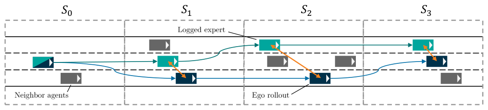

## Summary

DriveMLP 的核心发现是一个反直觉的结论：**训练策略比模型复杂度对自动驾驶规划的闭环性能影响更大**。作者通过同一 MLP 架构下四种训练方法的受控对照实验，证明 Expert-Guided RL（EGRL）——把 RL 当作优化工具、用 expert trajectory distance reward 在 non-reactive simulator 里训练——在 nuPlan Val14 Reactive 上达到 86.51，比 BC 高出 54 个点，比 BC-RL 高 8.46 个点。EGRL 的关键设计是：其他 agent 按日志回放（保证 expert trajectory 始终是有效参考），reward 是指数形式的轨迹距离（position 项归一化到 expert 位移、velocity 项直接 penalize speed deviation），不需要 adversarial reward learning、不需要 rule-based reward component、不需要 post-processing。2.3M 参数的 MLP 比 Flow Planner（14.27M）快 15×，推理 2.76ms。论文还做了 cross-backbone transfer：把 EGRL 套到 PlanTF / PLUTO / Diffusion Planner 的 encoder 上，reactive 性能分别提升 1.70 / 6.78 / 3.92 个点，进一步证明"训练策略的可迁移性"。理论上，EGRL 通过 closed-loop rollout 在 policy 自己诱导的状态分布上优化，把 BC 的 quadratic compounding error bound 降到 linear（connection to DAgger），同时指数 reward 在 sharpness $\alpha_1 \to \infty$ 极限下退化为 exact state matching，连接到 soft occupancy matching（connection to IRL）。

## Problem & Motivation

- Open-loop IL（PlanTF, PLUTO, Diffusion Planner, Flow Planner）在 Non-Reactive 上分数尚可，但 Reactive 设置下掉得厉害——nuPlan Val14: Flow Planner 90.43 NR → 83.31 R（-7.12），PlanTF 84.27 → 76.95（-7.32）。根因是 BC 学的是 one-step 行为，没有暴露在自己诱导的状态分布上，distribution shift + causal confusion。
- 一个典型的 causal confusion 例子：Diffusion Planner 在训练时加入 ego-state input 后，closed-loop 性能反而掉了近 10 个点——说明 open-loop 训练会把有用的 causal cue 变成 spurious shortcut。
- Standard RL 靠 rule-based reward（CaRL, GIGAFLOW），需要大量 reward engineering；IRL（GAIL, AIRL）靠 adversarial reward learning，计算昂贵且不稳定。
- 问题：能不能用 expert demonstration 直接导出 reward，让 RL 在 non-reactive simulator 里训练，既避免 rule-based reward 的 engineering burden，又避免 adversarial reward learning 的 instability？
- 作者的对照实验设计：**固定架构（同一 MLP）、固定数据、固定超参**，只改变训练方法——BC / AIRL / BC-RL / EGRL，看训练策略本身能带来多大提升。

## Method

**1. Non-reactive simulator（§2.2）**

- 这是 EGRL 可行的前提：ego 由学习策略控制并遵循车辆动态约束，其他 agent 按日志轨迹独立回放，静态环境固定。
- 如果改成 fully reactive（其他 agent 响应 ego 行为），ego 的 deviation 会改变周围 agent 的轨迹，expert trajectory 就不再是有效参考，trajectory-distance reward 失去意义。
- 这个设计把 DAgger 的"需要 interactive expert access"问题换成了"需要 non-reactive log-replay simulator"——后者在自动驾驶里天然存在（nuPlan、Waymax 等都提供）。

**2. Trajectory-distance reward（§2.3）**

- 核心思想：最小化 ego rollout 与 expert trajectory 的偏差，等价于在 Gaussian noise 模型下最大化 expert state visitation 的 likelihood。
- Position reward（速度归一化）：

$$
r_t^{\text{pos}} = \exp\left( -\alpha_1 \frac{\delta_t}{\kappa_t^{\text{expert}} + \epsilon} \right),\quad
\delta_t = \|p_t^{\text{ego}} - p_t^{\text{expert}}\|_2,\quad
\kappa_t^{\text{expert}} = \|p_t^{\text{expert}} - p_{t-1}^{\text{expert}}\|_2
$$

- $\kappa_t^{\text{expert}}$ 是 expert 的位移，作为归一化项让高速时的 deviation tolerance 自动变大（同样的控制误差在高速下产生更大的 positional deviation）。
- Velocity reward：

$$
r_t^{\text{vel}} = \exp\left( -\alpha_2 \left| v_t^{\text{ego}} - v_t^{\text{expert}} \right| \right)
$$

- 总 reward：

$$
r_t = \alpha_3 r_t^{\text{pos}} + (1 - \alpha_3) r_t^{\text{vel}}
$$

- Termination：超出 expert trajectory 邻域、碰撞、off-road——这些是"trajectory-distance reward 不再有效"的信号，而非 driving preference 的编码。终止时给固定 penalty $r_p$。
- 为什么用指数而非直接 distance？消融显示去掉指数（用 inverse distance）从 86.51 掉到 82.74；去掉归一化直接用 raw distance 塌到 47.58——归一化是最关键的组件。

**3. Policy architecture（§2.4）**

- Permutation-invariant set encoder：分别编码 ego state（含 velocity / acceleration / steering angle / yaw rate）、map（lane geometry + traffic light + route）、neighboring agents、static obstacles。
- 每个 encoder 是 shared MLP applied to each input element → mean pooling → 第二个 MLP；所有 encoder 输出拼接后再过一个 MLP 得到 joint latent。
- Policy head：对角高斯，输出 mean 和 diagonal variance。Value head：MLP。
- 参数量：DriveMLP 2.33M。

**4. RL 算法选择**

- Highway-env：SAC；nuPlan：PPO。作者没有严格解释为什么 nuPlan 用 PPO 而不是 SAC，附录只说两者都可以，但 PPO 在 nuPlan 上的稳定性更好。

**5. 关键超参（附录 B）**

| 项 | 设置 |
|:--|:--|
| 训练步数 | nuPlan 80M |
| 优化器 | Adam |
| Reward 超参 | $\alpha_1=3.0$、$\alpha_2=0.5$、$\alpha_3=0.9$ |
| 终止 penalty $r_p$ | 0 |
| $\gamma$ | 0.99 |
| PPO clip | 0.2 |
| Mini-batch | 256 |
| 环境 horizon | nuPlan 取决于 scenario，最长约 150 steps |

**6. 理论讨论（附录 C）**

- **Connection to DAgger**：BC 的 compounding error bound 是 $J(\pi^*) - J(\pi_\theta) \leq 2T^2\epsilon_{\text{BC}}$（quadratic in $T$）；EGRL 的 bound 是 $O(T \epsilon_{\text{EGRL}})$（linear in $T$），因为 policy gradient 在自己诱导的分布上计算，不需要在 expert 分布下近似。
- **Connection to IRL**：指数 reward 在 $\alpha_1 \to \infty$ 极限下退化为 indicator $\mathbb{1}[\delta_t=0]$，等价于 exact state matching；有限 $\alpha_1$ 时提供 soft occupancy matching，避免了 GAIL/AIRL 的 adversarial min-max。
- **Connection to SQIL**：SQIL 给 expert state 分配 $r=1$、其他 $r=0$，sparse signal 导致高方差；EGRL 给每个 rollout step 分配连续 gradient，方差更低。
- **Connection to regularized BC**：EGRL 可以分解为"policy 正则化 + Bellman-consistency prior"的 BC 变体，但正则项由 closed-loop rollout 自动生成，不需要 hand-craft。

## Pipeline

*Teal rectangle 是 logged expert ego trajectory；Dark blue 是 ego rollout（被学习策略控制）；Gray rectangle 是其他 agent 按日志轨迹独立回放；Orange arrow 是 ego 与 expert 在同一时刻的 position distance，用于 reward 计算。*

1. **初始化**：随机初始化 policy $\pi_\theta$ 和 value $V_\phi$，加载数据集 $\mathcal{D}$ 的所有 scenario（含 map / route / static objects / all agent trajectories）。
2. **采样 scenario**：从训练集随机选一个 scenario，把它固定为"non-reactive environment"——其他 agent 按日志轨迹回放，不再响应 ego。
3. **Rollout**：从 scenario 的初始状态开始，policy 输出 steering + acceleration，simulator 按车辆动态约束推进 ego state；其他 agent 继续播放预定义轨迹。
4. **计算 reward**：每步计算 ego 与 expert 的 position distance $\delta_t$，算 $r_t^{\text{pos}}$ 和 $r_t^{\text{vel}}$，加权得到 $r_t$；若偏离 expert 邻域、碰撞或 off-road，终止 episode 并给 $r_p=0$。
5. **RL update**：把整个 rollout 存进 buffer，PPO（或 SAC）做 gradient update——policy gradient 在 policy 自己诱导的分布上计算。
6. **循环**：重复 step 2–5 共 80M steps（nuPlan），validation score 在约 50M steps 时 plateau。
7. **测试**：固定 policy，在 Reactive（其他 agent 响应 ego）和 Non-Reactive（回放）两种设置下评估 nuPlan Val14 / Test14-Hard / Test14。

## Key Results

**1) Controlled training strategy comparison（同一架构，四种训练方法，Table 1）**

| Method | Highway-env Reward↑ | Ep. Len↑ | Term.↓ | Val14 NR | Val14 R | Test14-Hard NR | Test14-Hard R | Test14 NR | Test14 R |
|:--|--:|--:|--:|--:|--:|--:|--:|--:|--:|
| BC | 17.20±3.26 | 23.56±4.28 | 48.7% | 53.64 | 32.36 | 17.06 | 19.50 | 30.36 | 33.01 |
| AIRL | 20.37±0.40 | 28.48±0.46 | 9.3% | 51.74 | 58.74 | 43.00 | 52.09 | 48.88 | 61.15 |
| BC-RL | 20.28±0.92 | 28.70±1.15 | 20.0% | 77.19 | 78.05 | 66.05 | 65.35 | 77.17 | 77.23 |
| **EGRL** | **21.02±0.79** | **29.17±1.01** | **7.3%** | **90.38** | **86.51** | **76.68** | **74.50** | **86.38** | **87.06** |

- 同一 MLP 架构下，EGRL 在所有 benchmark 上第一；nuPlan Reactive gap：EGRL 86.51 vs BC 32.36（差 54.15）vs AIRL 58.74（差 27.77）vs BC-RL 78.05（差 8.46）。
- AIRL 在 Highway-env 上还不错，但在 nuPlan 上不稳定且性能最低——adversarial reward learning 在大规模场景下 scaling 困难。
- BC-RL 用的是 safety-related reward（不是 expert-derived），在 Non-Reactive 上也能学到不错的 reactive gap（78.05），但还是落后于 EGRL 8.46 个点。

**2) Cross-backbone transfer（把 EGRL 套到 SOTA encoder 上，Table 2）**

| Model | Original (Val14-R) | +EGRL | Δ% | Params |
|:--|--:|--:|--:|--:|
| PlanTF | 76.95 | 78.26 | +1.70 | 2.0M |
| PLUTO w/o ref. | 78.11 | 83.41 | +6.78 | 2.4M |
| Diffusion Planner* | 82.80 | 86.05 | +3.92 | 2.3M |

- 所有 backbone 套上 EGRL 后 reactive 性能都提升——训练策略的 benefit 与 backbone 无关。
- PLUTO 的 encoder 提升最大（+6.78），说明某些架构被 open-loop 训练的 distribution shift 伤害得更深。
- 迭代生成头（Diffusion / Flow）无法直接套 EGRL——需要在线 RL through multi-step denoising loops，这正是 PlannerRFT 系列在做的事。

**3) SOTA comparison（Table 3）**

| Method | Val14 NR | Val14 R | Test14-Hard NR | Test14-Hard R | Test14 NR | Test14 R |
|:--|--:|--:|--:|--:|--:|--:|
| PlanTF | 84.27 | 76.95 | 69.70 | 61.61 | 85.62 | 79.58 |
| PLUTO w/o refine | 88.89 | 78.11 | 70.03 | 59.74 | **89.90** | 78.62 |
| Diffusion Planner | 89.87 | 82.80 | 75.99 | 69.22 | 89.19 | 82.93 |
| Flow Planner | **90.43** | 83.31 | 76.47 | 70.42 | 89.88 | 82.93 |
| **DriveMLP** | 90.38 | **86.51** | **76.68** | **74.50** | 86.38 | **87.06** |

- DriveMLP 在所有 Reactive split 上第一：Val14-R 86.51（比 Flow Planner 高 3.2），Test14-Hard-R 74.50（高 4.08），Test14-R 87.06（高 4.13）。
- Reactive gap 显著更小：DriveMLP NR→R 差 3.87，Flow Planner 差 7.12——说明 closed-loop 训练有效缓解了 distribution shift。
- Non-Reactive 上 DriveMLP 略低于 PLUTO（89.90 vs 86.38），但差距小。

**4) Inference speed（Table 4）**

| Method | Time (ms)↓ | Params (M)↓ | Val14-R↑ |
|:--|--:|--:|--:|
| PlanTF | 8.30 | **2.02** | 76.95 |
| PLUTO w/o refine | 17.33 | 4.06 | 78.11 |
| Diffusion Planner | 72.34 | 6.04 | 82.80 |
| Flow Planner | 42.31 | 14.27 | 83.31 |
| **DriveMLP** | **2.76** | 2.33 | **86.51** |

- DriveMLP 比 Flow Planner 快 ~15×，比 Diffusion Planner 快 ~26×，比 PlanTF 快 ~3×。
- 训练开销：DriveMLP 需 ~112 NVIDIA L4 GPU-hours（~4.7× BC），Diffusion Planner 复现需 ~240 A100 GPU-hours；按 TFLOPS 归一化，DriveMLP 用 ~3-5× 更少算力达到更好 reactive 性能。

**5) Reward formulation ablation（Table 5）**

| Reward | Val14 NR | Val14 R |
|:--|--:|--:|
| **Base** | **90.38** | **86.51** |
| w/o speed reward | 87.44 | 84.92 |
| w/o exp.（用 inverse distance） | 84.87 | 82.74 |
| w/o normalization（直接 raw distance） | 50.49 | 47.58 |

- 归一化最关键（塌 38.93 点），指数形式次之（塌 3.77 点），speed reward 去掉也掉 1.59 点。
- Position reward 的速度归一化 $\kappa_t^{\text{expert}}$ 是核心组件——它让 reward 的灵敏度自动随速度调整。

**6) Noise robustness & data efficiency**

- **Noise**：向控制量注入 Gaussian noise（acceleration σ，steering μ+σ）后，DriveMLP 在所有 noise 设置下 Val14-R 保持 >82；Diffusion Planner（训练时用 data augmentation）从 82.80 掉到 ~40——closed-loop RL 学到的 policy 对 execution noise 显著更鲁棒。
- **Data efficiency**：把训练数据量减到 10%，DriveMLP 仍保持较强性能；Diffusion Planner 的 drop 更大。作者解释为 RL exploration 在有限数据下生成了"自适应"的 informative training data，而 augmentation 只能生成预定义 perturbation pattern。

## Strengths & Weaknesses

**Strengths**

- **反直觉但扎实的发现**：训练策略 > 模型复杂度——相同 MLP 架构，EGRL 比 BC 高 54 个点、比 BC-RL 高 8 个点；跨 backbone 迁移实验进一步验证 benefit 与架构无关。这直接挑战了社区"堆模型复杂度就完事"的默认假设。
- **Reward 设计极简但有效**：无 rule-based component（没有 speed limit / lane-keeping / comfort）、无 adversarial learning、无 auxiliary loss、无 post-processing。整个 reward 就是 expert trajectory distance，加上一个巧妙的速度归一化。消融显示归一化是最关键的组件（去掉塌 38 点）。
- **Non-reactive simulator 这个设计很聪明**：它把 DAgger 的"需要 interactive expert access"难题换成了"需要 non-reactive log-replay simulator"——后者在自动驾驶里天然存在，而且 ego deviation 不会改变其他 agent 行为这一点让 expert trajectory 始终是有效参考。
- **理论分析扎实且可验证**：connection to DAgger（quadratic → linear error bound）、connection to IRL（soft occupancy matching）、connection to SQIL（dense vs sparse gradient）、connection to regularized BC——每条都有可检验的推断。
- **工程上极其简单**：2.3M MLP、2.76ms 推理、单 stage 训练、无 auxiliary heads、无 curriculum learning、无 multi-source training。作为一个 baseline，它的性价比极高。
- **消融全面**：reward formulation、training dynamics（20M steps 超 BC、50M plateau）、noise robustness、data efficiency、cross-backbone transfer、ego-state ablation（ego-state 帮助 EGRL 但 hurting open-loop IL——直接解释了 causal confusion）。

**Weaknesses**

- **Non-reactive simulator 的假设可能局限**：真实世界里 ego 的行为会改变其他 agent 的轨迹（lane change、gap acceptance），non-reactive replay 无法捕捉这种交互。nuPlan 的 Reactive 测试虽然比其他方法好，但 DriveMLP 还是比 NR 掉了 3.87 个点；在 fully reactive 场景下 gap 可能更大。
- **Reward 锚定 expert 质量**：如果 expert demonstration 里有次优行为（如保守的减速、不自然的轨迹），policy 会直接学到这些。Data efficiency ablation 减到 10% 数据还行，但完全去掉 expert 呢？
- **只输出 low-level control，不是 trajectory planning**：业界主流是 trajectory output（PlanTF / PLUTO / Diffusion Planner / Flow Planner 都输出 multi-step trajectory），low-level control（steering + acceleration）可能限制下游控制器的灵活性——尤其是当车辆动态约束在不同车型上变化时。
- **Sim2Real 未验证**：论文自己承认 object-level planning policy 的 sim2real transfer 还没解决，DriveMLP 的 low-level control + 轻量架构虽然可能更容易部署，但没有真实车测试。
- **与 BC-RL 的比较不完全公平**：BC-RL 用的是 safety-related reward（不是 expert-derived），EGRL 用的是 expert trajectory reward——两者 reward 信号本质不同。论文把 BC-RL 归为"同训练范式的 baseline"，但严格来说 BC-RL 是 IL + rule-based RL 的混合，不是 IL + expert-derived RL。
- **没有真正解决 causal confusion 的根因**：DriveMLP 训练时还是给了 ego-state input（ablation 显示有帮助），但理论上它并没有区分"哪些特征是 causal 的"。它只是通过 closed-loop rollout 让 policy 更不容易过拟合到 spurious correlation——这是 mitigation，不是 resolution。
- **Highway-env variance 较大**：EGRL ±0.79 vs AIRL ±0.40，3 seeds 不够。nuPlan 用了几个 seeds 论文没说。
- **EGRL 无法直接套到迭代生成头**：作者自己承认 diffusion/flow planner 的 denoising loop 太 computationally intensive，无法做在线 RL。这意味着论文的"训练策略 > 模型复杂度"结论目前只对非迭代架构成立。
- **训练开销虽省 but non-trivial**：112 L4 GPU-hours 是 BC 的 4.7×，对于资源有限的团队可能仍是负担。

## Notes

+ **论文定位**：不是新的 planner architecture，而是一次系统性的**训练策略对照实验**——固定架构、固定数据、固定超参，只改变训练方法，看"训练策略本身"能带来多大提升。结论是：同一个 MLP，EGRL 把 nuPlan Reactive gap 从 BC 的 54% 压到 4%，比 Flow Planner（14.27M 参数）还快 15×。论文的主张不是"MLP 比 diffusion/flow 好"，而是"**先把训练策略做对，再考虑模型复杂度**"。
+ **可迁移点**：
  - **Non-reactive simulator + expert-derived reward** 这个组合可以套到任何有 expert 日志的规划场景上，包括你做的自动驾驶 planning——不需要 adversarial reward learning，不需要 rule-based component。关键前提是 non-reactive replay，这在 nuPlan / Waymax 等 benchmark 里天然存在。
  - **指数 reward 加速度归一化**：$r_t^{\text{pos}} = \exp(-\alpha_1 \delta_t / \kappa_t^{\text{expert}})$ 这个 $\kappa_t^{\text{expert}}$ 归一化项很巧妙，让高速时的 deviation tolerance 自动变大，避免了"高速下 reward 被压扁、低速下 reward 太敏感"的问题。
  - **Permutation-invariant set encoder + MLP** 作为 planning backbone 可能比 diffusion/flow 更轻量，适合 real-time deployment。如果你做的场景有实时性约束，值得对比。
+ **待跟进**：
  - 把 EGRL 训练策略套到 diffusion/flow planner 上——论文自己承认做不了，这正是 PlannerRFT / WorldRFT / Multi-ORFT 系列在尝试的方向，但那些方法都需要先训好 diffusion/flow，再在 denoising 层面做 RL；EGRL 的 reward 设计能不能直接用到 diffusion 的 output space（trajectory distance vs denoising space）？
  - Sim2Real 验证：DriveMLP 的 low-level control + 轻量架构，可能比 diffusion 模型更容易部署到真实车。如果能拿到 nuScenes / Waymo 的真车数据，值得测一下。
  - 与你做的 **VGGT 几何信息注入** 结合：DriveMLP 的 state space 里没有显式 3D 几何（只有 ego-centric map polylines + agent positions）。如果把 VGGT 的 occupancy / geometry 特征注入到它的 set encoder 里，看看 reactive 性能能不能再提升——尤其是在 occlusion 严重的场景。
  - 把 low-level control 改成 trajectory output，看 EGRL 在 trajectory space 里是否仍有效：论文说 trajectory output 的 planner 套 EGRL 有困难（output space 不同），但如果 trajectory 是 one-step 的，RL 能不能直接优化 trajectory distance？
  - 把 EGRL 和你之前读的 **PlannerRFT / WorldRFT / VPFlow** 做一个系统对比：三者都用 RL 优化规划，但 reward 设计（expert trajectory distance / rule-based reward / value-predictive imagined reward）和搜索空间（action space / denoising space / value level set）完全不同——能画出一条 "RL 用于 planning 的演化脉络" 吗？
