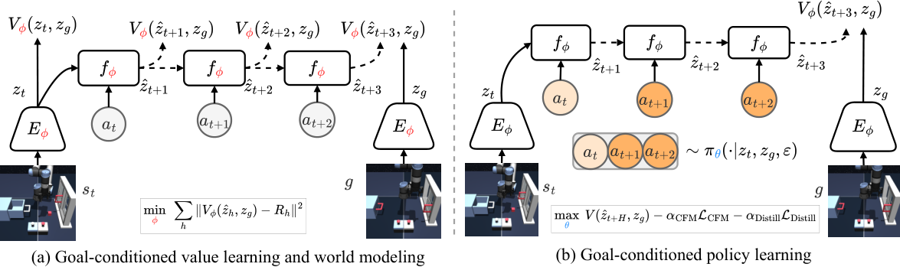

## Summary

Offline goal-conditioned RL 里有一个被普遍忽略的结构：在 hindsight relabeling 下，任意状态到同一轨迹上未来 goal 的稀疏奖励 Monte Carlo return 有闭式解，只取决于两者之间的时间距离 $d$。VPFlow 把这个闭式 return 当作 latent world model 的**唯一**监督——observation encoder、latent dynamics、goal-conditioned value head 联合训练，imagined latent 被要求预测 goal-reaching value 而不是匹配未来 state。于是 world model 可以是不准确的 simulator，却保持 value equivalence：不需要重建、不需要 target encoder / EMA / stop-gradient，也不需要显式的 anti-collapse 正则。控制侧蒸馏出一个 one-step flow policy，测试时在它的**噪声空间**里用 imagined generalized advantage 做搜索（ε-ES 或 ε-SGD / ε-Adam），解码出的 action 天然落在数据支撑内，绕开 action-space CEM 的 OOD 查询。OGBench 30 个 dataset：17 个 state 数据集平均成功率 **63.2%**（最强 model-free baseline GCIQL 32.9%），13 个 pixel 数据集 **37.6%**（CRL 27.5%）；而其 next-latent 预测误差比 state-predictive 版本大 1–8 个数量级，成功率反而更高。

## Problem & Motivation

- Offline goal reaching 与 model-based planning 的组合很有吸引力：一次离线预训练，测试时通过 goal 指定 + 想象未来做零样本适配。但这一组合此前几乎没有被系统研究。
- 现有 world model 方法沿袭一个未经检验的假设：planning 需要准确预测下一 state 或下一 latent。JEPA 类（PLDM、LeWM）靠 target encoder、stop-gradient、VICReg / SIGReg 防表征坍缩；TD-MPC 靠 target network、EMA 和 TD bootstrap。代价是引入一堆与任务无关的启发式。
- Goal reaching 自带额外监督：hindsight relabeling 把任意轨迹转成"到达了某个 goal"的成功样本，稀疏奖励下的 Monte Carlo return 有解析形式（式 3）。因此 value learning 可以从 TD bootstrap 退化为对固定目标的直接回归，这个回归目标反过来可以端到端监督 latent dynamics。
- 作者的理论依据是 value equivalence principle：两个 dynamics 只要诱导相同的 Bellman 算子，对策略学习就是等价的。推广到 world model，就是两个预测表征只要被 goal-conditioned value 函数评成相同值即等价，不必匹配未来 state。这放松了对 dynamics 的约束，可能扩大可达空间。
- 控制侧的问题是 search space 而非 algorithm：CEM / MPPI 直接扰动原始 action 序列，在低覆盖的 offline 数据上很快离开数据分布，value 函数被 OOD 查询利用（advantage exploitation）。生成式策略的噪声空间提供了"解码后仍在数据流形上"的候选集，天然适合做测试时搜索。

## Method

**0. 总体框架**

- 三组参数交替训练：$\phi$ 覆盖 encoder $E_\phi$、latent dynamics $f_\phi$ 与 twin value heads $V_{\phi,1},V_{\phi,2}$；$\theta$ 覆盖 velocity field $v_\theta$ 与蒸馏后的 one-step policy $\pi_\theta$。policy update interval $U=1$，即每步都更新。
- 训练不需要目标网络，也不需要重建项；value head 取两个头的 min 以抑制高估。

**1. Value equivalence principle（§5.1）**

- 两个预测表征 $\hat{s},\hat{s}'$ 关于某个 goal 等价，当且仅当 goal-conditioned value 给出相同评价：

$$
V_\phi(\hat{s},g)=V_\phi(\hat{s}',g)
$$

- 在稀疏 goal 奖励下 Bellman 算子可闭式写出，因此不需要递归 TD。直觉上，只要 imagined latent 落在正确的 value level set 上即可，simulator 是否忠实不重要。

**2. 闭式 hindsight Monte Carlo return（§5.2）**

- 设 $d$ 为同一轨迹上从 $s_t$ 到 relabeled goal $g=s_{t+d}$ 的步数，则折扣 return 为：

$$
R(s_t,g)=R(d)=\sum_{k=0}^{d}\gamma^{k}r(s_{t+k},g)=
\begin{cases}
\gamma^{d}, & r(s,g)=\mathbb{1}_{\{s=g\}} \\
\dfrac{1-\gamma^{d}}{\gamma-1}, & r(s,g)=\mathbb{1}_{\{s=g\}}-1
\end{cases}
$$

- 实践中采用后一种奖励形式，$R$ 随 $d$ 单调下降，可以直接当作"离 goal 还有多远"的进度信号。
- value goal 由三个来源混合采样：当前观测 0.2、同轨迹未来观测 0.5（偏移 $d\sim\mathrm{Geom}(1-\gamma)$）、数据集随机观测 0.3。随机 goal 不产生 value target，由 mask 置零。

**3. Value-predictive latent dynamics（§5.3）**

- 编码当前状态与 goal 后，dynamics 以 action chunk 为条件并行展开未来 latent：

$$
z_t=E_\phi(s_t),\quad z_g=E_\phi(g),\qquad
\hat{z}_{t+h}=f_\phi\left(z_t,a_{t:t+h-1}\right),\ h=1,\dots,H,\ \hat{z}_t\coloneqq z_t
$$

- VP 损失把每个 imagined latent 的 value 回归到数据集中对应真实状态的闭式 return：

$$
\mathcal{L}_{\mathrm{VP}}(\phi)\coloneqq\mathbb{E}_{(s_t,\bm{a}_t)\sim\mathcal{D},\,g\sim\mathcal{S}}\left[\frac{1}{H+1}\sum_{h=0}^{H}M_{t+h}\odot\left\|V_\phi(\hat{z}_{t+h},z_g)-R_{t+h}\right\|_2^2\right]
$$

- 关键点在于 target $R_{t+h}$ 只依赖数据集状态与时间距离，不含 $\phi$，因此是固定目标而非 bootstrap；encoder、dynamics、value head 被同一项联合优化。
- 该监督把表征空间按"到 goal 的时间距离"结构化，等于给 anti-collapse 提供了显式语义；论文的对照实验显示，仅靠 latent prediction + SIGReg 仍补不上这个差距（§D.2）。

**4. Flow policy as a behavior prior（§5.4）**

- 给定编码后的 state 与 goal，action chunk 的 Q 值用 imagined 终端 value 近似：

$$
Q(z_t,\bm{a}_t,z_g)\approx\mathbb{E}_{\hat{z}_{t+H}\sim f_\phi(z_t,\bm{a}_t)}\left[\gamma^{H}V_\phi(\hat{z}_{t+H},z_g)\right]
$$

- 策略损失为策略改进项加两项正则：

$$
\mathcal{L}_\pi(\theta)\coloneqq-Q(z_t,\bm{a}_t,z_g)+\alpha_{\mathrm{CFM}}\mathcal{L}_{\mathrm{CFM}}+\alpha_{\mathrm{Distill}}\mathcal{L}_{\mathrm{Distill}}
$$

- $\mathcal{L}_{\mathrm{CFM}}$ 在直线路径 $\bm{x}_u=(1-u)\bm{\varepsilon}+u\bm{a}$ 上拟合 velocity field，目标速度为 $\bm{a}-\bm{\varepsilon}$；$\mathcal{L}_{\mathrm{Distill}}$ 让 one-step policy $\pi_\theta$ 对齐多步 Euler 积分（10 步）的输出，teacher 侧 stop-gradient。one-step 解码是噪声搜索便宜的前提。

**5. Steering noise as planning（§5.5）**

- 稀疏奖励在 planning horizon 内没有排序信号，因此用 potential-based reward shaping 把 value 变成 dense reward：

$$
\delta_t=r_t+\gamma V_\phi(\hat{z}_{t+1},z_g)-V_\phi(\hat{z}_t,z_g)
$$

- 规划目标是对 reshaped reward 做 $(\gamma\lambda)$ 折扣累加，即 horizon $H$ 上的 GAE：

$$
A_t\coloneqq\sum_{h=0}^{H-1}(\gamma\lambda)^{h}\delta_{t+h},\quad \text{s.t.}\ \hat{z}_{t+h}=f_\phi(\hat{z}_t,a_{t:t+h-1})
$$

- $\lambda=1$ 时该式恒等于 $H$-step return 减去初始 value，因此最大化 GAE 与 MPC 的 $H$-step 目标一致；$\lambda<1$ 时相当于 $\lambda$-return，会改变候选排序。
- **ε-ES**（Algorithm 1）：$N_e$ 个 elite 初始化为策略 mode（$\bm{\varepsilon}=\bm{0}$），每轮把每个 elite 变异出 $N/N_e$ 个高斯子代，变异尺度退火 $\sigma_k=\max(\sigma_{\min},\sigma_{\max}\rho^{k})$；子代只有分数更高才替换父代，保证 elite 分数单调不降；最终按 $\exp(\beta A_e)$ 归一化权重采样一个 elite 执行。默认 $N=512$、$N_e=64$、$\beta=0.1$。
- **ε-SGD / ε-Adam**（Algorithm 3）：直接对噪声求梯度并做退火步长的梯度上升，单候选、$K$ 次前后向：

$$
\bm{u}^{(k)}=\nabla_{\bm{\varepsilon}}A\left(z_t,\operatorname{Dec}(\bm{\varepsilon}),z_g\right)\Big|_{\bm{\varepsilon}=\bm{\varepsilon}^{(k-1)}}
$$

- 论文在 locomotion 与 state 版 cube-single 上用一阶方案（实测更高），其余 manipulation 数据集用 ε-ES；所有方案只优化噪声，解码后的 action 裁到 $[-1,1]$。$K=0$ 即直接执行策略输出。
- 复杂度：ε-ES 为 $\mathcal{O}(KN\,C_{\mathrm{fwd}})$，一阶方案为 $\mathcal{O}(K(C_{\mathrm{fwd}}+C_{\mathrm{bwd}}))$。

**6. 关键超参**

| 项 | 设置 |
|:--|:--|
| 训练步数 / batch | state 1M、pixel 500k / 256 |
| 优化器 | Adam，cosine decay 到 0，grad clip 10 |
| action chunk $H$ | 16 |
| teacher Euler 步数 | 10 |
| latent 维度 $d_z$ | state 为观测维度，pixel 为 512 |
| dynamics | Transformer，width 192 / 3 layers / 3 heads，cross-attention + causal mask，RoPE |
| value heads | twin MLP，512/512/512 |
| flow 网络 | 按数据集取 192/3/3、384/4/6 或 512/4/8 |
| 学习率 $\eta_\phi=\eta_\theta$ | $3\times10^{-5}$ 至 $5\times10^{-4}$，逐数据集调 |
| 折扣 $\gamma$ | 0.99（pointmaze-giant、antmaze-giant 为 0.995） |
| $\alpha_{\mathrm{Distill}}$ / $\alpha_{\mathrm{CFM}}$ | 50–800 / 1 |
| planning | $n_c=1$、$N=512$、$N_e=64$、$\beta=0.1$，执行长度 1–16 |

## Pipeline

*(a) goal-conditioned value learning and world model：$E_\phi$ 编码当前观测，$f_\phi$ 按 action chunk 并行展开 imagined latents，各步 value 回归闭式 MC return；(b) goal-conditioned policy learning：one-step flow policy 把噪声解码为 action chunk，Q 值由 imagined 终端 value 给出，再用 CFM 与蒸馏正则约束在数据流形上。*

1. **采样**：从数据集轨迹随机取长度 $H$ 的片段 $(s_t,a_t,\dots,a_{t+H-1})$，按 0.2 / 0.5 / 0.3 混合采样 value goal，另从同轨迹未来观测采样 policy goal。
2. **编码与展开**：$z_t=E_\phi(s_t)$、$z_g=E_\phi(g)$；dynamics 一次并行调用得到 $\hat{z}_{t+1},\dots,\hat{z}_{t+H}$。
3. **算监督**：对每个 $h$ 计算时间距离 $d_h$ 与闭式 return $R_{t+h}$，mask 过滤跨轨迹或位于预测点之前的 goal。
4. **更新 world model**：最小化 $\mathcal{L}_{\mathrm{VP}}$，梯度同时穿过 encoder、dynamics 与 twin value heads。
5. **更新策略**：stop-gradient 编码 state / goal，采样噪声 $\bm{\varepsilon}$，one-step 解码 action chunk，用 dynamics 推一步到 $\hat{z}_{t+H}$，取 $\gamma^H\min_j V_{\phi,j}$ 作为 Q，优化 $-Q+\alpha_{\mathrm{CFM}}\mathcal{L}_{\mathrm{CFM}}+\alpha_{\mathrm{Distill}}\mathcal{L}_{\mathrm{Distill}}$。
6. **测试时规划**：每个控制步编码当前观测与 goal，在噪声空间最大化 $A_t$（ε-ES 或一阶梯度上升），解码后执行前 $H_{\mathrm{exec}}$ 个 action，再从新观测重规划。
7. **输出**：闭环执行；$K=0$ 时退化为纯 reactive flow policy。

## Key Results

**1) 与 model-free baseline 的对比（Table 1，成功率 %）**

| 输入 | 环境（数据集数） | GCBC | GCIVL | GCIQL | QRL | CRL | VPFlow |
|:--|:--|--:|--:|--:|--:|--:|--:|
| State | PointMaze (4) | 16.0 | 38.2 | 27.8 | 60.0 | 29.8 | **87.8** |
| State | AntMaze (4) | 19.8 | 31.8 | 35.0 | 53.0 | 61.8 | **68.0** |
| State | Cube (4) | 2.0 | 22.5 | 27.8 | 1.5 | 8.2 | **42.2** |
| State | Scene (1) | 5.0 | 42.0 | 51.0 | 5.0 | 19.0 | **78.0** |
| State | Puzzle (4) | 0.5 | 9.0 | 36.8 | 0.2 | 2.0 | **51.0** |
| State | Overall (17) | 9.3 | 26.4 | 32.9 | 27.3 | 25.1 | **63.2** |
| Pixel | AntMaze (4) | 5.0 | 9.0 | 5.2 | 1.5 | **68.2** | 61.0 |
| Pixel | Cube (4) | 7.2 | 21.0 | 13.2 | 16.8 | 13.5 | **34.8** |
| Pixel | Scene (1) | 12.0 | 25.0 | 12.0 | 10.0 | 11.0 | **33.0** |
| Pixel | Puzzle (4) | 4.2 | **28.2** | 6.5 | 0.2 | 4.8 | 18.3 |
| Pixel | Overall (13) | 6.0 | 19.8 | 8.6 | 6.5 | 27.5 | **37.6** |

- State 上每个环境组都第一，提升集中在 manipulation（Cube 42.2 vs 27.8、Scene 78.0 vs 51.0）；navigation 提升较小（AntMaze 68.0 vs 61.8），作者归因于 reactive policy 本身已能解决大部分导航任务。
- Pixel 上总体只比最强 baseline 高 10.1 点，且在 Visual AntMaze（61.0 vs 68.2）与 Visual Puzzle（18.3 vs 28.2）两组落后于单个 baseline。摘要中的 "at least 30.3 / 10.1 percentage points" 是相对**总体均值**的差距，不代表逐组占优。

**2) 与 latent planner 的对比**

- LeWM、PLDM、TD-MPC2 在 13 个 pixel 数据集中的 12 个上成功率为 0，Figure 4 只报告了唯一一组非零结果。
- 这三个 baseline 都训练 latent 去预测未来 state、再在 action 空间用 CEM 规划；论文据此认为这两条设计在多样化 play 数据上都不是最优。

**3) Value-predictive vs state-predictive（Q2，Figure 5）**

- 把 VP 损失换成 latent prediction（LP，式 13，$\lambda_{\mathrm{state}}=1$）后，next-latent 误差降低 1–8 个数量级，但四个数据集上成功率都没有提升：
  - scene-play：78.4% → 28.0%；
  - visual-cube-single：79.2% → 0.0%。
- visual-cube-single 的失败模式是坍缩：LP 项降到接近 0，encoder 找到"平凡可预测"的 latent，agent 永远到不了 goal。VP 因为没有匹配 target，反而通过时间距离把表征撑开。
- 加 SIGReg 的变体 $\mathcal{L}_{\mathrm{LP+SIG}}$ 改善了 LP 的表征，但没有弥合与 VP 的差距（§D.2）。

**4) 测试时搜索的位置与算法（Q3，Table 2）**

| Planner | 搜索空间 | Locomotion | Manipulation | All |
|:--|:--|--:|--:|--:|
| w/o steering（$K=0$） | – | 57.5 | 8.3 | 28.0 |
| $\mathcal{A}$-CEM | action | 22.6 | 1.6 | 10.0 |
| ε-CEM | noise | 53.2 | 31.5 | 40.2 |
| VPFlow（一阶 / ε-ES） | noise | **72.2** | **38.7** | **52.1** |

- Action-space CEM 比不搜索还差（10.0 vs 28.0），论文解释为 advantage 对 off-manifold action 的利用；同样的 CEM 换到噪声空间就恢复到 40.2，说明**搜索空间比优化算法更关键**。
- 增加迭代数 $K$ 在 cube-double、scene、visual-scene 上总体提升成功率（Figure 6），即测试时算力换性能；但论文也承认部分数据集上成功率会在 $K$ 增大后回落，而 imagined advantage 仍单调上升。

**5) Latent 的几何行为（Q4，Figure 7–8）**

- Visual AntMaze 的 t-SNE 显示：VP 训练下 imagined latents 会离开真实轨迹流形，但 agent 仍能到达 goal——dynamics 把 latent 推到"value 函数认为该处 value 正确"的位置。
- 定量上，VP 在 16 步 rollout 上的相对 latent 误差更大，但 value 误差通常更小（Figure 8(a)）；value field 的 level set 上，观测 latent 与 imagined latent 更接近（Figure 8(b)）。作者据此主张 latent error 不是可靠的 planning 指标，value error 才是。

**6) 规划目标消融（§D.1）**

- 与 mean-value、max-value 两种打分相比，GAE 在四组 visual 环境上均为最高，分别领先次优 7.7、2.0、6.0、3.3 个百分点。

## Strengths & Weaknesses

**Strengths**

- 论证链条干净：从 value equivalence principle 推出"只需 value 正确、不需 state 正确"，再用闭式 MC return 把它变成可实现的回归目标——方法是被理论推出来的，而不是堆模块堆出来的。
- 监督信号极简：没有 target network、EMA、stop-gradient、重建损失，也没有额外的 anti-collapse 正则；"value 目标不依赖 $\phi$"这一点同时解释了训练稳定性与防坍缩。
- 对"world model 必须预测未来 state"这一默认假设做了直接的反证实验：LP 把 latent 误差压低 1–8 个数量级却让成功率崩塌（scene-play 78.4→28.0、visual-cube-single 79.2→0.0），并补了 LP+SIGReg 对照排除"只是缺正则"的解释。
- 搜索空间与搜索算法被拆开比较（$\mathcal{A}$-CEM 10.0 / ε-CEM 40.2 / ε-ES 52.1），得出"空间比算法重要"这一可复用结论，而不是只报自家 planner 最好。
- 评测覆盖面大：OGBench 17 个 state + 13 个 pixel 数据集，8 / 4 个训练 seed，逐环境组报告而非只报总分。
- 作者在附录主动列出四条限制（轨迹不平滑、advantage 过优化、horizon 短、逐数据集调参），没有把方法包装成通用解。

**Weaknesses**

- **Pixel 上并非全面占优**：Visual AntMaze 61.0 低于 CRL 68.2，Visual Puzzle 18.3 低于 GCIVL 28.2；摘要的 "at least 10.1 points" 是总体均值口径，掩盖了组内落后。论文对此只有一句定性解释（long-horizon Visual AntMaze 落后），没有分析原因。
- **Model-free baseline 是引用而非复跑**：Table 1 的 GCBC / GCIVL / GCIQL / QRL / CRL 数字直接取自 OGBench 报告，训练预算、评测协议是否与 VPFlow 完全一致未说明；而 VPFlow 自身是逐数据集调参的，比较口径不完全对等。
- **Latent planner baseline 全零的可信度存疑**：LeWM / PLDM / TD-MPC2 由作者自行适配（Table 3），12/13 pixel 数据集成功率为 0 是极强的结论。附录 B.6 又明确说 planner 比较使用"分别调参、不匹配计算预算"，那么这组对比既不能证明 baseline 方法本身弱，也无法排除适配不当。
- **逐数据集调参削弱泛化主张**：学习率、$\alpha_{\mathrm{Distill}}$（50–800）、planner 类型与 $K$、$\sigma$、$\lambda$、$H_{\mathrm{exec}}$ 都在 30 个数据集上各自搜索。作者自己承认 manual per-dataset tuning is laborious；在这种协议下"value prediction 更好"的结论仍然成立，但"方法可直接用于新任务"不成立。
- **Value 目标来自次优 play 数据**：闭式 return 用的是数据里实际走过的时间距离，因此学到的 value landscape 反映行为分布而非最短路径。作者承认轨迹不平滑、不 time-optimal，receding-horizon 换 chunk 还会引入不连续；这使"到达 goal"与"以合理方式到达 goal"之间存在缺口。
- **理论保证只到 value equivalence，不到 planning 最优性**：value 函数在数据集状态上训练，却被用于评价 imagined latent；没有任何机制保证 imagined latent 的 value 校准正确（这也正是 advantage 过优化的根源）。所谓"imperfect world model 仍可规划"是经验结论，缺一个刻画"多不准确还能用"的界。
- **搜索会自我利用模型误差**：$K$ 增大时部分数据集成功率回落而 imagined advantage 单调上升，说明搜索最终在 exploit dynamics / value 的近似误差。论文只把它列为 limitation，没有给不确定性惩罚或 early stopping 的实际方案。
- **规划 horizon 固定为单个 chunk（$H=16$）**：长程任务的性能几乎全压在 terminal value 上；一旦 value 在局部平坦或具有欺骗性，$n_c=1$ 的设定就没有回旋余地。作者把扩展到数百步列为 future work。
- **"30 数据集"的统计强度不均**：Scene 只有 1 个数据集，其 78.0 与 33.0 的点估计没有跨数据集方差；不同环境组样本量差异大，总体均值会被 PointMaze（87.8）这类简单任务抬高。
- **缺少真实机器人或高维视觉验证**：全部实验在 OGBench 的 64×64 像素或低维 state 上完成，state 输入甚至用 identity encoder（$d_z$ 等于观测维度），value-predictive 表征在真实感知（如驾驶场景的 3D 特征）上是否仍成立未被检验。
- **One-step 蒸馏的质量没有单独消融**：$\alpha_{\mathrm{Distill}}$ 跨数据集相差 16 倍（50–800），one-step 策略与 10 步 teacher 的差距、以及它是否限制了搜索上限，都没有报告。

## Notes

+ **论文定位**：不是新的 planner，而是对 "world model 该学什么" 的一次重新表述——把 offline goal reaching 的闭式 return 当作免费监督，把表征学习目标从 state prediction 换成 value prediction；planner 只是这套表征的一个使用方式。
+ **可迁移点**：
  - "监督信号是否依赖被学的参数"是一个值得复用的设计判据：VP 的 target 由数据集时间距离给出、不含 $\phi$，因此天然免去 target network / EMA / stop-gradient 这一整套稳定性装置。
  - 噪声空间搜索 + 生成式策略先验，可以套到任何 flow / diffusion planner 上；它把 OOD 风险从"action 是否合理"前移到"噪声是否在训练分布内"，比在 action 空间加惩罚更直接。
  - "latent error 不是 planning 的可靠指标，value error 才是"提供了一个评估视角：如果一个 world model 的用途是决策，就不该用重建/预测误差给它打分。
+ **待跟进**：
  - 在没有闭式 return 的设定（dense reward、cost-based driving planning、多目标）里，能否构造等价的固定回归目标？这是该方法能否离开 goal reaching 的关键。
  - 把 value-predictive 监督用到高维感知特征（VGGT / DINOv2 / VLM latent）上，检验"不需要 state prediction"在真实视觉输入下是否仍成立。
  - 给搜索加不确定性或 pessimistic penalty，看能否把 $K$ 增大后的成功率回落压住；这决定测试时算力能否安全地继续放大。
  - 用同一个配置跑多任务/多数据集训练，验证"闭式回归不依赖 TD bootstrap，因此更适合统一预训练"这一说法。
