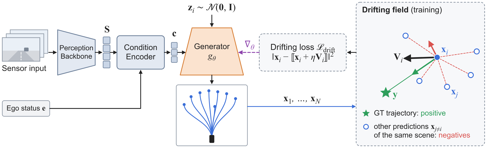

## Summary

Drifting model 把扩散的"迭代"从推理搬到训练：生成器 $g_\theta$ 一次前向就把噪声映射成样本，训练时用一个核场把生成样本拉向正样本、推离其他生成样本，收敛后 $q_\theta = p$。DriftingPlanner 是这套框架在轨迹规划上的第一次适配，它必须解决两个规划特有的困难。第一，图像生成里有离散类别，同一类的多张图共享目标分布；规划里每个 scene 就是自己的条件，只有一个 GT 轨迹，所以场必须逐 scene 计算。第二，逐 scene 计算只剩一个正样本，吸引项把 $N$ 条生成轨迹拉向同一点、互斥项把它们推开，结果它们停在一个以 GT 为球心的球壳上——推理时采样一次得到的是球壳上的一点而不是球心。作者用两个手段处理这个球壳：对单 query 解码器用 antithetic 推理，成对解码 $g(\mathbf{c},\mathbf{z})$ 与 $g(\mathbf{c},-\mathbf{z})$ 再平均，可证明能精确消去生成器关于 $\mathbf{z}$ 的所有奇次项（包括决定球壳半径的线性项），且是生成分布均值的无偏估计；对多 proposal 解码器改用逐坐标 Laplace 核，让横向与航向误差的权重不再被纵向大误差压平。整个解码器只用 drifting loss 训练，没有任何 $L_1$ 回归项。NAVSIM navtest 上 93.75 PDMS（DrivoR backbone + scorer，64 proposal 各出一对 antithetic 候选、共 128 条），同一 backbone 下纯解码器对比里单步 90.19 PDMS，与 flow matching 十步的 90.32 相差 0.13 点而延迟 6.49 ms vs 8.57 ms。

## Problem & Motivation

- 坐标回归解码器（TransFuser、DrivoR 等）速度快，但 $L_1$ 的最优解是每个坐标的中位数。当场景允许"保持车道"或"绕开障碍"两种都可行的机动时，中位数落在两者之间，而**两条可行驶轨迹之间的插值不保证可行驶**——DAC 与碰撞指标惩罚的正是这种情况。
- Diffusion / flow matching 建模的是分布而不是中位数，但代价在测试时：去噪要多步，驾驶方向最强的变体把 schedule 截断到 anchor 附近的 2 步；而且训练很少是纯生成式的，$L_1$ 辅助损失或学习到的 scorer 决定了大部分最终输出，因此报告的性能增益**无法归因于生成目标本身**。
- Drifting model 提供第三种选择：推理一次前向，训练时迭代。于是有一个直接问题——**只用 drifting loss、不加任何坐标回归项，能否在单步推理下与回归解码器和迭代生成解码器竞争**。
- 原版 drifting 不能直接用，因为它是为 class-conditional 图像生成设计的：场按 class label 分别计算，每个类有很多正样本。规划有两个差异（作者在 §1 明确列出）：
  1. 没有离散条件，每个 scene 由传感器输入与 ego 状态唯一确定，数据中没有任何其他样本共享它的目标分布。若把一个 mini-batch 的 scene 混在一起算场，会把 scene $b$ 的生成轨迹拉向无关 scene $b'$ 的 GT、并推离 $b'$ 的生成轨迹。
  2. 逐 scene 计算后只剩一个正样本（驾驶数据集每个 scene 只记录一条 GT 轨迹），于是产生上述球壳问题。

## Method

**1. Drifting 的基本形式（§3.1）**

- 生成器 $g_\theta$ 把 $\mathbf{z}\sim\mathcal{N}(\mathbf{0},\mathbf{I})$ 映射到样本 $\mathbf{x}$；$p$ 提供正样本，$q_\theta$ 提供负样本，核 $k(\mathbf{x},\mathbf{y})=\exp(-\lVert\mathbf{x}-\mathbf{y}\rVert_2/\tau)$ 定义漂移场：

$$
\mathbf{V}_{p,q}(\mathbf{x})=\frac{\mathbb{E}_{\mathbf{y}\sim p}\left[k(\mathbf{x},\mathbf{y})(\mathbf{y}-\mathbf{x})\right]}{\mathbb{E}_{\mathbf{y}\sim p}\left[k(\mathbf{x},\mathbf{y})\right]}-\frac{\mathbb{E}_{\mathbf{y}\sim q}\left[k(\mathbf{x},\mathbf{y})(\mathbf{y}-\mathbf{x})\right]}{\mathbb{E}_{\mathbf{y}\sim q}\left[k(\mathbf{x},\mathbf{y})\right]}
$$

- 第一项把 $\mathbf{x}$ 拉向正样本，第二项把它推离其他生成样本；$q=p$ 时两项抵消。训练目标是让生成器沿场走一小步后自我回归，stop-gradient 保证目标不反向传播：

$$
\mathcal{L}(\theta)=\mathbb{E}_{\mathbf{z}}\left\|g_\theta(\mathbf{z})-\mathrm{sg}\left[g_\theta(\mathbf{z})+\eta\mathbf{V}_{p,q_\theta}(g_\theta(\mathbf{z}))\right]\right\|_2^2
$$

- 与扩散的关键差异在部署形态：训练时分布被推着走，推理时仍只有一次前向。

**2. 问题设定（§3.2）**

- 输入 scene tokens $\mathbf{S}\in\mathbb{R}^{n_s\times d_s}$（相机 + LiDAR）与 ego 状态 $\mathbf{e}=[\mathrm{cmd},v_x,v_y,a_x,a_y]$，输出 $T$ 个位姿 $\hat{\mathbf{O}}=(\hat{\mathbf{o}}_1,\dots,\hat{\mathbf{o}}_T)\in\mathbb{R}^{T\times3}$，每项是当前 ego 坐标系下的位置（米）与航向（弧度）。
- 交叉注意力条件编码器把 $(\mathbf{S},\mathbf{e})$ 映射为条件向量 $\mathbf{c}$，生成器直接输出轨迹快照：

$$
\hat{\mathbf{O}}(\mathbf{c},\mathbf{z})=g_\theta(\mathbf{c},\mathbf{z}),\qquad \mathbf{x}=\operatorname{vec}(\hat{\mathbf{O}})\in\mathbb{R}^{D},\ D=3T
$$

- GT 轨迹 $\mathbf{y}=\operatorname{vec}(\mathbf{O}^\star)$ **只作为场中的正样本出现**，不参与任何直接的 $\mathbf{x}$–$\mathbf{y}$ 距离损失。

**3. Scene-isolated drifting field（§3.3）**

- 对 batch 内每个 scene 抽 $N$ 个 latent、解码 $N$ 条轨迹，核在形状 $B\times N\times(N_p+N)$ 的张量上逐 scene 计算，不同 scene 的生成轨迹永不配对。这一步等价于原版的 per-class 计算，只是把 class label 换成 scene，并接受 $N_p=1$。

- **特征尺度**：用候选池（GT + 生成轨迹）上的平均距离（带下界 $\gamma_{\min}$）把向量归一化，$\tilde{\mathbf{x}}=\mathbf{x}/\gamma$，缩放量 detach 但轨迹本身保留梯度。

- **各向同性 $L_2$ 核的问题**：整条轨迹共用一个权重时，距离被误差最大的坐标主导，驾驶里通常是最后几个位姿的纵向位置。于是"离目标很远"的生成轨迹在看到几乎均匀的权重，横向与航向误差只得到很弱的平均化修正。

- **逐坐标 Laplace 核**：每个坐标 $\ell$ 有自己的 logit 矩阵和自己的权重，坐标先按 batch 内该坐标的标准差 $s_\ell$ 归一化：

$$
L^{+}_{ip,\ell}=-\frac{\left|\mathrm{sg}(\bar{x}_{i,\ell})-\bar{y}_{p,\ell}\right|}{\tau},\qquad L^{-}_{ij,\ell}=-\frac{\left|\mathrm{sg}(\bar{x}_{i,\ell})-\mathrm{sg}(\bar{x}_{j,\ell})\right|}{\tau}
$$

- 自斥项置 $-\infty$；每个坐标只有本坐标的误差进入权重，纵向的大误差不再压平横向与航向的修正信号。

- **联合归一化**：把吸引块与互斥块拼成一个矩阵一起归一化，使靠近目标的轨迹按比例获得更少的斥力（两个独立 softmax 无法表达这种耦合）：

$$
\log\boldsymbol{\Pi}=\tfrac{1}{2}\left(\operatorname{logsoftmax}_{\mathrm{row}}(\mathbf{L})+\operatorname{logsoftmax}_{\mathrm{col}}(\mathbf{L})\right)
$$

- **交叉质量加权**：联合归一化后两块总质量不等，因此各自按对方的行质量加权，使每一行的吸引质量与斥力质量相等：

$$
W^{+}_{ip}=\Pi^{+}_{ip}\sum_j\Pi^{-}_{ij},\qquad W^{-}_{ij}=\Pi^{-}_{ij}\sum_p\Pi^{+}_{ip}
$$

- 相等之后，原始场只依赖相对位移，对整场景的平移不变；否则会多出 $(\sum_p W^+_{ip}-\sum_j W^-_{ij})\tilde{\mathbf{x}}_i$ 这一项，把轨迹往归一化空间原点推或拉，与目标位置无关。

$$
\mathbf{F}_i=\sum_p W^{+}_{ip}(\tilde{\mathbf{y}}_p-\tilde{\mathbf{x}}_i)-\sum_j W^{-}_{ij}(\tilde{\mathbf{x}}_j-\tilde{\mathbf{x}}_i)
$$

- **数值**：最锐温度下权重在单精度下会下溢，因此整个归一化与加权在 log 空间完成、逐 scene 减最大值，场用 float32 且关闭混合精度。

- **逐 scene 单位 RMS 与多温度求和**：场按每个 scene 自己的 RMS 归一化，使不同 scene 的步长一致，再在多个温度上求和（锐核管最近的生成轨迹，宽核管整体布局）：

$$
\hat{\mathbf{F}}_{b,i}=\mathbf{F}_{b,i}\Big/\sqrt{\tfrac{1}{ND}\textstyle\sum_{i'}\lVert\mathbf{F}_{b,i'}\rVert_2^2+\epsilon},\qquad \mathcal{L}_{\mathrm{drift}}=\frac{1}{BND}\sum_{b,i}\left\|\tilde{\mathbf{x}}_{b,i}-\mathrm{sg}\left(\tilde{\mathbf{x}}_{b,i}+\eta\mathbf{V}_{b,i}\right)\right\|_2^2
$$

**4. 球壳与 antithetic 推理（§3.4）**

- 单一正样本下，吸引把所有生成轨迹拉向 $\tilde{\mathbf{y}}_b$，互斥把它们推开，最终半径由两项平衡决定、而非由数据方差决定。规划器只能输出一条轨迹，单次采样得到的是球壳上的一点。
- 球壳是否顽固取决于生成器结构。若噪声分支以无仿射参数的 LayerNorm 结尾，$\mathbf{h}(\mathbf{z})=\mathrm{LN}(\mathbf{W}\mathbf{z})$ 满足 $\lVert\mathbf{h}(\mathbf{z})\rVert_2=\sqrt{D_h}$ 且 $\mathbf{h}(-\mathbf{z})=-\mathbf{h}(\mathbf{z})$：噪声特征的模长不随 $\mathbf{z}$ 收缩，生成器只能靠后续层压制它，而互斥项每一步都在把它们推开。
- 对策是成对解码再平均，即 Monte Carlo 的 antithetic variates：

$$
\hat{\mathbf{x}}_M(\mathbf{c})=\frac{1}{2M}\sum_{m=1}^{M}\left(g_\theta(\mathbf{c},\mathbf{z}_m)+g_\theta(\mathbf{c},-\mathbf{z}_m)\right)
$$

- 命题（§3.4，附证明）：设 $g(\mathbf{c},\mathbf{z})=\bar{\mathbf{x}}+\mathbf{J}\mathbf{z}+\mathbf{r}(\mathbf{z})$ 且 $\lVert\mathbf{r}\rVert\le\frac{\beta}{2}\lVert\mathbf{z}\rVert^2$，则 (1) 单条生成轨迹偏离中心的 RMS 至少为 $\lVert\mathbf{J}\rVert_F-\frac{\beta}{2}\sqrt{D_z(D_z+2)}$；(2) antithetic 估计量不含任何奇次项，误差上界为 $\frac{\beta}{2M}\sum_m\lVert\mathbf{z}_m\rVert^2$，与 $\mathbf{J}$ 无关；(3) 它是生成分布均值的无偏估计。
- 换句话说，单条样本完整体现了决定球壳半径的线性项 $\mathbf{J}\mathbf{z}$，而成对平均对任意 $M\ge1$ 都能精确消去它以及所有更高阶奇次项，只留偶次曲率。$M$ 对固定噪声使推理确定；条件编码器只跑一次，$2M$ 个输入作为一批送入生成器。
- 备选是**直接生成器**：$[\mathbf{c};\mathbf{z}]$ 上的 SiLU MLP，无归一化层，第一层对 $\mathbf{z}$ 的权重可以收缩，因此 $\mathbf{J}$ 能在训练中变小、单条轨迹本身就会靠近中心；antithetic 仍然适用，只是消去剩余的部分。

**5. 单 query 产生多个轨迹假设（§3.5）**

- 解码器只有一个轨迹 query（每个 scene 一个 $\mathbf{c}$），所有变化都来自 $\mathbf{z}$；没有 anchor、mode embedding 或 mode 分类器。但多个 latent 解出的是一组不同的假设，而不是同一条轨迹的副本。
- 来源可以写成一行梯度恒等式——因为目标是 stop-gradient 副本，对生成轨迹的梯度就是场本身乘常数：

$$
\nabla_{\tilde{\mathbf{x}}_{b,i}}\mathcal{L}_{\mathrm{drift}}=-\frac{2\eta}{BND}\mathbf{V}_{b,i}
$$

- 于是条件相近的 scene 的参数更新会叠加，$\mathbf{c}$ 处的生成器近似被 $p(\mathbf{y}\mid\mathbf{c})$ 上的平均场驱动，等效于一个多正样本集合：每条生成轨迹主要被离它近的正样本吸引，互斥项则把它们分开。回归解码器在同样数据上只会收敛到点估计（$L_1$ 下是中位数、$L_2$ 下是条件均值）。
- 若 $p(\mathbf{y}\mid\mathbf{c})$ 本身含有分离的机动，这套论证会把生成轨迹放到每一个机动上；但作者检查的场景里轨迹**只在单一机动内部散开**（曲率、速度剖面不同），没有跨机动的分组。

**6. 多 proposal 解码器 + scorer（§3.5）**

- 沿 DrivoR 的结构：一组学习到的轨迹 query 与 scene token 做注意力、在多个 decoder stage 里精炼，每个精炼后的 query 作为一个 proposal 的条件 $\mathbf{c}$，drifting 生成器替换掉原来的回归头。
- 每个 proposal 用一个 antithetic 对解码，scorer head 预测每条候选的 NAVSIM 子分数并选 PDMS 最高者；64 个 proposal → 128 条候选，全部来自同一次 batched 解码。

**7. 关键设置**

| 项 | 设置 |
|:--|:--|
| 轨迹 | 8 个位姿 / 4 s，当前 ego 坐标系 |
| 训练时每 scene 生成数 $N$ | 16 |
| 温度集 $\mathcal{T}$ | $\{0.2,0.5,1.0\}$（基线）；$\{0.02,0.05,0.2\}$（多数实验） |
| 漂移步长 $\eta$ | 0.1（基线）/ 0.2（单 query 实验） |
| 单 query 解码器训练 | DINOv2 ViT-S/14 + rank-32 LoRA，3 相机 224×336，48 个 register token（宽度 384），15 epochs |
| 多 proposal 解码器 | DrivoR backbone，64 proposal，每 proposal 一个 antithetic 对 |
| 核对比训练 | 从零训练 25 epochs，seed 42，仅 drifting loss |
| 消融用两个单模态 planner | Compact（$d=128$，120 epochs）、Wide（$d=256$，200 epochs），冻结 ImageNet ResNet-34 前视 token（16）+ LiDAR BEV token（16） |
| 训练目标 | 仅 $\mathcal{L}_{\mathrm{drift}}$，无 $L_1$/$L_2$ 回归项、无辅助损失 |
| Scorer 监督 | 训练时用 proxy PDMS（GPU 复现，与官方 scorer 的 Pearson 0.99、MAE 0.54 分） |

## Pipeline

*感知 backbone 与条件编码器把传感器输入和 ego 状态映射为条件 $\mathbf{c}$；生成器 $g_\theta$ 把 $(\mathbf{c},\mathbf{z}_i)$ 一次前向解码为轨迹 $\mathbf{x}_i$，$N$ 个 latent 得到同一场景的 $N$ 条轨迹。训练时（虚线框内）每条生成轨迹只有一个正样本（GT，绿色箭头）和 $N-1$ 个同场景负样本（stop-gradient 的其他生成轨迹，红色箭头），两者合成漂移场 $\mathbf{V}_i$（黑色箭头），生成器回归到 $\mathrm{sg}(\mathbf{x}_i+\eta\mathbf{V}_i)$。*

1. **编码**：多相机 / LiDAR token 加 ego 状态经交叉注意力条件编码器得到 $\mathbf{c}$。
2. **训练采样**：每个 scene 抽 $N=16$ 个 $\mathbf{z}$，一次批前向得到 $N$ 条轨迹（每条是把 8 个位姿的 $(x,y,\psi)$ 拼成的 $D=24$ 维向量）。
3. **构场**：正样本为该 scene 的 GT（$N_p=1$），负样本为同 scene 其他生成轨迹的 stop-gradient 副本；逐坐标算 Laplace logit → 联合归一化 → 交叉质量加权 → 得到原始场。
4. **归一化并求和**：逐 scene 单位 RMS 归一化后，在多个温度上求和得到 $\mathbf{V}_{b,i}$。
5. **更新**：最小化 $\lVert\tilde{\mathbf{x}}-\mathrm{sg}(\tilde{\mathbf{x}}+\eta\mathbf{V})\rVert^2$；GT 只出现在场里，没有直接回归。
6. **推理（单 query）**：固定 $M$ 对 antithetic 噪声，一批解码 $2M$ 条轨迹后平均，输出球心；$M$ 固定所以结果确定。
7. **推理（多 proposal + scorer）**：每个 proposal 解一对，128 条候选进入 scorer，选预测 PDMS 最高者。
8. **执行**：输出 8 个位姿 / 4 s 轨迹，由 LQR 控制器以 10 Hz 跟踪（NAVSIM 非反应式交通）。

## Key Results

**1) NAVSIM navtest 与已发表 planner 对比（Table 1）**

| Method | 输入 | 解码器 | NC↑ | DAC↑ | TTC↑ | C↑ | EP↑ | PDMS↑ |
|:--|:--|:--|--:|--:|--:|--:|--:|--:|
| UniAD | C | Regression | 97.80 | 91.90 | 92.90 | 100.00 | 78.80 | 83.40 |
| PARA-Drive | C | Regression | 97.90 | 92.40 | 93.00 | 99.80 | 79.30 | 84.00 |
| TransFuser | C&L | Regression | 97.70 | 92.80 | 92.80 | 100.00 | 79.20 | 84.00 |
| Hydra-MDP | C&L | Scoring | 98.30 | 96.00 | 94.60 | 100.00 | 78.70 | 86.50 |
| DiffusionDrive | C&L | Trunc. diffusion | 98.20 | 96.20 | 94.70 | 100.00 | 82.20 | 88.10 |
| DrivoR† | C | Regression + scorer | **98.80** | **98.95** | 96.20 | 100.00 | 90.56 | 93.68 |
| **DriftingPlanner** | C | Drifting + scorer | 98.78 | 98.94 | **96.21** | 100.00 | **90.67** | **93.75** |

- 与 DrivoR† 的差距是 0.07 PDMS，且 DrivoR 的行是作者用公开 checkpoint 重评的；**这行对比说明的主要是同一个 scorer + backbone 的天花板，而不是 drifting 解码器本身的优势**。解码器本身的证据在 Table 5（见下）。

**2) 核设计（Table 2，同 backbone、同 seed，仅 drifting loss）**

| 解码器 | NC | DAC | DDC | TTC | EP | PDMS |
|:--|--:|--:|--:|--:|--:|--:|
| 各向同性 $L_2$ 核 | 95.74 | 91.73 | 90.55 | 88.35 | 84.31 | 83.79 |
| 逐坐标 Laplace 核 | **98.06** | **96.92** | **96.97** | **93.57** | **89.39** | **90.90** |

- 提升 7.11 点，DDC +6.42、TTC +5.22、DAC +5.19、EP +5.08、NC +2.32——方向与"横向/航向误差不再被纵向误差掩盖"的假设一致。
- 作者自己指出：两种核用的是不同的归一化尺度与温度集、且只有单个 seed，**7.11 点反映的是整套配置变化，不能归因于逐坐标加权本身**。

**3) 温度与漂移步长（Table 3，8 / 15 个配对 seed 取均值）**

| 轨迹 | 基线 PDMS | $\mathcal{T}=\{0.02,0.05,0.2\}$ | $\Delta$ | $\eta=1.0$ | $\Delta$ |
|:--|--:|--:|--:|--:|--:|
| Compact | 79.04 | **79.50** | +0.46 | 79.05 | +0.01 |
| Wide | 80.18 | **80.98** | +0.80 | 80.35 | +0.17 |

- 更低温度集在两个宽度上都更好，但作者只声称"支持被测试的这组"，不说"温度越低越好"。
- $\eta$ 放大十倍几乎无影响，原因可推：单位 RMS 归一化固定了 $|\mathbf{V}|$，$\eta$ 只是把整个梯度乘常数，而 AdamW 按梯度幅值归一化会抵消这个常数，weight decay 也不依赖梯度。

**4) 单 query 的假设分布（Table 4，24 个固定 navtest scene，每个机动 8 个）**

| 机动 | 场景数 | RMS 散布 (m) | 最大成对 ADE (m) | 单条生成 PDMS | Antithetic PDMS |
|:--|--:|--:|--:|--:|--:|
| 左转 | 8 | 0.50 | 1.49 | 78.30 | **80.81** |
| 右转 | 8 | 0.66 | 2.03 | 94.85 | **97.17** |
| 直行 | 8 | 0.49 | 1.59 | 81.21 | **85.06** |
| 全部 | 24 | 0.55 | 1.70 | 84.79 | **87.68** |

- 散布随预测时域增长（终点 RMS 0.98 m），跨场景从 0.26 到 0.97 m 有近四倍差异，右转最大。
- antithetic 输出与 16 条独立样本均值的距离只有 7.6 cm，支持"它估计的是集合中心"；24 个场景里 16 个更好、7 个持平、1 个更差。
- **但散布只在同一机动内**：24 个场景没有一个出现分组轨迹。作者举了一个直行场景，expert 直行而 16 条生成轨迹全部左转、得零分——噪声采样解决不了机动判错。

**5) 与迭代解码器的同 backbone 对比（Table 5）**

| 解码器 | NFE | PDMS↑ | ADE (m)↓ | FDE (m)↓ | 延迟 (ms)↓ |
|:--|--:|--:|--:|--:|--:|
| DDIM | 1 | 87.61 | **0.981** | **2.329** | 6.28 |
| DDIM | 20 | 89.83 | 1.253 | 2.973 | 13.18 |
| Anchor diffusion | 1 | 90.06 | 1.749 | 4.010 | 6.54 |
| Anchor diffusion | 20 | 89.41 | 1.988 | 4.254 | 13.56 |
| Flow matching | 1 | 83.66 | 1.809 | 3.434 | **6.04** |
| Flow matching | 10 | **90.32** | 1.472 | 3.529 | 8.57 |
| Flow matching | 20 | 90.15 | 1.500 | 3.618 | 11.00 |
| **Drifting** | 1 | 90.19 | 1.304 | 3.000 | 6.49 |

- 单步 90.19，高于 DDIM 单步（87.61）、flow 单步（83.66）与 anchor diffusion 单步（90.06），比 flow 十步低 0.13 点而快 2.08 ms。
- anchor diffusion 的最好成绩出现在 1 步、5 步反而掉 0.70 点——anchor 已把反向过程起点放在合理轨迹附近，多步只增加延迟。
- 每多一步：flow +0.26 ms、DDIM +0.36 ms；四个解码器在单步下的延迟差都小于 0.5 ms。
- 作者的解读有保留："单步 drifting 匹配多步迭代"，而不是超越。ADE 与 PDMS 不同向：DDIM 步数增加时 ADE 从 0.981 升到 1.253 而 PDMS 升 2.22；drifting 的 ADE 低于所有 flow / anchor 设置，但高于所有 DDIM 设置。

## Strengths & Weaknesses

**Strengths**

- 适配是"问题驱动"的，不是换个数据集跑一遍：识别出 planning 与 class-conditional 图像生成的两点结构差异（无条件类别、单正样本），并给出单正样本导致的球壳这一具体失效模式，再分别用 antithetic 与逐坐标核处理。
- 球壳分析有可验证的定量结论：LN 结尾的噪声分支模长恒为 $\sqrt{D_h}$、$h(-\mathbf{z})=-h(\mathbf{z})$，因此无法靠缩放噪声特征收壳；命题进一步给出"单条样本携带 $\lVert\mathbf{J}\rVert_F$ 量级的偏移、成对平均消去全部奇次项且误差不依赖 $\mathbf{J}$"这一可检验的界，并给出三条性质的证明。
- antithetic 推理的代价很低且结果确定：固定 $M$ 对噪声、编码器只跑一次、$2M$ 条轨迹一批出完；实测与 16 条样本均值只差 7.6 cm。
- 逐坐标核的动机是可检查的物理事实（驾驶轨迹里最后几个位姿的纵向误差主导整条轨迹的 $L_2$ 距离），消融方向也吻合（DDC +6.42、DAC +5.19）。
- 报告相对克制：明确写"单步匹配而非超越"、"7.11 点不能归因于逐坐标加权"、"24 个场景的子集分数不可与全 navtest 比较"、"实验无法分离数据方差与球壳引起的散布"，也主动指出直行场景全部预测错机动的失败案例。
- 推理成本有绝对数字（batch size 1、H20、FP32/TF32、6.49 ms），不是只报相对加速比。

**Weaknesses**

- **主结果的增益几乎全部来自继承的组件**：93.75 对 DrivoR† 93.68 只有 0.07 点，而 backbone（DINOv2 + LoRA）、64 个 proposal 的 decoder、scorer 全部沿用 DrivoR，唯一替换的是回归头。Table 1 因此不能作为"drifting 解码器更好"的证据；真正可比的是 Table 5，而那里单步 90.19 对 flow 十步 90.32 仍是**落后 0.13 点**，对 anchor diffusion 单步 90.06 只领先 0.13 点。论文的立论是"单步达到多步水平"，但摘要层面容易读成"超越 SOTA"。
- **与回归解码器打平这件事反而削弱了动机**：§1 论证 $L_1$ 中位数会落在两个机动之间、产生不可行驶轨迹，但 Table 1 里 DrivoR 这个**纯回归 + scorer** 的 planner 拿到 93.68，与 drifting 版本实质相同；Table 5 也没有把"同 backbone 的回归头"作为一行。若回归 + scorer + 多候选已经能解决中位数问题，drifting 的必要性就没有被直接证明。
- **单 query 的"多假设"不解决机动选择**：文中测得散布全在机动内部，且给出 16 条轨迹全部左转（expert 直行）的零分案例。这与"不需要 anchor / mode classifier"的叙事存在张力——anchor 在 anchor-diffusion 里的作用正是覆盖机动模式，噪声扰动在这里不提供这种覆盖。作者把"每个 scene 提供多条已验证轨迹"列为 future work，等于承认当前不具备模式覆盖。
- **消融的混杂没有被排除**：核对比同时改了核形式、归一化尺度与温度集，单 seed，作者自己说明不能归因；温度与 $\eta$ 的消融有 8 / 15 个配对 seed 但只报均值、无置信区间或标准差，+0.46 / +0.80 这类幅度是否显著无从判断。
- **处处缺少方差报告**：Table 1、Table 2、Table 5 都是单次结果，没有 seed 数、没有 error bar。Table 5 的 0.13 点差距在没有任何方差信息的情况下被用来支撑"匹配多步"的结论。
- **评测面窄且非反应式**：只在 NAVSIM v1.1（非反应式交通、LQR 跟踪、8 位姿 / 4 s）上评测，没有 nuPlan 闭环、没有 Bench2Drive、没有反应式对手；作者在结论里承认需要 reactive closed-loop 测试来检验相互交互与误差累积。
- **球壳分析用的是 LN 生成器，实际部署的是无归一化的"直接生成器"**：命题的前提（$\lVert\mathbf{J}\rVert_F$ 为主导项）在 $\mathbf{J}$ 可收缩时不成立，此时 antithetic 消去的只是残余部分，收益应更小。论文没有在直接生成器上单独报告"单条 vs antithetic"的同成本对比（Table 4 用的是直接生成器，但只有 24 个场景、且没有和"多取样平均"这一控制组区分开）。
- **对 scorer 的依赖没有被量化**：128 条候选里选一条，最终 PDMS 由 scorer 的排序质量决定。proxy PDMS 与官方 scorer 的 MAE 0.54 分、Pearson 0.99 是在**整条轨迹**上的相关性；排序 top-1 的准确率没有报告。若 scorer 是瓶颈，不同解码器之间的差异会被系统性抹平——这恰好可以解释 Table 1 的 0.07 点。
- **场的数值实现限制了可扩展性**：逐坐标核意味着 $D=3T$ 个独立的 $N\times(N_p+N)$ logit 矩阵，且必须在 float32 下关闭混合精度、在 log 空间做归一化；当前 $T=8$、$D=24$ 尚可，向更长时域或更高维轨迹表示（如带不确定性、带速度剖面）扩展时显存与吞吐代价未讨论。

## Notes

+ **论文定位**：不是新的生成框架，而是 drifting model（Deng et al., 2026）在轨迹规划上的第一次落地；贡献由三块组成——逐 scene 的场（让单目标监督成立）、对单正样本球壳的分析与 antithetic 解法、多 proposal 场景下的逐坐标核。核心卖点是"迭代在训练里、推理一次前向"。
+ **可迁移点**：
  - **antithetic 配对**是一个与任务无关的技巧：任何噪声条件的一次性生成器都可以在 2× batch 的代价下消去关于噪声的全部奇次项、并把输出变成确定值。对需要可复现输出的规划/控制部署尤其有用。
  - **"单正样本 → 球壳"的分析**可以复用到任何逐样本条件、单条监督信号的生成式策略（单演示模仿、单目标 goal-conditioned policy）：只要正样本只有一个，互斥项就会把样本推到半径由平衡点决定的壳上，而壳半径与数据方差无关。
  - **逐坐标归一化的距离**是一个便宜的修正：轨迹类目标的坐标量纲与误差尺度差异很大（纵向 vs 横向 vs 航向），共享尺度会让大误差坐标吞掉权重。这个观察可以直接搬到任何基于距离的 reward、损失或评估指标上。
  - **梯度恒等式 $\nabla_{\tilde{\mathbf{x}}}\mathcal{L}=-\frac{2\eta}{BND}\mathbf{V}$** 说明 drifting 的更新等价于"逐样本的场平均"，因此若想引入多正样本（例如每场景多条已验证轨迹），不需要改架构，只需要改场的正样本集合。
+ **待跟进问题**：
  - 若一个 scene 提供多条已验证轨迹（不同机动各一条），逐 scene 的场会变成真正的多正样本场，此时是否能在无 anchor 的情况下覆盖机动模式？作者已把它列为 future work，这是该方法从"单峰附近的抖动"走向"多峰"的关键一步。
  - 反应式闭环（nuPlan / Bench2Drive）下，单步解码器的误差如何跨决策步累积？非反应式 NAVSIM 上的 8 位姿开环跟踪不能回答这个问题。
  - scorer 的 top-1 排序准确率与解码器质量如何解耦？如果候选排序是瓶颈，那么"解码器之间的 0.1 点差异"本身没有信息量。
  - 场的 float32 / 无混合精度约束在更长时域、更高维轨迹表示下的开销曲线，决定这套方法能否用于 10 s 以上的预测或带协方差的轨迹输出。
