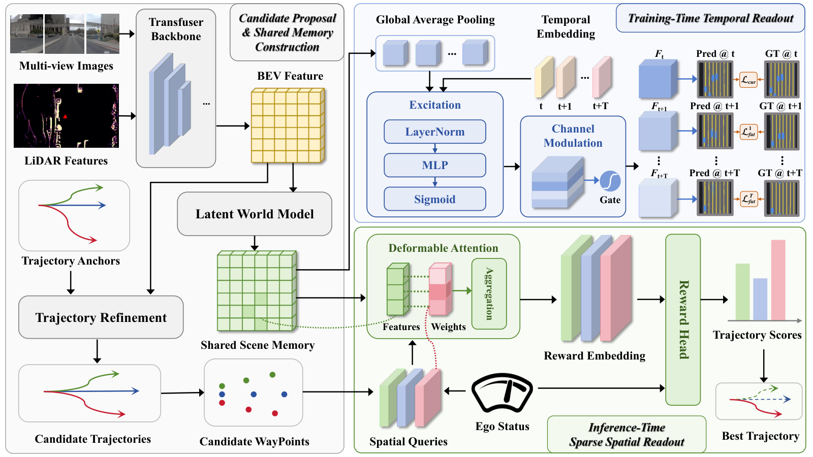

## Summary

候选轨迹评估是候选式端到端规划的核心环节，而 model-based evaluator 的主流做法是"为每条候选轨迹分别预测未来状态"，即 rollout。RFWorld 的论点是这个做法与规划的真实需求错配：rollout 的推理代价随预测时域与候选数同时增长，递归预测还会累积误差，而规划真正需要的只是**可供比较的未来相关信息**，不是为每条候选重建一整个未来场景。于是它把评估重构成"构建一次共享场景记忆 + 各候选稀疏读取"：当前 BEV 特征经 Transformer 潜世界模型得到轨迹无关的共享记忆 $\mathcal{M}_t$；训练时用轻量的时间读出分支（时间嵌入做通道门控 + 共享语义解码器）预测 1–4 s 的未来 BEV 语义图，以此把记忆塑造成"可被未来读取"的表示；推理时不再解码任何未来状态，每个候选轨迹的位姿点作为空间 query，通过 deformable attention 在记忆上做稀疏采样，再由 reward head 输出模仿奖励与仿真奖励（NC/DAC/EP/TTC/Comfort），取分数最高者。NAVSIM-v1 上 PDMS 90.5（ResNet-34 backbone），NC 99.0、TTC 96.0 在学习方法中最高；Bench2Drive 闭环 SR 31.36%、DS 62.38。真正有说服力的是代价：1024 候选下训练显存 8.7 GB 对 WoTE 的 33.9 GB，推理延迟 37.5 ms 对 49.2 ms，且候选数从 256 增到 1024 时延迟只涨 2.4 ms。

## Problem & Motivation

- 候选式规划（anchor / proposal / diffusion / flow）已经把动作空间变得多模态，于是"给定多条都合理的未来轨迹，该怎么评估"成为独立问题。
- 经典评估靠手工规则、代价函数或 MPC 目标；近年学习方法引入规则教师、仿真器反馈或学习到的 score / reward 模型。但很多评估器**只看当前状态**打分，或者依赖**显式的 candidate-conditioned 未来预测**。
- 世界模型本来可以让评估"未来感知"：想象每条候选的未来后果再估计 reward。但现有做法把每条候选的未来状态在整个时域上预测一遍，作者称之为 rollout，并指出三点问题：
  1. 推理代价随预测时域 $T$ 与候选数 $N$ 相乘增长；
  2. 递归预测的误差会累积，使打分本身不可靠；
  3. 更根本的是需求错配——规划不需要重建完整未来场景，只需要能可靠比较候选的未来相关信息。
- 因此论文把问题重述为：把 model-based 评估从"轨迹特定的未来 rollout"改成"rollout-free 的共享记忆读取"。为了让所有候选都能用同一套表示去读，候选的位姿必须表达在**当前 ego 坐标系的 BEV 平面**上，而不是每条候选各自的 ego-centric 未来坐标系——否则空间位置不可对齐，无法共享记忆。

## Method

**1. 候选生成与共享记忆构建（§4.1）**

- 输入 $\mathcal{O}_t=\{\mathcal{H}_t,\mathcal{L}_t,\mathcal{E}_t,\mathcal{I}_t\}$：历史帧、当前 LiDAR 特征、ego 状态、多视角图像；按 TransFuser 的多模态融合范式把历史 LiDAR 对齐到当前 ego 坐标系，与当前视觉融合得到 BEV 表示 $B_t$。
- 候选来自 anchor 词表加偏移，即每条 anchor 与场景交互预测一个修正量：

$$
\tau_i=a_i+\Delta_i,\qquad i=1,\dots,N
$$

- 与 candidate-conditioned 世界模型不同，记忆**只条件于观测、与轨迹无关**：把 $B_t$ 展平、加空间位置编码，送入 Transformer 潜世界模型：

$$
\mathcal{M}_t=\Phi_{\mathrm{mem}}\left(\mathrm{Flat}(B_t)+P\right)\in\mathbb{R}^{L\times d}
$$

- 这条"轨迹无关"是省算力的根源：$\mathcal{M}_t$ 算一次，训练分支与推理分支共用。

**2. 训练时的时间读出与语义监督（§4.2）**

- 把记忆 reshape 成 $d\times H\times W$（$L=HW$，记为 $\bar{\mathcal{M}}_t$），全局平均池化得上下文 $c_t$。对每个被监督的时间索引 $k\in\mathcal{S}$（含 $k=0$ 当前时刻）引入可学习时间嵌入 $e_k$，做 SE 风格的通道调制：

$$
g_k=2\cdot\sigma\left(\mathrm{MLP}\left(\mathrm{LN}(c_t+e_k)\right)\right),\qquad \bar{\mathcal{M}}_t^{(k)}=\bar{\mathcal{M}}_t\odot g_k
$$

- 门控在空间上广播、只重加权通道；随后由**所有时间戳共享**的语义解码器解出 BEV 语义图 $\hat{Y}_t^{(k)}=\mathcal{D}(\bar{\mathcal{M}}_t^{(k)})$。共享解码器是关键设计——不同时间戳之间的差异只能来自时间读出本身，不能来自各自独立的解码头。

- 监督是当前语义目标加未来语义目标（focal loss）：

$$
\mathcal{L}_{\mathrm{sem}}=\mathcal{L}_{\mathrm{cur}}+\sum_{k\in\mathcal{S}\setminus\{0\}}\omega_k\,\mathcal{L}_{\mathrm{fut}}^{(k)}
$$

- 该分支**只在训练时存在**，不进入推理路径；它的作用是把"未来会怎么变"压进共享记忆，而不是在推理时生成未来。

**3. 推理时的稀疏空间读出（§4.3）**

- 每个候选轨迹的第 $k$ 个位姿 $p_i^k$ 编码成空间 query $q_i^k=\psi(p_i^k)$，其在 BEV 平面上的参考位置记作 $r_i^k$；ego 状态上下文注入 query 以调制读出。采样参数头预测 $M$ 个偏移与注意力权重，在记忆上做双线性采样并加权：

$$
\{\Delta_{i,k}^{m},\alpha_{i,k}^{m}\}_{m=1}^{M}=\Gamma(q_i^k),\qquad z_i^k=\sum_{m=1}^{M}\alpha_{i,k}^{m}V\left(\bar{\mathcal{M}}_t,\ r_i^k+\Delta_{i,k}^{m}\right)
$$

- 位姿特征沿时域聚合为轨迹嵌入 $e_i$（注意与上面的时间嵌入 $e_k$ 是两个不同符号），与 ego 状态融合后进入两个奖励头：模仿奖励 $r_i^{\mathrm{im}}$（对专家行为的相似度）与仿真奖励 $r_i^{\mathrm{sim}}$（仿真器派生的安全与规划准则）。推理时聚合为最终分数，取最高者输出。

**4. 训练目标（§4.4）**

- 轨迹损失只监督离 GT 最近的 anchor；语义项用 focal loss；模仿奖励用"候选到专家轨迹相对距离"构造的软目标分布做交叉熵式优化；仿真奖励对 NC/DAC/EP/TTC/Comfort 用 BCE，另加 EP 的 margin ranking 正则（并入 $\mathcal{L}_{\mathrm{sim}}$）：

$$
\mathcal{L}_{\mathrm{total}}=\lambda_{\mathrm{traj}}\mathcal{L}_{\mathrm{traj}}+\lambda_{\mathrm{sem}}\mathcal{L}_{\mathrm{sem}}+\lambda_{\mathrm{im}}\mathcal{L}_{\mathrm{im}}+\lambda_{\mathrm{sim}}\mathcal{L}_{\mathrm{sim}}
$$

**5. 复杂度对比（§5.4）**

- 设 $N$ 候选、$T$ 时域、$L$ 个 BEV token、$M$ 个采样点：rollout 式评估为 $O\big(NT\cdot\mathcal{C}_{\mathrm{WM}}(L)\big)$，Transformer 世界模型主导时约 $O(NTL^2d)$，因为未来预测要为每条候选在整个时域上重复；RFWorld 建记忆一次 $O(\mathcal{C}_{\mathrm{WM}}(L))$，打分 $O(NTMd)$，因 $M\ll L$ 而把世界模型前向从 $NT$ 次降到 1 次——论文的表述是 "removes the dominant $NT$ factor from future-state generation"。

**6. 关键设置**

| 项 | 设置 |
|:--|:--|
| NAVSIM 数据 | 官方 trainval：85,109 训练 / 18,179 验证；test 12,146 场景（每场景只选一条轨迹，指标只算一次） |
| backbone | 与 Transfuser 相同的 ResNet-34（为公平比较固定） |
| 候选数 | 1024 个 anchor |
| 训练 | 2×RTX 3090，batch 16，50 epochs，AdamW，lr $1\times10^{-4}$ |
| Bench2Drive 输入 | 3 个前视相机拼成 1024×256；4 帧 LiDAR 栅格化为 256×256 BEV，覆盖每方向 32 m、0.25 m 分辨率 |
| Bench2Drive 微调 | 从 NAVSIM 权重初始化，AdamW 30k iters，batch 8，lr $5\times10^{-6}$，wd $1\times10^{-4}$，梯度裁剪 5 |
| Bench2Drive 部署 | 每步对 1024 候选排序取最高分；PID 跟踪第 6 个轨迹点转成油门/刹车/转向，油门上限 0.55 |

## Pipeline

*多视角图像与 LiDAR 经 Transfuser backbone 得到 BEV 特征；BEV 特征送入潜世界模型得到共享场景记忆，同时 anchor 经轨迹精炼得到候选轨迹。右上：训练时把记忆做全局池化、按时间嵌入门控后由共享语义解码器预测各时间戳的 BEV 语义图，用当前与未来语义 GT 监督；右下：推理时候选位姿点作为空间 query，经 deformable attention 在共享记忆上稀疏采样，结合 ego 状态进入 reward head 得到轨迹分数，选中最高分轨迹。*

1. **感知**：多视角图像 + 历史/当前 LiDAR + ego 状态，在 BEV 空间融合。
2. **建记忆**：BEV 特征展平加位置编码，经潜世界模型得到轨迹无关的共享记忆 $\mathcal{M}_t$（每帧只需一次）。
3. **训练分支**：全局池化 → 加时间嵌入 → LN+MLP+Sigmoid 得到通道门控 → 调制记忆 → 共享语义解码器输出当前与未来 $k$ 个时间戳的 BEV 语义图，与语义 GT 算 focal loss。
4. **生成候选**：anchor 与场景交互预测偏移，得到 1024 条候选轨迹并投影到当前 ego BEV 平面。
5. **评估**：每个位姿点生成空间 query，预测 $M$ 个采样偏移与权重，在记忆上双线性采样加权；沿时域聚合，融合 ego 状态，输出模仿奖励与 5 项仿真奖励。
6. **选择**：分数聚合后取最高的一条作为最终轨迹（每场景只输出一条，指标按该条计算）。
7. **闭环部署**：Bench2Drive 上用 PID 把选中轨迹转成控制量，跟踪第 6 个轨迹点。

## Key Results

**1) NAVSIM-v1 与 SOTA 对比（Table 1，均为 ResNet-34）**

| Method | WM | 监督 | NC↑ | DAC↑ | TTC↑ | Comf.↑ | EP↑ | PDMS↑ |
|:--|:--:|:--|--:|--:|--:|--:|--:|--:|
| Human（参考上界） | – | – | 100.0 | 100.0 | 99.9 | 100.0 | 87.5 | 94.8 |
| Ego Status MLP | × | Human | 93.0 | 77.3 | 83.6 | 100.0 | 62.8 | 65.6 |
| VADv2 | × | Human | 97.2 | 89.1 | 91.6 | 100.0 | 76.0 | 80.9 |
| UniAD | × | Human | 97.8 | 91.9 | 92.9 | 100.0 | 78.8 | 83.4 |
| LTF | × | Human | 97.4 | 92.8 | 92.4 | 100.0 | 79.0 | 83.8 |
| Transfuser | × | Human | 97.7 | 92.8 | 92.8 | 100.0 | 79.2 | 84.0 |
| DRAMA | × | Human | 98.0 | 93.1 | 94.8 | 100.0 | 80.1 | 85.5 |
| GoalFlow | × | Human | 98.3 | 93.8 | 94.3 | 100.0 | 79.8 | 85.7 |
| Hydra-MDP | × | Human & Rule | 98.3 | 96.0 | 94.6 | 100.0 | 78.7 | 86.5 |
| Hydra-MDP++ | × | Human & Rule | 97.6 | 96.0 | 93.1 | 100.0 | 80.4 | 86.6 |
| DiffusionDrive | × | Human | 98.2 | 96.2 | 94.7 | 100.0 | 82.2 | 88.1 |
| DriveSuprim | × | Human & Rule | 97.8 | 97.3 | 93.6 | 100.0 | **86.7** | 89.9 |
| DriveDPO | × | Human & Rule | 98.5 | **98.1** | 94.8 | 99.9 | 84.3 | 90.0 |
| LAW | ✓ | Human | 96.4 | 95.4 | 88.7 | 99.9 | 81.7 | 84.6 |
| WoTE | ✓ | Human & Rule | 98.5 | 96.8 | 94.9 | 99.9 | 81.9 | 88.3 |
| ResWorld | ✓ | Human | 98.9 | 96.5 | 95.6 | 100.0 | 83.1 | 89.0 |
| **RFWorld** | ✓ | Human & Rule | **99.0** | 97.8 | **96.0** | 100.0 | 84.6 | **90.5** |

- 加粗为**学习方法**中各列最优；Human 行是参考上界（NC 100.0、TTC 99.9、Comf. 100.0、PDMS 94.8），不参与加粗比较。
- RFWorld PDMS 90.5，比最强 baseline DriveDPO（90.0）高 0.5，比同属世界模型路线的 ResWorld（89.0）高 1.5，比 rollout 式评估的 WoTE（88.3）高 2.2。
- "最高"只在 NC / TTC / PDMS 三项成立：DAC 98.1 仍属 DriveDPO，EP 86.7 属 DriveSuprim；Comfort 在学习方法中几乎全部饱和（100.0，DriveDPO/WoTE/LAW 为 99.9），没有区分度。

**2) Bench2Drive 闭环（Table 2，官方 220 路线，CARLA 0.9.15）**

| Method | Success Rate (%)↑ | Driving Score↑ |
|:--|--:|--:|
| AD-MLP | 0.00 | 18.05 |
| UniAD | 16.36 | 45.81 |
| VAD | 15.00 | 42.35 |
| TCP | 30.00 | 59.90 |
| **RFWorld** | **31.36** | **62.38** |

- 相对最强的 TCP 是 +1.36 个百分点 / +2.48 分，两项都第一；但对比集合只有 4 个方法，绝对 SR 31.36% 仍低，见 Weaknesses。

**3) 世界模型与未来监督的消融（Table 3）**

| WM | 未来监督 | NC | DAC | TTC | Comf. | EP | PDMS |
|:--:|:--:|--:|--:|--:|--:|--:|--:|
| × | × | 98.7 | 94.4 | 95.2 | 99.8 | 83.4 | 88.9 |
| × | ✓ | 98.8 | 97.1 | 95.4 | 100.0 | 83.7 | 89.4 |
| ✓ | × | 98.5 | 96.5 | 95.1 | 99.8 | 82.3 | 88.4 |
| ✓ | ✓ | **99.0** | **97.8** | **96.0** | **100.0** | **84.6** | **90.5** |

- 只加世界模型、没有未来监督，反而比 baseline 低 0.5（88.9 → 88.4）——世界模型分支若只靠最终规划目标反传，学不到有用的预测特征。
- 只加未来监督、不要世界模型就有 89.4（+0.5）；两者同时上到 90.5（再 +1.1）。作者据此主张二者互补。
- `WM ×` 那一行是把时间语义读出**直接加在 backbone BEV 特征上**、不含 world model Transformer，所以这组消融分离的是"有没有潜世界模型"而非"有没有读出分支"；读出分支本身在四行里始终存在。

**4) 推理候选数与代价（Table 4，延迟在单张 RTX 3090 上测）**

| Method | #Traj. | PDMS↑ | 延迟↓ |
|:--|--:|--:|--:|
| WoTE | 256 | 88.3 | 37.0 ms |
| WoTE | 512 | 88.4 | 41.2 ms |
| WoTE | 1024 | 88.7 | 49.2 ms |
| RFWorld | 256 | 89.6 | 35.1 ms |
| RFWorld | 512 | 90.2 | 36.2 ms |
| RFWorld | 1024 | **90.5** | 37.5 ms |

- 两者都按 1024 anchor、batch 16 训练，测试时随机采样不同数量的 anchor。RFWorld 随候选数增加稳定提升（89.6 → 90.5），而 WoTE 几乎持平（88.3 → 88.7）。
- 训练显存在 1024 anchor、batch 16 下为 8.7 GB 对 33.9 GB（约 3.9× 差距）；延迟从 256 到 1024 只涨 2.4 ms，WoTE 涨 12.2 ms。
- 显存差距还体现在硬件需求上：WoTE 必须在 2×A6000（各 48 GB）上训练，RFWorld 用 2×RTX 3090（各 24 GB）即可。

**5) 未来监督时间戳数量（附录 A，Table 5）**

| #Future Sup. | 0 | 2 | 4 | 6 | 8 |
|:--|--:|--:|--:|--:|--:|
| PDMS | 88.4 | 89.5 | 90.0 | 90.3 | **90.5** |

- 单调上升；中间设置从时域的前后两半随机采样时间戳以保持时间均衡，说明约束越密、记忆的时序结构越强。
- `0` 这一行就是 Table 3 的 `WM ✓ / 未来监督 ×` 设置（88.4），两张表在主消融上自洽。

**6) 定性对比（Figure 3）**：与 WoTE 相比在四类场景更好——不驶出可行驶区域、提前减速避让行人、贴近车道中心线避开邻道车辆、在转弯前对向车流让行。Figure 4（附录）另行展示了四个未来时间戳的解码语义图与门控统计。

## Strengths & Weaknesses

**Strengths**

- 问题重述很干净，且给出了可检验的推论：如果"规划只需要未来相关信息而非未来重建"成立，那么去掉 rollout 应当既省算力又不掉性能。论文用代价和精度两条线同时支撑了这个论点。
- 代价分析拆得具体：$O(NT\cdot\mathcal{C}_{\mathrm{WM}}(L))$ 对 $O(\mathcal{C}_{\mathrm{WM}}(L))+O(NTMd)$，明确指出被消除的是未来状态生成里的 $NT$ 因子；并给出实测的显存（8.7 vs 33.9 GB）与延迟（37.5 vs 49.2 ms）两个独立证据，外加 WoTE 需要 48 GB 级显卡这一部署侧事实。
- 消融诚实地报告了一个不利结果：只加世界模型、不加未来监督会让 PDMS 从 88.9 掉到 88.4。这一行恰好说明"世界模型本身不产生收益，产生收益的是被监督塑造出的预测表示"，比只报全量结果更有信息量。
- 时间读出用了**共享语义解码器**，使不同时间戳的差异只能来自门控，这既省参数也让归一化实验可解释；附录进一步给出通道级分析与门控统计（共享基底 + 随时间推移更具选择性），是"辅助分支确实学到了时序结构"的直接证据。
- 双 benchmark：NAVSIM 上做算法对比与消融，Bench2Drive 上给出闭环验证，而不是只在开环打分上论证。
- 明确标注了每个 baseline 的监督类型（Human / Human & Rule），读者可以自行判断比较是否同源。

**Weaknesses**

- **增益幅度小且没有方差**：90.5 对 DriveDPO 90.0 只高 0.5，对 ResWorld 89.0 高 1.5；全文没有任何 seed 数、标准差或置信区间，0.5 点在这一量级上无法排除噪声。DriveDPO 与 DriveSuprim 都用 Human & Rule 监督，与 RFWorld 同源，因此这 0.5 点更像是训练细节差异而非机制差异。
- **消融无法把"共享记忆"与"稀疏读出"分开**：Table 3 变的是"有没有 world model Transformer"和"有没有未来监督"，但读出分支在四行中始终存在；论文没有做"保留未来语义监督、把 deformable 稀疏读出换成稠密读出或直接把语义图当特征"的对照。因此无法判断增益来自共享记忆这一表示，还是来自额外的语义辅助任务本身。
- **渐近收益没有等比例兑现**：论文的估计是省掉 $NT$ 倍（$N=1024$、$T=8$，约 $8\times10^3$），但实测端到端延迟只快 1.3×（49.2 → 37.5 ms）、训练显存 3.9×（33.9 → 8.7 GB）。固定开销（backbone、候选生成、reward head）主导了端到端时间，因此"减少约时域×候选数的计算"只在 world model 那一项成立，摘要的措辞容易让人误读为整体加速。
- **未来语义 GT 的来源没有交代**：训练信号完全依赖 1–4 s 的 BEV 语义图，但正文与附录都没有说明这些未来语义标签如何获得（NAVSIM 默认不提供该监督）。这既是复现缺口，也决定了方法的可迁移性——作者在 limitation 里只说"目前训练时需要语义目标"。
- **单 backbone、单评估规模**：所有对比固定在 ResNet-34，绝对指标被 backbone 上限压低（Human PDMS 94.8，方法最高 90.5）；没有报告换更强 backbone（如 VoVNet / ViT-L / 大模型）后的趋势，因此"记忆表示是否随规模受益"未知。
- **作者自陈的失效模式没有量化**：Limitations 把失败归因于轻量 perception backbone 特征不准、或相关道路几何与交通参与者位于观测范围之外；这些情形在 220 条闭环路线上占多少、与记忆质量如何区分，论文没有给失败统计。
- **Bench2Drive 的对比集合偏旧**：AD-MLP、VAD、UniAD、TCP 都不是近一年的强闭环规划器，31.36% SR 在这一基准上属于偏低水平；论文据"两项指标均第一"声称闭环领先，但比较范围不足以支撑"闭环 SOTA"。
- **闭环部署含手工常数**：PID 只跟踪第 6 个轨迹点、油门上限 0.55，这类常数对 Bench2Drive 的 SR 影响可能不小于算法本身，论文未做敏感性分析，也未说明这些常数是否对所有 baseline 一致。
- **关键超参缺失**：$\lambda_{\mathrm{traj/sem/im/sim}}$ 的取值、BEV token 数 $L$、采样点数 $M$、隐层宽度 $d$、门控 MLP 规模、未来时间戳的具体集合 $\mathcal{S}$ 都没有报告，复现只能靠猜。
- **世界模型的作用被限制在打分**：候选仍由 anchor + 偏移生成，多模态性来自 anchor 覆盖，记忆只影响排序。因此该方法无法缓解"anchor 覆盖不到正确机动"的问题；论文也没有报告 anchor 数量（1024）与实际命中率的关系。
- **推理侧记忆构建的成本未单独报告**：$O(\mathcal{C}_{\mathrm{WM}}(L))$ 是对 $L$ 个 BEV token 跑 Transformer，当 $L$ 变大（occupancy 尺度）时这一项可能反超打分项；作者在 limitation 里也承认稠密 BEV 不适合更高分辨率的未来预测，并提出改用稀疏 scene token。

## Notes

+ **论文定位**：不是新的候选生成器，而是把世界模型在规划中的角色从"逐候选未来模拟器"改成"规划可读的共享接口"（shared memory + ego state）。这个提法与 information bottleneck 的思路接近：下游只需要通过一对 $(\mathcal{M}_t,\mathcal{E}_t)$ 就能决策，不必回看原始观测。
+ **可迁移点**：
  - **"训练时加读出分支、推理时只做稀疏查询"**是一个通用的监督注入范式：任何 BEV planner 想利用未来信息，都可以只在训练时解码未来语义/占用、推理时把记忆当只读表来查，避免推理期付出未来生成的代价。
  - **共享记忆把打分代价与候选数解耦**：世界模型前向从 $NT$ 次降到 1 次，每条候选-时间步的打分从 $\mathcal{C}_{\mathrm{WM}}(L)$ 降到 $M$ 点采样，这使得测试时扩大候选集变得便宜（256 → 1024 只涨 2.4 ms）。对任何"测试时算力换性能"的规划器，这是可复用的结构。
  - **共享解码器的消融设计**：让所有时间戳共用一个解码器，把差异归因强制限制在门控上。这个技巧可以推广到任何"多时间步/多任务共享表征 + 轻量条件化"的架构验证。
  - **门控统计作为诊断**：均值、上下侧比例、跨通道方差随时间的单调变化，是判断辅助分支有没有退化（退化成复制当前特征）的低成本可视化手段。
+ **待跟进问题**：
  - 未来语义 GT 能否用伪标签或自监督时序目标替代？这决定方法能否用到没有未来标注的数据集上，也是作者自己列出的下一步。
  - 把稠密 BEV 记忆换成稀疏 scene token 后，$L$ 下降能否让"记忆构建"这一项也变得可忽略，从而把 1.3× 的端到端加速推向更接近理论值？
  - 记忆是否真的包含交互信息，还是只编码了几何与静态布局？Bench2Drive 上 SR 只有 31.36% 说明闭环交互仍是短板，需要在反应式场景下检验记忆的有用性边界。
  - 在更强 backbone 与大模型时代，这套"轻量读出 + 共享记忆"是否仍有增益，还是会被端到端大模型直接吸收？
