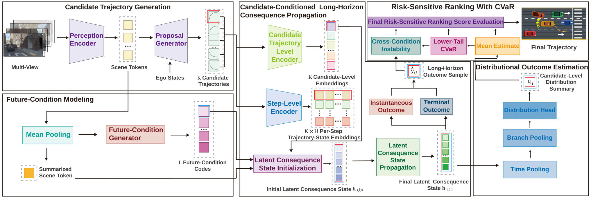

## Summary

候选式端到端规划里，评估器把候选质量压成一个确定性标量，于是"名义分数接近、但其中一条藏着灾难性尾部"的情况无法被区分。RiSE-Drive 只改评估阶段：先用未来条件生成器给出 $L=4$ 条分支，对每个候选-分支对做潜空间后果传播（GRU 式逐步更新，把逐时刻结果与终止结果按 $\gamma=0.99$ 折扣累加成一条长期结果样本），用 $M=10$ 个有序分位数估计该候选的结果分布，最后按**均值 − 尾部缺口 − 跨条件波动**排序。在完全对齐的 DrivoR 管线上，只增加 0.1M 可训练参数（18.8M → 18.9M）就把 NAVSIM-v1 navtest PDMS 从 93.1 提到 **94.2**、NAVSIM-v2 navhard EPDMS 从 48.3 提到 **51.3**、HUGSIM HD-Score 从 35.7 提到 **39.5**；代价是 EP 一致下降（89.1 → 88.7、Stage-II 70.0 → 68.7），即更保守的选择策略。

## Problem & Motivation

- 候选式规划（anchor / proposal / diffusion / flow）已经把动作空间做成多模态，剩余瓶颈从"生成"转移到"评估"：给定 $K$ 条都合理的轨迹，选哪条执行。
- 现有选择器把候选质量压成**确定性点分数**、启发式子分或单次结果估计。这有三个直接后果：延迟失效（当前帧看不出来、几秒后才暴露的失败）不可见；尾部风险不可见；排序稳定性恰好在最需要鲁棒的时候最差。
- 作者的主张：候选质量不是标量，而是**由未来条件诱导的长期结果分布** $Y_i=Y(\tau_i,\omega),\ \omega\sim p(\omega\mid o_t)$。因此正确做法是估计该分布，并按它的下尾统计排序，而不是只比均值。
- 选 CVaR 而不只是方差，是因为 CVaR 是下尾的凸相干风险度量：只惩罚"低于均值的部分"，不会被"上尾很好"掩盖；再叠加跨条件标准差惩罚，用来抑制"某个未来分支下特别不稳"的候选。
- 定位很明确：不动感知与提案生成，只换评估头。这既让归因干净（同 backbone、同 proposal 集，唯一变量是评估），也让论文的论点变成可证伪的——如果评估不是瓶颈，换头不会带来稳定提升。

## Method

**1. 基线与形式化（§3）**

- DrivoR 是 generate-and-score 的代表：多相机编码器得到场景 token $\mathbf{R}_t$，提案生成器给出 $K$ 条候选 $\mathcal{T}_t=\{\tau_i\}$，每条候选是 $H$ 步 ego-local 位姿 $\tau_i=\{\mathbf{p}_{i,h}\}_{h=1}^H$、$\mathbf{p}_{i,h}=(x,y,\theta)$；打分头输出 $C$ 维子分 $\mathbf{s}_i$，线性聚合成 $u_i=\boldsymbol{\lambda}^\top\mathbf{s}_i$，取 $\arg\max$。
- 论文把这套写法压缩成 $u_i=f_\psi(o_t,\tau_i)$，并指出 $u_i$ 只是 $Y_i=Y(\tau_i,\omega)$ 的点估计——**没有被建模的是 $\omega$ 带来的分布**。

**2. 未来条件建模（§4.2）**

- 场景 token 先均值池化成 $\bar{\mathbf{r}}_t$，再由 $L$ 个独立的条件生成器给出条件码：

$$
\omega_l=P_{\mathrm{ctx}}^{(l)}(\bar{\mathbf{r}}_t)\in\mathbb{R}^{d_\omega},\qquad l=1,\dots,L
$$

- 这 $L$ 个条件码就是评估时使用的全部"未来假设"，推理时它们由当前场景直接预测而来（不是从学到的分布里采样，见 Weaknesses）。

**3. 候选条件化的长期后果传播（§4.3）**

- 候选整体编码 $\mathbf{c}_i=E_\tau(\tau_i)$，逐位姿编码 $\mathbf{z}_{i,h}=E_p(\mathbf{p}_{i,h})$；初始隐状态把场景、候选、条件三者相加：

$$
\mathbf{h}_{i,l,0}=W_r\bar{\mathbf{r}}_t+W_c\mathbf{c}_i+W_\omega\omega_l+\mathbf{b}_0
$$

- 沿时域用带门控的更新推进（GELU 候选态 + sigmoid 门 + 残差混合）：

$$
\tilde{\mathbf{h}}_{i,l,h}=\phi\left(W_h\mathbf{h}_{i,l,h-1}+W_p\mathbf{z}_{i,h}+W_s\bar{\mathbf{r}}_t+\mathbf{b}_h\right),\qquad \mathbf{g}_{i,l,h}=\sigma\left(U_h\mathbf{h}_{i,l,h-1}+U_p\mathbf{z}_{i,h}+U_s\bar{\mathbf{r}}_t+\mathbf{b}_g\right)
$$

$$
\mathbf{h}_{i,l,h}=\mathbf{g}_{i,l,h}\odot\tilde{\mathbf{h}}_{i,l,h}+\left(1-\mathbf{g}_{i,l,h}\right)\odot\mathbf{h}_{i,l,h-1}
$$

- 每步解一个瞬时结果、末态解一个终止结果，折扣累加成该分支下的长期结果样本：

$$
\hat{y}_{i,l}=\sum_{h=1}^{H}\gamma^{h-1}r_{i,l,h}+\gamma^{H}r_{i,l}^{\mathrm{term}},\qquad r_{i,l,h}=g_r(\mathbf{h}_{i,l,h}),\quad r_{i,l}^{\mathrm{term}}=g_T(\mathbf{h}_{i,l,H})
$$

**4. 结果分布估计（§4.4）**

- 先把每条分支的隐状态沿时间池化，再跨分支平均，得到候选级表示 $\tilde{\mathbf{h}}_i=\frac{1}{L}\sum_l\frac{1}{H}\sum_h\mathbf{h}_{i,l,h}$；分位数头从它输出 $M$ 个有序分位数，单调性用"首分位数 + softplus 增量"硬保证：

$$
q_i^{(1)}=a_i,\qquad q_i^{(m)}=q_i^{(m-1)}+\mathrm{softplus}\left(h_m(\tilde{\mathbf{h}}_i)\right),\quad m=2,\dots,M
$$

- 均值估计取分位数的平均 $\hat{\mu}_i=\frac{1}{M}\sum_m q_i^{(m)}$。

**5. 风险敏感排序（§4.5）**

- 令 $M_\alpha=\lceil\alpha M\rceil$，下尾 CVaR 取最低 $M_\alpha$ 个分位数的均值；尾部缺口 $\hat{\Delta}_i=\hat{\mu}_i-\widehat{\mathrm{CVaR}}_\alpha^\downarrow(Y_i)$；跨条件波动 $\hat{\sigma}_i$ 是 $L$ 个分支结果样本的标准差。最终排序分数：

$$
\hat{J}_i=\hat{\mu}_i-\lambda_{\mathrm{tail}}\hat{\Delta}_i-\lambda_{\mathrm{var}}\hat{\sigma}_i
$$

- 三项的分工：均值管"总体好不好"，$\hat{\Delta}$ 管"下尾有多差"，$\hat{\sigma}$ 管"换个未来条件会不会翻车"。

**6. 训练目标（§4.6）**

- 分支级结果用 Huber 回归；分位数用 pinball loss；排序用带 margin 的 pairwise 损失，方向由目标分数 $J_i^\star$ 的符号决定（$J_i^\star$ 由目标样本的均值、经验 CVaR、标准差按上式构造）：

$$
\mathcal{L}_{\mathrm{rank}}=\sum_{i=1}^{K}\sum_{j\neq i}\max\left(0,\ \delta-\mathrm{sign}(J_i^\star-J_j^\star)\left(\hat{J}_i-\hat{J}_j\right)\right),\qquad \mathcal{L}=\lambda_b\mathcal{L}_{\mathrm{branch}}+\lambda_q\mathcal{L}_{\mathrm{quant}}+\lambda_r\mathcal{L}_{\mathrm{rank}}
$$

**7. 分支标签怎么来（附录 A.2，方法的关键前提）**

- 4 条分支不是学出来的隐变量，而是从训练日志里按两个标量交通量切出来的：**longitudinal pressure** = 前车纵向加速度取负；**lateral approach** = 同向相邻车朝 ego 走廊的横向速度（朝向为正）。
- 构造方式：先按 longitudinal pressure 的经验排名把日志窗口二分，再在每一半内按 lateral approach 的组内排名二分，得到四个条件（低/低、高/低、低/高、高/高）；每组取最接近该组分量中位数的那条观测（两量先按训练集 IQR 归一化再算距离）作为代表。
- 代表值用于设定前车目标纵向加速度与邻车目标横向速度，由 benchmark 在道路与动力学约束下平滑施加；**每个候选在同样四个条件下各跑一次 benchmark rollout + scoring，得到一组 $y_{i,l}^\star$**。也就是说监督信号来自仿真器对"候选 × 条件"的逐格打分。

**8. 实现细节**

| 项目 | 设置 |
|:--|:--|
| 基线管线 | DrivoR（camera-only），感知 backbone 与提案生成器完全冻结不变 |
| 输入与 backbone | 4 路环视相机；DINOv2 ViT-S，每相机 16 个 camera-aware register token；4 层 transformer decoder，hidden 256；LoRA rank 32 |
| 候选数 | $K=64$ |
| 未来分支数 | $L=4$ |
| 分位数个数 | $M=10$ |
| 隐层宽度 | $d_\omega=d_c=d_p=d_h=256$ |
| 风险参数 | $\alpha=0.2$、$\gamma=0.99$、$\lambda_{\mathrm{tail}}=0.5$、$\lambda_{\mathrm{var}}=0.1$ |
| 排序 margin / 损失权重 | $\delta=0.1$；$\lambda_b=\lambda_q=\lambda_r=1.0$ |
| 优化 | AdamW，lr $2\times10^{-4}$，cosine decay，4×RTX 4090 |
| 参数量 | 可训练 18.9M / 总计 42.3M（DrivoR 为 18.8M / 41.8M） |

## Pipeline

*图按五个模块自左向右：**候选轨迹生成**（多视角图像 + ego 状态 → 感知编码器 → 场景 token → 提案生成器 → $K$ 条候选）、**未来条件建模**（场景 token 均值池化 → 未来条件生成器 → $L$ 个条件码）、**候选条件化的长期后果传播**（候选级编码 + 逐步编码，与场景、条件一起初始化隐状态，逐步推进并解出瞬时结果与终止结果）、**分布结果估计**（时间池化 → 跨分支池化 → 分布头 → 候选级分布摘要 $\mathbf{q}_i$）、**风险敏感排序**（均值估计 + 下尾 CVaR + 跨条件不稳定 → 最终排序分 → 输出轨迹）。*

1. **编码**：4 路环视图像 + ego 状态 → 场景 token $\mathbf{R}_t$（与 DrivoR 相同，不改）。
2. **提案**：$G_{\mathrm{prop}}$ 输出 $K=64$ 条候选轨迹，每条含 $H$ 步 ego-local $(x,y,\theta)$。
3. **分支生成**：$\bar{\mathbf{r}}_t$ 过 $L=4$ 个条件生成器得到 $\{\omega_l\}$（推理时全部由当前场景预测）。
4. **后果传播**：对 $K\times L$ 个候选-条件对并行推进 $H$ 步隐状态，分别解出逐时刻结果与终止结果，折扣累加成 $\hat{y}_{i,l}$。
5. **分布估计**：时间 + 跨分支池化 → $\tilde{\mathbf{h}}_i$ → $M=10$ 个单调分位数 → 均值、下尾 CVaR、跨分支标准差。
6. **排序与执行**：$\hat{J}_i$ 取最大者作为规划输出；提案生成与感知在此阶段完全不参与改动。
7. **训练/推理差异**：训练需要 benchmark 对"候选 × 四条件"逐格 rollout 打出的 $y^\star$ 作监督；推理只需要当前场景，不需要任何未来 rollout。

## Key Results

**1) NAVSIM-v1 navtest（Table 1，PDMS）**

| Method | Input | Backbone | NC↑ | DAC↑ | EP↑ | TTC↑ | Comf.↑ | PDMS↑ |
|:--|:--:|:--|--:|--:|--:|--:|--:|--:|
| Human | – | – | 100 | 100 | 87.5 | 100 | 99.9 | 94.8 |
| Hydra-MDP | C & L | ResNet-34 | 98.3 | 96.0 | 78.7 | 94.6 | 100 | 86.5 |
| DiffusionDrive | C & L | ResNet-34 | 98.2 | 96.2 | 82.2 | 94.7 | 100 | 88.1 |
| WoTE | C & L | ResNet-34 | 98.5 | 96.8 | 81.9 | 94.9 | 99.9 | 88.3 |
| DriveSuprim | C | ResNet-34 | 97.8 | 97.3 | **86.7** | 93.6 | 100 | 89.9 |
| DriveVLA-W0 | C | Emu3-8B | 98.7 | **99.1** | 83.3 | 95.3 | 99.3 | 90.2 |
| iPad | C | ResNet-34 | 98.6 | 98.3 | 88.0 | 94.9 | 100 | 91.7 |
| Centaur | C | V2-99 | 99.5 | 98.9 | 85.9 | 98.0 | 100 | 92.6 |
| DrivoR | C | ViT-S | 98.9 | 98.3 | 89.1 | 96.2 | 100 | 93.1 |
| **RiSE-Drive** | C | ViT-S | **99.5** | 98.5 | 88.7 | **98.4** | 100 | **94.2** |

- 与同 backbone、同提案集的 DrivoR 相比 PDMS +1.1，NC 98.9 → 99.5、TTC 96.2 → 98.4，**EP 反而从 89.1 降到 88.7**；作者把这解读为"更安全、更保守的选择策略"。
- NC 99.5 与 Centaur 并列全表最高（Human 除外），TTC 98.4 为全表最高（Centaur 98.0）；DAC 仍低于 DriveVLA-W0 的 99.1，EP 低于 iPad 的 88.0 与 DrivoR 的 89.1。
- 表内两个非 ResNet 强基线 Centaur（92.6）与 DrivoR（93.1）都在 RiSE 之下，说明该增益不是"用了更强 backbone"带来的。

**2) NAVSIM-v2 navhard-two-stage（Table 2，EPDMS）**

| Method | Backbone | Stage-II NC | Stage-II DAC | Stage-II DDC | Stage-II TTC | Stage-II EP | EPDMS |
|:--|:--|--:|--:|--:|--:|--:|--:|
| LTF | ResNet-34 | 77.7 | 70.2 | 84.2 | 75.6 | 85.1 | 23.1 |
| DiffusionDrive* | ResNet-34 | 82.1 | 72.2 | 88.5 | 78.8 | 85.1 | 24.2 |
| RAP-DINO | ViT-H | 83.2 | 83.9 | 87.4 | 80.4 | 86.9 | 39.6 |
| DriveSuprim | V2-99 | 87.9 | 88.8 | 89.6 | 86.0 | 80.3 | 42.1 |
| GTRS-Dense | V2-99 | 91.2 | 89.4 | 94.4 | 90.0 | 69.5 | 45.0 |
| ZTRS | V2-99 | 91.1 | 90.4 | 95.8 | 89.8 | 63.6 | 48.1 |
| DrivoR | ViT-S | 90.2 | 88.4 | 91.9 | 88.0 | 70.0 | 48.3 |
| **RiSE-Drive** | ViT-S | **91.5** | 89.8 | 94.6 | **91.3** | 68.7 | **51.3** |

- 相对 DrivoR +3.0 EPDMS，相对表内此前最强的 ZTRS（48.1）+3.2；增益集中在 Stage-II 的安全项（NC +1.3、DDC +2.7、TTC +3.3），EP −1.3。
- Stage-I 上两者的安全项已经接近饱和（RiSE NC 99.0 vs DrivoR 98.8），**提升主要来自被扰动后的第二阶段**——这正是论文主张"长期后果建模"该起作用的地方。

**3) HUGSIM 真闭环（Table 3，RC / HD-Score）**

| Method | RC Easy | RC Medium | RC Hard | RC Extreme | RC Avg | HD Easy | HD Medium | HD Hard | HD Extreme | HD Avg |
|:--|--:|--:|--:|--:|--:|--:|--:|--:|--:|--:|
| LTF | 67.8 | 35.1 | 26.2 | 40.5 | 38.9 | 58.9 | 18.0 | 9.8 | 25.9 | 23.7 |
| UniAD | 78.4 | 60.5 | 33.6 | 17.8 | 45.9 | 64.9 | 45.8 | 20.6 | 6.6 | 32.7 |
| DrivoR | **80.9** | 50.5 | 33.8 | **47.1** | 49.8 | 73.3 | 34.6 | 18.8 | 32.5 | 35.7 |
| **RiSE-Drive** | 76.5 | **53.3** | **34.1** | 46.3 | **50.1** | **74.6** | **37.2** | **22.7** | **39.2** | **39.5** |

- HD-Score +3.8（hard +3.9、extreme +6.7），但 RC 只 +0.3，且 Easy（76.5 vs 80.9）与 Extreme（46.3 vs 47.1）两个子集**回退**：闭环里"更少碰撞/更合规"换来的不是"走得更远"。
- 这行数据也是 Weaknesses 里讨论 safety–progress 权衡的主要依据。

**4) 组件消融（Table 4）**

| 配置 | NAVSIM-v1 PDMS | v1 NC | navhard EPDMS | navhard TTC |
|:--|--:|--:|--:|--:|
| B-I：DrivoR | 93.1 | 98.9 | 48.3 | 88.0 |
| B-II：DrivoR w/o SD（轻量直接打分头） | 91.9 | 98.4 | 45.6 | 84.6 |
| + FCG（未来条件生成） | 92.6 | 98.7 | 46.8 | 86.5 |
| + CTE（候选级编码） | 92.9 | 98.8 | 47.5 | 87.3 |
| + SLE + LCP（逐步编码 + 长期后果传播） | 93.5 | 99.1 | 49.2 | 89.6 |
| + DOE（分布估计） | 93.9 | 99.3 | 50.6 | 90.5 |
| + RSR（风险敏感排序） | **94.2** | **99.5** | **51.3** | **91.3** |

- 在 harder 的 navhard 上增益最大的单步是 SLE+LCP（EPDMS +1.7），与其"长期后果传播是核心"的主张一致；但在 v1 PDMS 上最大单步其实是 FCG（+0.7）。DOE 与 RSR 分别再 +0.4 / +0.3 PDMS、+1.4 / +0.7 EPDMS，作者据此称两者互补而非可替换。
- 注意起点是 B-II 而不是 DrivoR：换掉原打分头先掉 1.2 PDMS，后面 2.3 分的恢复里有一部分只是把删掉的容量补回来。

**5) 参数开销（Table 5）**

| 配置 | 可训练参数 | 总参数 | PDMS | EPDMS | HD-Score Avg |
|:--|--:|--:|--:|--:|--:|
| DrivoR | 18.8M | 41.8M | 93.1 | 48.3 | 35.7 |
| B-II | 17.2M | 39.9M | 91.9 | 45.6 | 33.8 |
| RiSE-Drive | 18.9M | 42.3M | 94.2 | 51.3 | 39.5 |

- 相对 DrivoR 只多 0.1M 可训练参数、0.5M 总参数，作者据此论证增益是结构性的而非模型变大。

**6) 定性（Fig. 3）**：在 NavSafe 的四个安全关键场景（unprotected left turn、exit ramp、yielding、roundabout）上，RiSE-Drive 在冲突区更保守——UNPL 与 RDBT 只在有足够间距后才推进，EXR 稳定跟随匝道几何，YLD 先谨慎处理路权再恢复前进。

## Strengths & Weaknesses

**Strengths**

- **归因设计干净**：感知与提案生成完全冻结，唯一变量是评估头，因此 +1.1 / +3.0 / +3.8 三个增益可以直接归给"评估方式"而不是 backbone 或候选集变大。
- **把"风险"落成了可实现的排序统计**，而不是一个软正则或 curriculum：CVaR 缺口管下尾，跨条件标准差管不稳定，两个惩罚项都有明确的决策含义，且排序损失直接用目标分数差构造 pairwise margin，训练目标与推理准则一致。
- **三套协议上方向一致且增量最大处符合假设**：v1 与 v2 navhard 的提升集中在 NC/TTC/DDC，HUGSIM 的提升集中在 hard/extreme 的 HD-Score；这些正好是"需要长期后果建模"才会改善的项。
- **诚实报告了不利项**：EP 在 v1（89.1 → 88.7）与 v2 Stage-II（70.0 → 68.7）都下降，论文明确写了 "safer and slightly more conservative selection policy"，没有只挑有利指标。
- **分支构造协议可复现**：附录 A.2 把四种未来条件如何从日志里切出来、如何选代表观测、如何由 benchmark 施加都写清楚了，比多数"future branch"含糊的论文扎实。
- **参数成本极低**：+0.1M 可训练参数换来 +1.1 PDMS / +3.0 EPDMS / +3.8 HD-Score，工程上很容易插到别的 generate-and-score 管线里。

**Weaknesses**

- **所谓"结果分布"实际上只有 4 个点，且这 4 个点由两个标量交通量张成**：longitudinal pressure（前车纵向加速度）与 lateral approach（邻车横向速度）的四象限组合。天气、道路几何、行人、多车交互、以及"自车动作引起的他车反应"都不在 $\omega$ 的支撑集里。论文用 "plausible future perturbations" 描述它，容易让读者高估覆盖范围。
- **尾部估计的统计基础很薄**：$L=4$ 个样本、$M=10$ 个分位数、$\alpha=0.2$ 意味着 $M_\alpha=\lceil 0.2\times10\rceil=2$，即 CVaR 只由最低 2 个分位数、底层只有 4 个观测估计出来。论文没有给任何关于 $L$、$M$、$\alpha$ 的敏感性实验，"尾部风险被更准确估计"这一核心主张缺少统计支撑。
- **监督来自评测器本身**：$y_{i,l}^\star$ 是 benchmark 对"候选 × 条件"逐格 rollout + scoring 的结果（A.2）。这使评估器在学**复现 NAVSIM 的指标函数**，而不是学真实世界的后果；同时意味着训练时必须有一个能对任意候选、任意条件做闭环打分的仿真器。论文把方法定位成"只改评估头、可与任何 proposal 集组合"，但这一前提把部署场景（真车没有 roll-out 打分器）排除在外。
- **"更好评估"与"更多监督"没有被分离**：DrivoR 本身也是 oracle 子分监督，但它只拿到一条候选的未来；RiSE 拿到的是"每条候选 × 四个条件"的 4 倍标注。缺少"给 DrivoR 同样的 4 条件 target"的对照，因此无法判断增益来自分布建模还是来自标注量增加。
- **safety–progress 权衡被一句话带过**：v1 EP −0.4、v2 Stage-II EP −1.3、HUGSIM RC 仅 +0.3 且 Easy（−4.4）与 Extreme（−0.8）子集回退。这些都是"用前进换安全"的直接证据，论文没有做 $\lambda_{\mathrm{tail}}$ 扫描或 PDMS–EP 的 Pareto 分析来说明这个交换是否划算。
- **推理成本完全没报**：推理要为 $K=64$ 候选 × $L=4$ 分支各推进 $H$ 步隐状态，再做分位数与排序，相对 DrivoR 的额外延迟、显存、吞吐一个数字都没有。对一个主打"只改评估头、可插拔"的方法，这是关键缺失。
- **消融起点是 B-II 而非 DrivoR**：把 DrivoR 的 scoring decoder 换成轻量直接打分头后先掉 1.2 PDMS（93.1 → 91.9），随后 2.3 分的恢复里包含"把删掉的容量补回来"。相对真正 baseline 的净增益是 +1.1，而不是表里看起来的 +2.3。
- **单次运行、无方差**：+1.1 PDMS、+3.8 HD-Score 都是单点数字，全文没有 seed、标准差或置信区间；HUGSIM 只有 70+ 场景 / 400+ 场景，3.8 分的稳定性无从判断。
- **声称评 NavSafe，但只给了定性**：§5.1 专门介绍了 NavSafe 诊断集并说它"比 navtest 是更敏感的探针"，结果只在 §5.4 用四个场景做了可视化，没有任何 NavSafe 定量表。同理，§5.1 说在 v2 的 real-only navtest 上报 Stage-I EPDMS，正文与表格里都没有这个数字。
- **没有 Limitations 一节**：论文以 Conclusion 结束，上述训练依赖仿真器、条件覆盖窄、推理开销未知这些边界都没有在正文自我陈述。
- **附录承认了正文表格的印刷错误**：A.1 明确写 "Table 3 corrects the HUGSIM Easy RC for RiSE-Drive, which was misprinted as 79.5 in the conference version"（arXiv 版为 76.5）。单看这一处是诚实修正，但它降低了对关键表其他单元格的信任度，也说明主结果表的校对流程有问题。

## Notes

+ **论文定位**：不是新的 planner，也不是新的候选生成器，而是把"评估"从点估计改成**分布 + 风险排序**。核心 insight 是候选质量应当被建模成"由未来条件诱导的长期结果分布"，而排序准则必须显式惩罚下尾与跨条件不稳定——这与另一条路线（[[2611-RFWorld]] 主张根本不需要为每条候选预测未来）构成正面冲突：RiSE 恰恰是"候选条件化 rollout"的强化版。

+ **可迁移点**：
  - **CVaR 缺口 + 跨条件方差的双惩罚**可以直接套到任何"候选集 + 打分器"的决策环节（规划器、工具选择、GUI 动作选择），只要能为同一候选在不同假设下多次打分。
  - **用仿真器对"候选 × 条件"逐格打分成监督**是一个可复用的离线标注配方：它把"评估器"从"学人类偏好"变成"学可执行的判据"，代价是需要可控的分支模拟能力。
  - **分位数头的单调化技巧**（首分位数 + softplus 增量）是通用的分布回归实现细节，比排序后强制排序更稳定。
  - **用两个标量交通量二分日志窗口构造四类未来条件**是低成本构造分支的模板：不需要生成模型，也不需要人工标注场景难度。
  - **训练目标与推理准则对齐**：排序损失直接作用在 $J$ 上而不是各个分量上，避免了"训练优化子分、推理用加权和"的口径漂移。

+ **待跟进**：
  - **$L$、$M$、$\alpha$ 的敏感性**：$L$ 从 4 加到 8/16、$\alpha$ 从 0.2 调到 0.05，CVaR 估计与排序行为怎么变？只由 4 个样本估计的下尾是否稳定？
  - **池化方式**：当前分位数头吃的是跨分支均值池化的 $\tilde{\mathbf{h}}_i$，结构上抹平了"某一条分支特别差"的信号。换成 max / attention / 逐分支分位数再聚合，能否让单分支灾难直接可见？
  - **去掉仿真器标签后的替代监督**：能否用真实日志的接管、急刹、险情标签做弱监督，或用世界模型生成分支后果？这决定方法能否离开 NAVSIM 生态。
  - **推理开销与降本**：$K\times L$ 路传播的实测延迟，以及能否用共享传播、候选子采样或 early-exit 压低。
  - **safety–progress Pareto**：给 $\lambda_{\mathrm{tail}}$ 与 $\lambda_{\mathrm{var}}$ 做扫描，画出 PDMS–EP 前沿，判断"更保守"是否值得。
  - **与另两条评估路线同台对照**：[[2611-RFWorld]]（rollout-free 共享记忆）、World4Scorer（仿真器 outcome 标签）、DrivoR（oracle 子分）在同一 backbone、同一提案集上做三方对照，才能判断"要不要候选条件化未来"。
